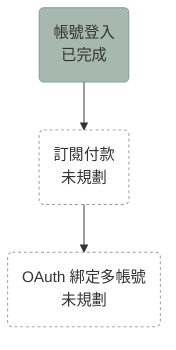

# Spec-Driven Development

## Document Model

<!-- prettier-ignore -->
| Path | Contains | Does Not Contain (Belongs In) |
| --- | --- | --- |
| `docs/specs/product.md` | Positioning, target users, scope (including what each pricing plan offers), non-goals, glossary | Behavior requirements (capability spec); technical choices (`architecture.md`); feature timelines (`roadmap.md`) |
| `docs/specs/architecture.md` | Current technical architecture, with inline rationale: services, deployment, data model, the feature-to-code map, and the domain rules of capabilities that have no spec yet | User-visible behavior of a capability that has a spec (capability spec); planned architecture (plan); full decision discussions (archived plan); what an agent can read from the repo's files, such as commands, config values, and CI job steps (those files) |
| `docs/specs/ui-guidelines.md` | Rules that every screen and every piece of UI copy follow | Behavior of one capability (capability spec); how to design a screen (`product-designer` skill) |
| `docs/specs/<capability>.md` | Implemented behavior of one product capability | Planned behavior (the spec files on a plan's branch, until its PR merges); issues left for a later plan (`roadmap.md`); a rule another requirement states (that requirement, cited by ID); technical structure (`architecture.md`); implementation details such as tables, classes, libraries (code); the text of the legal pages (code; a plan that changes it gives the new text in "做法要點") |
| `docs/plans/NNNN-slug.md` | A plan whose PR has not merged; it exists only on that PR's branch, never on `main` | Step-by-step implementation (left to the implementer); test names (test code); manual check steps (`tests/manual/`) |
| `docs/plans/archive/NNNN-slug.md` | Done plans, and plans abandoned before each plan had a single PR | Any edit after the PR that archives it merges; current behavior (specs) |
| `docs/plans/roadmap.md` | Dependency graph, vision for unfinished features, and known issues on `main` awaiting a fix | Detailed requirements (the stage's plan); plans in progress (their open PRs); finished features' descriptions (specs) |
| `tests/manual/<capability>.md` | Steps and expected results for the scenarios of `<capability>.md` that need a manual check | Results of a check (PR body); scenarios that automated tests cover fully (test code) |
| `design/<feature>.html` | Interactive drafts of screens, made with the `product-designer` skill, including the details of a screen that "Spec Conventions" keeps out of a spec | Rules that "Spec Conventions" lets a spec hold (capability spec); production code (`frontend/`); how a screen looks once its implementation starts (`frontend/`; the draft is never updated to match the implementation, including changes made while polishing) |

Specs on the `main` branch describe only what the code on `main` implements. Two parts are the exception: the positioning, target users, scope, and non-goals in `product.md`, and the whole of `ui-guidelines.md`. They describe the intended product and bound every plan. A screen on `main` that breaks a rule of `ui-guidelines.md` has a bug, and fixing it is a Tier 2 bug fix that restores spec'd behavior. A plan writes future behavior into the spec files on its branch, and that text reaches `main` only when the PR merges together with the code that implements it.

Capabilities built before this workflow have no spec until "Procedure: Backfill" writes one. The feature-to-code map in `architecture.md` lists every capability and links its spec once it has one. Until then, the code on `main` is the only full description of the capability's behavior, and the "Domain 規則" section of `architecture.md` holds its domain rules.

Archived plans are history. Never treat them as current guidance; read them only to understand why something is the way it is. The requirement and scenario IDs in them, and in merged PR descriptions, are the IDs of their time: an ID may since have been removed, moved to another spec, or reused.

Nothing in `docs/specs/` or `roadmap.md` is final. If you see a better approach than what they describe, including a decision the user already made, propose it before acting on it: state the trade-offs, address any recorded reason the alternative was rejected, and let the user decide. Until the user agrees, follow the documents as written.

## Pick the Tier

1. **Tier 1**: the change alters behavior a spec describes (or should describe), alters architecture, or adds a spec file for a new capability. A bug in a case no spec covers is a spec gap, so it is Tier 1, except in a capability that has no spec yet. Use the `plan` and `implement` procedures.
2. **Tier 2**: behavior-preserving but non-trivial: a bug fix that restores spec'd behavior, a bug fix in a capability that has no spec yet whose intended behavior the user confirms, a refactor, a performance change, dev tooling or CI config, a minor or major dependency bump, a change to a detail of a screen that "Spec Conventions" keeps out of a spec, such as which field has focus. Use the `change` procedure.
3. **Tier 3**: on the trivial whitelist below. No plan and no PR template; open a PR once the user instructs a push. The whitelist is exhaustive:
   - Typos, punctuation, and formatter output.
   - Comment-only changes.
   - Patch-level dependency bumps.
   - Doc-only fixes that make `docs/specs/` match current code. Never add new behavior this way.
   - Edits to the roadmap's text outside the graph; adding, splitting, or removing `unplanned` nodes and re-linking their edges; removing edges that "Roadmap Conventions" leaves out; collapsing finished features.
   - Edits to AGENTS.md and to the skills in `.agents/skills/`.
   - Adding or fixing links in `PRODUCT.md`, as its header describes.
   - Edits to the positioning, target users, scope, or non-goals in `product.md`, or to `ui-guidelines.md`, that the user explicitly asks for, together with the glossary terms that text uses.
   - Drafts in `design/` that no plan lists.

Writing the spec of a capability that `main` already implements, without changing its behavior, belongs to no tier: use the `backfill` procedure.

When unsure, take the higher tier.

## Rules That Apply Everywhere

- Never push to `main`. Never merge a PR. The user merges; a merge is the user's approval.
- Commit and push only when the user explicitly instructs it.
- In a PR body's manual checklist, tick an item only if the latest run of its check passed. Leave an item unticked only if you could not run the check, and state why under the item so the user can run it.
- Assign every PR you open to the user who directed the work: `gh pr create --assignee @me`, which resolves to the account `gh` is logged in as. If `gh` is logged in as a bot or someone other than that user, ask the user who to assign.
- Every time you push new content to a branch that has an open PR, check whether the PR title and description still match the branch's latest state, and update them if they do not.
- Right before every update to a PR title or description, fetch the current version from GitHub (`gh pr view <number> --json title,body`) and apply your edits on top of it, no matter how well you remember what you last wrote. Other people may be editing the same PR at the same time.
- For `draft`, `approved`, and `done`, the plan's frontmatter `status` is the source of truth. Change statuses only through the procedures below.
- When an edit to this skill or its templates changes what a plan must contain or which reviews a plan must pass, list every plan in an open PR in that PR's description, each with the user's decision: bring it up to the new rules, or keep it as written. Bring a plan up to date on its own branch as "Procedure: Plan" describes for revising a plan, which sends an approved plan back to the user for approval. If the plan has never passed a review that the new rules require, run that review as it runs for a new plan, not only on the revised parts.
- Never edit positioning, target users, scope, or non-goals in `product.md`, or `ui-guidelines.md`, unless the user explicitly asks. If a plan would conflict with either, stop and tell the user. A glossary term that the positioning, target users, scope, or non-goals use enters the glossary together with that text. Any other glossary addition or change is a spec change on a plan's branch.
- After every PR merges, `main` must work. There is no size cap on a plan; split by what can ship on its own.
- These rules constrain PR content, not commit structure. Humans may commit on any branch; number and order of commits do not matter.
- Language: specs, plans, roadmap, PR descriptions and `tests/manual/` are written in Traditional Chinese (Taiwan usage). PR titles, filenames, frontmatter keys and values, requirement IDs, scenario IDs, branch names and Mermaid node IDs are English.

## Plan Statuses

A plan and its implementation share one branch, `plan/NNNN-slug`, and one PR. The plan file lives only on that branch until the PR merges, at which point it is already archived as `done`.

<!-- prettier-ignore -->
| Status | Where it is represented |
| --- | --- |
| `unplanned` | A roadmap node only; no plan file exists |
| `draft` | `status: draft` in the plan file on the plan's branch; the PR, if open, is a GitHub draft |
| `approved` | `status: approved` in the plan file on the plan's branch. The commit that sets it is the approval commit, which the PR body links. Implementation commits after it do not change the status |
| `done` | An archived plan file with `status: done`, which reaches `main` when the PR merges |
| `abandoned` | A closed PR; nothing reaches `main` |

## Procedure: Plan

The plan stage writes the plan file and edits the specs on the plan's branch, so the specs show the change as it will read on `main`, and reviewers read the change as a diff instead of a description of edits. The implementation stage, run later by an agent that did not write the plan, adds the code to the same branch and PR.

1. Read `product.md`, `architecture.md`, every affected spec, `roadmap.md`, and the output of `gh pr list --state open`. If the plan adds or changes a screen or UI copy, read `ui-guidelines.md` too. If a capability that the plan changes has no spec on `main`, stop and tell the user: the plan edits that spec's requirements, so backfill the capability first ("Procedure: Backfill") and continue once the backfill PR merges.
2. Pick the ID: take the highest `NNNN` across `docs/plans/**/*.md` on `main` and the titles of all PRs, open or closed (`gh pr list --state all`), whether titled `[NNNN]` or the older `[plan NNNN]` and `[impl NNNN]`, then add 1. Closed PRs count because an abandoned plan leaves nothing on `main`, and reusing its number would make its PR and a later plan share one ID. If two plans end up with the same ID, the one merged later renumbers: its branch name, plan file name and `id`, PR title, and the links in the rationales it wrote.
3. Create branch `plan/NNNN-slug` from up-to-date `main`.
4. Copy `templates/plan.md` to `docs/plans/NNNN-slug.md` and fill it in. Write it for an implementer in a new session, who reads the plan, the branch's changes, the code, and the documents on `main`, but not this conversation:
   - `specs` lists every spec file the branch changes; `depends_on` lists plan IDs that must be `done` first; `roadmap` names the roadmap node the plan belongs to, an existing node's ID or a new snake_case ID for the node the implementation adds (see "Roadmap Conventions").
   - "目標" states, in one paragraph, what users or the system can do once the plan is done. Leave how screens look and the details of rules to "範圍" and the specs, because step 7 uses this paragraph as the PR body, where those details would duplicate the rules.
   - If the plan includes a change that the `product-designer` skill drafts (a significant feature, UI change, or layout change), make the draft as that skill describes, add it to this branch, and list it in "設計稿". The draft shows the layout, the states, and the copy, but every rule that "Spec Conventions" lets a spec hold still goes in the specs, because tests and reviews check the specs; the draft alone settles the other details of the screen. Keep the draft and the specs consistent.
   - "決策" records each choice the user made, with its options, trade-offs, and conclusion, so the rationales in the specs can link to the full discussion.
   - "做法要點" covers what the user must know before approving: architecture impact, and risky or hard-to-reverse operations (data migration, breaking API changes, deploy order between the frontend and the API server). It also holds what the implementation needs that only this conversation records and that the specs do not hold, such as a constraint the user stated, or behavior of a library, a browser, or an outside service that you tested while planning. No step-by-step implementation list. When the plan changes anything a legal page describes, such as the data Taigu records, how long Taigu keeps it, or the paid plans, "做法要點" also names each legal page to update and gives the new text, because the specs do not describe the legal pages' text and nothing else would flag the page as outdated.
   - "驗證方式" marks every scenario that the branch adds or modifies, by scenario ID and name, in a table under that heading, with how it will be verified: one or more of `unit`, `integration`, and `手動`, as "Spec Conventions" defines them. Do not name tests or write manual steps; the implementation does not exist yet. The scenario check also reads this table, so the branch can be pushed before the scenarios have tests (see "Spec Conventions"); a plan that adds or modifies no scenario writes 「無」 instead of the table.
   - "還沒定案的問題" must read 「無」 before asking the user to approve: ask the user each question there, and write each answer into the specs or the section of the plan it belongs to.
5. Edit the specs on this branch so they read as they will once the plan is done: requirements, scenarios, rationales, glossary rows, diagrams, and `architecture.md` sections, following "Spec Conventions". Write a decision's rationale into the spec or `architecture.md` next to the rule it explains (see "Spec Conventions") only if a future agent reading that text would plausibly re-propose the rejected option; its link to the archived plan opens only after the implementation archives the plan. Leave the code, the tests, and the steps in `tests/manual/` to the implementation. Tests and `tests/manual/` sections that name an existing scenario are the one exception, because the scenario check matches them to the specs and would stop the branch from being pushed: when the branch renames a scenario, rename its `tests/manual/` heading; when it removes a scenario, or renumbers one because its requirement moves to a split-off spec, remove or rename every test mark and `tests/manual/` section that names it. The implementation updates the steps and the tests' assertions.
6. Run the spec review (see "Independent Review") with the branch's changes under `docs/specs/` as the changes. Its inputs are the plan file, those changes, and the drafts the plan lists in "設計稿". Handle each finding that holds by the first of these cases that applies:
   - 過細: remove the text or scenario from the specs on this branch, together with every test mark and `tests/manual/` section that names a removed scenario, and list each removal to the user in one line. A 過細 既有問題 stays on `main` as it is; list it to the user in one line.
   - 缺圖: draw the diagram in the spec on this branch, and check it against the rules it summarizes.
   - 罕見情況: leave it out of the spec by default. List these findings to the user, one line each, and write one into the spec only if the user asks.
   - A finding that depends on untested behavior of a browser or an outside service: add no rule or scenario. In "做法要點", state the result the implementation must reach and that it records the tested behavior in `architecture.md`.
   - 既有問題: ask the user about each, like an open question. Recommend folding it into this plan when it lies in a requirement the plan already rewrites and the fix is small; otherwise recommend recording it in `roadmap.md` for a later plan (see "Roadmap Conventions"). Record it through its own Tier 3 PR to `main`, not on this branch, because the roadmap on this branch reaches `main` only with the implementation, and an abandoned plan would lose it.
   - Any other 行為會出錯 or 無法驗證: write it into "還沒定案的問題" and settle it with the user like any other open question.
7. If `main` has moved since the branch left it, merge `main` into the branch (never rebase; see "Procedure: Implement") and resolve any conflict in a spec file as a revision of the plan, so the user approves specs that agree with `main`. Then tell the user the plan is ready and wait. When the user instructs a push, commit, push, and open the PR as a GitHub draft (`gh pr create --draft`). Title: `[NNNN] <English title>`. Body: the plan's "目標" paragraph. Do not link the plan file: the PR's changed files already show it, and GitHub does not resolve relative links in PR descriptions. The PR stays a draft until the implementation is done (see "Spec Conventions" for what CI checks while it is a draft). Then wait for the user to approve the plan.
8. When the user approves the plan in the conversation, set `status: approved` in the plan file, commit only that change as `Approve plan NNNN`, push, which the approval itself authorizes, and put this line at the top of the PR body, after the "目標" paragraph: `核准的 plan：[plan NNNN](https://github.com/bingyangchen/taigu/blob/<approval commit>/docs/plans/NNNN-slug.md)`. That commit is the approval commit, which the implementation and its review compare against. GitHub does not let a PR's author approve it, so the user's words in the conversation are the approval, not a GitHub review or a PR comment. Then stop: tell the user to run `/sdd implement NNNN` in a new session.

To revise a plan before its implementation starts, edit the plan and the specs on its branch. If the plan is approved, set `status: draft` first. Run the spec review with the revised parts as the changes, then get the user's approval again as step 8 describes, which records a new approval commit and replaces the link in the PR body. Once the implementation has started, that is, once the branch has a commit after the approval commit other than a merge of `main`, revise the plan through step 3 of "Procedure: Implement" instead.

## Procedure: Implement <id>

Run this procedure in a session that did not write or revise the plan. The implementation is where gaps in the plan show, and an agent that remembers the planning fills them from that memory instead of from the plan and the specs. If this conversation wrote or revised plan NNNN, stop and tell the user to start a new session.

Preconditions: an open PR whose branch holds `docs/plans/NNNN-*.md` with `status: approved` and whose body links the approval commit; no change to `docs/plans/` or `docs/specs/` on the branch after the approval commit except what merges of `main` brought in, unless the implementation already started; and every plan in `depends_on` archived as `done` on `main`. Otherwise stop and tell the user.

1. Check out the PR's branch. If `main` has moved since the branch left it, merge `main` into the branch; never rebase, because rebasing rewrites the approval commit. Tell the user to use only "Update with merge commit" if GitHub offers to update the branch, for the same reason. A merge conflict in a spec file means `main` and the plan disagree: resolve it as a revision under step 3.
2. Write code against the specs on the branch. Build each screen listed in "設計稿" from its draft as the `product-designer` skill describes.
3. If the plan turns out wrong in a way that changes spec'd behavior, stop and ask the user, laid out like a decision in the plan: options, trade-offs, and your recommendation. Change the plan and the specs on this branch only after the user agrees. Changes that alter no spec'd behavior need no approval, such as an implementation detail, a scenario for a boundary of an existing rule that "Spec Conventions" asks a scenario for, or removing a rule or scenario that "Spec Conventions" keeps out of a spec. Every change to the plan or the specs after the approval commit is a deviation, which the PR body lists in step 7.
4. Review your own diff against the plan's "驗證方式": every scenario marked for automated testing must have a test at the stated level that names the scenario ID as "Spec Conventions" describes; add any that are missing. For every scenario marked `手動`, write its section in `tests/manual/` (see "Spec Conventions") with concrete steps against the actual implementation and the expected result taken from the scenario, and update the steps of every existing section whose scenario the branch changed. Then run `make test`, which also runs the scenario check, and make it pass. Then run every manual check you can (start the app with `make start`, open `https://local.taigu.tw`, drive a browser), and fix failures before moving on. If a check fails and you cannot fix it, stop and tell the user. If manual checks change during implementation, update the plan's "驗證方式" on this branch first; that is a deviation too.
5. Before the review, make sure the branch contains all of the following:
   - The code, the tests, and the `tests/manual/` sections from step 4.
   - Every deviation, in the specs and the plan.
   - The tested behavior that "做法要點" asks for, recorded in `architecture.md`.
   - The plan with `status: done`, moved to `docs/plans/archive/` with `git mv`. Once the plan leaves `docs/plans/`, the scenario check no longer accepts its scenarios without tests, so run `make test` again.
   - `roadmap.md` updated for the done plan, as "Roadmap Conventions" describes.
6. If the branch adds or changes a frontend screen, do not start the code review yet. Tell the user which screens changed, with their URLs on `https://local.taigu.tw`, and wait until the user says they have finished polishing them; the user may edit the code on this branch in the meantime. Then read the user's edits: where they change behavior or copy that a spec states, confirm with the user and update the spec on this branch to match, which is a deviation; where a screen now differs from its draft in "設計稿", that difference is a deviation too, recorded in the PR body and not by editing the draft. Give every added or changed scenario a test or a `tests/manual/` section as in step 4, run `make test` again, and rerun every manual check that the edits could affect.

   Run the code review (see "Independent Review"). Its inputs are the branch's changes, the plan and the specs as of the approval commit (`git show <approval commit>:<path>`), and the deviations. Merges of `main` bring other PRs' changes into the branch, so a plain diff from the approval commit is not the list of deviations; compute them by comparing the branch's own changes then and now, `git diff $(git merge-base <approval commit> main) <approval commit>` against `git diff $(git merge-base main HEAD) HEAD`, for example with `git range-diff` or by reading the two diffs side by side. Give the sub-agent the spec review's checklist as well: it runs the spec review with the spec deviations as the changes, and skips the spec review if there are none. If a merge of `main` after the approval commit changed a spec file that the branch also changes, tell the sub-agent to run the spec review with all of the branch's changes under `docs/specs/` as the changes. Fix code that does not match its spec. Handle the spec review's findings by their labels, as step 6 of "Procedure: Plan" describes, with two differences: a finding that step writes into "還沒定案的問題" is settled with the user directly, and a finding that depends on untested behavior of a browser or an outside service is tested now and recorded in `architecture.md`. A 過細 finding also removes every test mark and `tests/manual/` section that names a removed scenario. Before resolving a finding by changing spec'd behavior, ask the user; the outcome is a deviation too. If resolving the findings changes any spec text or code, give every added or changed scenario a test or a `tests/manual/` section, as in step 4, then run `make test` again, and rerun every manual check you can run.

7. Tell the user the work is ready and stop. When the user instructs a push, commit and push, rewrite the PR body from `templates/pr-plan.md`, and mark the PR ready for review (`gh pr ready`). Write the body against the approval commit, not the branch's history: describe the final state, and leave out problems that were found and fixed on the branch.
   - The body keeps the "目標" paragraph, the link to the approval commit, and any section that another rule requires, such as the list of plans that "Rules That Apply Everywhere" asks for when the PR also edits this skill. The link points at the commit, not the branch, because GitHub deletes the branch on merge, and the plan file moves to the archive.
   - "與 Plan 不同的地方" lists every deviation, split into "行為改變" and "實作細節". It covers every deviation that the review reported, computed as step 6 describes.
   - "手動檢查" has one checklist item per scenario marked `手動` in the plan's "驗證方式" as it stands on this branch, no more and no fewer, with the steps and expected result from its section in `tests/manual/`.
   - Do not list automated tests or their results; reviewers read the tests themselves, and CI reports results.

## Procedure: Change

1. Create branch `change/slug` from up-to-date `main`. Before writing any code, tell the user the change's "問題", "原因", and "做法", as `templates/pr-change.md` defines them, and wait for the user to agree. For a bug fix in a capability that has no spec yet, the "問題" states the behavior the fix restores, which the user's agreement confirms as intended. If the fix changes a screen in a way that the `product-designer` skill drafts, make the draft first and name it in the "做法"; the user's agreement approves it too. If step 4 needs this text and you no longer have it word for word, such as after the conversation was compacted, write the "問題" and "做法" out again and get the user's agreement again.
2. Implement. If the "做法" has to change, agree the new one with the user before going on. If the change turns out to alter spec'd behavior, stop: it is Tier 1. In a capability that has no spec yet, the same holds for any behavior other than what the agreed "問題" describes.
3. Run `make test`, which also runs the scenario check, and make it pass. List every scenario in `tests/manual/` whose behavior the change could affect, plus any check the change itself needs. Run every check you can, and fix failures before moving on. If a check fails and you cannot fix it, stop and tell the user. If the change makes a section's steps outdated, such as by renaming a command, update the section on this branch.
4. Run the code review (see "Independent Review"). Its inputs are the branch's changes and the "問題" and "做法" that the user agreed to, word for word. Fix code that does not match them, and run every manual check that the review lists and step 3 missed. If a finding shows the change alters spec'd behavior, stop: it is Tier 1. If resolving the findings changes any code, run `make test` again, and rerun every manual check you can run.
5. Tell the user the work is ready and stop. When the user instructs a push, commit, push, and open the PR. Body: `templates/pr-change.md`, describing the final state. Its manual checklist has one item per check from steps 3 and 4; an item for a scenario in `tests/manual/` starts with the scenario ID and takes its steps and expected result from that scenario's section.

## Procedure: Backfill <capability>

A backfill writes the spec of a capability that `main` already implements, describing what the code does, and changes no behavior. `<capability>` is the spec's filename without `.md`, chosen as "Spec Conventions" describes.

Preconditions: the capability has no spec on `main`, no `backfill/<capability>` branch exists locally or on `origin`, and no open `[backfill]` PR covers the capability. Otherwise stop and tell the user.

1. Create branch `backfill/<capability>` from up-to-date `main`.
2. Read the capability's code, starting from its row in the feature-to-code map of `architecture.md`: the frontend page and the components it uses, the backend app, and the scheduler jobs that touch its data. Read its existing tests, and everything `product.md`, `architecture.md`, and `ui-guidelines.md` say about it.
3. Copy `templates/spec.md` to `docs/specs/<capability>.md` and describe what the code on `main` does, as the user sees it, including errors, quota limits, and the differences between the Free and Standard plans. Pick a prefix that no spec has used, number the requirements from R1, and number each requirement's scenarios from 1. Write a rationale only for a decision whose reason the user gives you or a commit message or merged PR records (see "Spec Conventions" for its form).
4. Wherever `main` behaves in a way that looks wrong, such as contradicting `product.md`, `ui-guidelines.md`, or another rule of the capability, do not write that behavior as a rule. List each case to the user with your recommendation, and act on the user's decision for each:
   - Fix it first with "Procedure: Change", then rebase this branch onto `main` after the fix merges and describe the fixed behavior.
   - Leave the case out of the spec and record it in `roadmap.md` for a later plan (see "Roadmap Conventions").
   - Describe it as it is, because the user confirms it is intended.
5. Move each rule of this capability from the "Domain 規則" section of `architecture.md` into the spec, written as a requirement, and change every reference to the moved rule, such as one in the glossary of `product.md`, to cite the requirement by ID. Link the spec from the capability's row in the feature-to-code map.
6. For each scenario, find the existing tests that assert its 結果, and name the scenario in them (see "Spec Conventions"). Write a section in `tests/manual/` for every scenario that no test covers. Then run `make test` and make it pass, and run every manual check you can, as step 4 of "Procedure: Implement" describes. A manual check that fails means the spec misdescribes `main` or `main` has a bug: fix the spec, or handle the bug as step 4 does.
7. Run the code review (see "Independent Review"). Its inputs are the branch's changes. Fix spec text that does not match `main`. Handle a finding that shows `main` behaves wrongly as step 4 does. Remove the text or scenario of each 過細 finding, together with every test mark and `tests/manual/` section that names a removed scenario, and leave 罕見情況 out of the spec; list both to the user, one line each, and write a 罕見情況 into the spec only if the user asks. Draw the diagram for each 缺圖 finding. Settle every other gap or contradiction with the user before going on. If resolving the findings changes any spec text or test, give every added or changed scenario a test or a `tests/manual/` section, as in step 6, then run `make test` again.
8. Tell the user the work is ready and stop. When the user instructs a push, commit, push, and open the PR. Title: `[backfill] <English capability name>`. Body: `templates/pr-backfill.md`.

## Procedure: Abandon <id>

First list every open PR whose plan names NNNN in `depends_on`. If there are any, tell the user and wait for a decision on each: revise it on its branch as "Procedure: Plan" describes, or abandon it too. Then close the plan's PR with a comment stating why, and which plan replaces it if any. Nothing on the branch has reached `main`, so no other file changes. If the branch exists locally or on `origin`, tell the user and let them decide whether to delete it; never delete it yourself.

## Independent Review

### Running a Review

- Start a review only when every agreed edit is in place and no question about the scope of the work is waiting for the user's answer.
- Start a sub-agent without this conversation's context. If your tool cannot start one, tell the user and give them the instructions to run in a new session.
- Check which skills this environment offers. If one fits the review, tell the sub-agent to use it, and add each checklist item below that the skill does not cover. Without a fitting skill, give the checklists themselves. One sub-agent runs every check of a review.
- If the fitting skill itself hands the review to sub-agents without your conversation context, run the skill yourself instead of inside a sub-agent, because some tools do not let a sub-agent start another. The rules in this section then apply to the sub-agents that the skill starts: besides what the skill tells them, they get only the inputs and the checklist items that the skill does not cover.
- Give the sub-agent only the inputs that the procedure step names, and the checklists. Never add your own summary, reasoning, or assessment of the work: the review is worth running only because the sub-agent lacks them.
- "The branch's changes" means the working tree compared with the point where the branch left `main`: `git diff $(git merge-base main HEAD)` for tracked files, plus the new files that `git ls-files --others --exclude-standard` lists. Do not point the sub-agent at a commit range; it misses uncommitted work.
- Tell the sub-agent to report findings and not edit files.
- Check every finding against the documents and code. Never drop a finding silently: for each one you reject, tell the user why in one sentence.
- If resolving findings changes the meaning of spec text or changes code beyond comments and formatting, start a new round of the same review with fresh sub-agents and no inherited conversation. Each new round runs two sub-agents in parallel, because a sub-agent that starts from the previous report spends its attention on the earlier findings and on the parts that changed, and leaves the rest unread:
  - The verification sub-agent gets the previous round's report verbatim, together with the round's inputs, and reports for each earlier finding whether it is resolved, partly resolved, or not resolved. It does not look for new findings.
  - The discovery sub-agent gets the round's inputs and the checklist, but not the previous report or any summary of earlier rounds, and reviews all of the inputs from scratch. For a code review, the inputs are the full updated branch changes and the original review inputs.

  Keep previous findings and fix summaries in the parent agent. A discovery finding that repeats an earlier finding the user already decided needs no new decision: tell the user so in one line. Handle every other discovery finding as new.
- A review loop stops once a round reports no 行為會出錯 that the target users in `product.md` meet in normal use; start no further round after that, even if the round reported other findings. In every round, and in the last one, handle the other findings this way, because a reviewer always finds something, and turning every gap into a rule pulls implementation details into the spec, which creates the next round's gaps:
  - A finding that asks for a rule or scenario that "Spec Conventions" keeps out of a spec, such as which field has focus or a boundary that mirrors one with a scenario: add nothing, and list it to the user in one line.
- Reviews check substance, not wording: tell the sub-agent not to report word choice, phrasing, or punctuation. Once a round needs no further round, review the wording of the documents the branch adds or changes, once, with a writing skill for the documents' language if this environment offers one. The wording review changes wording only: drop every suggestion that would change what a rule, scenario, or decision says. If it shows that a text can be read two ways, rewrite the text to the meaning already decided; if that meaning was never decided, ask the user, as an open question, and handle the answer like any other change, which starts another round of the review.

### Spec Review

The spec review looks for gaps and contradictions that the changes bring into the specs. It covers the changes that the procedure step names, plus every existing requirement and scenario in the specs on the branch that:

1. Refers to a changed requirement by ID, or uses a term or definition that the changes alter.
2. Handles an input or state that a changed requirement also handles.
3. Has a scenario whose 前提 or 結果 depends on a changed rule.

A finding belongs to the changes when the changes create it: a contradiction with changed text, or a situation whose result the changes alter or leave unspecified. A gap or contradiction that exists on `main` whether or not the changes land is a pre-existing problem: the sub-agent reports it under a separate heading, 既有問題, and never drops it as out of scope. The plan's "決策" section records choices the user already made; the sub-agent does not report a recorded choice again unless it contradicts spec text. Checklist:

- How every input or state that the changes add or alter combines with each existing rule that handles the same input or state: for example, a record added while the user is at a Free quota, after the Standard trial has ended, for a stock that has no price yet, or for a date the market was closed. If an affected spec opens with a flowchart, start from the inputs and states it routes.
- No two requirements or scenarios give different results for the same situation, and every scenario's 結果 follows from its requirement's rule.
- No changed text restates a rule that another requirement states; it cites that requirement by ID instead.
- Spec text outside the requirements, such as definitions and flowcharts, agrees with the requirements.
- No requirement conflicts with the scope or non-goals in `product.md`, with a rule in `ui-guidelines.md`, or with a constraint recorded in `architecture.md`, such as tested behavior of a browser or an outside service.
- Every scenario's 結果 can be judged as met or not met.
- Every boundary of a rule that the changes add or alter has its own scenario when "Spec Conventions" asks for one.
- The changes hold no rule or scenario that "Spec Conventions" keeps out of a spec.
- The changes have every diagram that "Spec Conventions" asks for, and each diagram agrees with the rules it summarizes.
- When the plan lists drafts in "設計稿", each draft shows every state that the rules describe for its screen, and nothing in it contradicts a rule.

The sub-agent labels each finding with one of these:

- 行為會出錯: two texts contradict each other, or the specs leave wrong or unspecified a situation that the target users in `product.md` meet in normal use, such as while recording a trade, checking their holdings, or paying for Standard.
- 罕見情況: a situation that needs several uncommon conditions at once, such as editing the same record on two devices in the minute the Standard plan expires, or one that occurs only while developing, such as during `make start`. The label also applies to a 既有問題.
- 無法驗證: a scenario's 結果 cannot be judged as met or not met.
- 過細: a rule or scenario that "Spec Conventions" keeps out of a spec. The label also applies to a 既有問題.
- 缺圖: text that "Spec Conventions" asks to come with a diagram has none. A diagram that disagrees with the rules is 行為會出錯.

When a finding's result depends on behavior of a browser or an outside service, such as ECPay, the market data source, or Google sign-in, that `architecture.md` does not record, the sub-agent says so and suggests the result to aim for, not a new rule or scenario.

### Code Review

The items below cover only what this workflow adds. They do not replace a general review of correctness and code quality: tell the sub-agent to run one too.

Every code review checks:

- Every test asserts its scenario's 結果. `make check-scenarios` only matches scenario IDs to tests.
- The code respects the constraints that `architecture.md` records, such as checking Free quotas through the entitlements service before a write, and UI code follows `ui-guidelines.md`.
- Database migrations and API changes keep the frontend in production working while the API server and the frontend deploy at different times (see the deployment section of `architecture.md`), and match what the plan's "做法要點" or the agreed "做法" says about them.

For an implementation, the sub-agent also:

- Checks that the code carries out every scenario of the specs that this branch changes, as written. User-visible behavior that no scenario describes is a finding too when "Spec Conventions" lets a spec hold it: either the code or the spec is wrong. Check the other details of a screen against its draft.
- Checks that every screen listed in the plan's "設計稿" matches its draft in layout, states, and copy.
- Checks that every screen built from a draft uses the shared components in `frontend/src/components/` and the design tokens in `frontend/src/styles/`, and reports each class, color, or size value copied from a draft's own CSS into `frontend/`. A look that the plan approves as a decision belongs in a token or a variant of a shared component, not in a value local to one screen.
- Lists every deviation from the approval commit, in the plan, the specs, and the code, computed as step 6 of "Procedure: Implement" describes.

For a change, the sub-agent also:

- Checks that the code follows the agreed "做法" and solves the "問題".
- If the "做法" names a draft, runs the check on shared components and tokens from the implementation list above against it.
- Checks that every behavior the specs describe stays as it was. In a capability that has no spec yet, every behavior other than what the agreed "問題" describes stays as it was.
- Lists every scenario in `tests/manual/` whose behavior the change could affect.

For a backfill, the sub-agent also:

- Checks every scenario against the code on `main`, and reports each one that the code does not carry out as written, citing the code.
- Reports user-visible behavior of the capability that no scenario describes and that "Spec Conventions" lets a spec hold.
- Runs the spec review with every requirement of the new spec as the changes.

## Roadmap Conventions

`roadmap.md` has three sections: "總覽" holds one Mermaid graph for the whole project; "功能願景" holds one subsection per unfinished feature that adds capabilities; "已知問題" holds one subsection per unfinished node that only fixes behavior `main` already has, such as spec gaps, wrong behaviors, and screens or copy that break `ui-guidelines.md`.

````markdown

````

- Use `flowchart TD`. Do not group nodes into subgraphs, because a plan can span several features.
- A node stands for one stage of a feature and for every plan that works on that stage. A plan that only changes behavior the stage already delivered, without adding a capability, joins that stage's node instead of getting its own, as a plan that reverses one of the stage's design decisions does.
- Node IDs: a snake_case ID that names the stage, chosen when the node is added and kept when plans join it; a snake_case feature ID, with class `done`, for a collapsed finished feature.
- Use rounded nodes, `("...")`, never square `["..."]`.
- Labels read `<name><br/><status>`: the stage or feature name, then the status as text as well as color: `已完成` or `未規劃`. Labels carry no plan numbers, because a node can stand for several plans; the node's subsection links each plan.
- A node is `未規劃` until the stage's work is done, and `已完成` after that. A plan in an open PR does not change the roadmap on `main`; the PR updates the roadmap as part of finishing the plan, as step 5 of "Procedure: Implement" requires: it adds the plan to the node that its `roadmap` field names, adding the node if it does not exist, links the archived plan from the node's subsection, adds edges from `depends_on` except those this section leaves out, and marks the node `已完成` if the plan finishes the stage. Issues that the plan fixes in other nodes' known-issue subsections are removed from those subsections.
- Copy the two `classDef` lines above verbatim; do not change colors or add classes. They are tuned for both GitHub light and dark themes; the `done` fill is half-transparent so it shows as a muted green on either background, and its stroke matches its fill. `done` recedes to a muted fill, and `unplanned` stays a dashed outline.
- `A --> B` means B depends on A.
- Draw only direct dependencies: leave out `A --> C` when another path already leads from A to C, as in `A --> B --> C`. That path already implies the order, and the extra edge only adds crossings. After any change to the graph, remove the edges this rule leaves out.
- Features built before this workflow get no node: they have no plan to link. Add a node for one only when a plan depends on a stage of it that is not done.
- Keep `done` nodes until their feature is collapsed.
- A vision subsection states the feature's goal and scope, then lists its stages in order, linking every plan of each stage: a stage with one plan links its name, and a stage with several plans names each one after the stage name, as in `年繳方案（[plan 0005](archive/0005-annual-billing.md)、[plan 0006](archive/0006-annual-billing-refund.md)）`. If the feature has only one stage, skip the list: describe the stage in the same paragraph and put its plan link there. Keep it at the level of goals and stages; details belong in the stage's plan when it is written. Decisions the user has already made for an unplanned stage may be recorded in that stage's line, one sentence each, so they survive until the stage's plan is written. An issue that a plan leaves for a later stage goes in that stage's line, as a short paragraph stating the situation and what the stage must decide. Remove the subsection when every stage is done.
- A known-issue subsection states in one sentence what its fixes achieve, then lists each issue as a short paragraph stating the situation and the intended result. When a plan for the node is done, its PR replaces the issues it fixed with a sentence that summarizes the fix and links the archived plan. A spec gap on `main`, or a wrong behavior that a backfill left out of a spec, that the user decided to fix in a later plan goes in the most related `unplanned` subsection of "已知問題"; if none fits, add an `unplanned` node and its subsection. Remove the subsection when every plan of its node is done.
- When a stage is renamed, split, or removed, update every reference to its name in `docs/specs/` in the same PR.
- If the graph becomes hard to read, collapse each finished feature into one node in a Tier 3 PR. The collapsed node takes over every edge between the feature's nodes and nodes outside the feature.

## Spec Conventions

- One spec file per product capability that a user would recognize (`trade-records.md`, `billing.md`), not per page or technical module. Split a file into smaller capabilities when it grows too large.
- The frontmatter declares `prefix` (for example `TRADE`), and every requirement in the file uses it. Never change it, even if the file is renamed, so existing IDs stay valid. A file split from another declares a new prefix. Renumber the requirements moved into it under that prefix in their order in the new file, and number each one's scenarios from 1. In the same PR, rename the matching scenario IDs in tests and `tests/manual/` sections, and every reference to the old IDs in specs and in the plans and specs of open PRs.
- Requirement format: see `templates/spec.md`. IDs are `<PREFIX>-R<n>`.
- Name the component that does each thing. When spec text says what the system does, such as accepting or rejecting a request, recording, computing, or deleting data, fetching from an outside service, or deciding where to send the user, the subject is `前端`, the React app in `frontend/`, or `後端`, the Django service in `api-server/` together with the cron jobs that scheduler runs, which are its management commands. When both components take part, give each part its own subject. The reason: where a rule runs decides whether it holds for a request sent from outside the frontend, what happens when one side fails, and which test level can verify it, and `Taigu` as the subject hides all three. The following words have narrower uses:
  - A sentence about what the screen shows, such as 「畫面換到登入頁」, needs no subject, because only the frontend draws screens.
  - `api-server` is only the name of the service, always in backticks: its container, its directory, the service diagram in `architecture.md`, and text that has to tell it apart from scheduler, such as deployment. The same goes for `frontend`.
  - `Taigu` is only the product's name: what the user opens, uses, or holds an account in, and its pages and URLs. It is never the subject that does something or has a state; write the state itself, as in 「這檔股票還沒有價格」.
  - `瀏覽器` is only the user's browser: what the user does with it, what the browser itself does, such as keeping an HTTP-only cookie that the frontend's JavaScript cannot read, and the browser that a login or locally stored data belongs to.
  - `伺服器` and `系統` are not used for either component.

  The rule covers the specs, `architecture.md`, a plan's "做法要點", `roadmap.md`, and `tests/manual/`. The positioning, target users, scope, and non-goals in `product.md`, `ui-guidelines.md`, and "功能願景" in `roadmap.md` describe the intended product, where the split between the components may not be decided yet, so they may use `Taigu` as the subject.

- A spec holds only the rules that do at least one of the following, because tests and reviews check every rule a spec holds, and each extra detail becomes one more scenario to test and one more gap for the next review:
  - Decides what is stored, or a number the screen shows, such as an amount or a share count.
  - Blocks or allows an action, or decides which screen the user ends up on.
  - Keeps the user from losing what they entered or from saving a wrong record, such as Enter submitting a half-filled form.
  - Carries out a decision that the spec records as a rationale, such as one from a plan's "決策".
  - Records an exception to a 預設 rule of `ui-guidelines.md`, which that file requires the capability's spec to record.

  Leave every other detail of a screen to the draft and the code: which element has focus, keyboard behavior inside one control that follows the platform's convention, whether an input ignores a keystroke or shows an error for it, placeholder and empty-state copy, which fields a hint or summary lists and in what order, and what a small viewport hides. A detail on this list that also does one of the things above stays in the spec, such as an ignored keystroke that turns 1.5 into 15, or a delete action that a phone screen hides. A rule that `ui-guidelines.md` already states, such as moving focus to the first field with an error, is not written again either.
- Give a boundary of a rule its own scenario only where an implementation could plausibly get that boundary wrong, such as where a running total drops below zero or how an amount is rounded. A boundary that mirrors one that already has a scenario, such as the lower limit of a range whose upper limit has one, gets no scenario, and neither does a case that takes the same branch of the rule as an existing scenario.
- State each rule in one place: the requirement whose topic it is, which also holds the scenarios that test it. Anywhere else, including other specs and `architecture.md`, cite it by ID in one clause, without restating its conditions and details or narrowing it to some of its cases. A spec's opening summary, a glossary definition, and a flowchart or state diagram may describe a rule in general terms, but leave its conditions and details to the requirement. The positioning, target users, scope, and non-goals in `product.md`, and `ui-guidelines.md`, describe the intended product, so what they state does not count as a restatement.
- Draw a Mermaid diagram wherever a reader would otherwise have to piece a picture together from the text: states that change into one another (`stateDiagram-v2`), a decision with several branches (`flowchart`), or the order of requests between the frontend, the backend, and outside services (`sequenceDiagram`). Put the diagram before the rules it summarizes, name its states, branches, and steps with the terms the spec defines, and write under it, in a sentence, whatever it leaves out. The rules and scenarios stay in text, because tests and `tests/manual/` sections refer to them by ID; the diagram describes the rules in general terms, as the previous item allows. A requirement whose rule has only one or two conditions gets no diagram, because the text alone is faster to read.
- A new requirement or scenario takes one more than the largest number its prefix or requirement has in `docs/specs/` on `main` and in the spec changes of every open plan PR, for example `grep -rhoE 'TRADE-R9\.[0-9]+' docs/specs` on `main`, plus the same grep over each open plan PR's diff. Open plan PRs count because a plan claims its numbers on its branch before they reach `main`.
- Scenario IDs are `<requirement ID>.<n>` and start the scenario's line, followed by the scenario's name, as in `- TRADE-R8.11 在手機上刪除紀錄`. Plans, PR bodies, tests, and `tests/manual/` refer to a scenario by its ID, so a grep for the ID from any of them finds the scenario. Number a new requirement's scenarios from 1 in order. A scenario added to an existing requirement takes the next number as above, wherever it goes in the list. The requirement and scenario IDs that a plan adds are not final until its PR merges: whenever the plan adds or removes one, renumber the IDs it added so they have no gaps. In a new spec or under a new requirement, they run from 1 in list order; elsewhere, they start at one more than the largest number that `docs/specs/` on `main` and the other open plan PRs have for that prefix or requirement. Update every reference to them at the same time, in the plan, the specs, tests, and `tests/manual/` on the branch. IDs already in a spec on `main` follow the next rule even while a plan modifies them. Once an ID is in a spec on `main`, never renumber it, except when its requirement moves to a split-off spec: a scenario keeps its ID when its content changes, and a removed scenario leaves a gap, so a test that names an ID keeps pointing at the scenario it was written for. If two plans still claim the same ID before either reaches a spec on `main`, the later of the two to merge renumbers its own IDs, along with every reference to them on its branch.
- "驗證方式" uses these test levels: `unit` is a pytest test under an `api-server` app's `tests/unit/`, or a frontend Vitest test under `frontend/src/`; `integration` is a pytest test under `tests/integration/`, which calls outside services and which CI does not run; `手動` is a section in `tests/manual/`. Frontend Vitest tests run in Docker through `make test` and CI; the scenario checker reads both backend and frontend tests. The repo has no E2E test setup; a plan that needs E2E tests proposes it as a decision.
- A backend test that carries out a scenario takes the `scenario` mark with literal IDs, as in `@pytest.mark.scenario("TRADE-R8.1")` or `@pytest.mark.scenario("BILL-R2.1", "BILL-R2.2")`.
- For frontend scenario tests (for example, `frontend/src/example.test.tsx`), call `test` or `it` directly at module scope or inside an inline `describe` callback. Use an inline test callback and a literal title starting with `[ID]` or `[ID, ID]`, followed by the test name, as in `test("[MKT-R22.2] selects the earlier quote", () => { ... })`. With `test.each` or `describe.each`, keep IDs in the literal test title.
- The scenario checker rejects Vitest `.only` tests and suites.
- When a frontend test covers only part of a scenario's result, keep a manual check for the rest.
- Every scenario that needs a manual check, alone or on top of automated tests, has a section in the file of `tests/manual/` named after its spec, headed `## <scenario ID> <scenario name>`. The section states why the check is manual, then gives the steps and the expected result. Setup that every section of a file shares goes before its first section, without a `##` heading of its own. When a scenario changes or is removed, update or remove its section in the same PR.
- `make check-scenarios`, which `make test` and CI run, fails when a scenario has neither a test nor a `tests/manual/` section, when a test or a section names an ID that no spec has, when a section's name or file does not match its scenario, when a scenario line, a `scenario` mark, or a section heading breaks the formats above, when a scenario ID is used twice or a requirement ID is used twice in one spec, or when a code block in a spec or a `tests/manual/` file never closes. Locally, including in the pre-push hook, the check accepts a scenario without a test or a section when a plan still in `docs/plans/` lists it in "驗證方式", so a plan's branch can be pushed before its implementation. On a draft PR, CI runs the check with the same exception; once the PR is ready for review, CI runs it without the exception and also fails while any plan is still in `docs/plans/`. Two things keep a plan's PR from merging before its implementation archives the plan: the PR stays a GitHub draft until then, and the ruleset of `main` requires the scenario check to pass. The check also fails when a plan's "驗證方式" names a scenario by an ID or a name that no spec has, or when a code block in a plan never closes.
- Write the reason for the chosen option and, for each rejected option, the facts that rule it out, so a future agent does not re-propose it. Leave out what mattered only while deciding: the option-by-option comparison, research notes, and anything the reader can infer from the choice itself. Behavior trade-offs go in the capability spec; technical trade-offs go in `architecture.md`.
- Specs never defer work. When a plan leaves an issue for a later stage, record it in that stage's line in `roadmap.md`, as "Roadmap Conventions" describes. A cost written in a rationale reads as accepted, so a later plan that removes it would have to treat that as reversing a decision.
- `architecture.md` records only what an agent cannot read from the repo's files: decisions and their rationale, constraints the code must keep, tested behavior of browsers and outside services, mechanisms that span several files, such as a field named differently in the API and the database, and the domain rules of capabilities that have no spec yet. Restate a command, config value, or identifier from the code only when one of these needs it as context. The feature-to-code map is the exception: it lists each capability's code, because the procedures start from it.
- Write every rationale, in capability specs and `architecture.md` alike, as a blockquote that starts with `> 設計理由：`, so readers recognize it at a glance and one grep finds them all. A rationale that comes from a plan ends with `完整討論見 [NNNN](../plans/archive/NNNN-slug.md)。`; a rationale recorded without a plan, such as one that a backfill writes, ends with its last reason. Each rationale covers one decision and follows the paragraph, table, or heading it explains, so the reader knows what it is about before reading it. Never stack rationales back to back: when several would end up adjacent, give each its own subsection under a heading that names what it explains.
