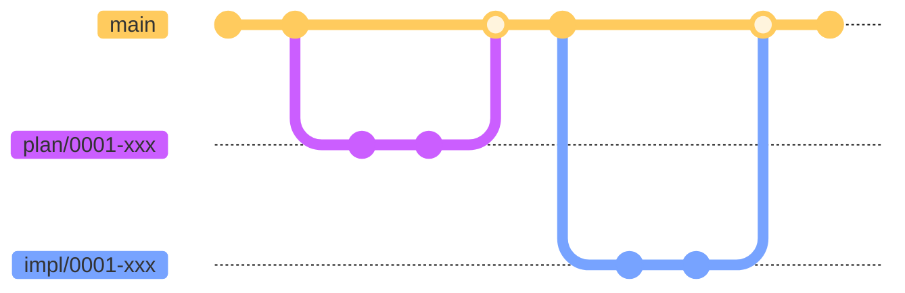

# Taigu

<p align="center">
  
</p>

     

## 🔍 Overview

Taigu is a stock portfolio tracker built for the Taiwan stock market. This README covers how to develop and deploy it. What the product does and how the system is built are in `docs/specs/`: start from [`product.md`](docs/specs/product.md) and [`architecture.md`](docs/specs/architecture.md).

## 🧑🏻‍💻 Development

### Repository Layout

| Directory | What it holds |
| --- | --- |
| `api-server/` | The Django API server, including the management commands that the scheduler runs |
| `frontend/` | The React web app, which Cloudflare Pages builds and serves |
| `scheduler/` | The APScheduler process that runs api-server management commands on a schedule |
| `reverse-proxy/` | The Nginx configs for dev and prod |
| `design/` | Interactive drafts of screens, served at `/design/` in dev |
| `docs/` | The specs (`docs/specs/`), plans, and roadmap (`docs/plans/`) |
| `tests/manual/` | The steps of the spec scenarios that need a manual check |
| `scripts/` | The scripts behind the Makefile targets |

### Prerequisites

- Operating System: MacOS or Linux
- Git (>=2.34.0)
- GNU Make (>=3.81.0)
- Docker (>=27.4.0)
- Visual Studio Code (or any other editor that supports devcontainer)

### Quick Start

- Step 0: Clone the repository

  ```bash
  git clone git@github.com:bingyangchen/taigu.git
  cd taigu
  ```

- Step 1: Create .env file

  ```bash
  cp example.env .env
  ```

  Fill in the values for the environment variables.

- Step 2: Build the images for development

  ```bash
  make build-dev
  ```

- Step 3: Initialize Development Environment

  ```bash
  make setup-dev
  ```

  This command will:
  - Add `local.taigu.tw` to your `/etc/hosts` file (requires `sudo`) so you can access the local server via domain name.
  - Generate development SSL certificates and keys under `reverse-proxy/` matching `local.taigu.tw` (uses [mkcert](https://github.com/FiloSottile/mkcert) when installed so browsers trust HTTPS and service workers work locally).
  - Install Git hooks in `.git/hooks/` to run automatic pre-commit linting and testing.

- Step 4: Run the Development Server

  ```bash
  make start
  # To stop the server, run `make stop`
  ```

  Once started, the application will automatically open or be accessible at `https://local.taigu.tw` in your browser.

### Validation

Run `make test` to check spelling, formatting, lint, backend tests, frontend Jest tests, and spec scenario coverage in Docker. Frontend tests run once without watch mode and also run in CI when frontend files or the lint-and-test workflow change.

### The Development Workflow

- **Step 1:** Create a branch from `main`, named as [Spec-Driven Development](#spec-driven-development) describes.
- **Step 2:** Complete your work, then commit and push your changes.
- **Step 3:** Open a pull request on GitHub and obtain approval for your PR.
- **Step 4:** Merge your branch into `main`.
- **Step 5:** Wait for the "Build and push production images" workflow on GitHub Actions to push the new images to Docker Hub.
- **Step 6:** SSH into the EC2 instance and deploy as [Deploying a New Version](#deploying-a-new-version) describes. You're done!

### Spec-Driven Development

Every change to spec'd behavior or architecture starts from a plan, and code follows. The full workflow is in `.agents/skills/sdd/SKILL.md`.

- `docs/specs/` describes what the code on `main` implements: the product, the architecture, the UI guidelines, and one spec per capability.
- `docs/plans/` holds approved changes, and `docs/plans/roadmap.md` shows what comes next.
- `tests/manual/` holds the steps for the scenarios that need a manual check.
- A change that alters behavior goes through a `plan/NNNN-xxx` branch, then an `impl/NNNN-xxx` branch. A behavior-preserving change, such as a bug fix that restores spec'd behavior or a refactor, uses a `change/xxx` branch, writing the spec of an existing capability uses a `backfill/xxx` branch, and abandoning an approved plan uses an `abandon/NNNN-xxx` branch. A trivial change on the skill's whitelist, such as a typo fix, takes any branch name.
- `make check-scenarios` checks that every scenario in `docs/specs/` has a backend test, a frontend Jest test, or a manual check; `make test` and CI run it too. Frontend tests name their scenarios in literal titles such as `test("[MKT-R22.2] selects the earlier quote", ...)`. See the SDD skill for the full marker rules.

A behavior change reaches `main` in two merges, the plan first and then its implementation:



### Dependency Management

Let's dive deeper into the details of **Step 2** of the development workflow when you need to add or remove a dependency:

#### API Server

- **Step 2-1:** Enter the shell of the API server container.
- **Step 2-2:** Install/Remove the dependency: `poetry add {DEPENDENCY} --lock` or `poetry remove {DEPENDENCY} --lock`
  - Note: The `--lock` flag prevents the download of the dependency, only version check will be performed.
- **Step 2-3:** Exit the shell and build the images for development.
- **Step 2-4:** Restart all Docker containers.

#### Frontend

- **Step 2-1:** Enter the shell of the frontend container.
- **Step 2-2:** Install/Remove the dependency: `npm install {DEPENDENCY} --save` or `npm remove {DEPENDENCY} --save`
- **Step 2-3:** Exit the shell and build the images for development.
- **Step 2-4:** Restart all Docker containers.

### Environment Variable Management

- **Step 1:** Define a new environment variable (with no value) in the `example.env` file.
- **Step 2:** Define the environment variable (with the value) in the `.env` file.
- **Step 3:** If it is used in the API server, you will also need to define the environment variable in `api-server/main/env.py` and `.github/workflows/lint-and-test.yaml`.

  You will also need to add the new environment variables into the `Test` environment on GitHub repository settings (Settings > Environments > Test > Variables/Secrets).

## 🚀 Production

### Prerequisites

- Operating System: Linux (Ubuntu >=22.04)
- Domain name: taigu.tw
- Git (>=2.34.0)
- GNU Make (>=3.81.0)
- Docker (>=27.4.0)

### One-Time Setup

```bash
git clone git@github.com:bingyangchen/taigu.git
cd ~/taigu
cp example.env .env

# [ACTION REQUIRED] Update ~/taigu/.env

# For running docker commands without sudo
sudo usermod -aG docker $USER
newgrp docker

make pull-images-prod
sudo timedatectl set-timezone Asia/Taipei
make start

# Restore the database from the backup:
docker cp ~/db-backups/backup.sql taigu-db-1:/backup.sql
make shell-db
    # In the db container:
    psql taigu < /backup.sql
    exit
```

### Deploying a New Version

```bash
cd ~/taigu
make deploy
```

### Managing the Standard Whitelist

Users on the whitelist get the Standard plan without paying (see BILL-R25 in `docs/specs/billing.md`).

```bash
cd ~/taigu
make shell-api-server
    # In the api-server container:
    python manage.py standard_whitelist add <email or user id> --note "<why>"
    python manage.py standard_whitelist remove <email or user id>
    python manage.py standard_whitelist list
    exit
```

Adding a user does not cancel their ECPay periodic charge. If `add` prints a warning about ECPay, ask the user to stop auto-renewal on the plan page.

### Managing Superusers

Superusers can open the admin console at `/admin` (see ADMIN-R1 and ADMIN-R2 in `docs/specs/admin.md`). The user must have signed in to Taigu at least once, so that the account exists.

```bash
cd ~/taigu
make shell-api-server
    # In the api-server container:
    python manage.py superuser add <email>
    python manage.py superuser remove <email>
    python manage.py superuser list
    exit
```

### Environment Variable Management

You can view `example.env` as the template for environment variable requirements. When you modify the environment variable requirements in `example.env`, you must also update the corresponding environment variables in the `.env` file on the production server.
