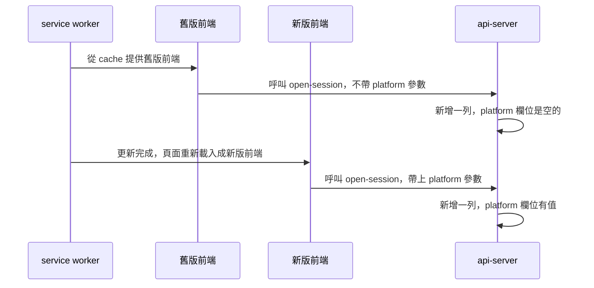

# 0003 記錄使用情況

## 目標

Taigu 開始記下每位登入的使用者在哪幾天、用網頁還是 PWA 使用過 Taigu，也在問題回報裡記下送出時的平台與 User-Agent，所以之後做出的後台可以用這個 plan 上線之後累積的資料統計活躍與留存，開發者查問題回報時也知道使用者用的是什麼環境。隱私權政策同時寫明 Taigu 記下這些資料、用在哪裡，以及使用紀錄保留多久。

## 範圍

- 要做：
  - 在 `product.md` 的「範圍」加上後台，這一項在這個 plan 的 PR 裡一起改。
  - 已登入的使用者的畫面開始顯示需要登入的頁面，或這種頁面回到前景時，Taigu 記下這位使用者當天用哪個平台使用過 Taigu（USAGE-R1），使用紀錄保留到帳號刪除為止（USAGE-R2）。
  - Taigu 在問題回報裡記下送出時的平台與 User-Agent（ISSUE-R3）。
  - 隱私權政策寫明 Taigu 記下的使用紀錄、問題回報的內容、平台與 User-Agent、使用紀錄的用途，以及使用紀錄與問題回報的保留期間（PUB-R11），條文寫在「做法要點」。
- 刻意不做的事：
  - 不回補這個 plan 上線之前的使用紀錄，因為 `User.last_login` 只留使用者最後一次開啟 Taigu 的時間，交易紀錄的建立時間則只代表使用者新增過資料，兩者都跟 USAGE-R1 的定義不同。
  - 不做後台與統計的畫面，這些留給 roadmap 的「後台」階段。
  - 不記錄 iOS 與 Android app 的平台，因為 app 還在 `mobile` 分支，沒有合併進 `main`。Roadmap 的「Mobile App」已經記下 app 合併時要記錄 iOS app 與 Android app 的平台。
  - Roadmap 的「介面文案與數字格式修正」列出的隱私權政策問題，例如沒有提到付款資料、綠界與 Gravatar，以及沒有寫交易紀錄、Google 帳號資料這些資料保存多久，留在那個階段。

## 設計稿

無

## Spec 變更

### usage-stats.md

新增這份 spec，frontmatter 的 `prefix` 是 `USAGE`，標題是「使用統計」。

#### 開頭的說明

使用統計讓開發者知道有多少使用者在使用 Taigu，以及他們用哪個平台使用 Taigu。Taigu 記下每位登入的使用者在哪幾天、用哪個平台使用過 Taigu，這些紀錄在本文件稱為使用紀錄。

#### USAGE-R1 記錄使用 Taigu 的日期與平台

已登入的使用者在下面這些時候，Taigu 記下這位使用者在這一天用哪個平台使用過 Taigu，一天以台灣時間計算：

- 畫面開始顯示 Taigu 需要登入的頁面（哪些頁面需要登入見 ACCT-R3）。

  開啟或重新整理這種頁面、登入後 Taigu 換到這種頁面，以及在 Taigu 裡換到這種頁面，都算開始顯示這種頁面。

- 顯示這種頁面的瀏覽器分頁或 PWA 從背景回到前景。

  例如使用者切回瀏覽器的分頁，或從其他 app 切回 PWA。

平台分成網頁與 PWA：Taigu 安裝成 PWA、在自己的視窗裡執行，畫面上沒有瀏覽器的網址列時是 PWA，在瀏覽器的分頁裡執行時是網頁。同一位使用者在同一天、同一個平台只有一筆使用紀錄。記錄沒有成功時，除了登入狀態結束的情況（處理方式見 ACCT-R5），畫面不顯示錯誤提示，正在顯示的頁面照常運作。

- USAGE-R1.1 在網頁上開啟 Taigu
  - 前提：使用者已經登入，今天（台灣時間 2026/10/24）還沒使用過 Taigu。
  - 動作：在瀏覽器裡開啟儀表板 `/`。
  - 結果：Taigu 記下這位使用者在 2026/10/24 用網頁使用過 Taigu。
- USAGE-R1.2 以 PWA 開啟 Taigu
  - 前提：使用者已經把 Taigu 安裝成 PWA 並登入，今天（台灣時間 2026/10/24）還沒使用過 Taigu。
  - 動作：從裝置的主畫面開啟安裝成 PWA 的 Taigu。
  - 結果：Taigu 記下這位使用者在 2026/10/24 用 PWA 使用過 Taigu。
- USAGE-R1.3 直接開啟設定頁
  - 前提：使用者已經登入，今天（台灣時間 2026/10/24）還沒使用過 Taigu。
  - 動作：在瀏覽器裡直接開啟設定頁 `/settings`。
  - 結果：Taigu 記下這位使用者在 2026/10/24 用網頁使用過 Taigu。
- USAGE-R1.4 登入後換到儀表板
  - 前提：使用者未登入，今天（台灣時間 2026/10/24）還沒使用過 Taigu。
  - 動作：在瀏覽器裡開啟儀表板 `/`，畫面換到歡迎頁之後，用 Google 帳號登入。
  - 結果：畫面換到儀表板，Taigu 記下這位使用者在 2026/10/24 用網頁使用過 Taigu。
- USAGE-R1.5 同一天再次開啟
  - 前提：Taigu 已經記下使用者在 2026/10/24 用網頁使用過 Taigu。
  - 動作：同一天在瀏覽器裡重新整理儀表板。
  - 結果：這位使用者在 2026/10/24 用網頁使用 Taigu 的使用紀錄仍然只有一筆。
- USAGE-R1.6 同一天用兩個平台開啟
  - 前提：使用者在瀏覽器與 PWA 裡都已經登入，Taigu 已經記下使用者在 2026/10/24 用網頁使用過 Taigu。
  - 動作：同一天從裝置的主畫面開啟安裝成 PWA 的 Taigu。
  - 結果：這位使用者在 2026/10/24 有網頁與 PWA 各一筆使用紀錄。
- USAGE-R1.7 隔天切回一直開著的分頁
  - 前提：使用者在台灣時間 2026/10/24 23:50 在瀏覽器裡開啟儀表板，之後切到其他分頁，沒有關閉 Taigu 的分頁。
  - 動作：台灣時間 2026/10/25 00:10 切回 Taigu 的分頁。
  - 結果：Taigu 記下這位使用者在 2026/10/25 用網頁使用過 Taigu。
- USAGE-R1.8 隔天在 Taigu 裡換頁
  - 前提：使用者在台灣時間 2026/10/24 23:50 在瀏覽器裡開啟儀表板，之後 Taigu 的分頁一直顯示在前景。
  - 動作：台灣時間 2026/10/25 00:10 點導覽列的「市場」。
  - 結果：Taigu 記下這位使用者在 2026/10/25 用網頁使用過 Taigu。
- USAGE-R1.9 日期以台灣時間計算
  - 前提：使用者已經登入，台灣時間 2026/10/24 與 2026/10/25 都還沒使用過 Taigu，現在是台灣時間 2026/10/25 07:30，也就是 UTC 2026/10/24 23:30。
  - 動作：在瀏覽器裡開啟儀表板。
  - 結果：Taigu 記下這位使用者在 2026/10/25 用網頁使用過 Taigu，沒有記下 2026/10/24。
- USAGE-R1.10 開啟不需要登入的頁面
  - 前提：使用者已經登入，今天（台灣時間 2026/10/24）還沒使用過 Taigu。
  - 動作：在瀏覽器裡開啟隱私權政策 `/privacy-policy`。
  - 結果：Taigu 沒有記下這位使用者在 2026/10/24 使用過 Taigu。
- USAGE-R1.11 離線時切回分頁
  - 前提：使用者已經登入，在瀏覽器裡開著儀表板，切到其他分頁之後，裝置的網路中斷。
  - 動作：切回 Taigu 的分頁。
  - 結果：畫面沒有出現錯誤提示，儀表板照常顯示。
- USAGE-R1.12 隔天從其他 app 切回 PWA
  - 前提：使用者在台灣時間 2026/10/24 23:50 從裝置的主畫面開啟安裝成 PWA 的 Taigu，畫面顯示儀表板，之後切到其他 app，沒有關閉 PWA。
  - 動作：台灣時間 2026/10/25 00:10 從 app 切換器切回 PWA。
  - 結果：Taigu 記下這位使用者在 2026/10/25 用 PWA 使用過 Taigu。
- USAGE-R1.13 記錄失敗之後換頁
  - 前提：使用者已經登入，在瀏覽器裡開著前一天開啟的儀表板，台灣時間 2026/10/24 還沒使用過 Taigu；2026/10/24 裝置的網路中斷時，使用者切回 Taigu 的分頁，這次記錄沒有成功。
  - 動作：網路恢復之後，點導覽列的「市場」。
  - 結果：Taigu 記下這位使用者在 2026/10/24 用網頁使用過 Taigu。
- USAGE-R1.14 登入狀態到期之後切回分頁
  - 前提：使用者在登入滿 30 天之前，在瀏覽器裡開啟設定頁 `/settings`，之後切到其他分頁，沒有關閉 Taigu 的分頁。
  - 動作：登入滿 30 天之後，切回 Taigu 的分頁。
  - 結果：畫面換到歡迎頁 `/welcome`，沒有出現錯誤提示；使用者重新登入後，畫面換回 `/settings`。

> 設計理由：Taigu 以畫面有沒有顯示需要登入的頁面判斷使用者這一天有沒有使用 Taigu，而不是看 api-server 有沒有收到這位使用者的任何 request，因為前端會在背景定時重新讀取行情，開著沒關的分頁每天都會送出 request，算出來的人數會偏高；也不是看使用者有沒有新增或修改資料，因為很多使用者開啟 Taigu 只是查看持股與行情，不算進去的話人數會偏低。頁面回到前景與在 Taigu 裡換頁也算使用，因為分頁可以一直開著好幾天，只在載入頁面時記錄的話，隔天切回分頁或在 Taigu 裡換頁的使用者不會被記下。完整討論見 [0003](../plans/archive/0003-usage-recording.md)。

#### USAGE-R2 使用紀錄的保留期間

Taigu 不會因為時間經過而刪除使用紀錄，使用者的帳號刪除時，這位使用者的使用紀錄一併刪除。

- USAGE-R2.1 帳號刪除
  - 前提：Taigu 記下使用者在 2026/10/24 用網頁使用過 Taigu。
  - 動作：開發者依使用者的要求刪除這個帳號。
  - 結果：這位使用者的使用紀錄全部刪除。

> 設計理由：使用紀錄保留到帳號刪除為止，而不是保留一段期間（例如 13 個月）之後只留每天的彙總數字，因為一筆使用紀錄只有使用者、日期與平台，沒有同樣保留到帳號刪除的交易紀錄那麼敏感，而且保留每位使用者的使用紀錄，開發者之後想到新的統計方式時，才能用過去的使用紀錄重算。完整討論見 [0003](../plans/archive/0003-usage-recording.md)。

### issue-reports.md

#### ISSUE-R3 送出問題回報

問題回報送出成功時，Taigu 另外記下送出時的平台與 User-Agent。規則改成：

問題回報送出成功時，Taigu 儲存去掉頭尾空白與換行之後的內容，並記錄送出的使用者、送出的時間、送出時的平台（平台的分法見 USAGE-R1），以及瀏覽器在送出的 request 裡帶的 User-Agent，接著編輯器關閉，畫面回到設定頁並出現提示「問題回報已送出，感謝你的回饋。」。

ISSUE-R3.1 的前提與結果加上平台與 User-Agent，ISSUE-R3.2 不變，另外新增 ISSUE-R3.3：

- ISSUE-R3.1 送出一則問題回報
  - 前提：使用者已經登入，在瀏覽器裡開啟 Taigu，在問題回報的編輯器輸入「點擊 Google 登入後畫面一直轉圈。」。
  - 動作：點送出按鈕。
  - 結果：Taigu 新增一則問題回報，內容是「點擊 Google 登入後畫面一直轉圈。」，平台是網頁，並記錄送出的這位使用者、送出的時間，以及瀏覽器在這個 request 裡帶的 User-Agent；編輯器關閉，畫面回到設定頁 `/settings`，出現提示「問題回報已送出，感謝你的回饋。」。
- ISSUE-R3.3 在 PWA 送出問題回報
  - 前提：使用者已經登入，從裝置的主畫面開啟安裝成 PWA 的 Taigu，在問題回報的編輯器輸入「匯出的檔案打不開。」。
  - 動作：點送出按鈕。
  - 結果：Taigu 新增一則問題回報，內容是「匯出的檔案打不開。」，平台是 PWA，User-Agent 是瀏覽器在這個 request 裡帶的 User-Agent。

### public-pages.md

#### PUB-R11 隱私權政策寫出使用紀錄與問題回報

新增這條需求：

隱私權政策寫明下面這些事：

- Taigu 記下的使用紀錄（見 USAGE-R1），以及使用紀錄用來統計 Taigu 的使用情況。
- Taigu 在問題回報裡記下的內容、平台與 User-Agent（見 ISSUE-R3）。
- 使用紀錄的保留期間（見 USAGE-R2），以及問題回報保留到帳號刪除為止。

- PUB-R11.1 查看隱私權政策寫的使用紀錄與問題回報
  - 前提：使用者未登入。
  - 動作：開啟隱私權政策 `/privacy-policy`。
  - 結果：「個人資料之蒐集」一節列出使用 Taigu 的日期與平台，以及問題回報的內容、送出時的平台與瀏覽器的 User-Agent；「個人資料之使用」一節列出統計 Taigu 的使用情況；「個人資料之保存期間」一節寫明使用紀錄與使用者送出的問題回報都保留到帳號刪除為止。

### architecture.md

#### 使用統計

新增這一節，放在「付款與額度」之後：

使用紀錄（USAGE-R1）存在 `daily_activity` 資料表，帳號刪除時一併刪除（USAGE-R2）。前端在 USAGE-R1 規定的時候呼叫 `open-session`，並帶上 `platform` 參數。舊版前端呼叫 `open-session` 時不會帶 `platform` 參數，api-server 照樣記下這一天，這一列的 `platform` 欄位是空的；同一位使用者同一天，`platform` 欄位是空的列也只有一列。

舊版前端有兩種：新版前端上線之前就開著的頁面，以及新版前端上線之後，使用者第一次開啟 Taigu 時 service worker 從 cache 提供的頁面。Service worker 從 cache 提供舊版前端時，同一位使用者那一天可能同時有 `platform` 欄位是空的與有值的兩列，順序如下圖：

#### Data Model

問題回報的平台與 User-Agent 可以是空的。以「股票代號在 API 與前端叫做 `sid`」開始的清單改成：

- 股票代號在 API 與前端叫做 `sid`，在參照股票的資料表裡是 `company_id`，在 `Company` 自己的資料表裡則是主鍵 `stock_id`，型別都是字串，例如 `"2330"`、`"0050"`。
- `TradeRecord` 沒有記錄買賣方向的欄位，`deal_quantity` 在買進時是正數，賣出時是負數，前端依正負號判斷買賣。
- `IssueReport` 的 `platform` 與 `user_agent` 可以是空的，空值出現在下面這些情況：
  - Taigu 開始記錄這兩個欄位之前送出的問題回報，兩個欄位都是空的。
  - 之後的問題回報由舊版前端送出，或 request 帶的 `platform` 不是 `web` 也不是 `pwa` 時，`platform` 是空的。
  - Request 沒有帶 User-Agent 時，`user_agent` 是空的。

#### 能力與程式碼對照

新增「使用統計」一列。以「| 能力 | 網址 | 前端頁面 |」開始的表格改成：

| 能力 | 網址 | 前端頁面 | 後端 app | Spec |
| --- | --- | --- | --- | --- |
| 交易紀錄與現金股利 | `/`、`/records`、`/records/trade/new`、`/records/trade/:recordId/edit`、`/records/cash-dividend/new`、`/records/cash-dividend/:recordId/edit`、`/settings/data-controls` | `frontend/src/pages/Main/Dashboard/Dashboard.tsx`、`frontend/src/pages/Main/Records/Records.tsx`、`frontend/src/pages/Main/EditorRoutes/EditorRoutes.tsx`、`frontend/src/pages/Settings/DataControls/DataControls.tsx` | `api-server/main/trade_record/`、`api-server/main/cash_dividend/` | [records.md](records.md) |
| 持股 | `/`、`/market`、`/market/holding/:sid` | `frontend/src/pages/Main/Dashboard/Dashboard.tsx`、`frontend/src/pages/Main/Market/Market.tsx`、`frontend/src/pages/Main/Details/Details.tsx`，計算在 `frontend/src/workers/tradeRecordWorker.ts` 與 `frontend/src/utils/market.ts` | 無，由前端依交易紀錄計算；Free 方案的持股檔數由 `api-server/main/billing/services/entitlements.py` 計算 | [holdings.md](holdings.md) |
| 投資績效 | `/`、`/earning-analysis`、`/market`、`/market/:sid` | `frontend/src/pages/Main/Dashboard/Dashboard.tsx`、`frontend/src/pages/Main/EarningAnalysis/EarningAnalysis.tsx`、`frontend/src/pages/Main/Market/Market.tsx`、`frontend/src/pages/Main/Details/Details.tsx`，計算在 `frontend/src/workers/tradeRecordWorker.ts` 與 `frontend/src/utils/util.ts` | 無，在前端計算 | [performance.md](performance.md) |
| 手續費 | `/`、`/handling-fee`、`/handling-fee/discounts/new`、`/handling-fee/discounts/:discountId/edit` | `frontend/src/pages/Main/Dashboard/Dashboard.tsx`、`frontend/src/pages/Main/HandlingFee/HandlingFee.tsx`、`frontend/src/pages/Main/EditorRoutes/EditorRoutes.tsx` | `api-server/main/handling_fee/` | [handling-fees.md](handling-fees.md) |
| 市場行情 | `/`、`/market-index/:market`、`/search`、`/market`、`/market/:sid`，以及各編輯器的「股票」欄位 | `frontend/src/pages/Main/Dashboard/Dashboard.tsx`、`frontend/src/pages/Main/MarketIndexDetails/MarketIndexDetails.tsx`、`frontend/src/pages/Main/Search/Search.tsx`、`frontend/src/components/StockSearchContent/StockSearchContent.tsx`（搜尋頁與桌面瀏覽器的搜尋視窗 `frontend/src/components/StockSearchModal/StockSearchModal.tsx` 共用）、`frontend/src/components/StockPicker/StockPicker.tsx`，重新抓行情的間隔在 `frontend/src/pages/Main/Main.tsx`、`Market.tsx` 與 `Details.tsx` | `api-server/main/market/` | [market-data.md](market-data.md) |
| 個股詳情 | `/market/:sid`、`/market/holding/:sid`、`/market/favorites/:sid` | `frontend/src/pages/Main/Details/Details.tsx` | `api-server/main/market/`、`api-server/main/stock_memo/` | [stock-details.md](stock-details.md) |
| 自選股 | `/market`、`/market/favorites/:sid` | `frontend/src/pages/Main/Market/Market.tsx`、`frontend/src/pages/Main/Details/Details.tsx` | `api-server/main/favorite/` | [favorites.md](favorites.md) |
| 買賣計畫 | `/plans`、`/plans/new`、`/plans/:planId/edit`、`/market` | `frontend/src/pages/Main/Plans/Plans.tsx`、`frontend/src/pages/Main/EditorRoutes/EditorRoutes.tsx`、`frontend/src/components/TradePlanEditor/TradePlanEditor.tsx`、`frontend/src/pages/Main/Market/Market.tsx` | `api-server/main/trade_plan/` | [trade-plans.md](trade-plans.md) |
| 帳號 | `/login`、`/settings`、`/settings/user-info`、`/settings/account-binding` | `frontend/src/pages/Login/Login.tsx`、`frontend/src/pages/Settings/Overview/Overview.tsx`、`frontend/src/pages/Settings/UserInfo/UserInfo.tsx`、`frontend/src/pages/Settings/AccountBinding/AccountBinding.tsx` | `api-server/main/account/` | [account.md](account.md) |
| 方案與付款 | `/settings/current-plan` | `frontend/src/pages/Settings/CurrentPlan/CurrentPlan.tsx`、`frontend/src/components/PlanUpsellModal/PlanUpsellModal.tsx` | `api-server/main/billing/` | [billing.md](billing.md) |
| 問題回報 | `/settings`、`/settings/issue-report` | `frontend/src/pages/Settings/Overview/Overview.tsx`、`frontend/src/pages/Settings/IssueReport/IssueReport.tsx` | `api-server/main/issue_report/` | [issue-reports.md](issue-reports.md) |
| 使用統計 | 需要登入的頁面（見 ACCT-R3） | `frontend/src/pages/Main/Main.tsx`、`frontend/src/pages/Settings/Settings.tsx`，判斷平台的是 `frontend/src/utils/util.ts` 的 `Util.isPWA` | `api-server/main/usage/`，記下使用紀錄的 `open-session` endpoint 在 `api-server/main/account/` | [usage-stats.md](usage-stats.md) |
| 公開頁面 | `/welcome`、`/privacy-policy`、`/terms-of-service`，以及其他找不到的網址 | `frontend/src/pages/Welcome/Welcome.tsx`、`frontend/src/pages/PrivacyPolicy/PrivacyPolicy.tsx`、`frontend/src/pages/TermsOfService/TermsOfService.tsx`、`frontend/src/pages/NotFound/NotFound.tsx`、`frontend/src/components/PageMeta/PageMeta.tsx`、`frontend/public/index.html`、`frontend/public/robots.txt`、`frontend/public/sitemap.xml`、`frontend/scripts/prerender.mjs` | 無 | [public-pages.md](public-pages.md) |

## 決策

### 怎樣算使用者在某一天使用過 Taigu

- 選項：
  - 畫面開始顯示需要登入的頁面，或這種頁面回到前景。
  - api-server 收到這位使用者的任何 request。
  - 使用者新增或修改了資料。
- 結論：畫面開始顯示需要登入的頁面，或這種頁面回到前景。
- 併入：usage-stats.md#USAGE-R1

### 平台怎麼分

- 選項：
  - 不分平台。
  - 分成網頁與 app。
  - 分成網頁、PWA、iOS app 與 Android app。
- 取捨：Taigu 沒有在記下使用紀錄時一起記下平台的話，之後沒辦法再替這些使用紀錄加上平台。
- 結論：分成網頁、PWA、iOS app 與 Android app。不過 `main` 上還沒有 app，所以這個 plan 只記網頁與 PWA，app 合併進 `main` 時再加上 iOS 與 Android。
- 併入：無

### 使用紀錄保留多久

- 選項：
  - 保留到帳號刪除為止。
  - 保留一段期間（例如 13 個月），之後刪掉每位使用者的使用紀錄，只留每天的彙總數字。
  - 只保留 30 天。
- 取捨：
  - 保留一段期間的話，開發者之後想到新的統計方式時，已經刪掉的使用紀錄沒辦法拿來重算。
  - 只保留 30 天的話，算不出 30 天的留存，也看不到長期的變化。
- 結論：保留到帳號刪除為止。
- 併入：usage-stats.md#USAGE-R2

### 問題回報要不要多記送出時的環境

- 選項：
  - 不多記。
  - 記下平台。
  - 記下平台與 User-Agent。
- 結論：記下平台與 User-Agent，因為開發者查問題時最常需要知道使用者用的是哪個瀏覽器與版本，而 api-server 本來就會在每個 request 的 header 收到 User-Agent。
- 併入：無

### 記錄使用情況與後台要不要分成兩個 plan

- 選項：
  - 一個 plan 做完記錄與後台。
  - 先做記錄使用情況，後台另外寫一個 plan。
- 取捨：使用紀錄沒辦法事後補記，記錄使用情況的功能晚一天上線，後台就少一天的資料可以統計；而後台的畫面與圖表最花時間，跟記錄放在同一個 plan 的話，記錄使用情況要等後台做完才能上線。
- 結論：先做記錄使用情況，後台另外寫一個 plan。
- 併入：無

### 要不要把後台寫進 product.md 的「範圍」

- 選項：
  - 不改「範圍」。
  - 在「範圍」新增一項後台。
- 取捨：Plan 0002 決定不把白名單寫進「範圍」，理由是「範圍」寫的是 Taigu 對使用者提供什麼，而白名單已經屬於「提供 Free 與 Standard 兩種方案」這一項。後台則不屬於「範圍」裡的任何一項，不寫進去的話，這個 plan 與之後後台的 plan 都會超出「範圍」。
- 結論：在「範圍」新增一項後台，寫法照開發者的確認。
- 併入：無

## 做法要點

- 新增 Django app `api-server/main/usage/` 與 `daily_activity` 資料表。
- `open-session` 多接受 `platform` 參數，值是 `web` 或 `pwa`，其他值回 400。
- `issue_report` 加上 `platform` 與 `user_agent` 兩個可以是空值的欄位，`user_agent` 沒有長度上限。
- 新增問題回報的 endpoint 也接受 `platform` 參數，但收到 `web` 與 `pwa` 以外的值時照常儲存問題回報，`platform` 欄位存成空值，因為使用者寫的內容比平台重要。
- User-Agent 由 api-server 從 request 的 header 讀出，前端不另外送。
- 兩個 migration 都只新增資料表與可以是空值的欄位，所以在 migration 之後、container 重啟之前，舊版的 api-server 照常運作。
- Cloudflare Pages 會先讓新版前端上線，api-server 要等 `make deploy` 之後才上線，這段期間新版前端送出的 `platform` 會被舊版 api-server 忽略，也還沒有使用紀錄。api-server 上線之後，舊版前端（見 architecture.md 的「使用統計」）不會帶 `platform`，api-server 照樣記下使用紀錄與問題回報，兩者的 `platform` 欄位都是空的，後台怎麼顯示這些紀錄記在 roadmap 的「後台」階段。
- USAGE-R1 依賴下面這些瀏覽器行為，architecture.md 還沒有紀錄。實作時要在 iOS Safari 安裝的 PWA、Android Chrome 安裝的 PWA、桌面 Chrome 安裝的 PWA 與桌面 Chrome 的分頁上實測，並把結果寫進 architecture.md 的「使用統計」：
  - 前端判斷 PWA 沿用 `Util.isPWA`（`display-mode: standalone`），要達到的結果是在這三種 PWA 裡都記成 PWA。
  - 要達到的結果是 Taigu 一段時間沒有顯示、使用者再看到它的時候都算回到前景，要實測的情況有：
    - 從 app 切換器切回 PWA。
    - 手機在 Taigu 顯示時鎖定螢幕，之後解鎖，瀏覽器與 PWA 都要測。
    - 從其他 app 切回手機的瀏覽器，而 Taigu 是目前的分頁。
    - 桌面瀏覽器的視窗或桌面 Chrome 安裝的 PWA 的視窗被其他 app 的視窗完全蓋住或縮到最小，之後再切回來。
    - 桌面電腦從睡眠喚醒或解除螢幕鎖定。
    - 從 back-forward cache 還原頁面。
  - 在這三種 PWA 裡用 Google 帳號登入之後，要達到的結果是登入當天記成 PWA，所以要確認從 Google 回到 Taigu 時，頁面是在 PWA 的視窗裡，還是在作業系統或瀏覽器另外開的瀏覽器畫面裡。
- ISSUE-R3 記下的 User-Agent 要跟瀏覽器送出的一樣，所以實作時要確認 prod 的 request 經過 Cloudflare 與 Nginx 之後，api-server 讀到的 User-Agent 沒有被改掉。
- 前端收到 403 時會把使用者登出（roadmap 的「登入與帳號修正」已經記下這個問題），而 CSRF cookie 是由 `me` 的回應設定的，所以前端在設定頁與回到前景這兩個新的時機呼叫 `open-session` 之前，都要確保 CSRF cookie 已經存在，例如沿用儀表板先等 `me` 回應的順序，否則沒有 CSRF cookie 的使用者會被登出。
- 隱私權政策的「最後更新日期」改成這個 plan 上線的日期，並加上下面的條文：
  - 「個人資料之蒐集」的清單加上兩項：
    - 「您使用本網站的日期與方式，也就是當時是在瀏覽器裡使用本網站，還是使用安裝到裝置上的本網站（PWA）。」
    - 「您送出的問題回報內容、送出時使用本網站的方式，以及您的瀏覽器提供的瀏覽器與作業系統資訊（User-Agent）。」
  - 「個人資料之使用」的清單加上一項：「統計本網站的使用情況，以改善本網站的服務。」
  - 在「個人資料之使用」之後新增一節「個人資料之保存期間」：「本網站保存您使用本網站的日期與方式的紀錄，以及您送出的問題回報，直到您的帳號刪除為止。」

## 驗證方式

| 情境 | 驗證方式 |
| --- | --- |
| USAGE-R1.1 在網頁上開啟 Taigu | unit、手動 |
| USAGE-R1.2 以 PWA 開啟 Taigu | unit、手動 |
| USAGE-R1.3 直接開啟設定頁 | 手動 |
| USAGE-R1.4 登入後換到儀表板 | 手動 |
| USAGE-R1.5 同一天再次開啟 | unit |
| USAGE-R1.6 同一天用兩個平台開啟 | unit |
| USAGE-R1.7 隔天切回一直開著的分頁 | unit、手動 |
| USAGE-R1.8 隔天在 Taigu 裡換頁 | unit、手動 |
| USAGE-R1.9 日期以台灣時間計算 | unit |
| USAGE-R1.10 開啟不需要登入的頁面 | 手動 |
| USAGE-R1.11 離線時切回分頁 | 手動 |
| USAGE-R1.12 隔天從其他 app 切回 PWA | 手動 |
| USAGE-R1.13 記錄失敗之後換頁 | 手動 |
| USAGE-R1.14 登入狀態到期之後切回分頁 | 手動 |
| USAGE-R2.1 帳號刪除 | unit |
| ISSUE-R3.1 送出一則問題回報 | unit、手動 |
| ISSUE-R3.3 在 PWA 送出問題回報 | unit、手動 |
| PUB-R11.1 查看隱私權政策寫的使用紀錄與問題回報 | 手動 |

## 還沒定案的問題

無
