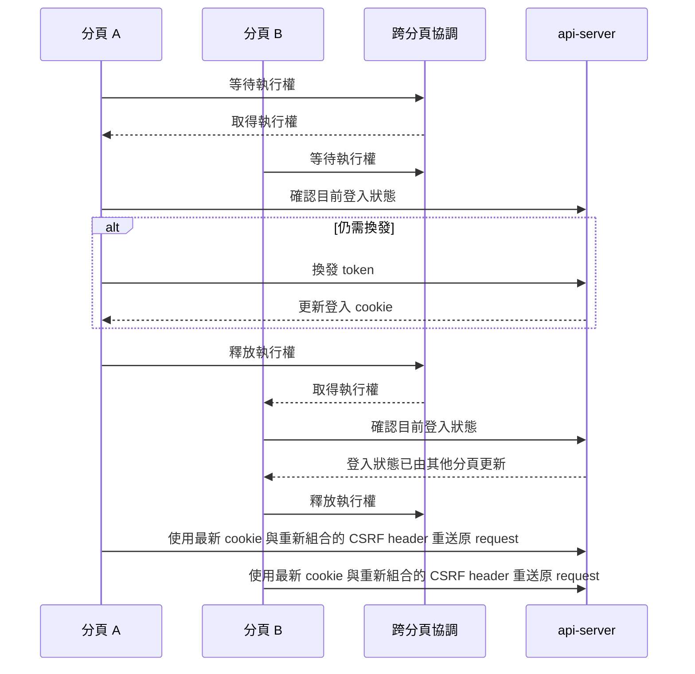
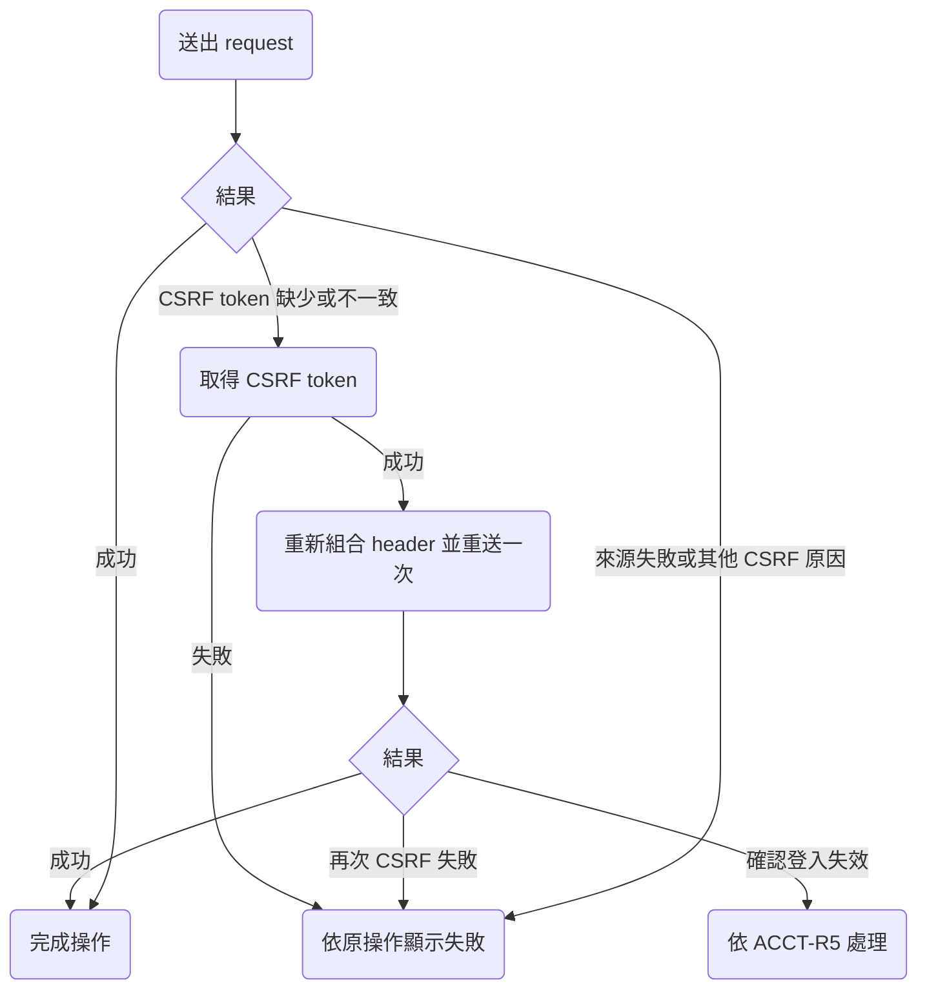

# 0005 登入與帳號修正

## 目標

讓使用者在多個分頁同時使用 Taigu 時維持登入，換綁 Google 帳號後作廢目前瀏覽器的舊 refresh token，並在 Google 資料不完整、CSRF token 需要重新取得或名字不符合限制時得到明確的處理結果；登入結束後清除瀏覽器保存的帳號資料，重新登入時只返回近期在原分頁開啟的網址。

## 範圍

- 要做：
  - 協調同一個瀏覽器的 token 換發。
  - 修正換綁後的 token 與登入期限。
  - 明定舊 Google 帳號重新註冊的試用資格。
  - 處理 Google 名字與頭像缺漏。
  - 恢復 CSRF token。
  - 驗證自行修改的名字。
  - 區分換綁結果的中文提示。
  - 清除帳號資料。
  - 限制登入後返回網址的用途。
- 刻意不做的事：
  - 從其他裝置登出。
  - 放寬後端對舊 refresh token 重複使用的檢查。
  - 限制透過換綁重新註冊取得試用期。

## 設計稿

無。沿用既有頁面、欄位、等待狀態與 toast，只調整驗證、提示與登入流程，不新增畫面或修改版面。

## Spec 變更

### account.md

#### ACCT-R2 第一次登入時建立帳號

登入取得的名字與頭像統一引用新增的資料處理規則。第一段規則改成：

第一次用某個 Google 帳號登入時，Taigu 替這個 Google 帳號建立新帳號，Email 取自這個 Google 帳號，名字與頭像依 ACCT-R15 取得；之後用同一個 Google 帳號登入都會進到這個帳號，而且登入時 Taigu 不會用 Google 帳號的資料覆蓋使用者改過的名字與頭像。

其他規則與既有情境不變。

#### ACCT-R3 未登入時開啟要登入才能使用的頁面

返回網址改成只供原分頁的下一次登入使用，並設定期限。規則改成：

除了歡迎頁（`/welcome`）、登入頁（`/login`）、隱私權政策（`/privacy-policy`）、服務條款（`/terms-of-service`）與 404 頁面，Taigu 的其他頁面都要登入才能使用；未登入的使用者開啟要登入才能使用的頁面時，Taigu 記住原本開啟的完整網址（包括 query string）並把畫面換到歡迎頁。不需要登入的那幾個頁面，規則見 PUB-R1、PUB-R4 與 PUB-R5。

記住的網址只供原分頁下一次成功登入後返回，自記住網址起 30 分鐘內有效。成功登入後，Taigu 先刪除這份紀錄，再依下列情況換頁：

- 原分頁的紀錄仍有效時，換回記住的網址。
- 沒有有效紀錄時，換到儀表板（`/`）。

返回網址另依以下規則處理：

- 關閉原分頁後，該分頁記住的返回網址失效。
- 其他分頁不使用原分頁記住的返回網址。
- 登入取消或失敗時，返回網址的期限不重新起算。
- 已登入的使用者開啟登入頁時，Taigu 依 ACCT-R1 換到儀表板，並清除該分頁留下的返回網址。
- 主動登出或登入失效時，返回網址的清除見 ACCT-R17。

既有情境 ACCT-R3.1 不變，ACCT-R3.2 改成：

- ACCT-R3.2 登入後換回原本開啟的網址
  - 前提：使用者未登入，開啟 `/records?sid=2330` 之後被導到歡迎頁。
  - 動作：在同一分頁換到登入頁，從記住網址起算未滿 30 分鐘時完成 Google 登入。
  - 結果：畫面換到 `/records?sid=2330`，記住的網址已清除。

新增以下情境：

- ACCT-R3.3 返回網址在滿 30 分鐘時失效
  - 前提：使用者未登入，開啟 `/records?sid=2330` 之後被導到歡迎頁。
  - 動作：在同一分頁完成 Google 登入，完成時距記住網址恰好 30 分鐘。
  - 結果：畫面換到儀表板，記住的網址已清除。
- ACCT-R3.4 返回網址只使用一次
  - 前提：使用者依 ACCT-R3.2 登入並返回歷史紀錄頁，之後主動登出。
  - 動作：直接從登入頁再次登入。
  - 結果：畫面換到儀表板。
- ACCT-R3.5 其他分頁不使用返回網址
  - 前提：分頁 A 因未登入而從 `/records?sid=2330` 被導到歡迎頁。
  - 動作：使用者另外開啟分頁 B，直接開啟登入頁並完成登入。
  - 結果：分頁 B 換到儀表板，不使用分頁 A 的返回網址。
- ACCT-R3.6 關閉原分頁後不使用返回網址
  - 前提：使用者因未登入而從 `/records?sid=2330` 被導到歡迎頁，之後關閉該分頁。
  - 動作：另開分頁，直接開啟登入頁並完成登入。
  - 結果：畫面換到儀表板。
- ACCT-R3.7 取消登入不延長返回期限
  - 前提：使用者未登入，開啟 `/records?sid=2330` 後被導到歡迎頁，之後開始 Google 登入並取消授權。
  - 動作：在原分頁再次開始登入，從最初記住網址起算超過 30 分鐘時完成登入。
  - 結果：畫面換到儀表板。
- ACCT-R3.8 已登入時清除留下的返回網址
  - 前提：分頁 A 記住了 `/records?sid=2330`，使用者之後在另一分頁完成登入。
  - 動作：在分頁 A 開啟登入頁。
  - 結果：畫面換到儀表板，分頁 A 記住的網址已清除。

#### ACCT-R5 登入狀態最長維持 30 天

換綁不再延長登入期限，確認登入失效時先清除帳號資料。規則改成：

同一個瀏覽器的登入狀態在登入滿 30 天後到期（最後換發的 access token 最多還能再用 15 分鐘），到期時間不隨使用或換綁 Google 帳號而延後；到期之前，除了登出（見 ACCT-R7）與舊的 refresh token 被重複使用（見 ACCT-R6），關閉瀏覽器或閒置都不必重新登入。

登入狀態因為到期、舊的 refresh token 被重複使用，或瀏覽器的登入 cookie 被清除而結束後，Taigu 下一次讀寫資料時先依 ACCT-R17 清除帳號資料，再依 ACCT-R3 記住這次開啟的網址並把畫面換到歡迎頁。CSRF 檢查失敗依 ACCT-R16 處理；連線失敗或服務暫時無法使用，不視為已確認登入失效。

既有情境 ACCT-R5.1 不變，ACCT-R5.2 與 ACCT-R5.3 改成：

- ACCT-R5.2 登入滿 30 天
  - 前提：使用者 31 天前登入，期間每天都使用 Taigu。
  - 動作：開啟歷史紀錄頁（`/records`），被導到歡迎頁後在原分頁未滿 30 分鐘時重新登入。
  - 結果：Taigu 依 ACCT-R17 清除帳號資料，畫面先換到歡迎頁（`/welcome`），重新登入後換回 `/records`。
- ACCT-R5.3 瀏覽器的登入 cookie 被清除
  - 前提：使用者已經登入，之後瀏覽器的登入 cookie 都被清除。
  - 動作：開啟歷史紀錄頁（`/records`），被導到歡迎頁後在原分頁未滿 30 分鐘時重新登入。
  - 結果：Taigu 依 ACCT-R17 清除帳號資料，畫面先換到歡迎頁（`/welcome`），重新登入後換回 `/records`。

#### ACCT-R6 舊的 Refresh Token 被重複使用時結束那次登入

保留後端拒絕重複使用的規則，同一個瀏覽器的正常分頁操作由前端協調。規則改成：

瀏覽器保存一份 refresh token，用來向 Taigu 維持登入狀態，Taigu 每次收到 refresh token 都換發新的一份並讓舊的失效；收到已經失效的舊 refresh token 時，Taigu 拒絕這次要求，並讓同一次登入換發過的所有 refresh token 都失效，使用那次登入的瀏覽器之後要重新登入。

同一個瀏覽器的多個 Taigu 分頁同時需要換發時，前端協調換發操作，讓等待中的分頁使用換發後的登入狀態，不因正常的同時換發而觸發上述規則。換綁時替換 refresh token 的規則見 ACCT-R11。

既有情境 ACCT-R6.1 不變，新增以下情境：

- ACCT-R6.2 多個分頁同時換發
  - 前提：同一個瀏覽器有多個已登入的 Taigu 分頁，登入尚未滿 30 天，access token 已過期。
  - 動作：多個分頁同時讀取需要登入的資料，換發與重送的 request 都正常收到回應。
  - 結果：各分頁都取得資料並維持登入，不因同時換發而結束登入。

#### ACCT-R7 登出

登出的資料清除統一引用 ACCT-R17。規則改成：

使用者在設定頁點「登出」並在確認視窗確認之後，Taigu 結束這個瀏覽器的這次登入、讓這次登入的 refresh token 失效，依 ACCT-R17 清除帳號資料，再把畫面換到登入頁；同一個帳號在其他瀏覽器的登入不受影響。登出 request 遇到 CSRF 檢查失敗時依 ACCT-R16 處理，沒有完成登出時留在原頁面，不顯示已登出。

既有情境 ACCT-R7.2、ACCT-R7.3 不變，ACCT-R7.1 改成：

- ACCT-R7.1 登出
  - 前提：使用者只在這個瀏覽器登入，新增過交易紀錄、點選過搜尋結果中的股票，並開啟設定頁。
  - 動作：點「登出」，在確認視窗點「登出」。
  - 結果：畫面換到登入頁（`/login`）；這次登入換發過的 refresh token 都失效，之後開啟儀表板（`/`）時畫面換到歡迎頁；瀏覽器內的帳號資料依 ACCT-R17 清除。

既有設計理由搬到 ACCT-R17，理由的內容不變。

#### ACCT-R9 修改名字與頭像

前端與 API 都驗證去掉頭尾空白後的名字，錯誤時不儲存任何欄位。規則改成：

使用者在頭像與名字頁（`/settings/user-info`）儲存修改時，Taigu 先去掉名字的頭尾空白，再驗證名字與「頭像位置」：

- 名字在 1 到 64 個字以內，而且頭像位置是空白或 http、https 開頭的網址時，儲存去掉頭尾空白後的名字與頭像，並把畫面換到設定頁。頭像位置空白時，每個顯示頭像的地方都改用預設的人像圖示。
- 名字是空白或超過 64 個字時，顯示「名字需為 1 到 64 個字。」，名字與頭像都不儲存，留在原頁面並保留輸入。
- 名字符合限制，但頭像位置是其他內容時，依 ACCT-R9.4 顯示錯誤，名字與頭像都不儲存。

前端與 API 採用相同的名字驗證規則；直接向 API 送出不符合限制的名字時，API 拒絕儲存並回傳上述中文提示。

既有情境不變，新增以下情境：

- ACCT-R9.5 去掉名字頭尾空白
  - 前提：使用者開啟頭像與名字頁，頭像位置符合限制。
  - 動作：把名字改成「 小明 」，儲存修改。
  - 結果：畫面換到設定頁，名字是「小明」。
- ACCT-R9.6 名字只有空白
  - 前提：使用者開啟頭像與名字頁，並修改頭像位置為合法的 https 網址。
  - 動作：把名字改成只有空白，儲存修改。
  - 結果：顯示「名字需為 1 到 64 個字。」，留在原頁面並保留輸入，名字與頭像都沒有儲存。
- ACCT-R9.7 名字超過 64 個字
  - 前提：使用者開啟頭像與名字頁，頭像位置符合限制。
  - 動作：輸入 65 個字的名字，儲存修改。
  - 結果：顯示「名字需為 1 到 64 個字。」，留在原頁面並保留輸入，名字與頭像都沒有儲存。
- ACCT-R9.8 名字長度的上下限
  - 前提：使用者開啟頭像與名字頁，頭像位置符合限制。
  - 動作：分別把名字改成 1 個字與 64 個字，各儲存一次。
  - 結果：兩次都成功儲存，設定頁分別顯示完整的名字。
- ACCT-R9.9 直接向 API 送出不符合限制的名字
  - 前提：使用者已登入，已設定名字與頭像。
  - 動作：直接向修改帳號資料的 API 分別送出空字串、只有空白、65 個字的名字，同時送出另一個合法頭像網址。
  - 結果：每次都拒絕儲存並回傳「名字需為 1 到 64 個字。」，帳號原本的名字與頭像不變。

#### ACCT-R11 更換綁定的 Google 帳號

換綁只替換目前瀏覽器的 token，資料缺漏依共用規則處理，並區分選到目前帳號與其他帳號。規則改成：

使用者可以在帳號綁定頁（`/settings/account-binding`）把帳號改綁到一個還沒有綁定任何 Taigu 帳號的 Google 帳號。改綁成功後，之後要用新的 Google 帳號登入，帳號的 Email 換成新 Google 帳號的 Email，名字與頭像依 ACCT-R15 取得，使用者改過的名字與頭像不會保留。

改綁成功時，Taigu 作廢目前瀏覽器這次登入的所有 refresh token，換發新的一組 token，沿用 ACCT-R5 的原本到期時間；使用者在目前瀏覽器維持登入，其他瀏覽器的登入也不受影響。

從 Google 回到帳號綁定頁時，Taigu 只在這次授權通過 ACCT-R12 的檢查時才處理選到的帳號，沒有完成授權時的處理見 ACCT-R13，使用者取消授權時的處理見 ACCT-R14。授權完成後依選到的 Google 帳號處理：

- 選到目前已綁定的帳號時，顯示「目前已綁定這個 Google 帳號，無需更換。」，帳號資料、refresh token 與登入到期時間都不變。
- 選到已綁定其他 Taigu 帳號的帳號時，顯示「這個 Google 帳號已綁定其他 Taigu 帳號，請選擇其他帳號。」，帳號資料、refresh token 與登入到期時間都不變。
- 選到尚未綁定任何 Taigu 帳號的帳號時，完成改綁並顯示「成功綁定」。

三種情況都從網址移除 Google 帶回的參數。舊 Google 帳號再次登入時依 ACCT-R2 建立新帳號，試用期依 BILL-R2 處理。

既有情境 ACCT-R11.1 不變，ACCT-R11.2 改成：

- ACCT-R11.2 選了已經綁定其他 Taigu 帳號的 Google 帳號
  - 前提：使用者開啟帳號綁定頁。
  - 動作：開始更換綁定的帳號，在 Google 的畫面選擇一個已經綁定其他 Taigu 帳號的 Google 帳號並同意授權。
  - 結果：顯示「這個 Google 帳號已綁定其他 Taigu 帳號，請選擇其他帳號。」，帳號資料與原本的 refresh token 不變，網址不再帶有 Google 帶回的參數。

新增以下情境：

- ACCT-R11.3 選到目前綁定的 Google 帳號
  - 前提：使用者已自行修改名字與頭像，開啟帳號綁定頁。
  - 動作：開始更換綁定的帳號，選擇目前綁定的 Google 帳號並同意授權。
  - 結果：顯示「目前已綁定這個 Google 帳號，無需更換。」，名字與頭像不被 Google 資料覆蓋，原本的 refresh token 與登入期限不變，網址不再帶有 Google 帶回的參數。
- ACCT-R11.4 改綁作廢原本的 Refresh Token
  - 前提：使用者已登入，保存了目前瀏覽器改綁前的 refresh token。
  - 動作：改綁成功後，用改綁前的 refresh token 要求換發。
  - 結果：Taigu 拒絕換發；改綁後的新 refresh token 仍可換發。
- ACCT-R11.5 改綁沿用原本的到期時間
  - 前提：使用者登入後第 20 天，登入期限還剩 10 天。
  - 動作：成功改綁另一個 Google 帳號。
  - 結果：目前瀏覽器保持登入，新 refresh token 的到期時間與改綁前相同。
- ACCT-R11.6 改綁不影響其他瀏覽器
  - 前提：同一個 Taigu 帳號在瀏覽器 A 與 B 都已登入。
  - 動作：在瀏覽器 A 成功改綁另一個 Google 帳號，之後在瀏覽器 B 換發 access token 並讀取資料。
  - 結果：瀏覽器 B 換發與讀取成功，不必重新登入。

#### ACCT-R12 只接受從同一個瀏覽器開始的 Google 授權

未登入時收到改綁 callback 的處理配合返回網址的期限。以「使用者已登入時回到登入頁」開始的那一段改成：

使用者已登入時回到登入頁，Taigu 照 ACCT-R1 換到儀表板；使用者未登入時回到帳號綁定頁，Taigu 照 ACCT-R3 換到歡迎頁。之後如果依 ACCT-R3 返回帳號綁定頁，Taigu 才處理 Google 帶回的結果。

其他規則與既有情境不變，ACCT-R12.5 改成：

- ACCT-R12.5 未登入時開啟別人傳來的改綁連結
  - 前提：使用者未登入；另一個人在自己的瀏覽器開始更換綁定的帳號，選擇一個還沒有綁定任何 Taigu 帳號的 Google 帳號並同意授權之後，取得 Google 帶回 Taigu 的網址 `/settings/account-binding?code=…&state=…`，但沒有在自己的瀏覽器完成改綁。
  - 動作：使用者在自己的瀏覽器開啟這個網址，畫面換到歡迎頁之後，在原分頁從記住網址起算未滿 30 分鐘時，用自己的 Google 帳號完成登入。
  - 結果：登入之後畫面換回帳號綁定頁，帳號綁定頁顯示使用者自己的 Google 帳號的 Email，網址不再帶有 `code` 與 `state`，並顯示錯誤提示「更換綁定的帳號失敗，請再試一次。」。

#### ACCT-R15 Google 帳號的名字與頭像

新增以下完整需求：

### ACCT-R15 Google 帳號的名字與頭像

第一次建立 Taigu 帳號（見 ACCT-R2）與成功換綁 Google 帳號（見 ACCT-R11）時，Taigu 依 Google 回傳的資料設定名字與頭像：

- 名字缺少、是空字串或只有空白時，名字設為「使用者」。
- 名字超過 64 個字時，取前 64 個字。
- 其他名字保留 Google 提供的內容。
- 頭像缺少或是空字串時，使用 ACCT-R9 的預設人像圖示；有頭像時使用 Google 提供的頭像。

上述情況都照常完成登入或換綁。再次登入既有帳號時保留使用者資料的規則見 ACCT-R2。

- ACCT-R15.1 Google 沒有提供名字
  - 前提：Google 回傳的名字分別是缺少、空字串與只有空白。
  - 動作：分別第一次登入與換綁到這個 Google 帳號。
  - 結果：操作成功，Taigu 的名字都是「使用者」。
- ACCT-R15.2 Google 名字超過 64 個字
  - 前提：Google 回傳 65 個字的名字。
  - 動作：分別第一次登入與換綁到這個 Google 帳號。
  - 結果：操作成功，Taigu 的名字是 Google 名字的前 64 個字。
- ACCT-R15.3 Google 名字恰好 64 個字
  - 前提：Google 回傳 64 個字的名字。
  - 動作：分別第一次登入與換綁到這個 Google 帳號。
  - 結果：操作成功，名字完整保留。
- ACCT-R15.4 Google 沒有提供頭像
  - 前提：Google 回傳的頭像分別是缺少與空字串。
  - 動作：分別第一次登入與換綁到這個 Google 帳號，開啟設定頁。
  - 結果：操作成功，顯示預設人像圖示。
- ACCT-R15.5 再次登入時 Google 資料不完整
  - 前提：使用者已有 Taigu 帳號並自行設定名字與頭像，Google 回傳的資料沒有名字與頭像。
  - 動作：用同一個 Google 帳號再次登入。
  - 結果：登入成功，保留使用者自行設定的名字與頭像。

#### ACCT-R16 CSRF 檢查失敗時恢復操作

新增以下完整需求：

### ACCT-R16 CSRF 檢查失敗時恢復操作

Taigu 收到前端送出的修改資料、Google 登入、換綁、換發 token 或登出 request 時，仍完整執行 CSRF 檢查；檢查失敗時拒絕執行原操作。前端依失敗原因處理：

- CSRF cookie 或 request 中的 token 缺少，或兩者不一致時，先重新取得 CSRF token，再用新的 token 自動重送原操作一次。
- CSRF token 格式不合法、來源檢查失敗或無法辨認失敗原因時，停止原操作，不自動重送。
- 重新取得 token 失敗，或重送後再次得到 CSRF 錯誤時，停止原操作，不繼續重試。

CSRF 失敗不視為登入結束；只有確認登入已失效時，才依 ACCT-R5 處理。互動操作無法恢復時，留在原頁面並保留尚未送出的輸入，顯示「無法完成操作，請重新整理後再試一次。」；原操作已有失敗提示規則時，沿用該規則，例如後台的 ADMIN-R13 與 ADMIN-R14，背景記錄使用情況的提示規則見 USAGE-R1。沒有完成 Google 登入時仍留在登入頁，沒有完成登出時仍留在登出前的頁面。

- ACCT-R16.1 缺少 CSRF Token 後恢復
  - 前提：使用者已登入，登入仍有效，但 CSRF cookie 已清除。
  - 動作：儲存修改後的名字，取得新 token 與重送都成功。
  - 結果：名字成功儲存，使用者維持登入；原本失敗的 request 沒有修改資料。
- ACCT-R16.2 CSRF Token 不一致後恢復
  - 前提：使用者已登入，送出名字修改時 header 的 CSRF token 與 cookie 不一致。
  - 動作：取得新 token 後重送成功。
  - 結果：名字只修改一次，使用者維持登入。
- ACCT-R16.3 來源檢查失敗
  - 前提：使用者的登入仍有效，送出的修改 request 未通過 CSRF 來源檢查。
  - 動作：前端收到來源檢查失敗的回應。
  - 結果：不自動重送，顯示失敗提示、保留輸入，資料未修改，登入未被結束。
- ACCT-R16.4 重送仍未通過 CSRF 檢查
  - 前提：修改名字的 request 因 token 缺少而失敗，重新取得 token 成功。
  - 動作：自動重送一次，仍收到 CSRF 失敗。
  - 結果：不再重試，顯示失敗提示、保留輸入，資料未修改，登入未被結束。
- ACCT-R16.5 無法重新取得 CSRF Token
  - 前提：修改名字的 request 因 token 缺少而失敗。
  - 動作：重新取得 token 時連線失敗。
  - 結果：不重送原操作，顯示失敗提示並保留輸入，不把連線失敗當成登入失效。
- ACCT-R16.6 換發 Token 時恢復 CSRF
  - 前提：使用者登入尚未滿 30 天，access token 已過期，CSRF cookie 已清除。
  - 動作：讀取需要登入的資料，取得新 CSRF token、換發與重送都成功。
  - 結果：資料讀取成功，使用者維持登入。
- ACCT-R16.7 登出時恢復 CSRF
  - 前提：使用者已登入，CSRF cookie 已清除。
  - 動作：確認登出，取得新 token 與重送都成功。
  - 結果：依 ACCT-R7 完成登出，refresh token 已失效。
- ACCT-R16.8 CSRF 恢復後確認登入已失效
  - 前提：使用者的 access token 與 refresh token 都已到期，CSRF cookie 已清除。
  - 動作：讀取需要登入的資料，取得新 CSRF token 成功，但換發 token 被判定為登入失效。
  - 結果：依 ACCT-R5 清除資料並換到歡迎頁。
- ACCT-R16.9 CSRF Token 格式不合法或原因不明
  - 前提：修改名字的 request 得到 CSRF token 格式不合法或無法辨認原因的 403 回應。
  - 動作：前端處理這個回應。
  - 結果：不自動重送，顯示失敗提示並保留輸入，不結束登入。
- ACCT-R16.10 Google 登入時恢復 CSRF
  - 前提：使用者已完成 Google 授權，Taigu 尚未處理這次授權結果，CSRF cookie 已清除。
  - 動作：送出 Google 登入的 request，取得新 CSRF token 與重送都成功。
  - 結果：完成登入，CSRF 失敗的 request 沒有消耗這次 Google 授權。

#### ACCT-R17 清除瀏覽器保存的帳號資料

新增以下完整需求，並承接 ACCT-R7 原本的設計理由：

### ACCT-R17 清除瀏覽器保存的帳號資料

主動登出（見 ACCT-R7）或確認登入已失效（見 ACCT-R5）時，Taigu 清除這個瀏覽器保存的帳號資料，包括交易紀錄、同步進度、離線時讀取用的現金股利紀錄、買賣計畫、自選股、個股筆記、手續費折讓、最近點選過的股票，以及之前記住的登入後返回網址。登入失效後這次開啟的網址，由 ACCT-R5 在清除完成後另行記住。

- ACCT-R17.1 主動登出後換另一個帳號登入
  - 前提：帳號 A 在瀏覽器中留下上述各種資料，包含最近點選的股票與返回網址。
  - 動作：帳號 A 主動登出，接著從登入頁登入帳號 B。
  - 結果：登入帳號 B 前已清除帳號 A 的上述資料；帳號 B 不看到帳號 A 的離線資料與最近股票，也不使用帳號 A 的舊返回網址。
- ACCT-R17.2 登入失效後換另一個帳號登入
  - 前提：帳號 A 在瀏覽器中留下上述各種資料，之後登入到期。
  - 動作：開啟 `/records?sid=2330` 觸發登入失效處理，再於原分頁未滿 30 分鐘時登入帳號 B。
  - 結果：登入帳號 B 前已清除帳號 A 的上述資料；帳號 B 不看到帳號 A 的離線資料與最近股票，畫面依 ACCT-R3 返回這次開啟的 `/records?sid=2330`。

> 設計理由：登出時刪除離線讀取用的資料，是為了讓同一個瀏覽器之後登入的人看不到前一個帳號的資料。

### billing.md

#### BILL-R2 試用期

一次試用的單位明定為 Taigu 帳號，舊 Google 帳號重新註冊可再獲試用。規則改成：

每個 Taigu 帳號第一次登入時開始 31 天的 Standard 試用期，試用期結束時變成未訂閱，同一個 Taigu 帳號只有一次試用期。換綁 Google 帳號不改變這個 Taigu 帳號的試用期；原本的 Google 帳號之後依 ACCT-R2 建立另一個 Taigu 帳號時，新帳號仍有自己的試用期。

既有情境不變，新增以下情境與設計理由：

- BILL-R2.4 舊 Google 帳號重新註冊
  - 前提：Taigu 帳號 A 的試用期已結束，使用者把它從 Google 帳號 G1 改綁到 G2。
  - 動作：登出後，用 G1 再次登入。
  - 結果：建立不同於 A 的 Taigu 帳號 B，B 開始自己的 31 天試用期；A 的試用期不變。
- BILL-R2.5 換綁不重算試用期
  - 前提：Taigu 帳號的試用期還剩 10 天。
  - 動作：成功換綁另一個 Google 帳號。
  - 結果：這個 Taigu 帳號的試用到期時間不變。

> 設計理由：試用資格以 Taigu 帳號判定，接受使用者透過換綁後重新註冊取得另一次試用，因此不另存曾經使用過的 Google 身分來限制試用。完整討論見 [0005](../plans/archive/0005-login-account-fixes.md)。

### market-data.md

#### MKT-R18 最近點選過的股票

最近股票的清除引用共用帳號規則。規則改成：

搜尋框沒有文字時，搜尋頁與搜尋視窗列出這台裝置最近在搜尋頁或搜尋視窗的搜尋結果點選過的股票，最多 10 檔，最近點選的排在最前面。登入結束時的清除見 ACCT-R17。

既有情境不變。

### admin.md

#### ADMIN-R1 只有 Superuser 能使用後台

未登入時開啟後台的既有情境，補上 ACCT-R3 的返回條件。規則與其他情境不變，ADMIN-R1.4 改成：

- ADMIN-R1.4 未登入時開啟後台
  - 前提：使用者是 superuser，沒有登入。
  - 動作：開啟 `/admin/usage`，畫面換到歡迎頁之後，在原分頁從記住網址起算未滿 30 分鐘時，用 Google 帳號完成登入。
  - 結果：畫面換到 `/admin/usage`，顯示使用情況頁。

### usage-stats.md

#### USAGE-R1 記錄使用 Taigu 的日期與平台

登入到期後返回設定頁的既有情境，補上 ACCT-R3 的返回條件。規則與其他情境不變，USAGE-R1.14 改成：

- USAGE-R1.14 登入狀態到期之後切回分頁
  - 前提：使用者在登入滿 30 天之前，在瀏覽器裡開啟設定頁（`/settings`），之後切到其他分頁，沒有關閉 Taigu 的分頁。
  - 動作：登入滿 30 天之後切回 Taigu 的分頁，畫面換到歡迎頁後，在原分頁從記住網址起算未滿 30 分鐘時重新登入。
  - 結果：畫面先換到歡迎頁（`/welcome`），沒有出現錯誤提示，重新登入後換回 `/settings`。

### architecture.md

#### 登入

前端協調 token 換發、CSRF 恢復與登入結束的處理，後端仍保留既有的安全檢查。在以「api-server 把 JWT 放在 HTTP-only cookie」開始的那一段之後，新增以下段落與圖：

前端跨分頁協調會修改目前瀏覽器登入 cookie 的換發與換綁操作，同一時間只由一個分頁執行。多個分頁需要換發時的流程如下圖，JWT 維持 HTTP-only，協調時不透過 JavaScript 傳遞 JWT。

> 設計理由：多分頁的正常換發由前端協調，後端仍依 ACCT-R6 拒絕已失效的 refresh token。不提供允許舊 token 再使用的短暫期間，因為那也會允許遭竊的舊 token 在這段期間繼續使用。後端已換發成功但瀏覽器沒收到回應時，使用者仍可能需要重新登入。完整討論見 [0005](../plans/archive/0005-login-account-fixes.md)。

CSRF 失敗由 Django 的失敗處理回傳可辨認的原因，前端只依 ACCT-R16 允許的原因恢復操作。取得 CSRF cookie 的 GET 不要求有效的 access token，因此 access token 過期時仍能恢復 refresh request；取得 cookie 不會登入、換綁或修改帳號資料。被 CSRF middleware 拒絕的 request 不進入原本的 view，也不消耗 OAuth state。

換綁的帳號資料更新、撤銷目前 refresh token 的舊 family 與建立新 family 在同一個資料庫 transaction 內完成，新 family 沿用舊 family 的到期時間。其他瀏覽器的 family 不變，access token 的驗證方式也不變。

> 設計理由：換綁後換成新的 family，舊 family 的 token 再被使用時只影響已作廢的舊 family，避免連帶撤銷改綁後的新 refresh token。其他裝置的登出屬於另一個功能，不在換綁時加入。完整討論見 [0005](../plans/archive/0005-login-account-fixes.md)。

登入成功後返回的網址改存在原分頁的 sessionStorage，連同記住的時間一起保存。前端依 ACCT-R3 判定能否使用，先移除紀錄再換頁。升級時清除舊 localStorage 裡沒有期限的返回網址，不把舊紀錄轉成新的有效紀錄。前端在清除帳號資料時，同時清除持久儲存與記憶體中的帳號資料，避免仍開著的分頁把舊資料重新寫回。

#### Google 授權

403 不再代表登入結束。在以「上面這些情況都不能回 401 或 403」開始的那一段，規則改成：

上面這些授權失敗都不能回 401 或 403，因為前端收到 401 時會先換發 access token，403 則保留給 CSRF 檢查失敗，由 ACCT-R16 處理。Google 帶回的 `error` 只由前端處理，不會送到 api-server。

本節其他段落與圖不變。

#### 使用統計

不再以收到 403 就登出作為呼叫順序的理由。以「前端呼叫 `open-session` 時」開始的那一段改成：

前端呼叫 `open-session` 時，如果瀏覽器還沒有 CSRF cookie，先等 `me` 的回應設定 cookie，再呼叫 `open-session`，避免第一次記錄使用情況就得到可預防的 CSRF 錯誤；實際發生 CSRF 失敗時依 ACCT-R16 處理，提示則依 USAGE-R1。

#### 後台

後台仍保留既有的權限回應，只更新不回 403 的理由。既有「不是 superuser 時回 404」的設計理由改成：

> 設計理由：不是 superuser 時回 404，讓一般使用者看到的結果跟網址不存在時相同，看不出 Taigu 有後台。完整討論見 [0004](../plans/archive/0004-admin-console.md)。

## 決策

### 多分頁換發與安全性

- 選項：
  - 前端協調換發，保留後端立即拒絕舊 token 的規則。
  - 後端在短暫期間接受舊 token 重複使用。
- 取捨：前端協調仍無法保證換發成功但回應遺失時維持登入；後端容許重複使用則會同時放寬對遭竊 token 的限制。
- 結論：前端協調換發，接受回應遺失時可能需要重新登入。
- 併入：architecture.md#登入。

### 換綁只處理目前瀏覽器

- 選項：
  - 只替換目前瀏覽器的 refresh token，沿用到期時間。
  - 換綁時讓其他裝置重新登入，或重新計算目前瀏覽器的 30 天。
- 結論：只替換目前瀏覽器的 token，沿用到期時間；從其他裝置登出另外規劃。
- 併入：architecture.md#登入。

### 試用資格以 Taigu 帳號判定

- 選項：
  - 每個新 Taigu 帳號有自己的試用期。
  - 保存 Google 身分歷史，限制舊身分重新取得試用。
- 結論：每個新 Taigu 帳號有自己的試用期，接受透過換綁重複試用。
- 併入：billing.md#BILL-R2。

### CSRF 失敗先恢復 Token

- 選項：
  - Token 缺少或不一致時取得新 token，最多自動重送一次。
  - 所有 CSRF 失敗都結束登入。
- 結論：只對可恢復的 token 問題重試一次，來源檢查失敗不重試，CSRF 失敗本身不代表登入失效。
- 併入：無。

### 名字、頭像與換綁提示

- 選項：
  - Google 名字缺少時用「使用者」、過長時截成 64 個字；自行輸入時驗證，超出限制則拒絕。
  - 過長的 Google 名字也改成「使用者」，或自行輸入時自動截斷。
- 結論：採第一個選項，缺少頭像時用預設圖示；選到目前綁定帳號時提示不必更換，選到其他 Taigu 帳號已綁定的帳號時提示選擇其他帳號。
- 併入：無。

### 返回網址與資料清除

- 選項：
  - 返回網址只供原分頁使用、保留 30 分鐘；主動登出與登入失效都清除帳號資料。
  - 各分頁共用返回網址或不設定期限；只在主動登出時清除資料。
- 結論：採第一個選項，登入失效時先清除舊資料，再記住這次開啟的網址。
- 併入：無。

## 做法要點

- 前端與 api-server 分開上線。CSRF 的結構化失敗回應與取得 cookie 的 GET 採相容性新增；新版前端對舊版 API 無法辨認的 403 停止操作、保留輸入，不猜測原因或登出。api-server 必須先提供上述能力，才可完成新版 CSRF 恢復流程的驗收。舊版前端仍可能把 403 當成登出，完整修正要等它更新。
- 跨分頁協調必須涵蓋 refresh 與換綁替換 token，等待中的分頁不能憑先前的 401 再換發一次；登出與登入失效的資料清除也必須讓仍開著的分頁停止使用舊帳號資料。實作時驗證瀏覽器的協調、分頁關閉、PWA、重新載入與舊版 service worker 頁面共存的實際行為，將實測結果與限制記錄於 `architecture.md`。
- 返回網址依 ACCT-R3 保存完整 path 與 query，包括 ACCT-R12.5 的改綁 callback，不可一律移除 `code`、`state`；返回後仍必須通過既有 OAuth 檢查。實作時確認分頁關閉、還原與複製分頁的儲存行為，記錄於 `architecture.md`，不能只假設 sessionStorage 在所有情況都會清除。
- Google 資料的名字、頭像可以缺少，Google 身分、Email 與 ID token 可信度的既有驗證仍要保留。名字的長度在前後端統一以 Unicode code point 計算，避免 emoji 在 JavaScript 與 Python 的長度不同；Google 過長名字也以同一方式截取。
- 換綁需要可辨認的「目前已綁定」結果，讓新版前端顯示提示而不誤顯示「成功綁定」；後端的回應變更必須與舊版前端相容，不能讓舊版前端把沒有改綁的結果誤當成成功。
- 本計劃不新增 Google 身分歷史或 server 端個人資料保存。隱私權政策（`/privacy-policy`）的「個人資料之保存期間」在既有段落後新增：「本網站會在您的瀏覽器保存帳號資料，以供離線讀取；登出或確認登入失效時，會清除這些資料與最近點選過的股票。未登入時記住的返回網址只供原分頁下一次登入使用，最多保留 30 分鐘。」實作時將最後更新日期改成實際更新當天；服務條款未描述本計劃改動的規則，不需改條文。

## 驗證方式

| 情境 | 驗證方式 |
| --- | --- |
| ACCT-R3.2 登入後換回原本開啟的網址 | 手動 |
| ACCT-R3.3 返回網址在滿 30 分鐘時失效 | 手動 |
| ACCT-R3.4 返回網址只使用一次 | 手動 |
| ACCT-R3.5 其他分頁不使用返回網址 | 手動 |
| ACCT-R3.6 關閉原分頁後不使用返回網址 | 手動 |
| ACCT-R3.7 取消登入不延長返回期限 | 手動 |
| ACCT-R3.8 已登入時清除留下的返回網址 | 手動 |
| ACCT-R5.2 登入滿 30 天 | unit、手動 |
| ACCT-R5.3 瀏覽器的登入 cookie 被清除 | 手動 |
| ACCT-R6.2 多個分頁同時換發 | 手動 |
| ACCT-R7.1 登出 | unit、手動 |
| ACCT-R9.5 去掉名字頭尾空白 | unit、手動 |
| ACCT-R9.6 名字只有空白 | unit、手動 |
| ACCT-R9.7 名字超過 64 個字 | unit、手動 |
| ACCT-R9.8 名字長度的上下限 | unit、手動 |
| ACCT-R9.9 直接向 API 送出不符合限制的名字 | unit |
| ACCT-R11.2 選了已經綁定其他 Taigu 帳號的 Google 帳號 | unit、手動 |
| ACCT-R11.3 選到目前綁定的 Google 帳號 | unit、手動 |
| ACCT-R11.4 改綁作廢原本的 Refresh Token | unit |
| ACCT-R11.5 改綁沿用原本的到期時間 | unit |
| ACCT-R11.6 改綁不影響其他瀏覽器 | unit、手動 |
| ACCT-R12.5 未登入時開啟別人傳來的改綁連結 | 手動 |
| ACCT-R15.1 Google 沒有提供名字 | unit |
| ACCT-R15.2 Google 名字超過 64 個字 | unit |
| ACCT-R15.3 Google 名字恰好 64 個字 | unit |
| ACCT-R15.4 Google 沒有提供頭像 | unit、手動 |
| ACCT-R15.5 再次登入時 Google 資料不完整 | unit |
| ACCT-R16.1 缺少 CSRF Token 後恢復 | unit、手動 |
| ACCT-R16.2 CSRF Token 不一致後恢復 | unit、手動 |
| ACCT-R16.3 來源檢查失敗 | unit、手動 |
| ACCT-R16.4 重送仍未通過 CSRF 檢查 | 手動 |
| ACCT-R16.5 無法重新取得 CSRF Token | 手動 |
| ACCT-R16.6 換發 Token 時恢復 CSRF | unit、手動 |
| ACCT-R16.7 登出時恢復 CSRF | unit、手動 |
| ACCT-R16.8 CSRF 恢復後確認登入已失效 | unit、手動 |
| ACCT-R16.9 CSRF Token 格式不合法或原因不明 | unit、手動 |
| ACCT-R16.10 Google 登入時恢復 CSRF | unit、手動 |
| ACCT-R17.1 主動登出後換另一個帳號登入 | 手動 |
| ACCT-R17.2 登入失效後換另一個帳號登入 | 手動 |
| BILL-R2.4 舊 Google 帳號重新註冊 | unit |
| BILL-R2.5 換綁不重算試用期 | unit |
| ADMIN-R1.4 未登入時開啟後台 | 手動 |
| USAGE-R1.14 登入狀態到期之後切回分頁 | 手動 |

## 還沒定案的問題

無。
