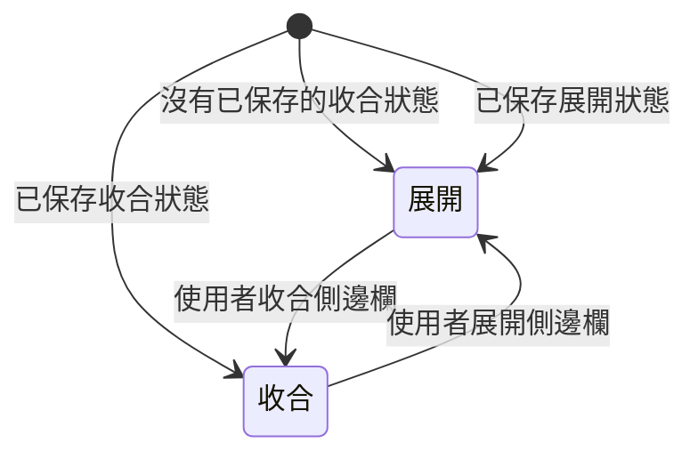

# 0007 前台桌面側邊欄收合

## 目標

使用者在桌面寬版前台可以收合左側導覽，主內容捲動時側邊欄維持固定位置；前端也會在同一個瀏覽器切換頁面或重新載入後保留收合狀態。

## 收合狀態

## 範圍

- 要做：
  - 在可用寬度至少 960px 時，讓前台側邊欄從 230px 收合到 64px，並提供可用滑鼠與鍵盤操作的按鈕。
  - 收合時保留所有導覽與操作入口，並為圖示提供 tooltip 與 screen reader 可讀名稱。
  - 在同一個瀏覽器保留收合狀態，沒有儲存空間時仍讓目前頁面的收合操作有效。
  - 讓主內容獨立捲動，避免主內容捲動時側邊欄上下移動。
  - 保持目前窄版導覽與各頁原有操作不變。
- 刻意不做的事：
  - 不調整前端依可用寬度切換版面的其他問題；這些問題仍列在 roadmap 的「前台版面修正」。
  - 不調整側邊欄的導覽項目、文字、目的頁面與新增或搜尋流程。

## 設計稿

- `design/frontend-sidebar.html`：展示桌面側邊欄展開與收合、窄版導覽，以及儀表板的載入中、沒有資料、讀取失敗、額度用完與第一次使用狀態。

## Spec 變更

### desktop-sidebar.md

#### NAV-R1 桌面側邊欄收合與固定位置

新增桌面前台側邊欄的收合、狀態保存與主內容捲動規則，需求全文如下：

在可用寬度至少 960px 的前台頁面，側邊欄預設展開，寬度為 230px。使用者可以用側邊欄頂端的按鈕收合或展開側邊欄；收合時寬度為 64px，只顯示圖示，所有導覽與操作仍可使用，圖示也有 screen reader 可讀的名稱，滑鼠移入或鍵盤焦點停留時會顯示名稱 tooltip。按鈕能以鍵盤操作，並以 `aria-expanded` 表示目前狀態。

前端把收合狀態存在目前的瀏覽器，使用者在同一個瀏覽器切換前台頁面或重新載入後，側邊欄維持原狀態。瀏覽器沒有收合紀錄時，側邊欄預設展開；瀏覽器無法存取儲存空間時，收合操作仍在目前頁面有效，重新載入後側邊欄預設展開。

桌面前台的主內容捲動時，側邊欄固定在視窗左側，不隨主內容上下移動。側邊欄內容超出可用高度時，使用者可以獨立捲動側邊欄。

可用寬度小於 960px 時不顯示收合按鈕，側邊欄依其他前台版面規則呈現，收合狀態不影響窄版導覽。

- NAV-R1.1 第一次開啟桌面前台
  - 前提：使用者在這個瀏覽器沒有前台側邊欄的收合紀錄。
  - 動作：以 1280px 寬的視窗開啟儀表板 `/`。
  - 結果：側邊欄寬度是 230px，導覽文字與操作名稱都顯示，側邊欄有收合按鈕。
- NAV-R1.2 收合與展開側邊欄
  - 前提：使用者以至少 960px 寬的視窗開啟前台頁面，側邊欄已展開。
  - 動作：點收合按鈕，再點展開按鈕。
  - 結果：收合後側邊欄寬度是 64px，只顯示圖示，導覽與操作仍可使用，指到圖示或以鍵盤移到圖示時會顯示名稱；再次點按鈕後側邊欄恢復 230px 與所有文字。
- NAV-R1.3 用鍵盤收合與展開
  - 前提：使用者以至少 960px 寬的視窗開啟前台頁面，鍵盤焦點停在側邊欄的收合按鈕。
  - 動作：按 Enter 或 Space，再按一次按鈕。
  - 結果：每次操作都切換側邊欄狀態，按鈕的 `aria-expanded` 與側邊欄狀態一致，焦點清楚可見。
- NAV-R1.4 切頁與重新載入後保留狀態
  - 前提：使用者在同一個瀏覽器把側邊欄收合。
  - 動作：換到市場頁 `/market`，再重新載入頁面。
  - 結果：切頁與重新載入後，側邊欄都維持收合。
- NAV-R1.5 捲動主內容時固定側邊欄
  - 前提：使用者以至少 960px 寬的視窗開啟內容超過一個視窗高度的頁面，側邊欄已展開。
  - 動作：用滑鼠滾輪或觸控板捲動主內容。
  - 結果：主內容上下捲動，側邊欄維持在視窗左側原位；側邊欄內容超出可用高度時，捲動側邊欄不會帶動主內容。
- NAV-R1.6 行動版導覽不受收合狀態影響
  - 前提：使用者已在同一個瀏覽器收合側邊欄，且目前前台使用行動版導覽。
  - 動作：開啟儀表板 `/`，再切回桌面版導覽。
  - 結果：行動版仍顯示原有的頁首與底部導覽列，不顯示桌面側邊欄的收合按鈕；切回桌面版後側邊欄仍是收合狀態。
- NAV-R1.7 收合功能的最小可用寬度
  - 前提：使用者已在寬度至少 960px 的視窗收合側邊欄。
  - 動作：把視窗縮到 959px，再拉回 960px。
  - 結果：959px 時收合按鈕不顯示，前台維持既有版面且不改寫收合狀態；拉回 960px 時，側邊欄恢復收合狀態。
- NAV-R1.8 瀏覽器無法儲存收合狀態
  - 前提：瀏覽器無法存取前台側邊欄的儲存空間，使用者開啟寬度至少 960px 的前台頁面。
  - 動作：收合側邊欄，再重新載入頁面。
  - 結果：收合操作在重新載入前有效，重新載入後側邊欄預設展開。

#### 設計理由

同一瀏覽器重新開啟前台時沿用側邊欄狀態，因為這個偏好屬於瀏覽器，不需要同步到使用者的其他裝置；瀏覽器無法儲存時仍保留目前頁面的操作能力。完整討論見 [0007](../plans/0007-frontend-sidebar-collapse.md)。

## 決策

### 側邊欄狀態的保存範圍

- 選項：
  - 把狀態存在目前瀏覽器。
  - 不保存狀態，每次開啟都展開。
  - 把狀態存在使用者帳號，讓不同裝置共用。
- 取捨：不保存會讓使用者每次都重新收合。
- 結論：把狀態存在目前瀏覽器，沒有既有紀錄時預設展開；儲存空間不可用時，收合操作只在目前頁面有效。
- 併入：desktop-sidebar.md#NAV-R1

### 側邊欄與主內容的捲動方式

- 選項：
  - 維持整個前台頁面共同捲動，讓側邊欄以 sticky 定位。
  - 讓主內容與側邊欄分開捲動，主內容捲動時側邊欄固定。
- 取捨：前台目前由 `Main.tsx` 管理桌面捲動位置，調整捲動容器時必須保留 `mainPage.scrollTop` 更新與切頁回到頂端的行為。
- 結論：主內容與側邊欄分開捲動，側邊欄固定在視窗左側，並保留側邊欄內容超出高度時的獨立捲動。
- 併入：無

## 做法要點

前端調整桌面主版面的捲動容器，側邊欄與主內容分開處理；`Main.tsx` 既有的捲動位置更新與切頁歸零行為須維持，行動裝置使用 document scroll 的行為不變。這項調整不涉及 API、資料庫或部署順序。

## 驗證方式

| 情境 | 驗證方式 |
| --- | --- |
| NAV-R1.1 第一次開啟桌面前台 | unit、手動 |
| NAV-R1.2 收合與展開側邊欄 | unit、手動 |
| NAV-R1.3 用鍵盤收合與展開 | unit、手動 |
| NAV-R1.4 切頁與重新載入後保留狀態 | unit、手動 |
| NAV-R1.5 捲動主內容時固定側邊欄 | 手動 |
| NAV-R1.6 行動版導覽不受收合狀態影響 | unit、手動 |
| NAV-R1.7 收合功能的最小可用寬度 | unit、手動 |
| NAV-R1.8 瀏覽器無法儲存收合狀態 | unit |

## 還沒定案的問題

無
