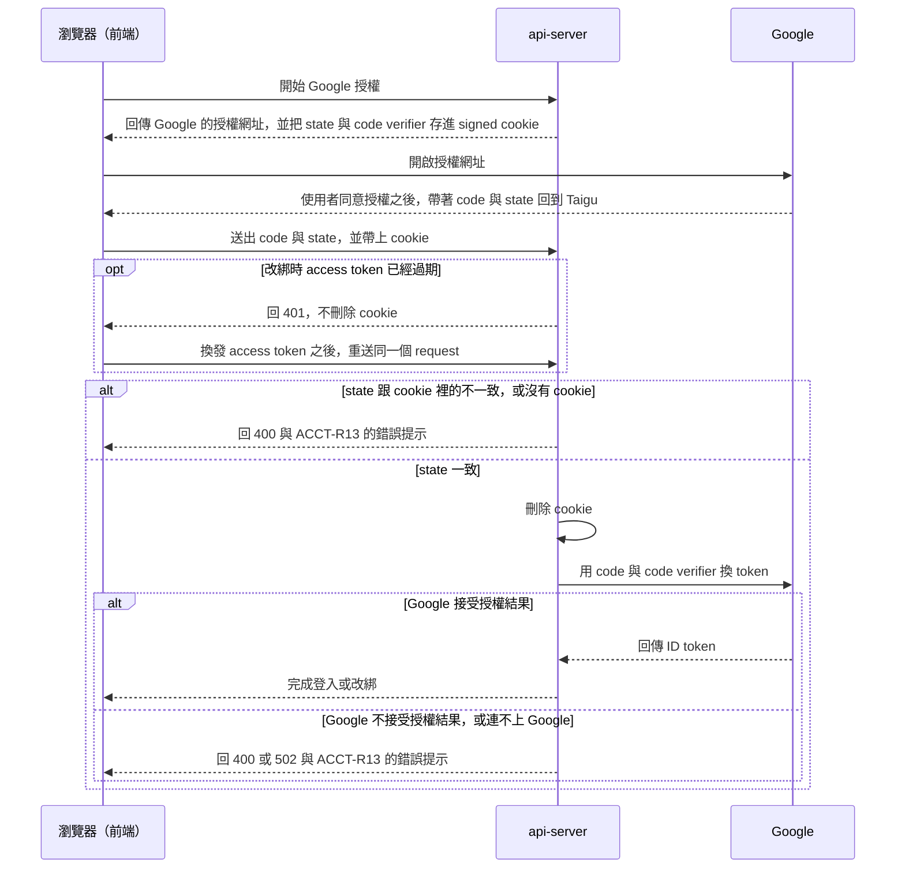

# 0001 驗證 OAuth `state`

## 目標

使用者從 Google 回到登入頁或帳號綁定頁時，Taigu 只在這次授權是從同一個瀏覽器開始的情況下，才登入或更換綁定的 Google 帳號。所以別人把帶著自己 Google 授權結果的 `/login?code=…` 或 `/settings/account-binding?code=…` 連結傳給使用者時，使用者打開連結不會登入別人的帳號，使用者的 Taigu 帳號也不會被改綁到別人的 Google 帳號。另外，使用者在 Google 的畫面取消授權，或授權沒有完成時，畫面會回到原本的頁面，網址不再留著 Google 帶回來的參數；其中授權沒有完成時，畫面也會顯示中文的錯誤提示。最後，access token 過期的使用者送出的 request，不會再因為跟未登入的 request 共用 rate limit 而得到 429。

## 範圍

- 要做：
  - api-server 開始 Google 授權時產生 OAuth 的 `state` 與 PKCE 的 code verifier，存進只有開始授權的瀏覽器才有的 cookie；用 `code` 向 Google 換 token 之前，先確認前端送來的 `state` 與這個 cookie 裡的 `state` 一致，換 token 時再把 code verifier 送給 Google。
  - 前端把 Google 帶回來的 `state` 連同 `code` 送給 api-server。
  - 授權沒通過檢查、Google 不接受授權結果、Taigu 連不上 Google，或 Google 帶回取消以外的錯誤時，登入頁與帳號綁定頁顯示中文的錯誤提示。
  - 使用者在 Google 的畫面取消授權時，前端移除網址上 Google 帶回來的參數。
  - Access token 過期時，改綁與其他需要登入的 request 不會因為跟未登入的 request 共用 rate limit 而被擋下。
- 刻意不做的事：
  - Roadmap 的「登入與帳號修正」階段列出的其他問題，例如兩個分頁同時換發登入憑證時被登出、改綁之後舊的登入憑證沒有作廢，以及 Google 回傳的資料沒有名字或頭像時得到 500，都留在那個階段。
  - 使用者選到已經綁定 Taigu 帳號的 Google 帳號時（ACCT-R11.2），既有的錯誤提示是英文，這個問題留在 roadmap 的「資料驗證與資料處理修正」階段。

## 設計稿

無

## Spec 變更

### account.md

#### ACCT-R1 用 Google 帳號登入

使用者從 Google 回到登入頁時，這次授權要先通過 ACCT-R12 的檢查，Taigu 才會登入；沒有完成登入時改照 ACCT-R13 處理，使用者取消授權時改照 ACCT-R14 處理。規則改成：

使用者在登入頁 `/login` 點 Google 登入按鈕、在 Google 的畫面同意授權，Taigu 完成登入之後把畫面換到儀表板 `/`；使用者是因為未登入而被導到歡迎頁的話，則換回原本開啟的網址（見 ACCT-R3），而已登入的使用者開啟登入頁時，Taigu 直接把畫面換到儀表板。從 Google 回到登入頁時，Taigu 只在這次授權通過 ACCT-R12 的檢查時才登入，沒有完成登入時的處理見 ACCT-R13，使用者取消授權時的處理見 ACCT-R14。

既有的情境不變。

#### ACCT-R5 登入狀態最長維持 30 天

規則的意思不變，只把「短效登入憑證」改寫成 access token，跟 ACCT-R12 的用詞一致。規則改成：

同一個瀏覽器的登入狀態在登入滿 30 天後到期（最後換發的 access token 最多還能再用 15 分鐘），到期時間不隨使用而延後（換綁 Google 帳號之後的登入狀態不在這條規則的範圍內）；到期之前，除了登出（見 ACCT-R7）與舊的登入憑證被重複使用（見 ACCT-R6），關閉瀏覽器或閒置都不必重新登入。登入狀態因為到期、舊的登入憑證被重複使用，或瀏覽器的登入 cookie 被清除而結束後，Taigu 下一次讀寫資料時把畫面換到歡迎頁，使用者重新登入後回到哪一頁見 ACCT-R3。

既有的情境不變。

#### ACCT-R11 更換綁定的 Google 帳號

使用者從 Google 回到帳號綁定頁時，這次授權要先通過 ACCT-R12 的檢查，Taigu 才會改綁；沒有完成改綁時改照 ACCT-R13 處理，使用者取消授權時改照 ACCT-R14 處理。規則改成：

使用者可以在帳號綁定頁 `/settings/account-binding` 把帳號改綁到一個還沒有綁定任何 Taigu 帳號的 Google 帳號，改綁之後要用新的 Google 帳號登入，帳號的 Email、名字與頭像也換成新 Google 帳號的資料，使用者改過的名字與頭像不會保留。從 Google 回到帳號綁定頁時，Taigu 只在這次授權通過 ACCT-R12 的檢查時才改綁，沒有完成改綁時的處理見 ACCT-R13，使用者取消授權時的處理見 ACCT-R14。

既有的情境不變。

#### ACCT-R12 只接受從同一個瀏覽器開始的 Google 授權

新增這條需求，放在 ACCT-R11 之後：

使用者在登入頁點 Google 登入按鈕，或在帳號綁定頁開始更換綁定的帳號時，Taigu 記下這個瀏覽器開始了一次 Google 授權。之後使用者從 Google 回到 Taigu 時，Taigu 只在下列兩種情況處理 Google 帶回的結果：

- 使用者未登入時回到登入頁。
- 使用者已登入時回到帳號綁定頁。

使用者已登入時回到登入頁，Taigu 照 ACCT-R1 換到儀表板；使用者未登入時回到帳號綁定頁，Taigu 照 ACCT-R3 換到歡迎頁，等使用者登入、畫面換回帳號綁定頁之後，Taigu 才處理 Google 帶回的結果。

Google 帶回授權結果（網址上的 `code`）時，這次授權要同時符合下列條件，Taigu 才登入（見 ACCT-R1）或改綁（見 ACCT-R11），不符合時的處理見 ACCT-R13：

- 這次授權是這個瀏覽器最近一次開始的授權，所以從其他瀏覽器開始的授權都不符合。
- 從開始授權到回到 Taigu 不超過 10 分鐘。
- Taigu 還沒處理過這次授權回到 Taigu 的網址。

  只要 Taigu 處理過這次授權回到 Taigu 的其中一個網址，就算那個網址上的 `code` 被改成其他值，這次授權也算處理過。不過 access token 過期（見 ACCT-R5）時，Taigu 換發 access token 之前不會處理這個網址，所以換發之後照常處理。

瀏覽器的 cookie 被清除時，這個瀏覽器之前開始的授權都會作廢，回到 Taigu 時都不符合上面的條件。

Google 帶回的是錯誤而不是授權結果時，使用者在 Google 的畫面取消授權的處理見 ACCT-R14，其他錯誤見 ACCT-R13。

- ACCT-R12.1 開啟別人傳來的登入連結
  - 前提：使用者未登入；另一個人在自己的瀏覽器開始登入，在 Google 的畫面同意授權之後，取得 Google 帶回 Taigu 的網址 `/login?code=…&state=…`，但沒有在自己的瀏覽器完成登入。
  - 動作：使用者在自己的瀏覽器開啟這個網址。
  - 結果：畫面留在登入頁，網址不再帶有 `code` 與 `state`，並顯示錯誤提示「登入沒有完成，請重新登入。」；之後開啟儀表板 `/` 時，畫面換到歡迎頁。
- ACCT-R12.2 開啟別人傳來的改綁連結
  - 前提：使用者已登入；另一個人在自己的瀏覽器開始更換綁定的帳號，選擇一個還沒有綁定任何 Taigu 帳號的 Google 帳號並同意授權之後，取得 Google 帶回 Taigu 的網址 `/settings/account-binding?code=…&state=…`，但沒有在自己的瀏覽器完成改綁。
  - 動作：使用者在自己的瀏覽器開啟這個網址。
  - 結果：帳號綁定頁仍顯示原本的 Email，網址不再帶有 `code` 與 `state`，並顯示錯誤提示「綁定的帳號沒有更換，請重新更換綁定的帳號。」；使用者登出後用原本的 Google 帳號登入，仍會進到這個帳號。
- ACCT-R12.3 開始登入超過 10 分鐘才回到 Taigu
  - 前提：使用者未登入，在登入頁點 Google 登入按鈕。
  - 動作：在 Google 的畫面停留超過 10 分鐘，再選擇帳號並同意授權。
  - 結果：畫面回到登入頁，並顯示錯誤提示「登入沒有完成，請重新登入。」，使用者沒有登入。
- ACCT-R12.4 同一個瀏覽器先後開始兩次登入
  - 前提：使用者未登入，而且不是從需要登入的頁面被導過來；使用者在分頁 A 的登入頁點 Google 登入按鈕，停在 Google 的畫面，接著在同一個瀏覽器的分頁 B 的登入頁也點 Google 登入按鈕。
  - 動作：先在分頁 A 選擇帳號並同意授權，再到分頁 B 選擇帳號並同意授權。
  - 結果：分頁 A 回到登入頁，並顯示錯誤提示「登入沒有完成，請重新登入。」；分頁 B 完成登入，畫面換到儀表板 `/`。
- ACCT-R12.5 未登入時開啟別人傳來的改綁連結
  - 前提：使用者未登入；另一個人在自己的瀏覽器開始更換綁定的帳號，選擇一個還沒有綁定任何 Taigu 帳號的 Google 帳號並同意授權之後，取得 Google 帶回 Taigu 的網址 `/settings/account-binding?code=…&state=…`，但沒有在自己的瀏覽器完成改綁。
  - 動作：使用者在自己的瀏覽器開啟這個網址，畫面換到歡迎頁之後，用自己的 Google 帳號登入。
  - 結果：登入之後畫面換回帳號綁定頁，帳號綁定頁顯示使用者自己的 Google 帳號的 Email，網址不再帶有 `code` 與 `state`，並顯示錯誤提示「綁定的帳號沒有更換，請重新更換綁定的帳號。」。
- ACCT-R12.6 Access Token 過期時更換綁定的帳號
  - 前提：使用者已登入，登入狀態還沒到期，但最後換發的 access token 已經過期；使用者在帳號綁定頁開始更換綁定的帳號；就在使用者回到 Taigu 之前，有一個未登入的 request 送到 Taigu 更換綁定帳號的 API。
  - 動作：在 Google 的畫面選擇一個還沒有綁定任何 Taigu 帳號的 Google 帳號並同意授權。
  - 結果：畫面回到帳號綁定頁並顯示「成功綁定」，綁定的帳號顯示新 Google 帳號的 Email。

#### ACCT-R13 Google 授權沒有完成時顯示錯誤提示

新增這條需求，放在 ACCT-R12 之後：

Taigu 處理 Google 帶回的結果時（見 ACCT-R12），只要發生下列任何一種情況，Taigu 就不登入也不改綁，從網址移除 Google 帶回來的參數，並依頁面顯示錯誤提示：

- 授權結果沒通過 ACCT-R12 的檢查。
- Google 不接受這次的授權結果，例如授權結果被改過或已經過期。
- Taigu 連不上 Google，或無法確認 Google 回傳的資料真的來自 Google。
- Google 帶回的是使用者取消授權以外的錯誤。

錯誤提示依頁面不同：

- 登入頁顯示「登入沒有完成，請重新登入。」，使用者仍是未登入。
- 帳號綁定頁顯示「綁定的帳號沒有更換，請重新更換綁定的帳號。」，使用者仍用原本的 Google 帳號登入。

使用者選到已經綁定 Taigu 帳號的 Google 帳號時，只有上面的情況都沒有發生，Taigu 才照 ACCT-R11 處理。

- ACCT-R13.1 登入時 Google 不接受授權結果
  - 前提：使用者未登入，在登入頁點 Google 登入按鈕，在 Google 的畫面同意授權；Google 帶回 Taigu 的網址裡，`code` 被改成其他值，`state` 沒有改。
  - 動作：開啟這個網址。
  - 結果：畫面留在登入頁，網址不再帶有 `code` 與 `state`，並顯示錯誤提示「登入沒有完成，請重新登入。」，使用者沒有登入。
- ACCT-R13.2 改綁時 Google 不接受授權結果
  - 前提：使用者已登入，在帳號綁定頁開始更換綁定的帳號，在 Google 的畫面選擇一個還沒有綁定任何 Taigu 帳號的 Google 帳號並同意授權；Google 帶回 Taigu 的網址裡，`code` 被改成其他值，`state` 沒有改。
  - 動作：開啟這個網址。
  - 結果：帳號綁定頁仍顯示原本的 Email，網址不再帶有 `code` 與 `state`，並顯示錯誤提示「綁定的帳號沒有更換，請重新更換綁定的帳號。」。
- ACCT-R13.3 登入時 Taigu 連不上 Google
  - 前提：使用者未登入，在登入頁點 Google 登入按鈕，在 Google 的畫面同意授權；Taigu 連不上 Google。
  - 動作：Google 把使用者帶回登入頁。
  - 結果：畫面留在登入頁，網址不再帶有 `code` 與 `state`，並顯示錯誤提示「登入沒有完成，請重新登入。」，使用者沒有登入。
- ACCT-R13.4 Google 帶回取消授權以外的錯誤
  - 前提：使用者未登入。
  - 動作：開啟 Google 帶著 `error=server_error` 回到登入頁的網址 `/login?error=server_error&state=…`。
  - 結果：畫面留在登入頁，網址不再帶有 `error` 與 `state`，並顯示錯誤提示「登入沒有完成，請重新登入。」，使用者沒有登入。
- ACCT-R13.5 沒通過檢查又選到已經綁定的 Google 帳號
  - 前提：使用者已登入，在分頁 A 的帳號綁定頁開始更換綁定的帳號，停在 Google 的畫面，接著在同一個瀏覽器的分頁 B 也開始更換綁定的帳號。
  - 動作：在分頁 A 選擇目前綁定的 Google 帳號並同意授權。
  - 結果：分頁 A 回到帳號綁定頁，仍顯示原本的 Email，並顯示錯誤提示「綁定的帳號沒有更換，請重新更換綁定的帳號。」。

#### ACCT-R14 在 Google 的畫面取消授權

新增這條需求，放在 ACCT-R13 之後：

Taigu 處理 Google 帶回的結果時（見 ACCT-R12），如果使用者在 Google 的畫面取消了授權，Taigu 不登入也不改綁，從網址移除 Google 帶回來的參數，也不顯示錯誤提示；這次授權有沒有符合 ACCT-R12 的條件，結果都一樣。

- ACCT-R14.1 登入時取消授權
  - 前提：使用者未登入，在登入頁點 Google 登入按鈕。
  - 動作：在 Google 的畫面取消授權。
  - 結果：畫面回到登入頁，網址沒有 Google 帶回來的參數，畫面上沒有錯誤提示，使用者沒有登入。
- ACCT-R14.2 改綁時取消授權
  - 前提：使用者已登入，在帳號綁定頁開始更換綁定的帳號。
  - 動作：在 Google 的畫面取消授權。
  - 結果：畫面回到帳號綁定頁，仍顯示原本的 Email，網址沒有 Google 帶回來的參數，畫面上沒有錯誤提示。

## 決策

### 怎麼把 `state` 跟開始授權的瀏覽器綁在一起

- 選項：
  - api-server 把 `state` 與 code verifier 存進 signed、HTTP-only 的 cookie。
  - 存進 Django session。
  - 前端把 `state` 存在 sessionStorage，由前端比對。
- 取捨：
  - Taigu 的登入用的是 JWT cookie，沒有用 Django session，所以把 `state` 與 code verifier 存進 Django session 的話，每次開始授權都要在資料庫寫一筆 session，還要另外清掉過期的 session。
  - 由前端比對的話，api-server 仍然會拿任何送來的 `code` 去換 token，而且 code verifier 會變成 JavaScript 讀得到的值。
- 結論：用 api-server 的 signed cookie。這個 cookie 只屬於 api-server 的網域，path 是 `/api/account`，SameSite 是 `Strict`，10 分鐘後到期。
- 併入：architecture.md#登入

### 要不要同時開啟 PKCE

- 選項：
  - 只檢查 `state`。
  - 同時開啟 PKCE。
- 結論：同時開啟，因為 code verifier 跟 `state` 存在同一個 cookie，所以就算 `code` 外流，別人在其他瀏覽器拿這個 `code` 也換不到 token。
- 併入：無

### 同一個瀏覽器同時開始好幾次授權時怎麼處理

- 選項：
  - Cookie 只存最近一次開始的授權。
  - Cookie 存好幾次授權，讓同一個瀏覽器同時開始的授權都能完成。
- 結論：只存最近一次，因為同一個瀏覽器同時開始兩次授權，是使用者在兩個分頁都點了 Google 登入按鈕，或都開始更換綁定的帳號的時候，這時使用者在最後開始授權的那個分頁就能完成登入或改綁（ACCT-R12.4）。
- 併入：無

### 怎麼讓 Access Token 過期的 Request 不被 Rate Limit 擋下

- 選項：
  - 把需要登入的 endpoint 的 rate limit 移到確認登入狀態之後。
  - Rate limit 遇到未登入的 request 時，改用 IP 當 key。
- 取捨：用 IP 當 key 的話，同一個 IP 後面的使用者（例如同一個公司網路裡的人）仍會共用 rate limit，而且 access token 過期的 request 會先用掉一次額度、得到 401，換發 access token 之後重送時再用一次。
- 結論：移到確認登入狀態之後，這樣未登入的 request 在確認登入狀態時就得到 401，不會用掉 rate limit 的額度。
- 併入：architecture.md#登入

## 做法要點

登入與改綁的 request 照下圖的順序處理。這張圖在實作時寫進 architecture.md 的「登入」，因為圖上畫的是前端、api-server 與 Google 之間的機制，不是使用者看得到的行為：

- 因為 api-server 先確認登入狀態，而且只在 `state` 一致時才刪除 cookie，所以 access token 過期、第一次 request 被 401 擋下時，cookie 還在，前端換發 access token 之後重送的 request 能通過檢查（ACCT-R12.6）；ACCT-R12.4 的分頁 A 沒通過檢查之後，分頁 B 也仍能完成登入。
- 每個需要登入的 endpoint 的 rate limit 都改成在確認登入狀態之後才套用，範圍是 `@rate_limit` 包在 `@require_login` 外面的大約 25 個 endpoint，分布在 account、trade_record、cash_dividend、market、trade_plan、favorite、stock_memo、handling_fee、issue_report 與 billing。這樣改是因為現在 access token 過期的 request 會被當成未登入，跟所有未登入的 request 共用每個 endpoint 的同一個 rate limit，所以剛好有其他未登入的 request 用完額度時，這個 request 會得到 429，前端也不會換發 access token 再重送。例如使用者回到 Taigu 之前的 2 秒內，有其他未登入的 request 送到 `change-binding` 時，ACCT-R12.6 的改綁就會失敗。
- Request 沒有帶 `state` 時，api-server 跟 `state` 不一致時一樣處理，因為別人傳來的連結可以不帶 `state`。
- api-server 在 ACCT-R13 列的情況下回傳 ACCT-R13 的錯誤提示當作 `message`：授權結果沒通過檢查、Google 不接受授權結果，以及無法確認 Google 回傳的資料時回 400，連不上 Google 或 Google 回 5xx 時回 502，跟 billing 處理綠界錯誤的方式一致。前端沿用現在的做法，把 `message` 顯示成錯誤提示。api-server 不能回 401 或 403，因為前端收到這兩個 status code 時會當成登入狀態結束，帳號綁定頁的使用者會因此被登出。
- Google 帶回的錯誤只由前端處理，不送到 api-server：`error=access_denied` 照 ACCT-R14 處理，其他 `error` 照 ACCT-R13 顯示錯誤提示。
- 部署順序：前端要比 api-server 先上線，因為新版的 api-server 要求 request 帶 `state`，舊版的前端不會送；新版的前端多送的 `state`，舊版的 api-server 會忽略。照現在的部署方式，merge 之後先確認 Cloudflare Pages 已經上線新版的前端，再執行 `make deploy`。api-server 重啟之後，下面這些使用者會看到一次 ACCT-R13 的錯誤提示，照錯誤提示重新登入或重新更換綁定的帳號，就能完成登入或改綁：
  - 在 api-server 重啟前開始授權、重啟後才回到 Taigu 的使用者。
  - 瀏覽器還在執行舊版前端的使用者，例如 service worker 還沒把前端換成新版的使用者。
- 實作時要實測下面幾件事，並把結果記進 architecture.md 的「登入」：
  - Google 接受 web application 類型、帶 client secret 的 OAuth client 使用 PKCE。
  - Google 帶使用者回到 Taigu 之後，前端送給 api-server 的 request 會帶上使用者去 Google 之前存下、SameSite 為 `Strict` 的 cookie。改綁的 request 要帶著使用者去 Google 之前就存下的登入 cookie，而 ACCT-R11.1 在桌面瀏覽器上成立，所以預期桌面瀏覽器也會帶上 SameSite 為 `Strict` 的 cookie。
  - 在 iOS 加到主畫面的 Taigu 與 Android 安裝的 Taigu 上，ACCT-R1.1 與 ACCT-R11.1 照樣成立，也就是使用者去 Google 之前存下的 cookie，回到 Taigu 之後仍在。
  - 使用者在 Google 的畫面取消授權時，Google 帶回 Taigu 的網址有哪些參數。依 OAuth 2.0 的規範，預期是 `error=access_denied` 與 `state`，沒有 `code`。
  - Google 除了 `access_denied` 之外，還會帶回哪些 `error`。

## 驗證方式

| 情境 | 驗證方式 |
| --- | --- |
| ACCT-R12.1 開啟別人傳來的登入連結 | unit、手動 |
| ACCT-R12.2 開啟別人傳來的改綁連結 | unit、手動 |
| ACCT-R12.3 開始登入超過 10 分鐘才回到 Taigu | unit、手動 |
| ACCT-R12.4 同一個瀏覽器先後開始兩次登入 | unit、手動 |
| ACCT-R12.5 未登入時開啟別人傳來的改綁連結 | 手動 |
| ACCT-R12.6 Access Token 過期時更換綁定的帳號 | unit、手動 |
| ACCT-R13.1 登入時 Google 不接受授權結果 | unit、手動 |
| ACCT-R13.2 改綁時 Google 不接受授權結果 | unit、手動 |
| ACCT-R13.3 登入時 Taigu 連不上 Google | unit、手動 |
| ACCT-R13.4 Google 帶回取消授權以外的錯誤 | 手動 |
| ACCT-R13.5 沒通過檢查又選到已經綁定的 Google 帳號 | unit、手動 |
| ACCT-R14.1 登入時取消授權 | 手動 |
| ACCT-R14.2 改綁時取消授權 | 手動 |

## 還沒定案的問題

無
