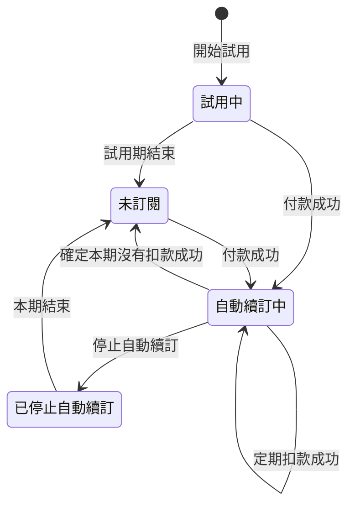

# 0006 訂閱流程修正

## 目標

使用者在訂閱、續訂、停止自動續訂，以及定期扣款沒有成功時，綠界都不會在之後的每一期重複扣款，使用者的方案也不會在已經付款的期間變成 Free；方案頁顯示的內容與提供的操作，跟後端實際的處理以及綠界做得到的事一致。

## 範圍

- 要做：
  - 每一期訂閱（billing.md 稱為「本期」）的結束時間對齊綠界的扣款日，並以台灣時間計算。
  - 本期結束之後、後端確定這一期有沒有扣款成功之前的這段時間（以下稱等待期），方案仍是 Standard。後端在本期結束日的隔天向綠界查詢，這一期沒有扣款成功時終止定期扣款，訂閱變成未訂閱，「扣款失敗」這個訂閱狀態拿掉。
  - 等待期內可以停止自動續訂。
  - 處理訂閱已經是自動續訂中、又有另一筆付款成功的情況，付款成功後又收到同一筆付款失敗的通知的情況，以及停止自動續訂時，綠界回傳 HTTP 錯誤，或是後端送給綠界的 request 逾時、連線失敗的情況。
  - 方案頁的修正：
    - 方案頁顯示等待期的狀態。
    - 確認訂閱的視窗寫出下次續費日。
    - 前端取得方案資料失敗時，方案頁只顯示錯誤訊息與「重新載入」按鈕。
    - 未訂閱的使用者不再看到已經過去的「有效至」日期。
    - 使用者從綠界付款頁按上一頁回到方案頁之後，可以重新選擇付款週期。
  - 停止自動續訂的確認視窗拿掉填寫原因的欄位，以及「你可以在到期前重新啟用自動續訂。」這句話。
  - billing.md 寫明計費功能上線之前註冊的帳號何時開始試用。
  - 後台的訂閱狀態人數拿掉「扣款失敗」。
  - 隱私權政策補上付款資料。
- 刻意不做的事：
  - 定期扣款失敗後的寬限期與補授權重試，留給 roadmap 的「扣款失敗的寬限期與重試」。
  - 刪除帳號時終止定期扣款，以及付款紀錄在帳號刪除後的保存，留給 roadmap 的「帳號刪除」。
  - 自動退款。
  - 已停止自動續訂的使用者在本期結束之前恢復自動續訂。

## 設計稿

無

## Spec 變更

### billing.md

#### 開頭的說明

訂閱狀態拿掉扣款失敗，後端確定自動續訂中的訂閱本期沒有扣款成功時，訂閱直接變成未訂閱；試用期的開始改寫成不限於第一次登入（見 BILL-R2）。以「使用者的訂閱處於下面五種狀態之一」開始的那一段，以及接在後面的狀態圖改成：

使用者的訂閱處於下面四種狀態之一，狀態之間的轉換如下圖：



狀態的清單裡，「試用中」那一項不再限定新使用者，「自動續訂中」那一項改寫成綠界在每期的扣款日扣款，「未訂閱」那一項加上本期沒有扣款成功的情況，並移除「扣款失敗」那一項。其他項目與接在清單後面的設計理由不變。這三項改成：

- 試用中：使用者在試用期內免費使用 Standard 方案的期間（見 BILL-R2）。
- 自動續訂中：使用者付款訂閱了 Standard 方案，綠界會在每期的扣款日自動扣款。
- 未訂閱：試用期結束後沒有訂閱、停止自動續訂後本期已經結束，或後端確定自動續訂中的本期沒有扣款成功（見 BILL-R22、BILL-R23）。

「本期」改成照綠界的扣款日計算，並加上「等待期」的定義。以「『本期』指」開始的那一段改成：

「本期」指訂閱最近一次付款成功或定期扣款成功所付的那一期；本期結束之後、下一次扣款成功之前，本期仍指剛結束的這一期。每一期何時結束見 BILL-R14，定期扣款成功時本期怎麼延後見 BILL-R20。「等待期」指自動續訂中的本期結束之後，到後端確定這一期有沒有扣款成功之前的這段時間（見 BILL-R22）。「每天的到期處理」指後端的 cron job 每天台灣時間凌晨 3:40 執行、更新到期訂閱狀態的處理。「本月」指台灣時間本月 1 日 0 點到現在。下面各需求的情境，前提沒有寫到白名單的，都是指不在白名單上的使用者。

#### BILL-R1 方案的判定

自動續訂中的使用者在等待期內方案仍是 Standard，扣款失敗拿掉。規則改成：

方案是 Standard 的使用者新增資料不受額度限制。方案依以下規則判定：

- 使用者在白名單上時，不論訂閱狀態，方案都是 Standard。
- 使用者不在白名單上時，試用中的使用者在試用期結束之前、自動續訂中的使用者在本期結束之前與等待期內，以及已停止自動續訂的使用者在本期結束之前，方案是 Standard。
- 使用者不在白名單上，也不符合上一項時，方案是 Free。

移除 BILL-R1.2 與 BILL-R1.4。其他情境不變，新增以下情境：

- BILL-R1.6 等待期內
  - 前提：使用者的訂閱是自動續訂中，本期在 1 小時前結束，後端還沒確定這一期有沒有扣款成功。
  - 動作：開啟方案頁。
  - 結果：方案是 Standard，方案頁不顯示「額度使用」區塊。

#### BILL-R2 試用期

計費功能上線之前就註冊、後端還沒記下訂閱狀態的帳號，要等計費功能上線之後第一次登入時才開始試用期。規則改成：

每個 Taigu 帳號第一次登入時開始 31 天的試用期，免費使用 Standard 方案。不過計費功能上線之前就註冊的帳號，在計費功能上線之後第一次登入之前，後端沒有記下訂閱狀態，所以要到那次登入時才開始試用期。試用期結束時變成未訂閱，同一個 Taigu 帳號只有一次試用期。更換綁定的 Google 帳號不改變這個 Taigu 帳號的試用期；原本的 Google 帳號之後依 ACCT-R2 建立另一個 Taigu 帳號時，新帳號仍有自己的試用期。

既有的情境與設計理由不變，新增以下情境：

- BILL-R2.6 計費功能上線之前註冊的帳號
  - 前提：使用者在 2021/03/01 註冊，計費功能上線之後沒有登入過。
  - 動作：使用者在 2026/10/21 登入。
  - 結果：訂閱是試用中，試用期到 2026/11/21。

#### BILL-R10 方案頁的「目前方案」區塊

扣款失敗拿掉，加上等待期的顯示；區塊不再對未訂閱的使用者顯示以前訂閱時的日期，訂閱因為本期沒有扣款成功而結束時，區塊會說明原因。規則改成：

方案頁的「目前方案」區塊依以下規則顯示內容：

- 本期結束之前，自動續訂中的使用者，以及不在白名單上、已停止自動續訂的使用者，區塊顯示 Standard、付款週期、每期金額與本期的結束日。
- 不在白名單上、自動續訂中的使用者在等待期內，區塊顯示 Standard、付款週期、每期金額、標成扣款日的本期結束日，以及「正在確認本期的扣款結果，確認前仍可使用 Standard 方案。」。
- 不在白名單上的試用中使用者在試用期結束之前，區塊顯示 Standard、標籤「試用中」與試用期的結束日。
- 不在白名單上、未訂閱的使用者，區塊顯示 Free，不顯示任何日期。上一份訂閱是照 BILL-R22 結束、之後還沒再訂閱的話，區塊另外顯示「上一期的扣款沒有成功，自動續訂已經結束。重新訂閱即可恢復 Standard 方案。」。
- 白名單上的使用者不是自動續訂中，或本期已經結束時，區塊只顯示 Standard、標籤「使用中」、行情更新的頻率，以及額度不限量的說明。

對白名單上的使用者不顯示的內容，從扣款失敗時的說明，改成等待期的扣款日與說明，以及訂閱照 BILL-R22 結束之後的說明。設計理由改成：

> 設計理由：白名單上的使用者看到的方案頁跟付費訂閱的使用者一樣，畫面上不提白名單；不過白名單上的使用者不論訂閱狀態都能使用 Standard 方案，「有效至」「試用至」「扣款日」這類日期，以及「正在確認本期的扣款結果，確認前仍可使用 Standard 方案。」與「上一期的扣款沒有成功，自動續訂已經結束。重新訂閱即可恢復 Standard 方案。」這兩句說明對他們不成立，所以不顯示這些內容。白名單上的使用者在試用中或未訂閱時，方案頁也沒有替他們編一組付款週期與續費日期，因為使用者會以為那一天會被扣款，點「停止自動續訂」時也沒有定期扣款可以終止。完整討論見 [0002](../plans/archive/0002-standard-whitelist.md)。

移除 BILL-R10.5。其他情境不變，新增以下情境：

- BILL-R10.8 等待期內
  - 前提：使用者的訂閱是月繳的自動續訂中，本期在 2026/10/21 10:00 結束，現在是 2026/10/21 15:00，後端還沒確定這一期有沒有扣款成功。
  - 動作：開啟方案頁。
  - 結果：「目前方案」區塊顯示「Standard」、標籤「月繳」、「NT$65/月」、「扣款日 2026/10/21」與「正在確認本期的扣款結果，確認前仍可使用 Standard 方案。」。
- BILL-R10.9 以前訂閱過的使用者未訂閱
  - 前提：使用者未訂閱，以前訂閱過月繳的 Standard 方案，上一期在 2026/09/21 結束。
  - 動作：開啟方案頁。
  - 結果：「目前方案」區塊顯示「Free」，沒有「有效至 2026/09/21」。
- BILL-R10.10 白名單上的使用者在等待期內
  - 前提：使用者在白名單上，訂閱是月繳的自動續訂中，本期在 1 小時前結束，後端還沒確定這一期有沒有扣款成功。
  - 動作：開啟方案頁。
  - 結果：「目前方案」區塊裡只有「Standard」、標籤「使用中」、「行情更新 約每 30 秒」與「額度 交易與股利、買賣計畫、持股、關注皆不限量」，沒有「扣款日」，也沒有「正在確認本期的扣款結果，確認前仍可使用 Standard 方案。」。
- BILL-R10.11 本期沒有扣款成功而結束訂閱之後
  - 前提：使用者的訂閱照 BILL-R22 在 2026/10/21 03:40 變成未訂閱，之後沒有再訂閱。
  - 動作：開啟方案頁。
  - 結果：「目前方案」區塊顯示「Free」與「上一期的扣款沒有成功，自動續訂已經結束。重新訂閱即可恢復 Standard 方案。」。
- BILL-R10.12 等待期內停止自動續訂而變成未訂閱之後
  - 前提：使用者在等待期內停止自動續訂，這一期沒有扣款成功，訂閱照 BILL-R23 變成未訂閱。
  - 動作：重新開啟方案頁。
  - 結果：「目前方案」區塊顯示「Free」，沒有「上一期的扣款沒有成功，自動續訂已經結束。重新訂閱即可恢復 Standard 方案。」。
- BILL-R10.13 本期沒有扣款成功而結束之後重新訂閱，停止自動續訂後到期
  - 前提：使用者的訂閱照 BILL-R22 在 2026/10/21 03:40 變成未訂閱；使用者在 2026/10/25 重新訂閱月繳，之後停止自動續訂，本期在 2026/11/25 結束，現在是 2026/11/26。
  - 動作：開啟方案頁。
  - 結果：「目前方案」區塊顯示「Free」，沒有「上一期的扣款沒有成功，自動續訂已經結束。重新訂閱即可恢復 Standard 方案。」。

#### BILL-R12 方案頁的「方案選擇」區塊

扣款失敗拿掉，自動續訂中的使用者在等待期內看不到「方案選擇」。規則改成：

使用者看不看得到方案頁的「方案選擇」區塊，依以下規則判定：

- 使用者不在白名單上，而且在試用中或未訂閱時，看得到這個區塊，可以選擇月繳 NT$65 或年繳 NT$700 訂閱 Standard 方案。
- 自動續訂中的使用者在本期結束之前與等待期內、已停止自動續訂的使用者在本期結束之前，以及白名單上的使用者，看不到這個區塊。

移除 BILL-R12.7。其他情境不變，新增以下情境：

- BILL-R12.9 等待期內
  - 前提：使用者的訂閱是自動續訂中，本期在 1 小時前結束，後端還沒確定這一期有沒有扣款成功。
  - 動作：開啟方案頁。
  - 結果：方案頁不顯示「方案選擇」區塊。

#### BILL-R13 確認訂閱並前往綠界付款

確認訂閱的視窗加上下次續費日。規則改成：

使用者在「方案選擇」點選付款週期後，畫面先顯示「確認訂閱 Standard」視窗，寫出付款週期、每期金額與下次續費日，使用者點「前往綠界付款」之後才前往綠界的信用卡付款頁。下次續費日是前端把開啟視窗的時間當成付款成功的時間，照 BILL-R14 算出的第 1 期結束日。

BILL-R13.1 改成：

- BILL-R13.1 點選月繳
  - 前提：今天是 2026/10/21，方案頁顯示「方案選擇」區塊。
  - 動作：點「月繳」。
  - 結果：畫面顯示「確認訂閱 Standard」視窗，寫出「付款週期 月繳」、「每期金額 NT$65」與「下次續費 2026/11/21」，視窗裡有關閉視窗的按鈕與「前往綠界付款」按鈕。

其他情境不變，新增以下情境：

- BILL-R13.3 在月底點選月繳
  - 前提：今天是 2027/01/31，方案頁顯示「方案選擇」區塊。
  - 動作：點「月繳」。
  - 結果：「確認訂閱 Standard」視窗寫出「下次續費 2027/02/28」。
- BILL-R13.4 點選年繳
  - 前提：今天是 2026/10/21，方案頁顯示「方案選擇」區塊。
  - 動作：點「年繳」。
  - 結果：「確認訂閱 Standard」視窗寫出「付款週期 年繳」、「每期金額 NT$700」與「下次續費 2027/10/21」。

新增設計理由：

> 設計理由：試用中的使用者開啟視窗時，視窗不另外寫出付款後試用期剩下的天數不會保留（見 BILL-R14），因為使用者從視窗寫出的下次續費日，已經看得出本期從付款當天開始算。完整討論見 [0006](../plans/archive/0006-billing-fixes.md)。

#### BILL-R14 付款成功

每一期的結束時間改成從付款成功的時間依台灣時間推算，凌晨收到通知的情況也包括在內；同一筆付款再收到成功通知時不改變訂閱，訂閱已經是自動續訂中時另一筆付款改照 BILL-R27 處理。規則改成：

綠界通知後端付款成功時，訂閱變成自動續訂中，試用期剩下的天數不會保留。這份訂閱第 n 期的結束時間，是後端收到這則通知的時間（台灣時間）加 n 個月（月繳）或 n 年（年繳）；那個月沒有同一天時，改在那個月的最後一天，時刻不變。後端已經記下付款成功的付款，再收到同一筆付款成功的通知時，訂閱與本期都不變；訂閱已經是自動續訂中時，另一筆付款成功的處理方式見 BILL-R27。

既有的情境不變，新增以下情境與設計理由：

- BILL-R14.4 台灣時間凌晨付款
  - 前提：使用者選擇月繳並前往綠界付款。
  - 動作：綠界在台灣時間 2026/10/31 05:00 通知後端這筆付款成功。
  - 結果：本期在 2026/11/30 05:00 結束。
- BILL-R14.5 在 2 月 29 日付款年繳
  - 前提：使用者選擇年繳並前往綠界付款。
  - 動作：綠界在 2028/02/29 10:00 通知後端這筆付款成功。
  - 結果：本期在 2029/02/28 10:00 結束。
- BILL-R14.6 同一筆付款再收到付款成功的通知
  - 前提：使用者在 2026/10/21 10:00 付款成功訂閱月繳，本期到 2026/11/21 10:00。
  - 動作：綠界在 2026/10/21 10:10 又送來同一筆付款成功的通知。
  - 結果：訂閱仍是自動續訂中，本期仍到 2026/11/21 10:00，後端沒有請綠界終止任何定期扣款。

> 設計理由：每一期的結束時間都從第一次付款成功的時間推算，不從每次收到定期扣款成功通知的時間重新起算，因為綠界每一期的扣款日固定在第一次扣款的那一天，那個月沒有那一天時改在月底，例如第一次扣款在 1/31 的話，之後的扣款日是 2/29、3/31；從收到通知的時間重新起算的話，29 日到 31 日付款的使用者，本期的結束日會漸漸早於綠界的扣款日。完整討論見 [0006](../plans/archive/0006-billing-fixes.md)。

#### BILL-R15 付款失敗

後端已經記下付款成功的付款，之後再收到這筆付款失敗的通知時，仍算付款成功。規則改成：

綠界通知後端付款失敗時，訂閱狀態不變；這筆付款已經付款成功的話，仍算付款成功。

既有的情境不變，新增以下情境：

- BILL-R15.2 付款成功之後收到同一筆付款失敗的通知
  - 前提：使用者的月繳付款已經付款成功，訂閱是自動續訂中。
  - 動作：後端收到這筆付款失敗的通知。
  - 結果：這筆付款仍是付款成功，訂閱仍是自動續訂中。

#### BILL-R17 付款完成前重新付款

從綠界的付款頁按瀏覽器的上一頁回到方案頁時，也可以再選擇付款週期。規則改成：

付款完成之前，使用者可以再從方案頁前往綠界付款，後端不會因為前一次的付款還沒完成而拒絕這次付款。使用者從綠界的付款頁按瀏覽器的上一頁回到方案頁時，也可以再選擇付款週期。

既有的情境不變，新增以下情境：

- BILL-R17.2 從綠界付款頁按上一頁
  - 前提：使用者在「確認訂閱 Standard」視窗點「前往綠界付款」，瀏覽器換到綠界的信用卡付款頁。
  - 動作：按瀏覽器的上一頁。
  - 結果：畫面顯示方案頁，「月繳」與「年繳」可以點選，畫面上沒有開著的「確認訂閱 Standard」視窗；點「年繳」時，畫面顯示「確認訂閱 Standard」視窗。

#### BILL-R18 不接受訂閱 Standard 方案的情況

自動續訂中的使用者在等待期內也不能再訂閱。規則改成：

後端在下面這些情況不接受訂閱 Standard 方案：

- 自動續訂中的使用者在本期結束之前與等待期內，以及已停止自動續訂的使用者在本期結束之前。
- 白名單上的使用者。

既有的情境與設計理由不變，新增以下情境：

- BILL-R18.4 等待期內再訂閱
  - 前提：使用者的訂閱是自動續訂中，本期在 1 小時前結束，後端還沒確定這一期有沒有扣款成功。
  - 動作：使用者要求訂閱月繳的 Standard 方案。
  - 結果：後端拒絕這次訂閱，不建立付款。

#### BILL-R20 定期扣款成功

定期扣款成功時，本期改成延後一期，結束時間跟收到通知的時間無關，同一次扣款只延後一次；扣款失敗這個狀態已經拿掉，規則只處理自動續訂中的訂閱。規則改成：

後端收到綠界對自動續訂中的訂閱送來的定期扣款成功通知時，本期延後一期，結束時間是照 BILL-R14 算出的下一期結束時間；收到通知時已經在等待期內也一樣。後端再收到已經記下的扣款的通知時，本期不再延後。

BILL-R20.1 改成：

- BILL-R20.1 自動續訂中的定期扣款成功
  - 前提：使用者的訂閱是月繳的自動續訂中，本期在 2026/10/21 10:00 結束。
  - 動作：綠界在 2026/10/21 01:00 通知後端定期扣款成功。
  - 結果：訂閱仍是自動續訂中，本期到 2026/11/21 10:00，方案頁顯示「下次續費 2026/11/21」。

移除 BILL-R20.2，新增以下情境：

- BILL-R20.3 月底付款之後的第 2 期
  - 前提：使用者在 2024/01/31 10:00 付款成功訂閱月繳，本期在 2024/02/29 10:00 結束。
  - 動作：綠界在 2024/02/29 01:00 通知後端定期扣款成功。
  - 結果：本期在 2024/03/31 10:00 結束。
- BILL-R20.4 等待期內收到定期扣款成功的通知
  - 前提：使用者的訂閱是月繳的自動續訂中，本期在 2026/10/21 10:00 結束，現在是 2026/10/21 20:00，後端還沒確定這一期有沒有扣款成功。
  - 動作：綠界通知後端定期扣款成功。
  - 結果：本期到 2026/11/21 10:00，方案頁顯示「下次續費 2026/11/21」。
- BILL-R20.5 後端從查詢結果記下扣款之後才收到通知
  - 前提：使用者的訂閱是月繳的自動續訂中，綠界在 2026/10/20 01:00 扣款成功，後端沒有收到通知，每天的到期處理在 2026/10/21 03:40 執行時照 BILL-R22 查詢，記下這次扣款，本期到 2026/11/20 10:00。
  - 動作：綠界之後送來同一次扣款成功的通知。
  - 結果：本期仍到 2026/11/20 10:00。

#### BILL-R21 定期扣款失敗

定期扣款失敗的通知不再改變訂閱狀態。規則改成：

後端收到綠界定期扣款失敗的通知時，只記下這次失敗，訂閱狀態不變，這一期有沒有扣款成功照 BILL-R22 判定。

BILL-R21.1 改成：

- BILL-R21.1 定期扣款失敗
  - 前提：使用者的訂閱是月繳的自動續訂中，本期在 2026/10/21 10:00 結束。
  - 動作：綠界在 2026/10/21 01:00 通知後端定期扣款失敗。
  - 結果：訂閱仍是自動續訂中，方案是 Standard。

#### BILL-R22 本期結束後確認扣款結果

本期沒有扣款成功時，訂閱不再變成扣款失敗，而是變成未訂閱，後端改在本期結束日的隔天向綠界查詢之後才判定，綠界已經自己終止的定期扣款也算終止成功。需求名稱從「本期結束後沒收到定期扣款結果」改成「本期結束後確認扣款結果」，規則改成：

自動續訂中的訂閱在本期結束之後進入等待期。每天的到期處理會處理本期結束日（台灣日期）在今天之前、還在等待期內的訂閱，先向綠界查詢訂閱自己的定期扣款（見 BILL-R27）已經成功扣款幾次，再依查詢的結果處理：

- 有後端還沒記下的成功扣款時，後端照 BILL-R20 處理，就像在查詢的時候收到了定期扣款成功的通知。
- 沒有時，後端請綠界終止訂閱自己的定期扣款，訂閱變成未訂閱。
- 後端向綠界查詢或請綠界終止定期扣款時，綠界回傳失敗或 HTTP 錯誤，或是後端送給綠界的 request 逾時、連線失敗的話，訂閱留在等待期，由下一次每天的到期處理再處理。

綠界可能已經自己終止了定期扣款，例如卡片到期或連續扣款失敗時；後端請綠界終止定期扣款時，綠界回傳這份定期扣款已經終止的話，後端算成終止成功。

設計理由原本寫的是本期結束後先等 1 天、留時間給綠界送來扣款結果，改成說明為什麼本期沒有扣款成功時結束訂閱，而不保留扣款失敗的狀態。設計理由改成：

> 設計理由：本期沒有扣款成功時，後端終止定期扣款、結束訂閱，不保留扣款失敗的狀態等綠界之後再扣款，因為綠界扣款失敗之後不會在同一期重試，下一次扣款要到下一期的扣款日，所以保留的話，使用者的方案會先變成 Free 一個月，之後又被扣款。而且綠界不能替既有的定期扣款換卡，換卡的使用者本來就要重新付款。完整討論見 [0006](../plans/archive/0006-billing-fixes.md)。

BILL-R22.1 與 BILL-R22.2 改成：

- BILL-R22.1 本期結束日當天
  - 前提：使用者的訂閱是自動續訂中，本期在 2026/10/21 00:30 結束，後端還沒收到這一期的扣款結果。
  - 動作：每天的到期處理在 2026/10/21 03:40 執行。
  - 結果：訂閱仍是自動續訂中，在等待期內。
- BILL-R22.2 本期結束日的隔天，這一期沒有扣款成功
  - 前提：使用者的訂閱是自動續訂中，本期在 2026/10/20 23:59 結束，綠界這一期沒有扣款成功。
  - 動作：每天的到期處理在 2026/10/21 03:40 執行。
  - 結果：後端請綠界終止這份定期扣款，訂閱變成未訂閱，方案是 Free，方案頁有「方案選擇」區塊。

新增以下情境：

- BILL-R22.3 後端沒收到扣款成功的通知
  - 前提：使用者的訂閱是月繳的自動續訂中，本期在 2026/10/20 10:00 結束，綠界在 2026/10/20 01:00 扣款成功，但後端沒有收到通知。
  - 動作：每天的到期處理在 2026/10/21 03:40 執行。
  - 結果：訂閱仍是自動續訂中，本期到 2026/11/20 10:00。
- BILL-R22.4 查詢時綠界連線逾時
  - 前提：使用者的訂閱是自動續訂中，本期在 2026/10/20 10:00 結束，後端還沒收到這一期的扣款結果。
  - 動作：每天的到期處理在 2026/10/21 03:40 執行，向綠界查詢時連線逾時。
  - 結果：訂閱仍是自動續訂中，在等待期內，方案是 Standard；每天的到期處理在 2026/10/22 03:40 執行時再向綠界查詢。
- BILL-R22.5 終止定期扣款時綠界回傳失敗
  - 前提：使用者的訂閱是自動續訂中，本期在 2026/10/20 10:00 結束，綠界這一期沒有扣款成功。
  - 動作：每天的到期處理在 2026/10/21 03:40 執行，請綠界終止定期扣款時，綠界回傳失敗。
  - 結果：訂閱仍是自動續訂中，在等待期內，方案是 Standard。
- BILL-R22.6 白名單上的使用者這一期沒有扣款成功
  - 前提：使用者在白名單上，訂閱是自動續訂中，本期在 2026/10/20 10:00 結束，綠界這一期沒有扣款成功。
  - 動作：每天的到期處理在 2026/10/21 03:40 執行。
  - 結果：後端請綠界終止這份定期扣款，訂閱變成未訂閱，方案仍是 Standard，「目前方案」區塊沒有「上一期的扣款沒有成功，自動續訂已經結束。重新訂閱即可恢復 Standard 方案。」。
- BILL-R22.7 綠界已經自己終止了這份定期扣款
  - 前提：使用者的訂閱是自動續訂中，本期在 2026/10/20 10:00 結束，綠界這一期沒有扣款成功，而且已經因為卡片到期自己終止了這份定期扣款。
  - 動作：每天的到期處理在 2026/10/21 03:40 執行。
  - 結果：訂閱變成未訂閱。

#### BILL-R23 停止自動續訂

等待期內也可以停止自動續訂，綠界回傳 HTTP 錯誤，或是後端送給綠界的 request 逾時、連線失敗時，跟綠界回傳失敗一樣處理，綠界已經自己終止的定期扣款算終止成功，並寫出已停止自動續訂的使用者再要求停止時的結果、等待期內「訂閱管理」區塊的說明、確認視窗的內容與停止之後頁面頂端的提示。規則改成：

使用者要求停止自動續訂時，依以下規則處理：

- 自動續訂中的使用者在本期結束之前，可以在方案頁的「訂閱管理」區塊停止自動續訂，後端請綠界終止訂閱自己的定期扣款（見 BILL-R27），成功之後訂閱變成已停止自動續訂。
- 自動續訂中的使用者在等待期內也可以停止自動續訂。後端先照 BILL-R22 向綠界查詢這一期有沒有扣款成功，再請綠界終止訂閱自己的定期扣款，然後依查詢的結果處理：
  - 有後端還沒記下的成功扣款時，後端照 BILL-R20 把本期延後一期，訂閱變成已停止自動續訂。
  - 沒有時，訂閱變成未訂閱。
- 試用中與未訂閱的使用者不能停止自動續訂。
- 已停止自動續訂的使用者要求停止自動續訂時，後端不請綠界終止任何定期扣款，訂閱不變，並照停止成功回應。
- 後端向綠界查詢或請綠界終止定期扣款時，綠界回傳失敗或 HTTP 錯誤，或是後端送給綠界的 request 逾時、連線失敗的話，訂閱不變，確認視窗不關閉，並顯示「綠界暫時無法處理，請稍後再試。」。不過綠界回傳這份定期扣款已經終止時，後端照 BILL-R22 算成終止成功。

不在白名單上的使用者停止之後，頁面頂端依結果顯示提示：

- 訂閱變成已停止自動續訂：「已停止自動續訂，Standard 權益會保留到 <本期的結束日>。」
- 訂閱變成未訂閱：「已停止自動續訂，目前方案是 Free。」

不在白名單上的使用者開啟確認視窗時，視窗的內容依以下規則顯示：

- 本期結束之前，視窗寫出「Standard 權益會保留至 <本期的結束日>。到期後會切換為 Free。」。
- 等待期內，視窗的說明是「停止後不會再自動扣款。如果本期已經扣款成功，Standard 權益會保留到 <下一期的結束日>；如果沒有，會立刻切換為 Free 方案。」，不寫「Standard 權益會保留至 <本期的結束日>。到期後會切換為 Free。」。
- 兩種情況的視窗都有「到期後會發生什麼？」，列出「既有交易紀錄、股利、持股與關注不會被刪除。」、「超過 Free 額度的資料仍會保留，但到期後可能無法新增超額項目。」與「行情更新會從約每 30 秒改為約每 10 分鐘。」。

「訂閱管理」區塊依以下規則顯示內容：

- 自動續訂中的使用者在本期結束之前與等待期內，區塊裡有「停止自動續訂」按鈕。等待期內，區塊的說明是「本期的扣款結果還在確認中。停止後不會再自動扣款。」。
- 不在白名單上、已停止自動續訂的使用者在本期結束之前，區塊裡寫「Standard 權益會保留到本期結束。到期後會切換為 Free，不會再自動扣款。」。
- 其他使用者（包括已停止自動續訂的白名單上的人）看不到這個區塊。

白名單上的使用者停止自動續訂時，確認視窗的說明只有「停止後不會再自動扣款。」，停止之後頁面頂端顯示「已停止自動續訂，之後不會再扣款。」。

設計理由不變。BILL-R23.1 與 BILL-R23.3 改成：

- BILL-R23.1 開啟停止自動續訂的確認視窗
  - 前提：使用者的訂閱是自動續訂中，本期到 2026/11/21。
  - 動作：在「訂閱管理」區塊點「停止自動續訂」。
  - 結果：畫面顯示確認視窗，標題是「停止 Standard 自動續訂？」，寫出「Standard 權益會保留至 2026/11/21。到期後會切換為 Free。」，「到期後會發生什麼？」裡沒有「你可以在到期前重新啟用自動續訂。」，視窗裡沒有「可以告訴我們原因嗎？」，按鈕是「保留自動續訂」與「停止自動續訂」。
- BILL-R23.3 綠界沒有終止定期扣款
  - 前提：畫面顯示停止自動續訂的確認視窗，綠界無法終止這份訂閱的定期扣款。
  - 動作：點確認視窗裡的「停止自動續訂」。
  - 結果：確認視窗不關閉，顯示「綠界暫時無法處理，請稍後再試。」，訂閱仍是自動續訂中。

其他情境不變，新增以下情境：

- BILL-R23.9 等待期內開啟停止自動續訂的確認視窗
  - 前提：使用者的訂閱是月繳的自動續訂中，本期在 2026/10/21 10:00 結束，現在是 2026/10/21 15:00，後端還沒確定這一期有沒有扣款成功。
  - 動作：在「訂閱管理」區塊點「停止自動續訂」。
  - 結果：確認視窗的說明是「停止後不會再自動扣款。如果本期已經扣款成功，Standard 權益會保留到 2026/11/21；如果沒有，會立刻切換為 Free 方案。」，沒有「Standard 權益會保留至 2026/10/21。到期後會切換為 Free。」，有「到期後會發生什麼？」。
- BILL-R23.10 等待期內停止自動續訂，這一期已經扣款成功
  - 前提：使用者的訂閱是月繳的自動續訂中，本期在 2026/10/21 10:00 結束，現在是 2026/10/21 15:00；綠界在 2026/10/21 01:00 扣款成功，但後端沒有收到通知，還沒確定這一期有沒有扣款成功；畫面顯示停止自動續訂的確認視窗。
  - 動作：點確認視窗裡的「停止自動續訂」。
  - 結果：後端請綠界終止這份定期扣款，訂閱變成已停止自動續訂，本期到 2026/11/21 10:00，頁面頂端顯示「已停止自動續訂，Standard 權益會保留到 2026/11/21。」。
- BILL-R23.11 等待期內停止自動續訂，這一期沒有扣款成功
  - 前提：使用者的訂閱是自動續訂中，本期在 2026/10/21 10:00 結束，現在是 2026/10/21 15:00，綠界這一期沒有扣款成功，後端還沒確定這一期有沒有扣款成功；畫面顯示停止自動續訂的確認視窗。
  - 動作：點確認視窗裡的「停止自動續訂」。
  - 結果：後端請綠界終止這份定期扣款，訂閱變成未訂閱，頁面頂端顯示「已停止自動續訂，目前方案是 Free。」，方案頁有「方案選擇」區塊。
- BILL-R23.12 白名單上的使用者在等待期內
  - 前提：使用者在白名單上，訂閱是月繳的自動續訂中，本期在 1 小時前結束，後端還沒確定這一期有沒有扣款成功。
  - 動作：開啟方案頁。
  - 結果：「訂閱管理」區塊寫「本期的扣款結果還在確認中。停止後不會再自動扣款。」，並有「停止自動續訂」按鈕。
- BILL-R23.13 請綠界終止定期扣款時連線逾時
  - 前提：使用者的訂閱是自動續訂中，本期還剩 20 天，畫面顯示停止自動續訂的確認視窗，後端請綠界終止定期扣款時連線逾時。
  - 動作：點確認視窗裡的「停止自動續訂」。
  - 結果：確認視窗不關閉，顯示「綠界暫時無法處理，請稍後再試。」，訂閱仍是自動續訂中。
- BILL-R23.14 綠界已經自己終止了這份定期扣款
  - 前提：使用者的訂閱是自動續訂中，本期到 2026/11/21，綠界已經因為卡片到期自己終止了這份定期扣款；畫面顯示停止自動續訂的確認視窗。
  - 動作：點確認視窗裡的「停止自動續訂」。
  - 結果：確認視窗關閉，訂閱變成已停止自動續訂，頁面頂端顯示「已停止自動續訂，Standard 權益會保留到 2026/11/21。」。
- BILL-R23.15 白名單上的使用者在等待期內停止自動續訂，這一期沒有扣款成功
  - 前提：使用者在白名單上，訂閱是自動續訂中，本期在 2026/10/21 10:00 結束，現在是 2026/10/21 15:00，綠界這一期沒有扣款成功，後端還沒確定這一期有沒有扣款成功；畫面顯示停止自動續訂的確認視窗。
  - 動作：點確認視窗裡的「停止自動續訂」。
  - 結果：後端請綠界終止這份定期扣款，訂閱變成未訂閱，頁面頂端顯示「已停止自動續訂，之後不會再扣款。」，方案頁沒有「訂閱管理」區塊，也沒有「方案選擇」區塊。
- BILL-R23.16 等待期內的「訂閱管理」區塊
  - 前提：使用者的訂閱是月繳的自動續訂中，本期在 1 小時前結束，後端還沒確定這一期有沒有扣款成功。
  - 動作：開啟方案頁。
  - 結果：「訂閱管理」區塊寫「本期的扣款結果還在確認中。停止後不會再自動扣款。」，並有「停止自動續訂」按鈕。
- BILL-R23.17 白名單上的使用者在等待期內開啟停止自動續訂的確認視窗
  - 前提：使用者在白名單上，訂閱是月繳的自動續訂中，本期在 2026/10/21 10:00 結束，現在是 2026/10/21 15:00，後端還沒確定這一期有沒有扣款成功。
  - 動作：在「訂閱管理」區塊點「停止自動續訂」。
  - 結果：確認視窗的說明只有「停止後不會再自動扣款。」，沒有「如果本期已經扣款成功，Standard 權益會保留到 2026/11/21；如果沒有，會立刻切換為 Free 方案。」，也沒有「到期後會發生什麼？」。
- BILL-R23.18 已停止自動續訂後再要求停止
  - 前提：使用者已停止自動續訂，本期到 2026/11/21。
  - 動作：使用者要求停止自動續訂。
  - 結果：後端沒有請綠界終止任何定期扣款，訂閱仍是已停止自動續訂，本期仍到 2026/11/21。

#### BILL-R24 停止自動續訂後到期

規則不變。BILL-R24.1 改成：

- BILL-R24.1 本期剛結束
  - 前提：使用者已停止自動續訂，本期在 1 分鐘前結束，每天的到期處理還沒執行。
  - 動作：開啟方案頁。
  - 結果：方案是 Free，「目前方案」區塊顯示「Free」，沒有「有效至」。

新增設計理由：

> 設計理由：已停止自動續訂的使用者在本期結束之前不能恢復自動續訂，要等本期結束後重新訂閱（見 BILL-R12），因為綠界終止的定期扣款不能重新啟用，只能建立新的定期扣款，而新的定期扣款在付款當下就扣第一期。改成等到扣款日之前才請綠界終止的話，使用者在那之前可以恢復自動續訂，但延後的終止失敗時，綠界會向已經停止自動續訂的使用者扣款。完整討論見 [0006](../plans/archive/0006-billing-fixes.md)。

#### BILL-R26 加入或移出白名單不改變訂閱

規則與其他情境不變。BILL-R26.2 改成：

- BILL-R26.2 白名單上的使用者定期扣款成功
  - 前提：使用者在白名單上，訂閱是月繳的自動續訂中，本期在 2026/10/21 10:00 結束。
  - 動作：綠界在 2026/10/21 11:00 通知後端定期扣款成功。
  - 結果：訂閱仍是自動續訂中，本期到 2026/11/21 10:00。

設計理由的用詞改成與其他需求一致，把「取消」改成「終止」，意思不變。設計理由改成：

> 設計理由：加入白名單時，後端不替使用者終止綠界的定期扣款，自動續訂中的使用者要自己在方案頁停止自動續訂（見 BILL-R23），因為白名單上的使用者不多，其中付費訂閱的使用者更少，開發者可以直接請他們停止自動續訂；而且加入白名單不會因為綠界的錯誤而失敗。完整討論見 [0002](../plans/archive/0002-standard-whitelist.md)。

#### BILL-R27 已有定期扣款時又付款成功

新增這條需求：

使用者的訂閱是自動續訂中時，綠界又通知後端另一筆付款成功的話，後端把這筆付款算成付款成功，但不改變訂閱，並請綠界終止這筆付款的定期扣款。BILL-R22 與 BILL-R23 查詢與終止的「訂閱自己的定期扣款」，是讓訂閱變成自動續訂中的那筆付款的定期扣款。後端請綠界終止這筆付款的定期扣款時，綠界回傳失敗或 HTTP 錯誤，或是後端送給綠界的 request 逾時、連線失敗的話，每天的到期處理會再請綠界終止，直到成功；綠界回傳這份定期扣款已經終止時，後端照 BILL-R22 算成終止成功。

- BILL-R27.1 在另一個分頁付了年繳
  - 前提：使用者先在一個分頁開啟年繳的綠界付款頁，沒有付款，再從另一個分頁訂閱月繳並付款成功；訂閱是月繳的自動續訂中，本期到 2026/11/21。
  - 動作：使用者在年繳的付款頁付款，綠界通知後端這筆付款成功。
  - 結果：年繳的這筆付款算付款成功，後端請綠界終止年繳的定期扣款，訂閱仍是月繳的自動續訂中，本期仍到 2026/11/21。
- BILL-R27.2 終止另一筆付款的定期扣款時綠界回傳失敗
  - 前提：同 BILL-R27.1，但後端請綠界終止年繳的定期扣款時，綠界回傳失敗。
  - 動作：下一次每天的到期處理執行。
  - 結果：後端再請綠界終止年繳的定期扣款。
- BILL-R27.3 另一筆付款的定期扣款已經被綠界終止
  - 前提：同 BILL-R27.2，下一次每天的到期處理請綠界終止年繳的定期扣款時，綠界回傳這份定期扣款已經終止。
  - 動作：再下一次每天的到期處理執行。
  - 結果：後端不再請綠界終止年繳的定期扣款。
- BILL-R27.4 另一筆付款成功之後停止自動續訂
  - 前提：使用者先開啟月繳的綠界付款頁，再從另一個分頁開啟年繳的綠界付款頁，先付月繳、再付年繳；訂閱是月繳的自動續訂中，本期到 2026/11/21，後端已經照 BILL-R27 終止年繳的定期扣款。
  - 動作：在方案頁停止自動續訂。
  - 結果：後端請綠界終止月繳的定期扣款，訂閱變成已停止自動續訂，本期仍到 2026/11/21。

> 設計理由：多扣的那一筆由開發者在綠界的特店後台手動退款，後端不自動退款，也不把它折算成多一期。自動退款要串接綠界的退款 API，而需要退款的只有使用者同時開著兩個付款頁、而且兩個都付款的情況；折算成多一期的話，月繳與年繳混在一起時，本期的結束時間會跟綠界的扣款日錯開（見 BILL-R14）。完整討論見 [0006](../plans/archive/0006-billing-fixes.md)。

#### BILL-R28 方案頁取得方案資料失敗

新增這條需求：

使用者開啟方案頁或點「重新載入」時，前端取得方案資料失敗的話，除了登入狀態結束的情況（處理方式見 ACCT-R5），方案頁只顯示「暫時無法取得方案資料，請稍後再試。」與「重新載入」按鈕；使用者點「重新載入」時，前端再取得一次方案資料。不過使用者是從綠界回到方案頁（見 BILL-R19）時，頁面頂端照樣顯示 BILL-R19 的提示，錯誤訊息與「重新載入」按鈕顯示在提示下方。

- BILL-R28.1 取得方案資料失敗
  - 前提：使用者在試用中，前端取得方案資料時，後端回應 500。
  - 動作：開啟方案頁。
  - 結果：方案頁只顯示「暫時無法取得方案資料，請稍後再試。」與「重新載入」按鈕，沒有「目前方案」區塊。
- BILL-R28.2 重新載入成功
  - 前提：使用者在試用中，方案頁顯示「暫時無法取得方案資料，請稍後再試。」，後端已經恢復。
  - 動作：點「重新載入」。
  - 結果：方案頁顯示「目前方案」區塊，標籤是「試用中」。
- BILL-R28.3 從綠界回到方案頁時取得方案資料失敗
  - 前提：使用者在綠界付款頁走完付款流程，前端取得方案資料時，後端回應 500。
  - 動作：綠界把瀏覽器導回 Taigu。
  - 結果：方案頁頂端顯示「若已完成付款，系統會在收到綠界通知後更新方案狀態。」，下方只有「暫時無法取得方案資料，請稍後再試。」與「重新載入」按鈕。

### admin.md

#### ADMIN-R10 目前的訂閱狀態

訂閱狀態少了扣款失敗；後端替自動續訂中的使用者記下的狀態，改成在後端確定這一期沒有扣款成功時才變成未訂閱；還沒記下訂閱狀態的使用者，說明改成引用 BILL-R2。規則改成：

訂閱頁顯示四種訂閱狀態（見 billing.md 的開頭）各有幾位使用者，以及白名單上的使用者人數，白名單上的使用者也依各自的訂閱狀態算進四種狀態的人數。後端依目前記下的訂閱狀態計算人數，記下的狀態可能比 billing.md 開頭的狀態圖晚改變：

- 試用期或已停止自動續訂的本期結束之後，要等下一次每天的到期處理執行，記下的狀態才會改變。
- 自動續訂中的本期結束之後，要等後端照 BILL-R22 或 BILL-R23 確定這一期沒有扣款成功，記下的狀態才會變成未訂閱。
- 不過試用期結束的使用者在每天的到期處理執行之前再操作 Taigu 時，例如登入、開啟或重新整理頁面（包括後台的頁面）、在設定頁以外的頁面之間換頁、開啟方案頁，或新增交易紀錄、現金股利、買賣計畫與自選股，記下的狀態在那時就變成未訂閱；只切回一直開著的分頁、沒有其他操作時，記下的狀態不變。

後端還沒記下訂閱狀態的使用者（見 BILL-R2）算成未訂閱。

ADMIN-R10.1 與 ADMIN-R10.6 改成：

- ADMIN-R10.1 各狀態的人數
  - 前提：有 3 位試用中、2 位自動續訂中、1 位已停止自動續訂與 4 位未訂閱的使用者，其中 1 位未訂閱的使用者在白名單上；試用中的使用者試用期都還沒結束，自動續訂中與已停止自動續訂的使用者本期都還沒結束。
  - 動作：Superuser 開啟訂閱頁。
  - 結果：試用中 3 人、自動續訂中 2 人、已停止自動續訂 1 人、未訂閱 4 人，白名單上的使用者 1 人。
- ADMIN-R10.6 自動續訂中的本期剛結束
  - 前提：使用者 A 的訂閱是自動續訂中，本期在 1 小時前結束，後端還沒確定這一期有沒有扣款成功；沒有其他自動續訂中的使用者。
  - 動作：Superuser 開啟訂閱頁。
  - 結果：自動續訂中是 1 人。

其他情境不變。

### product.md

#### 術語表

試用期不再限定新使用者。「試用期」那一列改成：

| 術語 | 定義 |
| --- | --- |
| 試用期 | 每個 Taigu 帳號一次、免費使用 Standard 方案的期間，見 BILL-R2。 |

## 決策

### 定期扣款沒有成功時怎麼處理

- 選項：
  - 結束訂閱：後端確定這一期沒有扣款成功時，請綠界終止定期扣款，訂閱變成未訂閱，拿掉扣款失敗的狀態。
  - 寬限期加上重試：先在寬限期內保留 Standard 方案，並由後端用綠界的補授權重試幾次，全部失敗才結束訂閱。
  - 保留扣款失敗，等綠界在下一期的扣款日再扣款；使用者再訂閱時，後端先請綠界終止舊的定期扣款。
- 取捨：選寬限期加上重試的話，補授權只能用在最新一期授權失敗、而且仍在啟用中的定期扣款，綠界的 stage 環境沒辦法測試，第一次真正執行會在 prod。保留扣款失敗的話，使用者的方案會先變成 Free 一個月，之後又被扣款。
- 結論：結束訂閱。寬限期與重試記成 roadmap 上的「扣款失敗的寬限期與重試」；之後做這個階段時，後端只要在確定這一期沒有扣款成功與請綠界終止定期扣款之間加上重試。
- 併入：billing.md#BILL-R22

### 每一期的結束時間怎麼算

- 選項：
  - 從第一次付款成功的時間（台灣時間）推算第 n 期的結束時間，對齊綠界的扣款日。
  - 維持每次收到定期扣款成功的通知時從那個時間重新起算，只改成用台灣時間計算。
- 結論：對齊綠界的扣款日。
- 併入：billing.md#BILL-R14

### 等待期多長，以及後端依什麼判定

- 選項：
  - 每天的到期處理在本期結束日的隔天向綠界查詢，只用查詢的結果判定，定期扣款失敗的通知只記下來。
  - 維持本期結束滿 1 天之後才判定。
  - 收到定期扣款失敗的通知時，就在本期結束時把訂閱改成未訂閱。
- 取捨：本期在 00:00 結束的使用者，等待期最長約 27 小時 40 分。
- 結論：本期結束日的隔天查詢，只用查詢的結果判定。綠界文件對扣款失敗時會不會通知寫得前後不一致，所以依失敗通知判定的路徑可能永遠不會執行，仍要靠查詢處理沒收到通知的情況。
- 併入：architecture.md#付款與額度

### 等待期內能不能停止自動續訂

- 選項：
  - 可以，停止前先向綠界查詢這一期有沒有扣款成功。
  - 不行，等待期內交給隔天的到期處理。
- 結論：可以，停止前先查詢。後端漏收這一期的成功通知時，不查詢就終止的話，已經付了這一期的使用者會被當成未訂閱；不能停止的話，知道卡片刷不過的使用者最多要等約一天才能重新訂閱。
- 併入：architecture.md#付款與額度

### 已經有定期扣款時又有另一筆付款成功，多扣的款怎麼處理

- 選項：
  - 開發者在綠界的特店後台手動退款。
  - 把這筆付款折算成多一期。
  - 後端呼叫綠界的退款 API 自動退款。
- 取捨：後端沒有接告警，開發者要等使用者來信才會知道要退款。
- 結論：開發者手動退款。不論選哪一種，後端都會終止比較晚付款的那份定期扣款。
- 併入：billing.md#BILL-R27

### 停止自動續訂後能不能在本期結束前恢復

- 選項：
  - 不能，確認視窗拿掉「你可以在到期前重新啟用自動續訂。」。
  - 讓使用者在本期結束前重新付款訂閱，並決定剩下的天數怎麼處理。
  - 停止時先不終止綠界的定期扣款，等扣款日之前才終止，在那之前可以恢復。
- 結論：不能恢復。
- 併入：billing.md#BILL-R24

### 訂閱因為本期沒有扣款成功而結束時，方案頁要不要說明原因

- 選項：
  - 說明原因，直到使用者重新訂閱。
  - 不說明，留給 roadmap 的「扣款失敗的寬限期與重試」設計怎麼通知使用者。
- 結論：說明原因。付費使用者的方案突然變成 Free、新增紀錄時被升級提示擋下時，方案頁是 Taigu 唯一能告訴他原因的地方；之後加上寬限期，重試全部失敗時仍然要結束訂閱，記下訂閱怎麼結束的欄位到時還用得到。
- 併入：無

### 確認訂閱的視窗要不要寫出試用期剩下的天數不會保留

- 選項：
  - 試用中的使用者開啟視窗時，另外寫出「付款成功後試用期會立刻結束，剩下的試用天數不會保留。」。
  - 不另外寫，下次續費日已經看得出本期從付款當天開始算。
- 結論：不另外寫。
- 併入：billing.md#BILL-R13

### 停止自動續訂時填的原因

- 選項：
  - 拿掉填寫原因的欄位。
  - 後端存下原因，並在隱私權政策與後台加上這項資料。
- 結論：拿掉這個欄位。付費使用者目前很少，開發者可以直接詢問。
- 併入：無

### 付款紀錄與帳號刪除

- 選項：
  - 在這個 plan 一起處理刪除帳號的指令與去識別化。
  - 另寫一份 plan。
- 結論：另寫一份 plan，記在 roadmap 的「帳號刪除」，因為去識別化會改到 account.md、usage-stats.md、admin.md 與 issue-reports.md，牽涉的決定跟訂閱流程無關。Taigu 的綠界特店以個人申請，商業會計法的會計憑證保存期限不適用，所以在那份 plan 完成之前，付款紀錄仍會隨帳號一起刪除。
- 併入：無

## 做法要點

### 架構

- 後端開始呼叫綠界的 `QueryCreditCardPeriodInfo` 查詢定期扣款成功的次數。每天的到期處理（BILL-R22、BILL-R27）與等待期內的停止自動續訂（BILL-R23）都會呼叫綠界，每天的到期處理逐份處理訂閱，處理其中一份訂閱時綠界回傳錯誤的話，不影響其他訂閱的處理。
- 實作要更新 `architecture.md` 的「付款與額度」：
  - 記下綠界定期扣款的行為，以及後端依賴這些行為的地方，並附上綠界文件的來源：
    - 每期的扣款日固定在第一次扣款的那一天，那個月沒有那一天時改在月底；扣款失敗時，沒有補授權的話，綠界要到下一期的扣款日才會再扣款（[綠界文件 2868](https://developers.ecpay.com.tw/2868/)）。
    - 連續 6 次扣款失敗或卡片到期時，綠界自動終止定期扣款（[綠界客服中心 16214](https://support.ecpay.com.tw/16214/)）。
    - 綠界每期只對 `PeriodReturnURL` 送一次通知（[綠界文件 5631](https://developers.ecpay.com.tw/5631/)）。
    - 終止的定期扣款不能重新啟用（[綠界文件 2900](https://developers.ecpay.com.tw/2900/)）。
  - 把「後端回 `0|ERROR` 時，綠界會再送一次通知」限定在 `ReturnURL`。綠界文件寫的是 5 到 15 分鐘後重送，當天共送 4 次；`PeriodReturnURL` 的文件沒有寫到重送。
  - 記下「等待期多長，以及後端依什麼判定」與「等待期內能不能停止自動續訂」這兩個決策的設計理由。
- 實作要拿掉 `architecture.md`「後台」一節裡 `past_due` 的說明。
- 下面這些綠界與瀏覽器的行為還沒實測，實作要在綠界的 stage 環境與瀏覽器上實測，達到下面的結果，並把實測的行為記在 `architecture.md`：
  - 從綠界的付款頁按上一頁時，瀏覽器可能直接還原之前的方案頁，也可能重新載入。兩種情況都要做到 BILL-R17.2 的結果。
  - `QueryCreditCardPeriodInfo` 回傳的成功次數，要能讓後端判斷這一期有沒有還沒記下的成功扣款。後端從查詢結果補記一次扣款之後，又收到同一次扣款的通知時，要對到同一筆付款紀錄，本期只延後一次；所以要確認查詢回傳的 `gwsr` 與通知裡的 `Gwsr` 是同一個值，或改用兩邊都有的 `TotalSuccessTimes` 對應。
  - 綠界已經自己終止的定期扣款，後端再請綠界終止時，綠界文件寫的是回傳 `RtnCode` `90100149`。實作要確認綠界實際回傳的 `RtnCode` 是不是 `90100149`，讓後端照 BILL-R22 算成終止成功。
  - 綠界文件沒有寫扣款日從第一次授權的日期起算，還是從結帳建立的時間（`MerchantTradeDate`）起算。後端算出的本期結束日要跟綠界實際的扣款日落在同一天。實測發現要改用綠界通知裡的付款時間、而不是後端收到通知的時間起算本期的話，就是修改 BILL-R14，實作要先跟使用者確認。

### 資料庫與部署順序

- Prod 目前沒有任何付款成功的訂閱，所以上線時不用轉換扣款失敗的訂閱、不用照新的 BILL-R14 重算本期的結束時間，也不用檢查綠界上有沒有重複的定期扣款。
- 訂閱狀態不再有 `past_due`；後端要記下哪些定期扣款還沒終止成功（BILL-R27），以及上一份訂閱是不是照 BILL-R22 結束（BILL-R10），所以資料庫的 check constraint 會修改，並多兩個欄位。`make deploy` 先執行 migration 再重啟 container，所以新欄位要有預設值，讓舊版的後端在 container 重啟之前仍能正常執行。
- 前端與後端上線的先後如下圖，新的前端上線到後端重啟之間，兩邊是不同的版本：

  ```mermaid
  sequenceDiagram
    participant Dev as 開發者
    participant GH as GitHub
    participant CF as Cloudflare Pages
    participant DB as 資料庫
    participant API as 後端的 container
    Dev->>GH: 合併 impl PR
    GH->>CF: Build 並上線新的前端
    Note over CF,API: 新的前端搭配舊的後端
    Dev->>DB: make deploy 執行 migration
    Dev->>API: make deploy 重啟 container
    Dev->>DB: 檢查這段期間付款成功的訂閱
  ```

  - 新的前端搭配舊的後端時，舊的後端沒有回傳等待期的資訊，新的前端要把這種回應當成不在等待期。
  - 這段期間付款訂閱的使用者，本期的結束時間仍由舊的後端用 UTC 計算，算出的結束日可能比綠界的扣款日早一天，之後會被每天的到期處理誤判成沒有扣款成功。所以合併 impl PR 之後要馬上執行 `make deploy`；部署之後，開發者確認這段期間有沒有使用者付款成功，有的話照 BILL-R14 手動修正這些訂閱的本期結束時間。
- 舊的前端停止自動續訂時仍會送出 `reason` 與 `reason_detail`，新的後端照舊忽略這兩個欄位。
- 停止自動續訂成功之後，前端直接用停止自動續訂的 API 回傳的方案資料更新畫面，不再另外取得一次方案資料，所以停止成功的提示不會因為另一次 request 失敗而不見。

### 隱私權政策

實作要在隱私權政策（`frontend/src/pages/PrivacyPolicy/PrivacyPolicy.tsx`）「個人資料之蒐集」的清單裡，以「您送出的問題回報內容」開始的那一項後面新增下面這一項，並把「最後更新日期」改成 impl PR 合併的日期：

> 您訂閱 Standard 方案時的付款紀錄，包括付款週期、金額、付款時間，以及綠界科技（ECPay）提供的交易編號。付款在綠界科技的付款頁完成，本網站會把您的帳號編號與付款金額提供給綠界科技，以對應這筆付款，但不會取得您完整的信用卡卡號。

「個人資料之保存期間」留給 roadmap 的「帳號刪除」改寫。

## 驗證方式

| 情境 | 驗證方式 |
| --- | --- |
| BILL-R1.6 等待期內 | unit、手動 |
| BILL-R2.6 計費功能上線之前註冊的帳號 | unit |
| BILL-R10.8 等待期內 | 手動 |
| BILL-R10.9 以前訂閱過的使用者未訂閱 | 手動 |
| BILL-R10.10 白名單上的使用者在等待期內 | 手動 |
| BILL-R10.11 本期沒有扣款成功而結束訂閱之後 | unit、手動 |
| BILL-R10.12 等待期內停止自動續訂而變成未訂閱之後 | unit、手動 |
| BILL-R10.13 本期沒有扣款成功而結束之後重新訂閱，停止自動續訂後到期 | unit、手動 |
| BILL-R12.9 等待期內 | 手動 |
| BILL-R13.1 點選月繳 | 手動 |
| BILL-R13.3 在月底點選月繳 | 手動 |
| BILL-R13.4 點選年繳 | 手動 |
| BILL-R14.4 台灣時間凌晨付款 | unit |
| BILL-R14.5 在 2 月 29 日付款年繳 | unit |
| BILL-R14.6 同一筆付款再收到付款成功的通知 | unit |
| BILL-R15.2 付款成功之後收到同一筆付款失敗的通知 | unit |
| BILL-R17.2 從綠界付款頁按上一頁 | 手動 |
| BILL-R18.4 等待期內再訂閱 | unit |
| BILL-R20.1 自動續訂中的定期扣款成功 | unit |
| BILL-R20.3 月底付款之後的第 2 期 | unit |
| BILL-R20.4 等待期內收到定期扣款成功的通知 | unit |
| BILL-R20.5 後端從查詢結果記下扣款之後才收到通知 | unit |
| BILL-R21.1 定期扣款失敗 | unit |
| BILL-R22.1 本期結束日當天 | unit |
| BILL-R22.2 本期結束日的隔天，這一期沒有扣款成功 | unit |
| BILL-R22.3 後端沒收到扣款成功的通知 | unit |
| BILL-R22.4 查詢時綠界連線逾時 | unit |
| BILL-R22.5 終止定期扣款時綠界回傳失敗 | unit |
| BILL-R22.6 白名單上的使用者這一期沒有扣款成功 | unit、手動 |
| BILL-R22.7 綠界已經自己終止了這份定期扣款 | unit |
| BILL-R23.1 開啟停止自動續訂的確認視窗 | 手動 |
| BILL-R23.3 綠界沒有終止定期扣款 | unit、手動 |
| BILL-R23.9 等待期內開啟停止自動續訂的確認視窗 | 手動 |
| BILL-R23.10 等待期內停止自動續訂，這一期已經扣款成功 | unit、手動 |
| BILL-R23.11 等待期內停止自動續訂，這一期沒有扣款成功 | unit、手動 |
| BILL-R23.12 白名單上的使用者在等待期內 | 手動 |
| BILL-R23.13 請綠界終止定期扣款時連線逾時 | unit、手動 |
| BILL-R23.14 綠界已經自己終止了這份定期扣款 | unit |
| BILL-R23.15 白名單上的使用者在等待期內停止自動續訂，這一期沒有扣款成功 | unit、手動 |
| BILL-R23.16 等待期內的「訂閱管理」區塊 | 手動 |
| BILL-R23.17 白名單上的使用者在等待期內開啟停止自動續訂的確認視窗 | 手動 |
| BILL-R23.18 已停止自動續訂後再要求停止 | unit |
| BILL-R24.1 本期剛結束 | 手動 |
| BILL-R26.2 白名單上的使用者定期扣款成功 | unit |
| BILL-R27.1 在另一個分頁付了年繳 | unit |
| BILL-R27.2 終止另一筆付款的定期扣款時綠界回傳失敗 | unit |
| BILL-R27.3 另一筆付款的定期扣款已經被綠界終止 | unit |
| BILL-R27.4 另一筆付款成功之後停止自動續訂 | unit |
| BILL-R28.1 取得方案資料失敗 | 手動 |
| BILL-R28.2 重新載入成功 | 手動 |
| BILL-R28.3 從綠界回到方案頁時取得方案資料失敗 | 手動 |
| ADMIN-R10.1 各狀態的人數 | unit |
| ADMIN-R10.6 自動續訂中的本期剛結束 | unit |

## 還沒定案的問題

無
