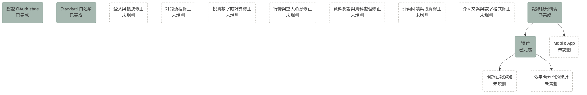

# Roadmap

<!-- 圖與願景段落的寫法見 sdd skill 的「Roadmap Conventions」一節。 -->

## 總覽

## 功能願景

從「登入與帳號修正」到「介面文案與數字格式修正」這幾節列的，都是補寫 spec 時發現、沒有寫進 spec 的錯誤行為，怎麼修等寫 plan 時再決定。

### 登入與帳號修正

讓使用者在登入期限內不會被登出、Google 回傳的資料不完整時也能登入、需要登出時確實登出，換綁帳號之後也不會留下舊的 refresh token 或多出一次試用期。

- 同一個瀏覽器的兩個分頁同時換發 refresh token 時（例如還原整個瀏覽器的分頁之後），api-server 把第二個分頁送來的舊 refresh token 當成被重複使用，結束這次登入，兩個分頁都被登出。目標是同一個瀏覽器同時換發時不會登出。
- 換綁 Google 帳號時，api-server 另外發一組重新算 30 天的 refresh token，舊的那組沒有作廢；換綁之後，舊的 Google 帳號再登入會建立一個新的 Taigu 帳號，也再得到一次試用期。目標是換綁時作廢舊的 refresh token，舊的 Google 帳號能不能再拿到試用期在 plan 裡決定。
- Google 回傳的資料沒有名字或頭像，或名字超過 64 個字時，登入或換綁會得到 500，使用者沒辦法登入。目標是改用預設的名字與頭像，照常登入。
- CSRF 檢查失敗（403）時，前端把它當成登入狀態結束，帶使用者到歡迎頁，但送出的登出 request 也因為同樣的原因失敗，所以 api-server 上的登入沒有結束。目標是 CSRF 檢查失敗時重新取得 CSRF token，或確實登出。

### 訂閱流程修正

讓訂閱、續訂、取消與扣款失敗的流程不會讓使用者多付錢，畫面上的說明也跟實際能做的事一致。

- 自動續訂的一期結束後，每天 03:40 的到期處理要等期滿超過 1 天才把狀態改成扣款失敗，所以實際會等 1 到將近 2 天，但這段期間使用者已經被當成 Free，方案頁也讓使用者再訂閱一次，可能重複扣款。目標是等待綠界扣款結果的這段期間仍然算 Standard，方案頁也不提供再訂閱。
- 扣款失敗之後有下面這些問題。目標是方案頁提供的操作與 api-server 允許的一致，而且不會重複扣款；寫 plan 之前要先確認綠界會不會繼續用舊的定期扣款扣款。
  - 方案頁不顯示「停止自動續訂」，但 api-server 允許停止。
  - 使用者再訂閱一次時，Taigu 會向綠界建立新的定期扣款，卻沒有取消舊的。
  - 扣款失敗的狀態不會自己變成未訂閱。
  - 白名單上、扣款失敗的使用者同樣沒辦法停止自動續訂，綠界如果繼續扣款，他們會為本來就能免費使用的 Standard 方案付錢。
- 停止自動續訂的確認視窗寫「你可以在到期前重新啟用自動續訂。」，但 Taigu 沒有重新啟用的功能。目標是確認視窗只寫 Taigu 做得到的事，做法（做出這個功能或拿掉這句話）在 plan 裡決定。
- 停止自動續訂時填的原因會送到 api-server，但 api-server 沒有存下來。目標是不向使用者收集沒有用到的資料，做法（存下原因或拿掉這個欄位）在 plan 裡決定。
- 確認訂閱 Standard 的視窗只寫金額，沒寫續訂日期，不符合 ui-guidelines.md 的「文案」。目標是加上第一次續訂的日期。
- 方案頁載入失敗時，畫面會顯示猜出來的方案，例如試用中的使用者看到 Standard 月繳。目標是只顯示錯誤與重試。
- 以前訂閱過、現在未訂閱而且不在白名單上的使用者，方案頁會顯示已經過去的「有效至」日期。目標是不顯示這個日期。
- 扣款失敗的使用者開始結帳又放棄之後，那筆還沒付款的結帳會讓下一次定期扣款成功的通知處理失敗，訂閱維持扣款失敗，直到綠界重送通知。目標是定期扣款成功的通知不受還沒付款的結帳影響。
- 從綠界的付款頁按上一頁回到方案頁時，如果瀏覽器直接還原之前的頁面，確認視窗與方案的按鈕會一直停在等待中，要重新整理才能再選。寫 plan 之前要先實測瀏覽器的行為。目標是回到方案頁之後可以重新選擇方案。
- 一期的結束時間以 UTC 計算，所以在台灣時間 1 日或 29 日到 31 日的 00:00 到 08:00 付款或扣款時，結束時間會跟以台灣時間計算的差一到三天。目標是以台灣時間計算。
- 使用者付了一筆已經被新結帳取代的舊結帳時，這筆付款仍算成功，綠界那邊會留下兩個定期扣款，停止自動續訂時只取消比較新的那一個。目標是不會同時留下兩個定期扣款。
- 綠界在付款成功之後又送來同一筆付款失敗的通知時，api-server 會把已付款改成失敗，之後使用者停止自動續訂時，api-server 也不會向綠界取消定期扣款，這筆付款也會從後台的試用轉付費與每月付款消失。寫 plan 之前要先確認綠界會不會這樣通知。目標是已付款的付款不會被改成失敗。
- 開發者依使用者的要求刪除帳號時，這位使用者的付款紀錄會一起刪除，所以後台訂閱頁從付款紀錄算出來的每月付款金額，過去的月份也會跟著變少。依商業會計法，會計憑證要保存 5 年，所以付款紀錄可能不該隨帳號刪除。目標是付款紀錄保存到法規要求的期限，做法與隱私權政策要怎麼改在 plan 裡決定。
- 計費功能上線之前註冊的使用者，要等之後再開啟 Taigu 才開始試用，計費功能上線之後沒有再開啟過 Taigu 的使用者沒有任何訂閱狀態，但 billing.md 沒有描述這些使用者（BILL-R2 寫的是第一次登入時開始試用）。目標是 billing.md 寫明這些使用者的試用期與訂閱狀態。
- 停止自動續訂時，綠界回應 HTTP 錯誤、逾時或連線失敗時，request 會得到 500，畫面只顯示通用的「Unknown error occurred」，而不是綠界錯誤該有的 502 與說明。目標是這些情況都當成綠界錯誤處理。

### 投資數字的計算修正

讓持股、年化報酬率、漲跌幅這些數字在每個畫面都算得對，而且算法一致。

- 交易紀錄少於 2 筆時，整體與每檔股票的年化報酬率都固定是 0%，所以只買過一次的股票看不到年化報酬率。目標是只要有一筆交易紀錄就算得出年化報酬率。
- 交易紀錄至少有 2 筆、而且有持股還沒有價格時，年化報酬率顯示 -99%；從其他頁面進入個股詳情頁時，這種股票的年化報酬率則停在 0.00%。目標是沒有價格時不顯示錯誤的數字，要顯示什麼在 plan 裡決定。
- 在個股詳情頁上，已經賣光的股票的年化報酬率會停在 0%；在這個頁面新增、編輯或刪除現金股利紀錄之後，年化報酬率也不會重算，重新整理之後才正確。目標是進入頁面時與紀錄變動時都算出正確的值。
- 下面這些情況，年化報酬率會顯示 1000.00%、-99.00% 或 450.50% 這類沒有意義或算錯的值。目標是這些情況都不顯示錯誤的數字。
  - 所有交易都在今天以前的同一天，而且已經沒有持股時，例如當沖。
  - 現金流量依日期加總後，最早一天是收入、或最晚一天是支出時，例如已經沒有持股，而最後一次當沖是賠錢。
  - 現金流量的正負號變換不只一次時，例如有賺有賠的當沖。這時年化報酬率可能有兩個解或沒有解，Taigu 只顯示其中一個值或邊界值。
- 前端把交易日期當成 UTC 的午夜解析，所以台灣時間 00:00 到 08:00 之間，投入金額走勢圖的最後一點是昨天、看不到今天的紀錄；手續費頁的 6M、1Y、5Y 在 08:00 之後也會漏掉起始月 1 日的紀錄。目標是日期一律以台灣時間計算。
- 成交單價是 0 的買進（例如配股）會算進庫存，卻不會出現在個股詳情頁的庫存分佈裡，之後的賣出也因此從庫存分佈扣掉錯的股數。目標是庫存分佈與庫存的股數一致。
- 賣出超過當時的庫存時，下面幾個地方算出的持股不一致，也影響 Free 方案的持股額度。目標是每個地方得到相同的持股，做法（擋下超賣，或讓之後的買進先補上多賣的股數）在 plan 裡決定。
  - 前端的先買先賣直接丟掉多賣的股數。
  - 實現損益只在完全沒有持股時才把賣出的股數當成放空，賣出超過既有庫存時同樣丟掉多出來的股數。
  - api-server 判斷持股時加總所有成交股數。
- 在同一次開啟 Taigu 的期間，把一筆交易紀錄的交易日期改到同一檔股票另一筆交易的同一天時，重新整理之前，先買先賣會用錯的順序處理這兩筆，平均成本與實現損益也跟著錯。目標是改完日期就用正確的順序計算。
- 刪除一筆賣出、讓一檔股票重新變成持股時，Taigu 不會立刻抓這檔股票的價格，要等下一次定期更新，這段期間價格顯示「--」、市值算 0。目標是刪除之後立刻抓價格。
- 交易日期在未來的交易紀錄會算進投入金額，但投入金額走勢圖只畫到今天，所以走勢圖的最後一點跟投入金額對不上，最早一筆交易紀錄在未來時，走勢圖是空的。目標是走勢圖與投入金額一致，要不要接受未來的交易日期在 plan 裡決定。
- 直接開啟個股詳情頁時，現金股利紀錄如果比交易紀錄晚載入完成，年化報酬率不會重算，所以沒有計入現金股利。目標是所有紀錄都載入之後再算。
- 儀表板的大盤指數卡片與大盤指數頁算漲跌幅時除以「最新指數＋漲跌」，搜尋結果則除以現價、只留 1 位小數。目標是都除以昨收價、留 2 位小數，跟個股詳情頁一致。

### 行情與重大消息修正

讓行情與重大消息依時更新，不會因為單一股票的資料問題整批漏掉。

- 直接開啟或重新整理市場頁、個股詳情頁時，Standard 使用者在「關注」分頁的價格，以及個股詳情頁的價格與盤中走勢，都要每 10 分鐘才更新一次，要換到其他頁面再回來才變成 30 秒。目標是一律依方案決定間隔。
- 證交所的重大消息資料裡有創新板公司，Taigu 沒辦法把這些公司加進股票清單，所以每小時整批上市公司的重大消息都存不進去，使用者因此看不到任何上市公司的重大消息。目標是加不進股票清單的公司直接跳過，其他公司的重大消息照常存下來。
- 上櫃轉上市的股票，Taigu 仍然用原本的市場去抓價格，所以價格從此不再更新。目標是股票換市場時更新它的市場。
- PR #194 之後，Taigu 在 13:30 就寫入加權指數與櫃買指數當天最後一個點，13:58、13:59 抓到的值不會蓋過去，所以這個點可能早於收盤集合競價的結果。要先確認證交所的即時資料在 13:30 是否已經是收盤值，不是的話改用 13:58 之後的值。
- 個股詳情頁每次抓到價格，都會在歷史走勢的最後加上一個以瀏覽器日期為準的點，所以週末、假日與交易日 09:00 之前也會多出一個點。目標是用價格本身的日期。
- 重大消息實際保留的期間是 30 天少 8 小時。目標是剛好 30 天。
- 同一批重大消息裡有兩則同一家公司、同一個時間發布的消息時，那個市場的重大消息整批都存不進去。目標是只略過重複的那一則。
- 抓重大消息時才加進股票清單的公司沒有行情紀錄，所以要等下一個交易日 Taigu 抓到行情之後，才搜尋得到，個股詳情頁也才有價格。目標是加進股票清單時就能搜尋。
- 一次抓全部股票的行情超過 60 秒時，scheduler 會略過下一分鐘的抓取。目標是交易時段的每一分鐘都抓得到行情。
- 證交所回報一檔股票的價格卻沒有昨收價時，Taigu 把整個價格記成漲跌。目標是沒有昨收價時不記漲跌。
- 儀表板的加權指數與櫃買指數卡片顯示同一個日期，也就是櫃買指數最後一點的日期，兩個指數最後一點的日期不同時，加權指數卡片的日期是錯的。目標是各自顯示自己的日期。
- 搜尋頁與搜尋視窗送出關鍵字時沒有做 URL encoding，關鍵字裡有 `&`、`#` 或 `+` 時會被截斷。目標是跟編輯器的「股票」欄位一樣先做 URL encoding 再送出。
- Taigu 開著的時候方案改變（例如試用期結束），持股價格與大盤指數要等下一次開啟 Taigu 或從設定頁回來，市場頁與個股詳情頁的價格要等換到其他頁面再回來，才改用新方案的更新間隔。目標是方案改變之後就用新的間隔。
- product.md 與歡迎頁寫 Standard 方案的行情每 30 秒更新一次，但 Taigu 每分鐘才向證交所抓一次行情，30 秒只是前端重新讀取的間隔。目標是實際的更新頻率與說法一致，做法（加快抓取或改寫說法）在 plan 裡決定。
- 搜尋股票的結果沒有排序，符合的股票超過 30 檔時，股票代號完全相同的那一檔可能不在結果裡，例如搜尋「50」不一定找得到 0050。目標是股票代號完全相同的排在最前面。

### 資料驗證與資料處理修正

讓 Taigu 擋下沒有意義的資料，處理已經不存在的資料時也有明確的結果。

- 可以存下 0 股的交易紀錄，歷史紀錄頁會把它顯示成「賣出」。目標是編輯器與 api-server 都擋下 0 股。
- 買賣計畫接受 0 元的目標價格與 0 股的目標股數；api-server 也接受負的目標價格，以及「買」「賣」以外的買賣方向；目標價格是 0、而且股票還沒有價格的計畫，也會打亂買賣計畫頁的排序。目標是都擋下。
- 買賣計畫頁依目標價格與目前價格的差距排序，但還沒載入股價的計畫會排在最前面。目標是沒有股價的計畫排在最後，或是載入每個計畫的股價。
- 頭像與名字頁的名字沒有驗證，空白也能存，超過 64 個字時 api-server 回 500。目標是名字限制在 1 到 64 個字，超出範圍時用中文的錯誤提示寫出這個限制。
- 要換綁的 Google 帳號已經綁在其他 Taigu 帳號時，錯誤提示是英文；使用者選到目前綁定的 Google 帳號時，也會出現同一句。目標是用中文，並分開這兩種情況。
- 另一台裝置已經移除的自選股，或已經刪除的交易紀錄、現金股利紀錄、買賣計畫、手續費折讓，在這台裝置上再移除、編輯或刪除時，api-server 回 500。目標是移除自選股時當作成功，其他情況回應找不到這筆資料。
- 編輯手續費折讓時清空備註，備註不會被清掉。目標是存成空白。
- 新增或編輯手續費折讓之後，列表沒有依日期重新排序，重新整理才會正確。目標是存完就照日期排序。
- 淨手續費小於或等於 0 時，即使使用者已經有交易紀錄，手續費頁也會顯示「手續費由交易紀錄產生，請先新增交易紀錄。」。目標是依有沒有交易紀錄決定要不要顯示這句。
- 儲存個股筆記之後，個股詳情頁的重大消息會消失，接著打開「公司資訊」時，整個畫面會換成 React Router 預設的錯誤畫面；在公司資訊載入完成前打開筆記的編輯器並儲存，會用空白蓋掉原本的筆記。目標是儲存後保留公司資訊，載入完成前不讓使用者編輯筆記。
- 不經過編輯器送出 -0.5 這類帶小數的負數現金股利時，api-server 先轉成整數再檢查，所以存成 0 元。目標是拒絕負數。
- 歷史紀錄頁的搜尋區分英文字母的大小寫，搜尋 `00679b` 找不到 00679B，市場頁的搜尋則不分大小寫。目標是都不分大小寫。
- 一台裝置同步紀錄時，如果帳號還沒有任何變更紀錄（例如新帳號第一次使用），之後超過 90 天沒有開啟 Taigu，再開啟時會漏掉這段期間在其他裝置做的變更。目標是這台裝置上次同步的時間早於變更紀錄保留的 90 天時，一律重新下載全部紀錄。
- 匯出的交易紀錄是一個陣列，現金股利紀錄卻包在 `data` 欄位裡。目標是兩個檔案的格式一致。
- 登出時，瀏覽器裡最近點選過的股票與登入前要去的網址都沒有刪除，下一個在這個瀏覽器登入的人看得到；登入前要去的網址也沒有期限，幾天之後或換另一個帳號登入時，仍會被帶到那個網址。目標是登出時一併刪除，記下的網址只用在緊接著的那次登入。
- 「關注」分頁依持倉、年化報酬率或今日漲跌幅排序時，數值相同的自選股（例如都不是持股，或都是平盤）沒有固定的順序。依年化報酬率排序時，沒有年化報酬率的股票（例如不是持股的自選股）也依 Taigu 算出的某個值排序，所以會排在其他股票之間。目標是有固定的順序，例如依加入的時間，沒有年化報酬率的股票排在哪裡在 plan 裡決定。
- api-server 收到不合法的 request 時一律回 400，沒有區分格式錯誤（例如日期格式不對、缺少必填欄位）與內容不符合規則（例如金額不是正數、股票代號不存在）。目標是在 plan 裡決定要不要把內容不符合規則的情況改成回 422；決定要改的話，在 `architecture.md` 寫下 400 與 422 的分界，整個 API 一起改，前端也照新的 status code 處理。

### 介面回饋與導覽修正

讓每個會等待的地方照 ui-guidelines.md 的「回饋」顯示載入狀態、失敗時讓使用者看得出失敗，返回按鈕也不會把使用者帶離 Taigu。

- 送出失敗時，錯誤提示直接顯示 api-server 或瀏覽器的英文訊息，例如 `Failed to fetch`、`Rate Limit Exceeded`、`Unknown error occurred`。目標是一律用中文寫出發生了什麼事、使用者可以怎麼做。
- 送出資料時登入狀態剛好結束（api-server 回 401、403 或 404）時，前端不把這次送出當成失敗，例如問題回報會顯示送出成功，其實沒有存下來。目標是顯示送出失敗，並帶使用者重新登入。
- api-server 回 404 時，前端一律把網址換成 `/404` 並重新載入，所以前端與 api-server 部署的時間不同、呼叫到還不存在的 endpoint 時，使用者會看到 404 頁面。目標是只有使用者開啟的網址不存在時才顯示 404 頁面。
- 個股詳情頁的愛心按鈕失敗時，畫面同時出現兩個錯誤提示；被額度擋下時，除了升級提示視窗，還多出「請稍後再試」。目標是只出現一個中文的錯誤提示，被額度擋下時不出現錯誤提示。
- 很多畫面在載入失敗時看起來像沒有資料。目標是這些畫面都顯示載入中與錯誤狀態。
  - 大盤指數卡片載入失敗時顯示 0000-00-00 與 0。
  - 搜尋頁與桌面瀏覽器的搜尋視窗沒有載入中與錯誤狀態。
  - 個股詳情頁的公司資訊在載入中與載入失敗時都顯示成沒有資料，走勢圖載入失敗時也顯示成沒有資料。
  - 買賣計畫頁載入失敗時顯示成沒有資料。
  - 交易紀錄載入失敗或離線開啟時，即使瀏覽器裡存有交易紀錄，儀表板、歷史紀錄頁、收益分析頁與市場頁的「持股」分頁也都顯示成沒有任何紀錄或持股，編輯既有紀錄的編輯頁也一直顯示「找不到這筆資料」。
  - 個股詳情頁第一次抓價格就失敗時，畫面寫「畫面顯示的是最近一次取得的資訊。」，但畫面上還沒有任何價格。
  - 匯出紀錄時沒有載入狀態，失敗時畫面沒有任何反應。
- 問題回報的內容超過 5,000 字時，送出按鈕只是變成停用，沒有說明原因；編輯器把 emoji 這類字元算成 2 個字，api-server 算成 1 個字，所以接近 5,000 字時兩邊的判斷不同。目標是顯示字數與上限，而且編輯器與 api-server 用同一種算法。
- 返回按鈕與導覽有下面這些問題。目標是沒有上一頁時回到預設的頁面，離開問題回報頁時回到上一頁。
  - 「回儀表板」「回列表」與法律頁面在行動裝置上的「上一頁」按鈕都會回到瀏覽器的上一頁，所以直接開網址進來時，從其他網站連過來的分頁按了會離開 Taigu，新分頁按了則沒有反應。
  - 在收益分析頁、手續費頁與大盤指數頁，側邊欄與底部導覽列的「儀表板」不能點，使用者只能靠「回儀表板」這類返回按鈕回到儀表板。
  - 在行動裝置上送出或離開問題回報頁時，瀏覽紀錄會多一頁。
  - 未登入時直接開啟編輯頁、登入之後回到那個編輯頁時，編輯頁的返回與送出會回到 Google 的登入畫面或登入頁，而不是直接開啟編輯頁時該回到的歷史紀錄頁、買賣計畫頁或手續費頁。
- 新版前端上線之後，使用者第一次直接開啟 `/records`、`/settings` 這類網址時，畫面會先顯示這個網址的頁面，接著 service worker 更新完成，`serviceWorkerRegistration.ts` 把網址換成 `/` 再重新載入，結果畫面停在儀表板，但照 ACCT-R5.1，直接開啟 `/records` 時畫面應該顯示歷史紀錄頁。直接開啟後台的網址時也一樣，畫面會換成儀表板，所以 Taigu 會替 superuser 記下這一天的使用紀錄，但照 USAGE-R1，只開啟後台的頁面不會記下使用紀錄。目標是 service worker 更新之後在原本的網址重新載入，包括 `?` 之後的參數。
- 個股詳情頁的「查看交易紀錄」會開啟 `/records?sid=<股票代號>`，把股票代號當成歷史紀錄頁的搜尋關鍵字，而這個搜尋也比對日期與其他股票代號，所以從 2023 燁輝的個股詳情頁點「查看交易紀錄」時，歷史紀錄頁會列出所有 2023 年的紀錄。目標是從個股詳情頁進來時只列出這檔股票的紀錄。
- 網址上的股票代號不在股票清單裡時，`/market/9999` 的價格一直顯示載入中，同時出現資料暫時無法更新的提示；`/records/trade/new?sid=9999` 的「股票」欄位一直顯示「讀取股票名稱中...」。目標是顯示找不到這檔股票。
- 在 `/market/favorites/<股票代號>` 取消關注之後切換上一檔或下一檔，或目前的股票不在分頁的列表裡時，切換到下一檔時會跳到列表的第一檔，切換到上一檔時則沒有反應。目標是依目前的股票在列表裡原本的位置切換。
- 剛加進股票清單、價格還是 0 元的股票，個股詳情頁顯示「$0」，「持股」與「關注」分頁則顯示「--」。目標是都顯示「--」。
- 個股詳情頁的重大消息時間與歷史走勢的日期依瀏覽器的時區顯示。目標是一律顯示台灣時間。
- 在桌面瀏覽器上，個股詳情頁的上一檔、下一檔箭頭在清單的兩端仍然出現，網址是 `/market/<股票代號>` 時兩邊的箭頭也都會出現，按了都沒有反應。目標是沒有上一檔或下一檔時不顯示那個箭頭。
- 在行動裝置上，「關注」分頁的價格更新失敗時只剩一個 32×32px 的 ↻ 按鈕，沒有文字。目標是寫出更新失敗，觸控範圍至少 44×44px。
- 頭像載入失敗時，側邊欄與行動裝置底部的導覽列顯示破圖，設定頁則改顯示預設的圖示。目標是每個地方都改顯示預設的圖示。
- 帳號綁定頁的「處理中」在換綁完成前就結束；從 Google 回到登入頁之後，登入按鈕也有一小段時間沒有載入狀態。目標是處理完成前都顯示載入狀態。
- 歡迎頁在瀏覽器提供安裝選項時，會把頁首的「登入」換成「安裝」，所以回訪的使用者在頁首找不到登入的入口，只能從方案卡片上寫給新使用者的按鈕進入登入頁。目標是同時保留登入與安裝。
- 編輯器的按鈕只寫「送出」「捨棄」，問題回報的視窗、刪除與登出的確認視窗、方案頁的確認視窗都寫「取消」，頭像與名字頁寫「儲存」「捨棄」「套用」，都沒寫出對象，不符合 ui-guidelines.md 的「文案」。目標是按鈕都寫出動作與對象。
- 有還沒存的內容時，下面這些操作會直接丟掉內容或結束編輯。目標是有還沒存的內容時一律先確認。
  - 在桌面瀏覽器上按「捨棄」（問題回報的視窗是「取消」）、Esc 或瀏覽器的上一頁，或在行動裝置上用系統的返回手勢時，還沒存的內容會直接丟掉，只有編輯頁自己的返回按鈕會先問「捨棄變更？」。
  - 個股筆記的編輯器與頭像與名字頁按「捨棄」時完全不問。
  - 在桌面瀏覽器的編輯器裡，於「股票」欄位按 Esc 會關掉整個編輯器。
  - 在「股票」欄位按 Enter 選擇搜尋結果時，如果其他欄位都已填好，編輯器會直接送出。
- 交易紀錄、現金股利紀錄、買賣計畫、手續費折讓與問題回報的編輯頁有很多相似但不完全相同的行為，例如什麼時候出現「捨棄變更？」確認視窗、找不到要編輯的資料時顯示什麼、離開後回到哪一頁，以及儲存失敗時是否保留輸入的內容，spec 在每個能力各寫一次。寫這個階段的 plan 時，決定要不要把這些行為整理成一條共用的規則，例如寫進 ui-guidelines.md，各能力的 spec 只寫自己的編輯頁不同的地方。
- 手續費折讓的編輯器儲存失敗時會直接關閉，輸入的內容跟著消失，其他編輯器則維持開啟。在桌面瀏覽器上新增交易紀錄、現金股利紀錄或買賣計畫時被額度擋下，編輯器也會先關閉，行動裝置的編輯頁則保留輸入的內容。目標是失敗或被擋下時都保留輸入的內容。

### 介面文案與數字格式修正

讓介面上的說法跟 Taigu 實際的行為一致，數字與文案照 ui-guidelines.md 的「漲跌」「數字」與「文案」顯示。

- 歡迎頁的文案有下面這些地方與實際的功能、試用期不一致。目標是歡迎頁的文案與實際的功能、試用期一致。
  - 歡迎頁寫「支援上市、上櫃、興櫃與 ETF」，但 Taigu 沒有興櫃的資料。
  - Free 方案卡片的「每月可使用：」底下列了不是每月計算的持股與關注檔數。
  - 歡迎頁寫試用一個月，實際的試用期是 31 天。
  - 登入狀態到期的使用者回到歡迎頁時，按鈕仍寫「開始一個月試用」，但這些使用者已經沒有試用期。
- 隱私權政策與服務條款有下面這些問題：
  - 兩個法律頁面的「聯絡我們」連到私有 repo 的 GitHub issues，未登入的人打開是 404。目標是聯絡方式只留未登入的讀者也能使用的 email。
  - 服務條款的「聯絡我們」一段寫成「隱私權政策」，兩個法律頁面的這一段也都多了一個半形空格。目標是修正這些文字。
  - 隱私權政策沒有提到付款資料、綠界與 Gravatar，也沒有寫交易紀錄、Google 帳號資料這些資料保存多久。目標是隱私權政策寫到付款資料、綠界與 Gravatar，也寫出每種資料保存多久；寫保存期間之前，要先確認每種資料實際保存多久。
  - 兩個法律頁面的頁面說明用「你」，不符合 ui-guidelines.md 對法律頁面的規定。目標是改用「您」。
- 「關注」分頁的搜尋框、統計數字與沒有自選股時的標題還寫「最愛」，愛心按鈕失敗時的錯誤提示寫「收藏」。目標是都改成「關注」。
- 方案頁的 Free 方案寫「約每 600 秒」，停止自動續訂的確認視窗與 product.md 則寫 10 分鐘；方案頁「額度使用」區塊的「持股」與「關注」兩列也寫了「本月」。目標是都寫 10 分鐘，「持股」與「關注」兩列不寫「本月」。
- 刪除手續費折讓的確認視窗只寫「刪除後，這筆折讓不會再計入手續費分析。」，編輯器「其他操作」區塊的「刪除後無法復原，手續費分析會同步更新。」也一樣，都沒寫出儀表板的年化報酬率也會跟著改變；刪除現金股利紀錄的確認視窗也只寫「刪除後，這筆現金股利不會再計入收益分析。」，沒寫出儀表板的年化報酬率與實現損益也會改變。目標是寫出所有會跟著改變的數字。
- 歡迎頁的標題「專業投資組合管理，精準損益計算與績效追蹤」是行銷的語氣，ui-guidelines.md 的「語言與語氣」規定不用行銷話術。目標是改成務實的說法，或在 ui-guidelines.md 寫明歡迎頁的例外。
- 登入按鈕寫「使用 Google 帳戶繼續」，設定頁的頁面標題寫「帳戶設定」，歡迎頁的內文與按鈕（例如「先建立免費帳戶」）、隱私權政策的頁面說明也有幾處寫「帳戶」，其他地方都寫「帳號」。目標是都寫「帳號」。
- 每檔股票的年化報酬率在市場頁叫「報酬率」，在個股詳情頁叫「年化報酬率」。目標是兩個頁面用同一個名稱。
- 儀表板沒有交易紀錄時的說明用了行銷的語氣，可以點的「點這裡」也沒寫出動作，而且沒辦法用鍵盤操作。目標是改成寫出動作、鍵盤也能操作的按鈕，例如「新增交易紀錄」。
- 收益分析的長條圖用藍色表示獲利、紅色表示虧損，跟 ui-guidelines.md 的「漲跌」相反，正數也沒有 + 號。目標是紅色表示獲利、綠色表示虧損，正數加上 + 號。
- 數字格式不一致：大盤指數與搜尋結果的價格沒有千分位，個股詳情頁正的實現損益與年化報酬率沒有 + 號，圖表的 tooltip 用半形冒號、市值沒有四捨五入、庫存分佈的數量沒寫單位。目標是照 ui-guidelines.md 的規則顯示。
- 手續費頁的圖表略過沒有紀錄的月份，月份標籤也沒寫年份，所以 1Y、5Y 與 ALL 可能出現兩個「3月」。目標是看得出每個長條是哪一年的哪個月。

### 後台

讓開發者在只有自己能使用的後台，看到有多少使用者在使用 Taigu、新使用者會不會持續使用、試用後有多少使用者付費訂閱，並處理使用者的問題回報。

1. [記錄使用情況](archive/0003-usage-recording.md)：記下使用者使用 Taigu 的日期與平台，以及送出問題回報時的平台與 User-Agent，讓後台上線時已經有資料可以統計。
2. [後台](archive/0004-admin-console.md)：加上後台的權限檢查，做出統計活躍、留存與試用轉付費的畫面，以及問題回報的列表。
3. 問題回報通知：api-server 收到新的問題回報時通知開發者，並讓每則問題回報有自己的網址。開發者在討論 plan 0003 與 0004 時已經決定下面這些事：
   - api-server 收到每則新的問題回報時，都在背景透過 Telegram bot 送一次通知給開發者，失敗時只記 log。
   - Telegram 的通知裡有回報內容的前 100 個字、使用者的 email、平台，以及這則回報在後台的連結。
   - 每則問題回報的網址是 `/admin/issue-reports/<id>`，頁面只顯示這則問題回報，用的是問題回報列表的同一種卡片，而且預設展開。
   - 隱私權政策要寫明 Telegram 會收到通知裡的這些資料。

   隱私權政策寫明問題回報保存到帳號刪除為止，但 Telegram 上的通知不會在帳號刪除時一起刪除，所以寫這個階段的 plan 時，要決定帳號刪除時怎麼處理這些通知，或是改寫「個人資料之保存期間」的條文。

4. 依平台分開的統計：後台的活躍人數依網頁與 PWA 分開顯示。開發「記錄使用情況」時，開發者只在 macOS 的桌面 Chrome 分頁實測過瀏覽器的行為（見 architecture.md 的「使用統計」），所以後台依平台分開統計之前，要先在實機上確認下面這些事，並把結果寫進 architecture.md：

   - iOS Safari 安裝的 PWA、Android Chrome 安裝的 PWA 與桌面 Chrome 安裝的 PWA 都記成 PWA。
   - 下面這些情況，Taigu 回到畫面上時都會記下使用紀錄：
     - 在手機上從其他 app 切回 PWA 或瀏覽器。
     - 手機在 Taigu 顯示時鎖定螢幕，之後解鎖。
     - 在桌面電腦上，Taigu 的視窗被其他 app 的視窗完全蓋住或縮到最小，之後使用者再切回 Taigu。
     - 桌面電腦從睡眠喚醒，或解除螢幕鎖定。
     - 瀏覽器從 back-forward cache 還原頁面。
   - 在這三種 PWA 裡用 Google 帳號登入之後，登入當天的使用紀錄記成 PWA。

   「記錄使用情況」上線之後，舊版前端送出的使用紀錄 `platform` 欄位都是空的，而且每次新版前端上線之後，`platform` 欄位是空的使用紀錄，多半跟同一位使用者同一天 `platform` 欄位有值的那一筆來自同一次開啟 Taigu（見 architecture.md 的「使用統計」），所以寫這個階段的 plan 時，也要決定依平台分開統計時怎麼算 `platform` 欄位是空的使用紀錄。

### Mobile App

讓使用者在 iOS 與 Android 上用 app 使用 Taigu。App 也要照 USAGE-R1 記下使用紀錄，平台分成 iOS app 與 Android app；如果 app 提供問題回報，送出時也要照 ISSUE-R3 記下平台，另外記下 app 的版本與作業系統的版本。
