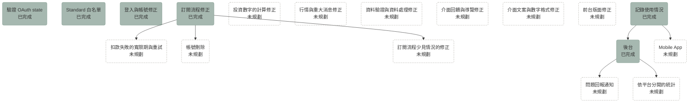

# Roadmap

<!-- 圖、功能願景與已知問題的寫法見 sdd skill 的「Roadmap Conventions」一節。 -->

## 總覽

## 功能願景

### 後台

讓開發者在只有自己能使用的後台，看到有多少使用者在使用 Taigu、新使用者會不會持續使用、試用後有多少使用者付費訂閱，並處理使用者的問題回報。

1. [記錄使用情況](archive/0003-usage-recording.md)：記下使用者使用 Taigu 的日期與平台，以及送出問題回報時的平台與 User-Agent，讓後台上線時已經有資料可以統計。
2. [後台](archive/0004-admin-console.md)：加上後台的權限檢查，做出統計活躍、留存與試用轉付費的畫面，以及問題回報的列表。
3. 問題回報通知：後端收到新的問題回報時通知開發者，並讓每則問題回報有自己的網址。開發者在討論 plan 0003 與 0004 時已經決定下面這些事：
   - 後端收到每則新的問題回報時，都在背景透過 Telegram bot 送一次通知給開發者，失敗時只記 log。
   - Telegram 的通知裡有回報內容的前 100 個字、使用者的 email、平台，以及這則回報在後台的連結。
   - 每則問題回報的網址是 `/admin/issue-reports/<id>`，頁面只顯示這則問題回報，用的是問題回報列表的同一種卡片，而且預設展開。
   - 隱私權政策要寫明 Telegram 會收到通知裡的這些資料。

   隱私權政策寫明問題回報保存到帳號刪除為止，但 Telegram 上的通知不會在帳號刪除時一起刪除，所以寫這個階段的 plan 時，要決定帳號刪除時怎麼處理這些通知，或是改寫「個人資料之保存期間」的條文。

4. 依平台分開的統計：後台的活躍人數依網頁與 PWA 分開顯示。開發「記錄使用情況」時，開發者只在 macOS 的桌面 Chrome 分頁實測過瀏覽器的行為（見 architecture.md 的「使用統計」），所以後台依平台分開統計之前，要先在實機上確認下面這些事，並把結果寫進 architecture.md：

   - iOS Safari 安裝的 PWA、Android Chrome 安裝的 PWA 與桌面 Chrome 安裝的 PWA 都記成 PWA。
   - 下面這些情況，Taigu 回到畫面上時都會記下使用紀錄：
     - 在手機上從其他 app 切回 PWA 或瀏覽器。
     - 手機在 Taigu 顯示時鎖定螢幕，之後解鎖。
     - 在桌面電腦上，Taigu 的視窗被其他 app 的視窗完全蓋住或縮到最小，之後使用者再切回 Taigu。
     - 桌面電腦從睡眠喚醒，或解除螢幕鎖定。
     - 瀏覽器從 back-forward cache 還原頁面。
   - 在這三種 PWA 裡用 Google 帳號登入之後，登入當天的使用紀錄記成 PWA。

   「記錄使用情況」上線之後，舊版前端送出的使用紀錄 `platform` 欄位都是空的，而且每次新版前端上線之後，`platform` 欄位是空的使用紀錄，多半跟同一位使用者同一天 `platform` 欄位有值的那一筆來自同一次開啟 Taigu（見 architecture.md 的「使用統計」），所以寫這個階段的 plan 時，也要決定依平台分開統計時怎麼算 `platform` 欄位是空的使用紀錄。

### Mobile App

讓使用者在 iOS 與 Android 上用 app 使用 Taigu。App 也要照 USAGE-R1 記下使用紀錄，平台分成 iOS app 與 Android app；如果 app 提供問題回報，送出時也要照 ISSUE-R3 記下平台，另外記下 app 的版本與作業系統的版本。

### 扣款失敗的寬限期與重試

讓定期扣款失敗的使用者在一段寬限期內繼續使用 Standard 方案，並由後端用綠界的補授權（`CreditCardPeriodAction` 的 `ReAuth`）重試扣款，全部失敗才照 BILL-R22 終止定期扣款。

已經查到的限制是，補授權只能用在最新一期授權失敗、而且仍在啟用中的定期扣款，在 stage 環境沒辦法測試，而且要等綠界之後送來的通知才知道補授權的結果。

寫這個階段的 plan 時，要決定寬限期多長、重試幾次；Taigu 目前也沒有通知使用者扣款失敗的方式，所以也要決定怎麼讓使用者知道要更新信用卡。

### 帳號刪除

讓開發者依使用者的要求刪除帳號之後，綠界不會再向這位使用者扣款，付款紀錄與使用紀錄也不會因為刪除帳號而消失。

目前開發者是手動刪除帳號，付款紀錄會跟著刪除；使用者還在自動續訂中的話，綠界之後仍會扣款，後端收到通知時卻找不到這位使用者。

已經決定的事：

- 開發者用新的 management command 刪除帳號，這個指令先請綠界終止這位使用者啟用中的定期扣款，終止失敗就不刪除帳號。
- 刪除帳號改成去識別化：刪除 email、名字、頭像、Google 帳號的綁定，以及交易紀錄、現金股利紀錄、買賣計畫、自選股這些記帳時建立的資料，帳號只留下 id 與建立時間，付款紀錄與使用紀錄留在這個帳號上。
- 同一個 Google 帳號之後再登入時，後端替這個 Google 帳號建立新的帳號。

Taigu 的綠界特店以個人申請，所以商業會計法的會計憑證保存期限不適用於付款紀錄。

寫這個階段的 plan 時，要決定問題回報在刪除帳號時怎麼處理、後台的統計是否算進已刪除的帳號（見 ADMIN-R5），並改寫隱私權政策的「個人資料之保存期間」。

這個階段完成之前，開發者刪除帳號前要先在綠界的特店後台終止這位使用者的定期扣款。

## 已知問題

這一節的每個小節列的，都是 `main` 已經有的行為裡發現的問題。已有 plan 的修正方式見該 plan，其餘等寫 plan 時再決定。

### 投資數字的計算修正

讓持股、年化報酬率、漲跌幅這些數字在每個畫面都算得對，而且算法一致。

- 交易紀錄少於 2 筆時，整體與每檔股票的年化報酬率都固定是 0%，所以只買過一次的股票看不到年化報酬率。目標是只要有一筆交易紀錄就算得出年化報酬率。
- 交易紀錄至少有 2 筆、而且有持股還沒有價格時，年化報酬率顯示 -99%；從其他頁面進入個股詳情頁時，這種股票的年化報酬率則停在 0.00%。目標是沒有價格時不顯示錯誤的數字，要顯示什麼在 plan 裡決定。
- 在個股詳情頁上，已經賣光的股票的年化報酬率會停在 0%；在這個頁面新增、編輯或刪除現金股利紀錄之後，年化報酬率也不會重算，重新整理之後才正確。目標是進入頁面時與紀錄變動時都算出正確的值。
- 下面這些情況，年化報酬率會顯示 1000.00%、-99.00% 或 450.50% 這類沒有意義或算錯的值。目標是這些情況都不顯示錯誤的數字。
  - 所有交易都在今天以前的同一天，而且已經沒有持股時，例如當沖。
  - 現金流量依日期加總後，最早一天是收入、或最晚一天是支出時，例如已經沒有持股，而最後一次當沖是賠錢。
  - 現金流量的正負號變換不只一次時，例如有賺有賠的當沖。這時年化報酬率可能有兩個解或沒有解，畫面只顯示其中一個值或邊界值。
- 前端把交易日期當成 UTC 的午夜解析，所以台灣時間 00:00 到 08:00 之間，投入金額走勢圖的最後一點是昨天、看不到今天的紀錄；手續費頁的 6M、1Y、5Y 在 08:00 之後也會漏掉起始月 1 日的紀錄。目標是日期一律以台灣時間計算。
- 成交單價是 0 的買進（例如配股）會算進庫存，卻不會出現在個股詳情頁的庫存分佈裡，之後的賣出也因此從庫存分佈扣掉錯的股數。目標是庫存分佈與庫存的股數一致。
- 賣出超過當時的庫存時，下面幾個地方算出的持股不一致，也影響 Free 方案的持股額度。目標是每個地方得到相同的持股，做法（擋下超賣，或讓之後的買進先補上多賣的股數）在 plan 裡決定。
  - 前端的先買先賣直接丟掉多賣的股數。
  - 實現損益只在完全沒有持股時才把賣出的股數當成放空，賣出超過既有庫存時同樣丟掉多出來的股數。
  - 後端判斷持股時加總所有成交股數。
- 在同一次開啟 Taigu 的期間，把一筆交易紀錄的交易日期改到同一檔股票另一筆交易的同一天時，重新整理之前，先買先賣會用錯的順序處理這兩筆，平均成本與實現損益也跟著錯。目標是改完日期就用正確的順序計算。
- 刪除一筆賣出、讓一檔股票重新變成持股時，前端不會立刻抓這檔股票的價格，要等下一次定期更新，這段期間價格顯示「--」、市值算 0。目標是刪除之後立刻抓價格。
- 交易日期在未來的交易紀錄會算進投入金額，但投入金額走勢圖只畫到今天，所以走勢圖的最後一點跟投入金額對不上，最早一筆交易紀錄在未來時，走勢圖是空的。目標是走勢圖與投入金額一致，要不要接受未來的交易日期在 plan 裡決定。
- 直接開啟個股詳情頁時，現金股利紀錄如果比交易紀錄晚載入完成，年化報酬率不會重算，所以沒有計入現金股利。目標是所有紀錄都載入之後再算。
- 儀表板的大盤指數卡片與大盤指數頁算漲跌幅時除以「最新指數＋漲跌」，搜尋結果則除以現價、只留 1 位小數。目標是都除以昨收價、留 2 位小數，跟個股詳情頁一致。

### 行情與重大消息修正

讓行情與重大消息依時更新，不會因為單一股票的資料問題整批漏掉。

- 直接開啟或重新整理市場頁、個股詳情頁時，Standard 使用者在「關注」分頁的價格，以及個股詳情頁的價格與盤中走勢，都要每 10 分鐘才更新一次，要換到其他頁面再回來才變成 30 秒。目標是一律依方案決定間隔。
- 證交所的重大消息資料裡有創新板公司，後端的 cron job 沒辦法把這些公司加進股票清單，所以每小時整批上市公司的重大消息都存不進去，使用者因此看不到任何上市公司的重大消息。目標是加不進股票清單的公司直接跳過，其他公司的重大消息照常存下來。
- 上櫃轉上市的股票，後端的 cron job 仍然用原本的市場去抓價格，所以價格從此不再更新。目標是股票換市場時更新它的市場。
- PR #194 之後，後端的 cron job 在 13:30 就寫入加權指數與櫃買指數當天最後一個點，13:58、13:59 抓到的值不會蓋過去，所以這個點可能早於收盤集合競價的結果。要先確認證交所的即時資料在 13:30 是否已經是收盤值，不是的話改用 13:58 之後的值。
- 個股詳情頁每次抓到價格，都會在歷史走勢的最後加上一個以瀏覽器日期為準的點，所以週末、假日與交易日 09:00 之前也會多出一個點。目標是用價格本身的日期。
- 重大消息實際保留的期間是 30 天少 8 小時。目標是剛好 30 天。
- 同一批重大消息裡有兩則同一家公司、同一個時間發布的消息時，那個市場的重大消息整批都存不進去。目標是只略過重複的那一則。
- 抓重大消息時才加進股票清單的公司沒有行情紀錄，所以要等下一個交易日後端的 cron job 抓到行情之後，才搜尋得到，個股詳情頁也才有價格。目標是加進股票清單時就能搜尋。
- 一次抓全部股票的行情超過 60 秒時，scheduler 會略過下一分鐘的抓取。目標是交易時段的每一分鐘都抓得到行情。
- 證交所回報一檔股票的價格卻沒有昨收價時，後端的 cron job 把整個價格記成漲跌。目標是沒有昨收價時不記漲跌。
- 儀表板的加權指數與櫃買指數卡片顯示同一個日期，也就是櫃買指數最後一點的日期，兩個指數最後一點的日期不同時，加權指數卡片的日期是錯的。目標是各自顯示自己的日期。
- 搜尋頁與搜尋視窗送出關鍵字時沒有做 URL encoding，關鍵字裡有 `&`、`#` 或 `+` 時會被截斷。目標是跟編輯器的「股票」欄位一樣先做 URL encoding 再送出。
- Taigu 開著的時候方案改變（例如試用期結束），持股價格與大盤指數要等下一次開啟 Taigu 或從設定頁回來，市場頁與個股詳情頁的價格要等換到其他頁面再回來，才改用新方案的更新間隔。目標是方案改變之後就用新的間隔。
- product.md 與歡迎頁寫 Standard 方案的行情每 30 秒更新一次，但後端的 cron job 每分鐘才向證交所抓一次行情，30 秒只是前端重新讀取的間隔。目標是實際的更新頻率與說法一致，做法（加快抓取或改寫說法）在 plan 裡決定。
- 搜尋股票的結果沒有排序，符合的股票超過 30 檔時，股票代號完全相同的那一檔可能不在結果裡，例如搜尋「50」不一定找得到 0050。目標是股票代號完全相同的排在最前面。

### 訂閱流程少見情況的修正

讓 [plan 0006](archive/0006-billing-fixes.md) 之後的訂閱流程，在幾個條件同時成立時也不會讓使用者多付錢或少拿到已經付款的期間。這些問題是 plan 0006 之後才出現在 `main` 上的。

下面的項目沿用 billing.md 的用詞：「本期」指訂閱最近一次付款成功或定期扣款成功所付的那一期，本期結束之後、下一次扣款成功之前，仍指剛結束的這一期；「等待期」指本期結束之後、後端確定這一期有沒有扣款成功之前的這段時間；「到期處理」指後端每天台灣時間凌晨 3:40 執行、更新到期訂閱狀態的 cron job。

- 本期結束日當天、本期結束的時刻之前，使用者停止自動續訂時，後端不會先查詢綠界。如果後端剛好漏收了當天凌晨的扣款成功通知，使用者這一期已經付了款，本期結束時訂閱卻變成未訂閱。已停止自動續訂的訂閱之後才收到這則晚到的成功通知時，後端怎麼處理也沒有規定。目標是使用者在本期結束日當天停止時，後端也先向綠界查詢，之後才收到晚到的成功通知時，後端也照樣延後本期。
- 綠界一直回應錯誤，等待期拖過了下一期的扣款日時，後端可能漏記兩期的扣款，但後端照 BILL-R22 查詢之後只把本期延後一期，隔天的到期處理又會判定這一期沒有扣款成功。目標是後端一次查到幾期還沒記下的扣款，就把本期延後幾期。
- 使用者付了被取代的舊結帳時，BILL-R27 只處理訂閱是自動續訂中的情況，下面這些情況都可能讓使用者重複扣款，或讓剛付款的使用者變成未訂閱。目標是這些情況都不會讓使用者重複扣款，也不會讓剛付款的使用者變成未訂閱。
  - 使用者在已停止自動續訂、本期還沒結束時付款，訂閱會照 BILL-R14 變回自動續訂中。
  - 使用者在等待期內付款，隔天的到期處理可能判定原本那份訂閱這一期沒有扣款成功，剛付款的使用者也跟著變成未訂閱。
  - 舊結帳的定期扣款在終止成功之前又扣款時，後端只記下這次扣款，不延後本期，使用者因此多付一期。
- 後台的每月付款（ADMIN-R11）會算進開發者照 BILL-R27 手動退款的那一筆；後端照 BILL-R22 查詢時才補記的扣款，會歸到查詢當天的月份，而不是綠界扣款的月份。目標是每月付款不算進已經退款的付款，補記的扣款歸到綠界扣款的月份。
- 等待期內停止自動續訂時，下面兩種情況 billing.md 都沒有情境。目標是兩種情況都有情境。
  - 向綠界查詢失敗。
  - 查到還沒記下的成功扣款，但終止定期扣款失敗。這時後端已經知道這一期扣款成功，本期卻沒有延後，方案頁仍顯示「正在確認本期的扣款結果」。目標是後端先記下查到的成功扣款並延後本期。
- 綠界在扣款日的哪個時段扣款，還沒有實測。如果綠界的扣款排在隔天 03:40 之後，到期處理會在扣款之前判定這一期沒有扣款成功並終止定期扣款。目標是實測扣款的時段，必要時把判定的時間往後移。
- 綠界每期的扣款日從第一次授權的日期起算，還是從結帳建立的時間（`MerchantTradeDate`）起算，還沒有實測。兩者不在同一天時（例如在 23:59 開啟付款頁、00:01 付款），本期的結束日會比扣款日早或晚一天。目標是實測之後，必要時改用綠界通知裡的付款時間或結帳建立的時間推算本期，這會改到 BILL-R14。
- 第二期以後 `PeriodReturnURL` 送來的 `TotalSuccessTimes` 是不是跟查詢的結果一樣算進第一次扣款，還沒有實測。不一樣的話，後端從查詢結果與從通知記下的同一次扣款會對不上，本期可能延後兩次。目標是實測，必要時改用兩邊都有的扣款編號對應。
- 從綠界的付款頁按上一頁、瀏覽器從 bfcache 還原方案頁的情況，還沒有在真的瀏覽器實測（見 architecture.md 的「從綠界付款頁回到方案頁」）。目標是在桌面與手機的瀏覽器上實測，確認 BILL-R17.2 的結果。
- 等待期內方案頁還顯示「停止自動續訂」時，訂閱可能已經變成未訂閱，例如凌晨的到期處理照 BILL-R22 結束了訂閱，或使用者在另一個分頁停止了自動續訂。使用者這時再按停止，後端照 BILL-R23 拒絕，確認視窗顯示後端的英文訊息而且不關閉，方案頁也停在舊的內容。目標是確認視窗關閉，方案頁更新成目前的狀態，並說明自動續訂已經結束。
- 使用者付款之後被綠界帶回方案頁時，如果後端還沒處理付款成功的通知，方案頁仍顯示試用中或 Free 方案，以及「方案選擇」，後端之後收到通知時，方案頁也不會自己更新。使用者以為付款沒成功、再付一次的話，會照 BILL-R27 被多扣一筆。綠界帶回瀏覽器與送出 `ReturnURL` 通知的先後還沒有實測。目標是付款成功的使用者回到方案頁之後，不用自己重新整理，方案頁就會在後端記下付款之後顯示自動續訂中。
- 後端沒有收到第一次付款的通知（`ReturnURL`）時，例如後端停機、綠界當天重送的通知也都沒收到，使用者已經付了款，訂閱卻仍是試用中或未訂閱，綠界之後照樣每期扣款；使用者照 BILL-R17 再付款一次的話，會同時有兩份定期扣款，後端照 BILL-R27 也不會終止第一份定期扣款。目標是後端最後一定會知道這筆付款，做法例如讓每天的到期處理向綠界查詢還沒完成的結帳。
- BILL-R16 只規定付款成功的通知要驗證檢查碼、綠界特店編號、金額與綠界交易編號，沒有涵蓋定期扣款的通知。後端已經會驗證定期扣款通知的檢查碼。目標是 BILL-R16 也涵蓋定期扣款的通知。

### 資料驗證與資料處理修正

讓前端與後端擋下沒有意義的資料，處理已經不存在的資料時也有明確的結果。

- 可以存下 0 股的交易紀錄，歷史紀錄頁會把它顯示成「賣出」。目標是編輯器與後端都擋下 0 股。
- 買賣計畫接受 0 元的目標價格與 0 股的目標股數；後端也接受負的目標價格，以及「買」「賣」以外的買賣方向；目標價格是 0、而且股票還沒有價格的計畫，也會打亂買賣計畫頁的排序。目標是都擋下。
- 買賣計畫頁依目標價格與目前價格的差距排序，但還沒載入股價的計畫會排在最前面。目標是沒有股價的計畫排在最後，或是載入每個計畫的股價。
- 另一台裝置已經移除的自選股，或已經刪除的交易紀錄、現金股利紀錄、買賣計畫、手續費折讓，在這台裝置上再移除、編輯或刪除時，後端回 500。目標是移除自選股時當作成功，其他情況回應找不到這筆資料。
- 編輯手續費折讓時清空備註，備註不會被清掉。目標是存成空白。
- 新增或編輯手續費折讓之後，列表沒有依日期重新排序，重新整理才會正確。目標是存完就照日期排序。
- 淨手續費小於或等於 0 時，即使使用者已經有交易紀錄，手續費頁也會顯示「手續費由交易紀錄產生，請先新增交易紀錄。」。目標是依有沒有交易紀錄決定要不要顯示這句。
- 儲存個股筆記之後，個股詳情頁的重大消息會消失，接著打開「公司資訊」時，整個畫面會換成 React Router 預設的錯誤畫面；在公司資訊載入完成前打開筆記的編輯器並儲存，會用空白蓋掉原本的筆記。目標是儲存後保留公司資訊，載入完成前不讓使用者編輯筆記。
- 不經過編輯器送出 -0.5 這類帶小數的負數現金股利時，後端先轉成整數再檢查，所以存成 0 元。目標是拒絕負數。
- 頭像與名字頁只接受空白或 http、https 開頭的頭像位置，但只有前端檢查，後端收到什麼 `avatar_url` 都會存下來，所以不經過頭像與名字頁送出 request，就能存下 `javascript:` 開頭的網址。目標是後端也只接受空白或 http、https 開頭的網址。
- 儲存個股筆記時，只有前端會去掉前後的空白，後端收到什麼 `note` 都原樣存下來，所以不經過個股筆記的編輯器送出 request 時，存下的筆記會保留前後的空白。目標是後端也去掉前後的空白。
- 歷史紀錄頁的搜尋區分英文字母的大小寫，搜尋 `00679b` 找不到 00679B，市場頁的搜尋則不分大小寫。目標是都不分大小寫。
- 一台裝置同步紀錄時，如果帳號還沒有任何變更紀錄（例如新帳號第一次使用），之後超過 90 天沒有開啟 Taigu，再開啟時會漏掉這段期間在其他裝置做的變更。目標是這台裝置上次同步的時間早於變更紀錄保留的 90 天時，一律重新下載全部紀錄。
- 匯出的交易紀錄是一個陣列，現金股利紀錄卻包在 `data` 欄位裡。目標是兩個檔案的格式一致。
- 「關注」分頁依持倉、年化報酬率或今日漲跌幅排序時，數值相同的自選股（例如都不是持股，或都是平盤）沒有固定的順序。依年化報酬率排序時，沒有年化報酬率的股票（例如不是持股的自選股）也依前端算出的某個值排序，所以會排在其他股票之間。目標是有固定的順序，例如依加入的時間，沒有年化報酬率的股票排在哪裡在 plan 裡決定。
- 後端收到不合法的 request 時一律回 400，沒有區分格式錯誤（例如日期格式不對、缺少必填欄位）與內容不符合規則（例如金額不是正數、股票代號不存在）。目標是在 plan 裡決定要不要把內容不符合規則的情況改成回 422；決定要改的話，在 `architecture.md` 寫下 400 與 422 的分界，整個 API 一起改，前端也照新的 status code 處理。

### 介面回饋與導覽修正

讓每個會等待的地方照 ui-guidelines.md 的「回饋」顯示載入狀態、失敗時讓使用者看得出失敗，返回按鈕也不會把使用者帶離 Taigu。

- 送出失敗時，錯誤提示直接顯示後端或瀏覽器的英文訊息，例如 `Failed to fetch`、`Rate Limit Exceeded`、`Unknown error occurred`。目標是一律用中文寫出發生了什麼事、使用者可以怎麼做。
- 送出資料時，如果登入狀態剛好結束，前端不把這次送出當成失敗，例如問題回報會顯示送出成功，其實沒有存下來。目標是顯示送出失敗，並帶使用者重新登入。
- 個股筆記儲存（STOCK-R15）、股票欄位搜尋（MKT-R21）與行情更新（STOCK-R3、FAV-R12）的失敗規則，要求在原頁顯示錯誤、保留內容或提供重試，但登入到期時 ACCT-R5 要求換到歡迎頁。目標是釐清登入失效與其他操作失敗時的處理，讓這些規格一致。
- 後端回 404 時，前端一律把網址換成 `/404` 並重新載入，所以前端與後端部署的時間不同、呼叫到還不存在的 endpoint 時，使用者會看到 404 頁面。目標是只有使用者開啟的網址不存在時才顯示 404 頁面。
- 個股詳情頁的愛心按鈕失敗時，畫面同時出現兩個錯誤提示；被額度擋下時，除了升級提示視窗，還多出「請稍後再試」。目標是只出現一個中文的錯誤提示，被額度擋下時不出現錯誤提示。
- 方案頁在「確認訂閱 Standard」視窗點「前往綠界付款」、建立付款失敗時，畫面同時出現兩個相同的錯誤 toast，頁面頂端的錯誤提示被還開著的視窗擋住，視窗裡也沒有錯誤提示。目標是錯誤提示只出現一次，而且顯示在視窗裡。
- 很多畫面在載入失敗時看起來像沒有資料。目標是這些畫面都顯示載入中與錯誤狀態。
  - 大盤指數卡片載入失敗時顯示 0000-00-00 與 0。
  - 搜尋頁與桌面瀏覽器的搜尋視窗沒有載入中與錯誤狀態。
  - 個股詳情頁的公司資訊在載入中與載入失敗時都顯示成沒有資料，走勢圖載入失敗時也顯示成沒有資料。
  - 買賣計畫頁載入失敗時顯示成沒有資料。
  - 交易紀錄載入失敗或離線開啟時，即使瀏覽器裡存有交易紀錄，儀表板、歷史紀錄頁、收益分析頁與市場頁的「持股」分頁也都顯示成沒有任何紀錄或持股，編輯既有紀錄的編輯頁也一直顯示「找不到這筆資料」。
  - 個股詳情頁第一次抓價格就失敗時，畫面寫「畫面顯示的是最近一次取得的資訊。」，但畫面上還沒有任何價格。
  - 匯出紀錄時沒有載入狀態，失敗時畫面沒有任何反應。
- 問題回報的內容超過 5,000 字時，送出按鈕只是變成停用，沒有說明原因；編輯器把 emoji 這類字元算成 2 個字，後端算成 1 個字，所以接近 5,000 字時兩邊的判斷不同。目標是顯示字數與上限，而且編輯器與後端用同一種算法。
- 返回按鈕與導覽有下面這些問題。目標是沒有上一頁時回到預設的頁面，離開問題回報頁時回到上一頁。
  - 「回儀表板」「回列表」與法律頁面在行動裝置上的「上一頁」按鈕都會回到瀏覽器的上一頁，所以直接開網址進來時，從其他網站連過來的分頁按了會離開 Taigu，新分頁按了則沒有反應。
  - 在收益分析頁、手續費頁與大盤指數頁，側邊欄與底部導覽列的「儀表板」不能點，使用者只能靠「回儀表板」這類返回按鈕回到儀表板。
  - 在行動裝置上送出或離開問題回報頁時，瀏覽紀錄會多一頁。
  - 未登入時直接開啟編輯頁、登入之後回到那個編輯頁時，編輯頁的返回與送出會回到 Google 的登入畫面或登入頁，而不是直接開啟編輯頁時該回到的歷史紀錄頁、買賣計畫頁或手續費頁。
- 新版前端上線之後，使用者第一次直接開啟 `/records`、`/settings` 這類網址時，畫面會先顯示這個網址的頁面，接著 service worker 更新完成，`serviceWorkerRegistration.ts` 把網址換成 `/` 再重新載入，結果畫面停在儀表板，但照 ACCT-R5.1，直接開啟 `/records` 時畫面應該顯示歷史紀錄頁。直接開啟後台的網址時也一樣，畫面會換成儀表板，所以前端會呼叫 `open-session`，後端替 superuser 記下這一天的使用紀錄，但照 USAGE-R1，只開啟後台的頁面不會記下使用紀錄。目標是 service worker 更新之後在原本的網址重新載入，包括 `?` 之後的參數。
- 個股詳情頁的「查看交易紀錄」會開啟 `/records?sid=<股票代號>`，把股票代號當成歷史紀錄頁的搜尋關鍵字，而這個搜尋也比對日期與其他股票代號，所以從 2023 燁輝的個股詳情頁點「查看交易紀錄」時，歷史紀錄頁會列出所有 2023 年的紀錄。目標是從個股詳情頁進來時只列出這檔股票的紀錄。
- 網址上的股票代號不在股票清單裡時，`/market/9999` 的價格一直顯示載入中，同時出現資料暫時無法更新的提示；`/records/trade/new?sid=9999` 的「股票」欄位一直顯示「讀取股票名稱中...」。目標是顯示找不到這檔股票。
- 在 `/market/favorites/<股票代號>` 取消關注之後切換上一檔或下一檔，或目前的股票不在分頁的列表裡時，切換到下一檔時會跳到列表的第一檔，切換到上一檔時則沒有反應。目標是依目前的股票在列表裡原本的位置切換。
- 剛加進股票清單、價格還是 0 元的股票，個股詳情頁顯示「$0」，「持股」與「關注」分頁則顯示「--」。目標是都顯示「--」。
- 個股詳情頁的重大消息時間與歷史走勢的日期都依瀏覽器的時區顯示，所以裝置時區在台灣以西的使用者，看到的日期可能比台灣日期早一天。目標是一律顯示台灣時間。
- 在桌面瀏覽器上，個股詳情頁的上一檔、下一檔箭頭在清單的兩端仍然出現，網址是 `/market/<股票代號>` 時兩邊的箭頭也都會出現，按了都沒有反應。目標是沒有上一檔或下一檔時不顯示那個箭頭。
- 在行動裝置上，「關注」分頁的價格更新失敗時只剩一個 32×32px 的 ↻ 按鈕，沒有文字。目標是寫出更新失敗，觸控範圍至少 44×44px。
- 行動裝置上的加號按鈕（見 REC-R10）與點開後的選項都是綁了點擊事件的 `div`，所以加號按鈕沒有 screen reader 讀得到的名稱，加號按鈕與選項也都不能用鍵盤操作。目標是加號按鈕有 screen reader 讀得到的名稱，加號按鈕與選項都能用鍵盤操作。
- 頭像載入失敗時，側邊欄與行動裝置底部的導覽列顯示破圖，設定頁則改顯示預設的圖示。目標是每個地方都改顯示預設的圖示。
- 帳號綁定頁的「處理中」在換綁完成前就結束；從 Google 回到登入頁之後，登入按鈕也有一小段時間沒有載入狀態。目標是處理完成前都顯示載入狀態。
- 歡迎頁在瀏覽器提供安裝選項時，會把頁首的「登入」換成「安裝」，所以回訪的使用者在頁首找不到登入的入口，只能從方案卡片上寫給新使用者的按鈕進入登入頁。目標是同時保留登入與安裝。
- 編輯器的按鈕只寫「送出」「捨棄」，問題回報的視窗、刪除與登出的確認視窗、方案頁的確認視窗都寫「取消」，頭像與名字頁寫「儲存」「捨棄」「套用」，都沒寫出對象，不符合 ui-guidelines.md 的「文案」。目標是按鈕都寫出動作與對象。
- 有還沒存的內容時，下面這些操作會直接丟掉內容或結束編輯。目標是有還沒存的內容時一律先確認。
  - 在桌面瀏覽器上按「捨棄」（問題回報的視窗是「取消」）、Esc 或瀏覽器的上一頁，或在行動裝置上用系統的返回手勢時，還沒存的內容會直接丟掉，只有編輯頁自己的返回按鈕會先問「捨棄變更？」。
  - 個股筆記的編輯器與頭像與名字頁按「捨棄」時完全不問。
  - 在桌面瀏覽器的編輯器裡，於「股票」欄位按 Esc 會關掉整個編輯器。
  - 在「股票」欄位按 Enter 選擇搜尋結果時，如果其他欄位都已填好，編輯器會直接送出。
- 交易紀錄、現金股利紀錄、買賣計畫、手續費折讓與問題回報的編輯頁有很多相似但不完全相同的行為，例如什麼時候出現「捨棄變更？」確認視窗、找不到要編輯的資料時顯示什麼、離開後回到哪一頁，以及儲存失敗時是否保留輸入的內容，spec 在每個能力各寫一次。寫這個階段的 plan 時，決定要不要把這些行為整理成一條共用的規則，例如寫進 ui-guidelines.md，各能力的 spec 只寫自己的編輯頁不同的地方。
- 手續費折讓的編輯器儲存失敗時會直接關閉，輸入的內容跟著消失，其他編輯器則維持開啟。在桌面瀏覽器上新增交易紀錄、現金股利紀錄或買賣計畫時被額度擋下，編輯器也會先關閉，行動裝置的編輯頁則保留輸入的內容。目標是失敗或被擋下時都保留輸入的內容。

### 介面文案與數字格式修正

讓介面上的說法跟實際的行為一致，數字與文案照 ui-guidelines.md 的「漲跌」「數字」與「文案」顯示。

- 歡迎頁的文案有下面這些地方與實際的功能、試用期不一致。目標是歡迎頁的文案與實際的功能、試用期一致。
  - 歡迎頁寫「支援上市、上櫃、興櫃與 ETF」，但股票清單只有上市櫃股票，沒有興櫃股票。
  - Free 方案卡片的「每月可使用：」底下列了不是每月計算的持股與關注檔數。
  - 歡迎頁寫試用一個月，實際的試用期是 31 天。
  - 登入狀態到期的使用者回到歡迎頁時，按鈕仍寫「開始一個月試用」，但這些使用者已經沒有試用期。
- 隱私權政策與服務條款有下面這些問題：
  - 兩個法律頁面的「聯絡我們」連到私有 repo 的 GitHub issues，未登入的人打開是 404。目標是聯絡方式只留未登入的讀者也能使用的 email。
  - 服務條款的「聯絡我們」一段寫成「隱私權政策」，兩個法律頁面的這一段也都多了一個半形空格。目標是修正這些文字。
  - 隱私權政策沒有提到付款資料、綠界與 Gravatar，也沒有寫交易紀錄、Google 帳號資料這些資料保存多久。目標是隱私權政策寫到付款資料、綠界與 Gravatar，也寫出每種資料保存多久；寫保存期間之前，要先確認每種資料實際保存多久。
  - 兩個法律頁面的頁面說明用「你」，不符合 ui-guidelines.md 對法律頁面的規定。目標是改用「您」。
- 「關注」分頁的搜尋框、統計數字與沒有自選股時的標題還寫「最愛」，愛心按鈕失敗時的錯誤提示寫「收藏」。目標是都改成「關注」。
- 方案頁的 Free 方案寫「約每 600 秒」，停止自動續訂的確認視窗與 product.md 則寫 10 分鐘；方案頁「額度使用」區塊的「持股」與「關注」兩列也寫了「本月」。目標是都寫 10 分鐘，「持股」與「關注」兩列不寫「本月」。
- 刪除手續費折讓的確認視窗只寫「刪除後，這筆折讓不會再計入手續費分析。」，編輯器「其他操作」區塊的「刪除後無法復原，手續費分析會同步更新。」也一樣，都沒寫出儀表板的年化報酬率也會跟著改變；刪除現金股利紀錄的確認視窗也只寫「刪除後，這筆現金股利不會再計入收益分析。」，沒寫出儀表板的年化報酬率與實現損益也會改變。目標是寫出所有會跟著改變的數字。
- 歡迎頁的頁面標題「專業投資組合管理，精準損益計算與績效追蹤」與頁面說明「Taigu 是專業的台股投資記帳工具……」用「專業」「精準」形容 Taigu。ui-guidelines.md 的「語言與語氣」規定文案不誇大功能，不過「引導、動態與回饋」允許歡迎頁的文案比日常功能的文案親切。目標是在 plan 裡決定這些說法算不算誇大功能，算的話改成務實的說法。
- 登入按鈕寫「使用 Google 帳戶繼續」，設定頁的頁面標題寫「帳戶設定」，歡迎頁的內文與按鈕（例如「先建立免費帳戶」）、隱私權政策的頁面說明也有幾處寫「帳戶」，其他地方都寫「帳號」。目標是都寫「帳號」。
- 每檔股票的年化報酬率在市場頁叫「報酬率」，在個股詳情頁叫「年化報酬率」。目標是兩個頁面用同一個名稱。
- 儀表板沒有交易紀錄時的說明用了行銷的語氣，可以點的「點這裡」也沒寫出動作，而且沒辦法用鍵盤操作。目標是改成寫出動作、鍵盤也能操作的按鈕，例如「新增交易紀錄」。
- 收益分析的長條圖用藍色表示獲利、紅色表示虧損，跟 ui-guidelines.md 的「漲跌」相反，正數也沒有 + 號。目標是紅色表示獲利、綠色表示虧損，正數加上 + 號。
- 數字格式不一致：大盤指數與搜尋結果的價格沒有千分位符號，個股詳情頁正的實現損益與年化報酬率沒有 + 號，圖表的 tooltip 用半形冒號、市值沒有四捨五入、庫存分佈的數量沒寫單位。目標是照 ui-guidelines.md 的規則顯示。
- 手續費頁的圖表略過沒有紀錄的月份，月份標籤也沒寫年份，所以 1Y、5Y 與 ALL 可能出現兩個「3月」。目標是看得出每個長條是哪一年的哪個月。

### 前台版面修正

讓前台的頁面照 ui-guidelines.md 的「版面」，依可用寬度切換版面。

- 前端用 `Util.isMobile` 從 User-Agent 判斷是不是行動裝置，再依結果選擇版面，行動裝置用頁首與底部導覽列，其他裝置用側邊欄；編輯器、圖表與大部分頁面也依同一個判斷調整畫面。所以在桌面瀏覽器把視窗縮到小於 960px 時，畫面仍是側邊欄的版面；前端從 iPad 的 User-Agent 判斷不出是行動裝置，所以直立時可用寬度小於 960px 的 iPad 也顯示側邊欄的版面。目標是可用寬度小於 960px 時用窄版的導覽與字級，960px 起用寬版的側邊欄與字級。
