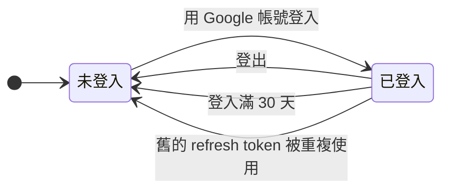

# 帳號

使用者要先用 Google 帳號登入 Taigu，才能記帳與使用其他功能。這份 spec 寫的是登入、登入狀態維持多久與怎麼結束、未登入時開啟頁面會被導去哪裡，以及設定頁（`/settings`）的總覽與兩項帳號設定（修改名字與頭像、更換綁定的 Google 帳號）。資料的匯出見 REC-R20，方案與付款寫在 [billing.md](billing.md)。

同一個瀏覽器的登入狀態會照下圖改變，每一種轉換的規則寫在下面的需求：

## 需求

### ACCT-R1 用 Google 帳號登入

使用者在登入頁（`/login`）點 Google 登入按鈕、在 Google 的畫面同意授權，後端完成登入之後，畫面換到儀表板（`/`）；使用者是因為未登入而被導到歡迎頁的話，則換回原本開啟的網址（見 ACCT-R3），而已登入的使用者開啟登入頁時，畫面直接換到儀表板。從 Google 回到登入頁時，後端只在這次授權通過 ACCT-R12 的檢查時才完成登入，沒有完成登入時的處理見 ACCT-R13，使用者取消授權時的處理見 ACCT-R14。

- ACCT-R1.1 從登入頁登入
  - 前提：使用者未登入，而且不是從要登入才能使用的頁面被導過來。
  - 動作：開啟登入頁，點 Google 登入按鈕，在 Google 的畫面選擇帳號並同意授權。
  - 結果：畫面回到 Taigu 並換到儀表板（`/`）。
- ACCT-R1.2 已登入時開啟登入頁
  - 前提：使用者已登入。
  - 動作：開啟登入頁（`/login`）。
  - 結果：畫面換到儀表板（`/`）。

### ACCT-R2 第一次登入時建立帳號

第一次用某個 Google 帳號登入時，後端替這個 Google 帳號建立新帳號，Email 取自這個 Google 帳號，名字與頭像依 ACCT-R15 取得；之後用同一個 Google 帳號登入都會進到這個帳號，而且登入時後端不會用 Google 帳號的資料覆蓋使用者改過的名字與頭像。

新帳號的試用期見 BILL-R2。

- ACCT-R2.1 第一次登入
  - 前提：沒有任何 Taigu 帳號綁定這個 Google 帳號。
  - 動作：用這個 Google 帳號登入，再開啟設定頁。
  - 結果：設定頁顯示這個 Google 帳號的頭像、名字與 Email。
- ACCT-R2.2 再次登入時保留改過的名字
  - 前提：使用者用這個 Google 帳號登入過，並在頭像與名字頁把名字改成「小明」。
  - 動作：登出，再用同一個 Google 帳號登入，開啟設定頁。
  - 結果：設定頁顯示的名字是「小明」，不是 Google 帳號的名字。

### ACCT-R3 未登入時開啟要登入才能使用的頁面

除了歡迎頁（`/welcome`）、登入頁（`/login`）、隱私權政策（`/privacy-policy`）、服務條款（`/terms-of-service`）與 404 頁面，Taigu 的其他頁面都要登入才能使用；未登入的使用者開啟要登入才能使用的頁面時，前端記住原本開啟的完整網址（包括 query string）並把畫面換到歡迎頁。不需要登入的那幾個頁面，規則見 PUB-R1、PUB-R4 與 PUB-R5。

記住的網址只供原分頁下一次成功登入後返回，自記住網址起 30 分鐘內有效。成功登入後，前端先刪除這份紀錄，再依下列情況換頁：

- 原分頁的紀錄仍有效時，換回記住的網址。
- 沒有有效紀錄時，換到儀表板（`/`）。

返回網址另依以下規則處理：

- 關閉原分頁後，該分頁記住的返回網址失效；不過瀏覽器還原或複製分頁時，前端接受瀏覽器帶回的紀錄，但仍依最初記住網址的時間判定 30 分鐘期限。
- 其他分頁不使用原分頁記住的返回網址，瀏覽器還原或複製分頁的情況依上一項處理。
- 登入取消或失敗時，返回網址的期限不重新起算。
- 已登入的使用者開啟登入頁時，前端依 ACCT-R1 把畫面換到儀表板，並清除該分頁留下的返回網址。
- 主動登出或登入失效時，返回網址的清除見 ACCT-R17。

- ACCT-R3.1 未登入時開啟要登入才能使用的頁面
  - 前提：使用者未登入。
  - 動作：開啟設定頁（`/settings`）。
  - 結果：畫面換到歡迎頁（`/welcome`）。
- ACCT-R3.2 登入後換回原本開啟的網址
  - 前提：使用者未登入，開啟 `/records?sid=2330` 之後被導到歡迎頁。
  - 動作：在同一分頁換到登入頁，從記住網址起算未滿 30 分鐘時完成 Google 登入。
  - 結果：畫面換到 `/records?sid=2330`，記住的網址已清除。
- ACCT-R3.3 返回網址在滿 30 分鐘時失效
  - 前提：使用者未登入，開啟 `/records?sid=2330` 之後被導到歡迎頁。
  - 動作：在同一分頁完成 Google 登入，完成時距記住網址恰好 30 分鐘。
  - 結果：畫面換到儀表板，記住的網址已清除。
- ACCT-R3.4 返回網址只使用一次
  - 前提：使用者依 ACCT-R3.2 登入並返回歷史紀錄頁，之後主動登出。
  - 動作：直接從登入頁再次登入。
  - 結果：畫面換到儀表板。
- ACCT-R3.5 其他分頁不使用返回網址
  - 前提：分頁 A 因未登入而從 `/records?sid=2330` 被導到歡迎頁。
  - 動作：使用者另外開啟分頁 B，直接開啟登入頁並完成登入。
  - 結果：分頁 B 換到儀表板，不使用分頁 A 的返回網址。
- ACCT-R3.6 關閉原分頁後不使用返回網址
  - 前提：使用者因未登入而從 `/records?sid=2330` 被導到歡迎頁，之後關閉該分頁。
  - 動作：另開分頁，直接開啟登入頁並完成登入。
  - 結果：畫面換到儀表板。
- ACCT-R3.7 取消登入不延長返回期限
  - 前提：使用者未登入，開啟 `/records?sid=2330` 後被導到歡迎頁，之後開始 Google 登入並取消授權。
  - 動作：在原分頁再次開始登入，從最初記住網址起算超過 30 分鐘時完成登入。
  - 結果：畫面換到儀表板。
- ACCT-R3.8 已登入時清除留下的返回網址
  - 前提：分頁 A 記住了 `/records?sid=2330`，使用者之後在另一分頁完成登入。
  - 動作：在分頁 A 開啟登入頁。
  - 結果：畫面換到儀表板，分頁 A 記住的網址已清除。
- ACCT-R3.9 還原分頁沿用原返回期限
  - 前提：使用者未登入，原分頁記住了 `/records?sid=2330`，關閉後透過瀏覽器還原分頁，瀏覽器保留了這筆紀錄。
  - 動作：分別在最初記住網址未滿 30 分鐘與已滿 30 分鐘時完成登入。
  - 結果：未滿 30 分鐘時返回 `/records?sid=2330`，已滿 30 分鐘時換到儀表板；兩次都清除使用的紀錄。
- ACCT-R3.10 複製分頁沿用原返回期限
  - 前提：使用者未登入，原分頁記住了 `/records?sid=2330`，瀏覽器複製分頁時也複製了這筆紀錄。
  - 動作：在複製的分頁分別於最初記住網址未滿 30 分鐘與已滿 30 分鐘時完成登入。
  - 結果：未滿 30 分鐘時返回 `/records?sid=2330`，已滿 30 分鐘時換到儀表板；複製分頁不重新起算期限，使用的紀錄已清除。

### ACCT-R4 未登入時拒絕讀寫資料

讀取或修改使用者的資料與行情都要登入，沒有登入的 request，後端一律拒絕。

- ACCT-R4.1 未登入時送出需要登入的 request
  - 前提：沒有登入。
  - 動作：直接向後端送出任何一個需要登入的 request，例如讀取帳號資料或交易紀錄。
  - 結果：後端拒絕這個 request，不回傳也不修改任何資料。

### ACCT-R5 登入狀態最長維持 30 天

同一個瀏覽器的登入狀態在登入滿 30 天後到期（最後取得的 access token 最多還能再用 15 分鐘），到期時間不隨使用或更換綁定的 Google 帳號而延後；到期之前，除了登出（見 ACCT-R7）與舊的 refresh token 被重複使用（見 ACCT-R6），關閉瀏覽器或閒置都不必重新登入。

登入狀態因為到期、舊的 refresh token 被重複使用，或瀏覽器的登入 cookie 被清除而結束後，前端下一次向後端讀寫資料時先依 ACCT-R17 清除帳號資料，再依 ACCT-R3 記住這次開啟的網址並把畫面換到歡迎頁。CSRF 檢查失敗依 ACCT-R16 處理；連線失敗或後端暫時無法使用時，前端不當成已確認登入失效。

- ACCT-R5.1 閒置並關閉瀏覽器後再開啟
  - 前提：使用者 1 小時前登入，之後關閉了瀏覽器。
  - 動作：開啟瀏覽器，開啟歷史紀錄頁（`/records`）。
  - 結果：畫面顯示歷史紀錄頁，不必重新登入。
- ACCT-R5.2 登入滿 30 天
  - 前提：使用者 31 天前登入，期間每天都使用 Taigu。
  - 動作：開啟歷史紀錄頁（`/records`），被導到歡迎頁後在原分頁未滿 30 分鐘時重新登入。
  - 結果：前端依 ACCT-R17 清除帳號資料，畫面先換到歡迎頁（`/welcome`），重新登入後換回 `/records`。
- ACCT-R5.3 瀏覽器的登入 cookie 被清除
  - 前提：使用者已經登入，之後瀏覽器的登入 cookie 都被清除。
  - 動作：開啟歷史紀錄頁（`/records`），被導到歡迎頁後在原分頁未滿 30 分鐘時重新登入。
  - 結果：前端依 ACCT-R17 清除帳號資料，畫面先換到歡迎頁（`/welcome`），重新登入後換回 `/records`。

### ACCT-R6 舊的 Refresh Token 被重複使用時結束那次登入

瀏覽器保存一份 refresh token，用來向後端取得新的 access token，以維持登入狀態。後端接受 refresh token 時，會發出新的 access token 與 refresh token，並讓舊的 refresh token 失效；收到已經失效的舊 refresh token 時，後端拒絕這次要求，並讓同一次登入發出過的所有 refresh token 都失效，使用那次登入的瀏覽器之後要重新登入。

同一個瀏覽器的多個 Taigu 分頁同時需要更新 access token 時，前端協調更新 access token 的操作，讓等待中的分頁使用更新後的登入狀態，不因正常的同時更新 access token 而觸發上述規則。更換綁定的 Google 帳號時替換 refresh token 的規則見 ACCT-R11。

- ACCT-R6.1 有人重複使用舊的 Refresh Token
  - 前提：使用者登入後，瀏覽器已經用 refresh token 維持過一次登入狀態，手上是替換後的新 refresh token。
  - 動作：有人拿替換之前的舊 refresh token 向後端要求維持登入狀態。
  - 結果：後端拒絕這次要求，瀏覽器手上的新 refresh token 也一起失效。
- ACCT-R6.2 多個分頁同時更新 Access Token
  - 前提：同一個瀏覽器有多個已登入的 Taigu 分頁，登入尚未滿 30 天，access token 已過期。
  - 動作：多個分頁同時讀取需要登入的資料，更新 access token 與重送的 request 都正常收到回應。
  - 結果：各分頁都取得資料並維持登入，不因同時更新 access token 而結束登入。

### ACCT-R7 登出

使用者在設定頁點「登出」並在確認視窗確認之後，後端結束這個瀏覽器的這次登入、讓這次登入的 refresh token 失效，接著前端依 ACCT-R17 清除帳號資料，再把畫面換到登入頁；同一個帳號在其他瀏覽器的登入不受影響。登出 request 遇到 CSRF 檢查失敗時依 ACCT-R16 處理，沒有完成登出時留在原頁面，不顯示已登出。

- ACCT-R7.1 登出
  - 前提：使用者只在這個瀏覽器登入，新增過交易紀錄、點選過搜尋結果中的股票，並開啟設定頁。
  - 動作：點「登出」，在確認視窗點「登出」。
  - 結果：畫面換到登入頁（`/login`）；這次登入發出過的 refresh token 都失效，之後開啟儀表板（`/`）時畫面換到歡迎頁；瀏覽器內的帳號資料依 ACCT-R17 清除。
- ACCT-R7.2 取消登出
  - 前提：使用者已登入，開啟設定頁。
  - 動作：點「登出」，在確認視窗選擇不登出。
  - 結果：確認視窗關閉，畫面留在設定頁，使用者仍是登入狀態。
- ACCT-R7.3 其他瀏覽器的登入不受影響
  - 前提：同一個帳號在瀏覽器 A 與瀏覽器 B 都已登入。
  - 動作：在瀏覽器 A 登出。
  - 結果：瀏覽器 B 繼續使用 Taigu，不必重新登入。

### ACCT-R8 設定頁總覽

設定頁（`/settings`）顯示使用者的頭像、名字、Email 與目前方案的名稱（Standard 或 Free），並提供頭像與名字頁、帳號綁定頁、資料控制頁、方案頁、隱私權政策、服務條款與問題回報的入口，以及登出（見 ACCT-R7）；superuser 的設定頁另外有後台的入口（見 ADMIN-R3）。

頁尾的 Taigu Logo 連到歡迎頁（`/welcome`），在同一個瀏覽器分頁開啟，保留登入狀態，使用者按瀏覽器的上一頁可回到設定頁。

方案的判定見 BILL-R1。

- ACCT-R8.1 開啟設定頁
  - 前提：使用者已登入，帳號在試用期內。
  - 動作：開啟設定頁（`/settings`）。
  - 結果：設定頁顯示使用者的頭像、名字與 Email，目前方案顯示「Standard」；點頭像與名字、Email、資料控制、目前方案，畫面分別換到頭像與名字頁（`/settings/user-info`）、帳號綁定頁（`/settings/account-binding`）、資料控制頁（`/settings/data-controls`）、方案頁（`/settings/current-plan`）；頁面上另有隱私權政策、服務條款、問題回報與登出的入口。
- ACCT-R8.2 從設定頁的 Logo 查看歡迎頁
  - 前提：使用者已登入，畫面在設定頁（`/settings`）。
  - 動作：點頁尾的 Taigu Logo，再按瀏覽器的上一頁。
  - 結果：同一個瀏覽器分頁先顯示歡迎頁（`/welcome`），按上一頁後回到設定頁（`/settings`），使用者仍是登入狀態。

### ACCT-R9 修改名字與頭像

使用者在頭像與名字頁（`/settings/user-info`）儲存修改時，前端先去掉名字的頭尾空白，再驗證名字與「頭像位置」：

- 名字在 1 到 64 個字以內，而且頭像位置是空白或 http、https 開頭的網址時，後端儲存去掉頭尾空白後的名字與頭像，畫面換到設定頁。頭像位置空白時，每個顯示頭像的地方都改用預設的人像圖示。
- 名字是空白或超過 64 個字時，前端顯示「名字需為 1 到 64 個字。」，名字與頭像都不儲存，畫面留在原頁面並保留輸入。
- 名字符合限制，但頭像位置是其他內容時，前端依 ACCT-R9.4 顯示錯誤，名字與頭像都不儲存。

後端也會去掉名字的頭尾空白，再驗證長度為 1 到 64 個字；直接向後端送出不符合限制的名字時，後端拒絕儲存並回傳上述中文提示。

- ACCT-R9.1 修改名字
  - 前提：使用者開啟頭像與名字頁，「頭像位置」是空白或 http、https 開頭的網址。
  - 動作：把名字改成「小明」，儲存修改。
  - 結果：畫面換到設定頁，顯示的名字是「小明」。
- ACCT-R9.2 修改頭像
  - 前提：使用者開啟頭像與名字頁。
  - 動作：在「頭像位置」輸入一張圖片的 https 網址，儲存修改。
  - 結果：畫面換到設定頁，頭像顯示這張圖片。
- ACCT-R9.3 清空頭像位置
  - 前提：使用者有頭像，開啟頭像與名字頁。
  - 動作：清空「頭像位置」，儲存修改。
  - 結果：畫面換到設定頁；設定頁、桌面瀏覽器的側邊欄與行動裝置的底部導覽列都顯示預設的人像圖示。
- ACCT-R9.4 頭像位置不是 http 或 https 網址
  - 前提：使用者開啟頭像與名字頁，把名字改成「測試」。
  - 動作：在「頭像位置」輸入「ftp://example.com/avatar.png」，儲存修改。
  - 結果：畫面顯示錯誤提示「無效的頭像 URL，請檢查格式是否正確」，留在頭像與名字頁，名字與頭像都沒有儲存。
- ACCT-R9.5 去掉名字頭尾空白
  - 前提：使用者開啟頭像與名字頁，頭像位置符合限制。
  - 動作：把名字改成「 小明 」，儲存修改。
  - 結果：畫面換到設定頁，名字是「小明」。
- ACCT-R9.6 名字只有空白
  - 前提：使用者開啟頭像與名字頁，並修改頭像位置為合法的 https 網址。
  - 動作：把名字改成只有空白，儲存修改。
  - 結果：顯示「名字需為 1 到 64 個字。」，留在原頁面並保留輸入，名字與頭像都沒有儲存。
- ACCT-R9.7 名字超過 64 個字
  - 前提：使用者開啟頭像與名字頁，頭像位置符合限制。
  - 動作：輸入 65 個字的名字，儲存修改。
  - 結果：顯示「名字需為 1 到 64 個字。」，留在原頁面並保留輸入，名字與頭像都沒有儲存。
- ACCT-R9.8 名字長度的上下限
  - 前提：使用者開啟頭像與名字頁，頭像位置符合限制。
  - 動作：分別把名字改成 1 個字與 64 個字，各儲存一次。
  - 結果：兩次都成功儲存，設定頁分別顯示完整的名字。
- ACCT-R9.9 直接向 API 送出不符合限制的名字
  - 前提：使用者已登入，已設定名字與頭像。
  - 動作：直接向修改帳號資料的 API 分別送出空字串、只有空白、65 個字的名字，同時送出另一個合法頭像網址。
  - 結果：後端每次都拒絕儲存並回傳「名字需為 1 到 64 個字。」，帳號原本的名字與頭像不變。

### ACCT-R10 使用 Gravatar 頭像

使用者的 Email 在 Gravatar 有頭像時，頭像與名字頁顯示「使用 Gravatar 頭像」，使用者確認套用之後，前端把 Gravatar 頭像的網址填進「頭像位置」，等使用者儲存修改才儲存。

- ACCT-R10.1 套用 Gravatar 頭像
  - 前提：使用者的 Email 在 Gravatar 有頭像，開啟頭像與名字頁。
  - 動作：點「使用 Gravatar 頭像」，確認套用。
  - 結果：「頭像位置」換成 Gravatar 頭像的網址，頭像預覽換成 Gravatar 頭像；這時還沒有儲存，儲存修改之後設定頁的頭像才換成 Gravatar 頭像。
- ACCT-R10.2 Email 沒有 Gravatar 頭像
  - 前提：使用者的 Email 在 Gravatar 沒有頭像。
  - 動作：開啟頭像與名字頁。
  - 結果：頁面上沒有「使用 Gravatar 頭像」。

### ACCT-R11 更換綁定的 Google 帳號

使用者可以在帳號綁定頁（`/settings/account-binding`）選擇另一個還沒有綁定任何 Taigu 帳號的 Google 帳號，取代目前綁定的 Google 帳號。更換成功後，之後要用新的 Google 帳號登入，帳號的 Email 換成新 Google 帳號的 Email，名字與頭像依 ACCT-R15 取得，使用者改過的名字與頭像不會保留。

更換綁定的 Google 帳號成功時，後端作廢目前瀏覽器這次登入的所有 refresh token，發出新的 access token 與 refresh token，沿用 ACCT-R5 的原本到期時間；使用者在目前瀏覽器維持登入，其他瀏覽器的登入也不受影響。

從 Google 回到帳號綁定頁時，後端只在這次授權通過 ACCT-R12 的檢查時才處理選到的帳號，沒有完成授權時的處理見 ACCT-R13，使用者取消授權時的處理見 ACCT-R14。授權完成後依選到的 Google 帳號處理：

- 選到目前已綁定的帳號時，以黃色 toast 顯示「目前已綁定這個 Google 帳號，無需更換。」，帳號資料、refresh token 與登入到期時間都不變。
- 選到已綁定其他 Taigu 帳號的帳號時，顯示「這個 Google 帳號已綁定其他 Taigu 帳號，請選擇其他帳號。」，帳號資料、refresh token 與登入到期時間都不變。
- 選到尚未綁定任何 Taigu 帳號的帳號時，完成更換綁定的 Google 帳號並顯示「成功綁定」。

三種情況前端都從網址移除 Google 帶回的參數。舊 Google 帳號再次登入時，後端依 ACCT-R2 建立新帳號，試用期依 BILL-R2 處理。

- ACCT-R11.1 更換綁定的 Google 帳號成功
  - 前提：使用者把名字改成「小明」，開啟帳號綁定頁。
  - 動作：開始更換綁定的帳號，在 Google 的畫面選擇一個還沒有綁定任何 Taigu 帳號的 Google 帳號並同意授權。
  - 結果：畫面回到帳號綁定頁並顯示「成功綁定」，綁定的帳號顯示新 Google 帳號的 Email；設定頁的名字與頭像換成新 Google 帳號的名字與頭像，不再是「小明」；登出後用新的 Google 帳號登入，會進到這個帳號。
- ACCT-R11.2 選了已經綁定其他 Taigu 帳號的 Google 帳號
  - 前提：使用者開啟帳號綁定頁。
  - 動作：開始更換綁定的帳號，在 Google 的畫面選擇一個已經綁定其他 Taigu 帳號的 Google 帳號並同意授權。
  - 結果：顯示「這個 Google 帳號已綁定其他 Taigu 帳號，請選擇其他帳號。」，帳號資料與原本的 refresh token 不變，網址不再帶有 Google 帶回的參數。
- ACCT-R11.3 選到目前綁定的 Google 帳號
  - 前提：使用者已自行修改名字與頭像，開啟帳號綁定頁。
  - 動作：開始更換綁定的帳號，選擇目前綁定的 Google 帳號並同意授權。
  - 結果：以黃色 toast 顯示「目前已綁定這個 Google 帳號，無需更換。」，名字與頭像不被 Google 資料覆蓋，原本的 refresh token 與登入期限不變，網址不再帶有 Google 帶回的參數。
- ACCT-R11.4 更換綁定的 Google 帳號後作廢原本的 Refresh Token
  - 前提：使用者已登入，保存了目前瀏覽器更換綁定的 Google 帳號前的 refresh token。
  - 動作：更換綁定的 Google 帳號成功後，用更換綁定的 Google 帳號前的 refresh token 要求更新 access token。
  - 結果：後端拒絕更新 access token；更換綁定的 Google 帳號後的新 refresh token 仍可用來更新 access token。
- ACCT-R11.5 更換綁定的 Google 帳號後沿用原本的到期時間
  - 前提：使用者登入後第 20 天，登入期限還剩 10 天。
  - 動作：成功把綁定的 Google 帳號換成另一個 Google 帳號。
  - 結果：目前瀏覽器保持登入，新 refresh token 的到期時間與更換綁定的 Google 帳號前相同。
- ACCT-R11.6 更換綁定的 Google 帳號不影響其他瀏覽器
  - 前提：同一個 Taigu 帳號在瀏覽器 A 與 B 都已登入。
  - 動作：在瀏覽器 A 成功把綁定的 Google 帳號換成另一個 Google 帳號，之後在瀏覽器 B 更新 access token 並讀取資料。
  - 結果：瀏覽器 B 更新 access token 與讀取成功，不必重新登入。

### ACCT-R12 只接受從同一個瀏覽器開始的 Google 授權

使用者在登入頁點 Google 登入按鈕，或在帳號綁定頁開始更換綁定的帳號時，後端記下這個瀏覽器開始了一次 Google 授權。之後使用者從 Google 回到 Taigu 時，Google 帶回的結果只在下列兩種情況才會處理：

- 使用者未登入時回到登入頁。
- 使用者已登入時回到帳號綁定頁。

使用者已登入時回到登入頁，前端照 ACCT-R1 把畫面換到儀表板，不送出 Google 帶回的結果；使用者未登入時回到帳號綁定頁，前端送出的 request 因為未登入被後端拒絕，前端照 ACCT-R3 把畫面換到歡迎頁。之後如果依 ACCT-R3 返回帳號綁定頁，Google 帶回的結果才會處理。

Google 帶回授權結果（網址上的 `code`）時，前端把授權結果送到後端，這次授權要同時符合下列條件，後端才完成登入（見 ACCT-R1）或更換綁定的 Google 帳號（見 ACCT-R11），不符合時的處理見 ACCT-R13：

- 這次授權是這個瀏覽器最近一次開始的授權，所以從其他瀏覽器開始的授權都不符合。
- 從開始授權到回到 Taigu 不超過 10 分鐘。
- 後端還沒處理過這次授權回到 Taigu 的網址。

  只要後端處理過這次授權回到 Taigu 的其中一個網址，就算那個網址上的 `code` 被改成其他值，這次授權也算處理過。不過 access token 過期（見 ACCT-R5）時，後端在確認登入狀態時就拒絕這次 request，不會處理這個網址，所以前端更新 access token 並重送之後，後端照常處理。

瀏覽器的 cookie 被清除時，這個瀏覽器之前開始的授權都會作廢，回到 Taigu 時都不符合上面的條件。

Google 帶回的是錯誤而不是授權結果時，使用者在 Google 的畫面取消授權的處理見 ACCT-R14，其他錯誤見 ACCT-R13。

- ACCT-R12.1 開啟別人傳來的登入連結
  - 前提：使用者未登入；另一個人在自己的瀏覽器開始登入，在 Google 的畫面同意授權之後，取得 Google 帶回 Taigu 的網址 `/login?code=…&state=…`，但沒有在自己的瀏覽器完成登入。
  - 動作：使用者在自己的瀏覽器開啟這個網址。
  - 結果：畫面留在登入頁，網址不再帶有 `code` 與 `state`，並顯示錯誤提示「登入失敗，請重新登入。」；之後開啟儀表板（`/`）時，畫面換到歡迎頁。
- ACCT-R12.2 開啟別人更換綁定的 Google 帳號時取得的連結
  - 前提：使用者已登入；另一個人在自己的瀏覽器開始更換綁定的帳號，選擇一個還沒有綁定任何 Taigu 帳號的 Google 帳號並同意授權之後，取得 Google 帶回 Taigu 的網址 `/settings/account-binding?code=…&state=…`，但沒有在自己的瀏覽器完成更換綁定的 Google 帳號。
  - 動作：使用者在自己的瀏覽器開啟這個網址。
  - 結果：帳號綁定頁仍顯示原本的 Email，網址不再帶有 `code` 與 `state`，並顯示錯誤提示「更換綁定的帳號失敗，請再試一次。」；使用者登出後用原本的 Google 帳號登入，仍會進到這個帳號。
- ACCT-R12.3 開始登入超過 10 分鐘才回到 Taigu
  - 前提：使用者未登入，在登入頁點 Google 登入按鈕。
  - 動作：在 Google 的畫面停留超過 10 分鐘，再選擇帳號並同意授權。
  - 結果：畫面回到登入頁，並顯示錯誤提示「登入失敗，請重新登入。」，使用者沒有登入。
- ACCT-R12.4 同一個瀏覽器先後開始兩次登入
  - 前提：使用者未登入，而且不是從要登入才能使用的頁面被導過來；使用者在分頁 A 的登入頁點 Google 登入按鈕，停在 Google 的畫面，接著在同一個瀏覽器的分頁 B 的登入頁也點 Google 登入按鈕。
  - 動作：先在分頁 A 選擇帳號並同意授權，再到分頁 B 選擇帳號並同意授權。
  - 結果：分頁 A 回到登入頁，並顯示錯誤提示「登入失敗，請重新登入。」；分頁 B 完成登入，畫面換到儀表板（`/`）。
- ACCT-R12.5 未登入時開啟別人更換綁定的 Google 帳號時取得的連結
  - 前提：使用者未登入；另一個人在自己的瀏覽器開始更換綁定的帳號，選擇一個還沒有綁定任何 Taigu 帳號的 Google 帳號並同意授權之後，取得 Google 帶回 Taigu 的網址 `/settings/account-binding?code=…&state=…`，但沒有在自己的瀏覽器完成更換綁定的 Google 帳號。
  - 動作：使用者在自己的瀏覽器開啟這個網址，畫面換到歡迎頁之後，在原分頁從記住網址起算未滿 30 分鐘時，用自己的 Google 帳號完成登入。
  - 結果：登入之後畫面換回帳號綁定頁，帳號綁定頁顯示使用者自己的 Google 帳號的 Email，網址不再帶有 `code` 與 `state`，並顯示錯誤提示「更換綁定的帳號失敗，請再試一次。」。
- ACCT-R12.6 Access Token 過期時更換綁定的帳號
  - 前提：使用者已登入，登入狀態還沒到期，但最後取得的 access token 已經過期；使用者在帳號綁定頁開始更換綁定的帳號；就在使用者回到 Taigu 之前，有一個未登入的 request 送到後端更換綁定帳號的 API。
  - 動作：在 Google 的畫面選擇一個還沒有綁定任何 Taigu 帳號的 Google 帳號並同意授權。
  - 結果：畫面回到帳號綁定頁並顯示「成功綁定」，綁定的帳號顯示新 Google 帳號的 Email。

### ACCT-R13 Google 授權沒有完成時顯示錯誤提示

前端處理 Google 帶回的結果時（見 ACCT-R12），只要發生下列任何一種情況，使用者就不會登入，綁定的 Google 帳號也不會改變，前端從網址移除 Google 帶回來的參數，並依頁面顯示錯誤提示：

- 授權結果沒通過 ACCT-R12 的檢查。
- Google 不接受這次的授權結果，例如授權結果被改過或已經過期。
- 後端連不上 Google，或無法確認 Google 回傳的資料真的來自 Google。
- Google 帶回的是使用者取消授權以外的錯誤。

錯誤提示依頁面不同：

- 登入頁顯示「登入失敗，請重新登入。」，使用者仍是未登入。
- 帳號綁定頁顯示「更換綁定的帳號失敗，請再試一次。」，使用者仍用原本的 Google 帳號登入。

使用者選到已經綁定 Taigu 帳號的 Google 帳號時，只有上面的情況都沒有發生，後端才照 ACCT-R11 處理。

- ACCT-R13.1 登入時 Google 不接受授權結果
  - 前提：使用者未登入，在登入頁點 Google 登入按鈕，在 Google 的畫面同意授權；Google 帶回 Taigu 的網址裡，`code` 被改成其他值，`state` 沒有改。
  - 動作：開啟這個網址。
  - 結果：畫面留在登入頁，網址不再帶有 `code` 與 `state`，並顯示錯誤提示「登入失敗，請重新登入。」，使用者沒有登入。
- ACCT-R13.2 更換綁定的 Google 帳號時 Google 不接受授權結果
  - 前提：使用者已登入，在帳號綁定頁開始更換綁定的帳號，在 Google 的畫面選擇一個還沒有綁定任何 Taigu 帳號的 Google 帳號並同意授權；Google 帶回 Taigu 的網址裡，`code` 被改成其他值，`state` 沒有改。
  - 動作：開啟這個網址。
  - 結果：帳號綁定頁仍顯示原本的 Email，網址不再帶有 `code` 與 `state`，並顯示錯誤提示「更換綁定的帳號失敗，請再試一次。」。
- ACCT-R13.3 登入時後端連不上 Google
  - 前提：使用者未登入，在登入頁點 Google 登入按鈕，在 Google 的畫面同意授權；後端連不上 Google。
  - 動作：Google 把使用者帶回登入頁。
  - 結果：畫面留在登入頁，網址不再帶有 `code` 與 `state`，並顯示錯誤提示「登入失敗，請重新登入。」，使用者沒有登入。
- ACCT-R13.4 Google 帶回取消授權以外的錯誤
  - 前提：使用者未登入。
  - 動作：開啟 Google 帶著 `error=server_error` 回到登入頁的網址 `/login?error=server_error&state=…`。
  - 結果：畫面留在登入頁，網址不再帶有 `error` 與 `state`，並顯示錯誤提示「登入失敗，請重新登入。」，使用者沒有登入。
- ACCT-R13.5 沒通過檢查又選到已經綁定的 Google 帳號
  - 前提：使用者已登入，在分頁 A 的帳號綁定頁開始更換綁定的帳號，停在 Google 的畫面，接著在同一個瀏覽器的分頁 B 也開始更換綁定的帳號。
  - 動作：在分頁 A 選擇目前綁定的 Google 帳號並同意授權。
  - 結果：分頁 A 回到帳號綁定頁，仍顯示原本的 Email，並顯示錯誤提示「更換綁定的帳號失敗，請再試一次。」。

### ACCT-R14 在 Google 的畫面取消授權

前端處理 Google 帶回的結果時（見 ACCT-R12），如果使用者在 Google 的畫面取消了授權，前端不把這個結果送到後端，所以使用者不會登入，綁定的 Google 帳號也不會改變；前端從網址移除 Google 帶回來的參數，也不顯示錯誤提示；這次授權有沒有符合 ACCT-R12 的條件，結果都一樣。

- ACCT-R14.1 登入時取消授權
  - 前提：使用者未登入，在登入頁點 Google 登入按鈕。
  - 動作：在 Google 的畫面取消授權。
  - 結果：畫面回到登入頁，網址沒有 Google 帶回來的參數，畫面上沒有錯誤提示，使用者沒有登入。
- ACCT-R14.2 更換綁定的 Google 帳號時取消授權
  - 前提：使用者已登入，在帳號綁定頁開始更換綁定的帳號。
  - 動作：在 Google 的畫面取消授權。
  - 結果：畫面回到帳號綁定頁，仍顯示原本的 Email，網址沒有 Google 帶回來的參數，畫面上沒有錯誤提示。

### ACCT-R15 Google 帳號的名字與頭像

第一次建立 Taigu 帳號（見 ACCT-R2）與成功更換綁定的 Google 帳號（見 ACCT-R11）時，後端依 Google 回傳的資料設定名字與頭像：

- 名字缺少、是空字串或只有空白時，名字設為「使用者」。
- 名字超過 64 個字時，取前 64 個字。
- 其他名字保留 Google 提供的內容。
- 頭像缺少或是空字串時，使用 ACCT-R9 的預設人像圖示；有頭像時使用 Google 提供的頭像。

上述情況都照常完成登入或更換綁定的 Google 帳號。再次登入既有帳號時保留使用者資料的規則見 ACCT-R2。

- ACCT-R15.1 Google 沒有提供名字
  - 前提：Google 回傳的名字分別是缺少、空字串與只有空白。
  - 動作：分別完成這兩種操作：第一次用這個 Google 帳號登入、把既有 Taigu 帳號綁定的 Google 帳號換成這個 Google 帳號。
  - 結果：操作成功，Taigu 帳號的名字都是「使用者」。
- ACCT-R15.2 Google 名字超過 64 個字
  - 前提：Google 回傳 65 個字的名字。
  - 動作：分別完成這兩種操作：第一次用這個 Google 帳號登入、把既有 Taigu 帳號綁定的 Google 帳號換成這個 Google 帳號。
  - 結果：操作成功，Taigu 帳號的名字是 Google 名字的前 64 個字。
- ACCT-R15.3 Google 名字恰好 64 個字
  - 前提：Google 回傳 64 個字的名字。
  - 動作：分別完成這兩種操作：第一次用這個 Google 帳號登入、把既有 Taigu 帳號綁定的 Google 帳號換成這個 Google 帳號。
  - 結果：操作成功，名字完整保留。
- ACCT-R15.4 Google 沒有提供頭像
  - 前提：Google 回傳的頭像分別是缺少與空字串。
  - 動作：分別完成這兩種操作：第一次用這個 Google 帳號登入、把既有 Taigu 帳號綁定的 Google 帳號換成這個 Google 帳號，再開啟設定頁。
  - 結果：操作成功，顯示預設人像圖示。
- ACCT-R15.5 再次登入時 Google 資料不完整
  - 前提：使用者已有 Taigu 帳號並自行設定名字與頭像，Google 回傳的資料沒有名字與頭像。
  - 動作：用同一個 Google 帳號再次登入。
  - 結果：登入成功，保留使用者自行設定的名字與頭像。

### ACCT-R16 CSRF 檢查失敗時恢復操作

後端收到前端送出的修改資料、Google 登入、更換綁定的 Google 帳號、更新 access token 或登出 request 時，仍完整執行 CSRF 檢查；檢查失敗時拒絕執行原操作。前端依失敗原因處理：

- CSRF cookie 或 request 中的 token 缺少，或兩者不一致時，先重新取得 CSRF token，再用新的 token 自動重送原操作一次。
- CSRF token 格式不合法、來源檢查失敗或無法辨認失敗原因時，停止原操作，不自動重送。
- 重新取得 token 失敗，或重送後再次得到 CSRF 錯誤時，停止原操作，不繼續重試。

前端不把 CSRF 失敗當成登入結束；只有確認登入已失效時，才依 ACCT-R5 處理。操作無法恢復時，前端依以下規則處理：

- 互動操作留在原頁面並保留尚未送出的輸入，顯示「無法完成操作，請重新整理後再試一次。」；不過原操作已有失敗提示規則時，沿用該規則，例如後台的 ADMIN-R13 與 ADMIN-R14。
- 背景記錄使用情況的提示規則見 USAGE-R1。
- 沒有完成 Google 登入時，畫面仍留在登入頁。
- 沒有完成登出時，畫面仍留在登出前的頁面。

- ACCT-R16.1 缺少 CSRF Token 後恢復
  - 前提：使用者已登入，登入仍有效，但 CSRF cookie 已清除。
  - 動作：儲存修改後的名字，取得新 token 與重送都成功。
  - 結果：名字成功儲存，使用者維持登入；原本失敗的 request 沒有修改資料。
- ACCT-R16.2 CSRF Token 不一致後恢復
  - 前提：使用者已登入，送出名字修改時 header 的 CSRF token 與 cookie 不一致。
  - 動作：取得新 token 後重送成功。
  - 結果：名字只修改一次，使用者維持登入。
- ACCT-R16.3 來源檢查失敗
  - 前提：使用者的登入仍有效，送出的修改 request 未通過 CSRF 來源檢查。
  - 動作：前端收到來源檢查失敗的回應。
  - 結果：不自動重送，顯示失敗提示、保留輸入，資料未修改，登入未被結束。
- ACCT-R16.4 重送仍未通過 CSRF 檢查
  - 前提：修改名字的 request 因 token 缺少而失敗，重新取得 token 成功。
  - 動作：自動重送一次，仍收到 CSRF 失敗。
  - 結果：不再重試，顯示失敗提示、保留輸入，資料未修改，登入未被結束。
- ACCT-R16.5 無法重新取得 CSRF Token
  - 前提：修改名字的 request 因 token 缺少而失敗。
  - 動作：重新取得 token 時連線失敗。
  - 結果：不重送原操作，顯示失敗提示並保留輸入，不把連線失敗當成登入失效。
- ACCT-R16.6 更新 Access Token 時恢復 CSRF
  - 前提：使用者登入尚未滿 30 天，access token 已過期，CSRF cookie 已清除。
  - 動作：讀取需要登入的資料，取得新 CSRF token、更新 access token 與重送都成功。
  - 結果：資料讀取成功，使用者維持登入。
- ACCT-R16.7 登出時恢復 CSRF
  - 前提：使用者已登入，CSRF cookie 已清除。
  - 動作：確認登出，取得新 token 與重送都成功。
  - 結果：依 ACCT-R7 完成登出，refresh token 已失效。
- ACCT-R16.8 CSRF 恢復後確認登入已失效
  - 前提：使用者的 access token 與 refresh token 都已到期，CSRF cookie 已清除。
  - 動作：讀取需要登入的資料，取得新 CSRF token 成功，但更新 access token 被判定為登入失效。
  - 結果：依 ACCT-R5 清除資料並換到歡迎頁。
- ACCT-R16.9 CSRF Token 格式不合法或原因不明
  - 前提：修改名字的 request 得到 CSRF token 格式不合法或無法辨認原因的 403 回應。
  - 動作：前端處理這個回應。
  - 結果：不自動重送，顯示失敗提示並保留輸入，不結束登入。
- ACCT-R16.10 Google 登入時恢復 CSRF
  - 前提：使用者已完成 Google 授權，後端尚未處理這次授權結果，CSRF cookie 已清除。
  - 動作：送出 Google 登入的 request，取得新 CSRF token 與重送都成功。
  - 結果：完成登入，CSRF 失敗的 request 沒有消耗這次 Google 授權。

### ACCT-R17 清除瀏覽器保存的帳號資料

主動登出（見 ACCT-R7）或確認登入已失效（見 ACCT-R5）時，前端清除這個瀏覽器保存的帳號資料，包括交易紀錄、同步進度、離線時讀取用的現金股利紀錄、買賣計畫、自選股、個股筆記、手續費折讓、最近點選過的股票，以及之前記住的登入後返回網址。登入失效後，前端依 ACCT-R5 在清除完成後另行記住這次開啟的網址。

- ACCT-R17.1 主動登出後換另一個帳號登入
  - 前提：帳號 A 在瀏覽器中留下上述各種資料。
  - 動作：帳號 A 主動登出，接著從登入頁登入帳號 B。
  - 結果：前端在登入帳號 B 前已清除帳號 A 的上述資料；使用者登入帳號 B 後看不到帳號 A 的離線資料與最近點選過的股票，前端也不使用帳號 A 的舊返回網址。
- ACCT-R17.2 登入失效後換另一個帳號登入
  - 前提：帳號 A 在瀏覽器中留下上述各種資料，之後登入到期。
  - 動作：開啟 `/records?sid=2330` 觸發登入失效處理，再於原分頁未滿 30 分鐘時登入帳號 B。
  - 結果：前端在登入帳號 B 前已清除帳號 A 的上述資料；使用者登入帳號 B 後看不到帳號 A 的離線資料與最近點選過的股票，畫面依 ACCT-R3 返回這次開啟的 `/records?sid=2330`。

> 設計理由：登出時刪除離線讀取用的資料，是為了讓同一個瀏覽器之後登入的人看不到前一個帳號的資料。
