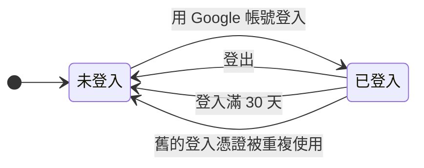

# 帳號

使用者要先用 Google 帳號登入 Taigu，才能記帳與使用其他功能。這份 spec 寫的是登入、登入狀態維持多久與怎麼結束、未登入時開啟頁面會被導去哪裡，以及設定頁 `/settings` 的總覽與兩項帳號設定（修改名字與頭像、更換綁定的 Google 帳號）。資料的匯出見 REC-R20，方案與付款寫在 [billing.md](billing.md)。

同一個瀏覽器的登入狀態會照下圖改變，每一種轉換的規則寫在下面的需求：

## 需求

### ACCT-R1 用 Google 帳號登入

使用者在登入頁 `/login` 點 Google 登入按鈕、在 Google 的畫面同意授權，Taigu 完成登入之後把畫面換到儀表板 `/`；使用者是因為未登入而被導到歡迎頁的話，則換回原本開啟的網址（見 ACCT-R3），而已登入的使用者開啟登入頁時，Taigu 直接把畫面換到儀表板。從 Google 回到登入頁時，Taigu 只在這次授權通過 ACCT-R12 的檢查時才登入，沒有完成登入時的處理見 ACCT-R13，使用者取消授權時的處理見 ACCT-R14。

- ACCT-R1.1 從登入頁登入
  - 前提：使用者未登入，而且不是從需要登入的頁面被導過來。
  - 動作：開啟登入頁，點 Google 登入按鈕，在 Google 的畫面選擇帳號並同意授權。
  - 結果：畫面回到 Taigu 並換到儀表板 `/`。
- ACCT-R1.2 已登入時開啟登入頁
  - 前提：使用者已登入。
  - 動作：開啟登入頁 `/login`。
  - 結果：畫面換到儀表板 `/`。

### ACCT-R2 第一次登入時建立帳號

第一次用某個 Google 帳號登入時，Taigu 替這個 Google 帳號建立新帳號，名字、頭像與 Email 取自這個 Google 帳號；之後用同一個 Google 帳號登入都會進到這個帳號，而且登入時 Taigu 不會用 Google 帳號的資料覆蓋使用者改過的名字與頭像。

新帳號的試用期見 BILL-R2。

- ACCT-R2.1 第一次登入
  - 前提：沒有任何 Taigu 帳號綁定這個 Google 帳號。
  - 動作：用這個 Google 帳號登入，再開啟設定頁。
  - 結果：設定頁顯示這個 Google 帳號的頭像、名字與 Email。
- ACCT-R2.2 再次登入時保留改過的名字
  - 前提：使用者用這個 Google 帳號登入過，並在頭像與名字頁把名字改成「小明」。
  - 動作：登出，再用同一個 Google 帳號登入，開啟設定頁。
  - 結果：設定頁顯示的名字是「小明」，不是 Google 帳號的名字。

### ACCT-R3 未登入時開啟需要登入的頁面

除了歡迎頁 `/welcome`、登入頁 `/login`、隱私權政策 `/privacy-policy`、服務條款 `/terms-of-service` 與找不到頁面，Taigu 的其他頁面都要登入才能使用；未登入的使用者開啟要登入的頁面時，Taigu 記住原本開啟的完整網址（包括 `?` 之後的參數）並把畫面換到歡迎頁，使用者登入後再換回這個網址。不需要登入的那幾個頁面，規則見 PUB-R1、PUB-R4 與 PUB-R5。

- ACCT-R3.1 未登入時開啟需要登入的頁面
  - 前提：使用者未登入。
  - 動作：開啟設定頁 `/settings`。
  - 結果：畫面換到歡迎頁 `/welcome`。
- ACCT-R3.2 登入後換回原本開啟的網址
  - 前提：使用者未登入，開啟 `/records?sid=2330` 之後被導到歡迎頁。
  - 動作：換到登入頁，用 Google 帳號登入。
  - 結果：畫面換到 `/records?sid=2330`。

### ACCT-R4 未登入時拒絕讀寫資料

讀取或修改使用者的資料與行情都要登入，沒有登入的 request，Taigu 一律拒絕。

- ACCT-R4.1 未登入時送出需要登入的 request
  - 前提：沒有登入。
  - 動作：直接向 Taigu 的 API 送出任何一個需要登入的 request，例如讀取帳號資料或交易紀錄。
  - 結果：Taigu 拒絕這個 request，不回傳也不修改任何資料。

### ACCT-R5 登入狀態最長維持 30 天

同一個瀏覽器的登入狀態在登入滿 30 天後到期（最後換發的 access token 最多還能再用 15 分鐘），到期時間不隨使用而延後（換綁 Google 帳號之後的登入狀態不在這條規則的範圍內）；到期之前，除了登出（見 ACCT-R7）與舊的登入憑證被重複使用（見 ACCT-R6），關閉瀏覽器或閒置都不必重新登入。登入狀態因為到期、舊的登入憑證被重複使用，或瀏覽器的登入 cookie 被清除而結束後，Taigu 下一次讀寫資料時把畫面換到歡迎頁，使用者重新登入後回到哪一頁見 ACCT-R3。

- ACCT-R5.1 閒置並關閉瀏覽器後再開啟
  - 前提：使用者 1 小時前登入，之後關閉了瀏覽器。
  - 動作：開啟瀏覽器，開啟歷史紀錄頁 `/records`。
  - 結果：畫面顯示歷史紀錄頁，不必重新登入。
- ACCT-R5.2 登入滿 30 天
  - 前提：使用者 31 天前登入，期間每天都使用 Taigu。
  - 動作：開啟歷史紀錄頁 `/records`。
  - 結果：畫面換到歡迎頁 `/welcome`；使用者重新登入後，畫面換回 `/records`。
- ACCT-R5.3 瀏覽器的登入 cookie 被清除
  - 前提：使用者已經登入，之後瀏覽器的登入 cookie 都被清除。
  - 動作：開啟歷史紀錄頁 `/records`。
  - 結果：畫面換到歡迎頁 `/welcome`；使用者重新登入後，畫面換回 `/records`。

### ACCT-R6 舊的登入憑證被重複使用時結束那次登入

瀏覽器保存一份登入憑證，用來向 Taigu 維持登入狀態，Taigu 每次收到登入憑證都換發新的一份並讓舊的失效；收到已經失效的舊憑證時，Taigu 拒絕這次要求，並讓同一次登入換發過的所有憑證都失效，使用那次登入的瀏覽器之後要重新登入。

- ACCT-R6.1 有人重複使用舊的登入憑證
  - 前提：使用者登入後，瀏覽器已經用登入憑證維持過一次登入狀態，手上是換發後的新憑證。
  - 動作：有人拿換發之前的舊憑證向 Taigu 要求維持登入狀態。
  - 結果：Taigu 拒絕這次要求，瀏覽器手上的新憑證也一起失效。

### ACCT-R7 登出

使用者在設定頁點「登出」並在確認視窗確認之後，Taigu 結束這個瀏覽器的這次登入、讓這次登入的登入憑證失效，並刪除這個瀏覽器保存的這個帳號的交易紀錄，以及離線時讀取用的現金股利紀錄、買賣計畫、自選股、個股筆記與手續費折讓，再把畫面換到登入頁；同一個帳號在其他瀏覽器的登入不受影響。

- ACCT-R7.1 登出
  - 前提：使用者只在這個瀏覽器登入，新增過交易紀錄，並開啟設定頁。
  - 動作：點「登出」，在確認視窗點「登出」。
  - 結果：畫面換到登入頁 `/login`；這次登入換發過的登入憑證都失效，之後開啟儀表板 `/` 時畫面換到歡迎頁；這個瀏覽器不再保存這個帳號的交易紀錄。
- ACCT-R7.2 取消登出
  - 前提：使用者已登入，開啟設定頁。
  - 動作：點「登出」，在確認視窗選擇不登出。
  - 結果：確認視窗關閉，畫面留在設定頁，使用者仍是登入狀態。
- ACCT-R7.3 其他瀏覽器的登入不受影響
  - 前提：同一個帳號在瀏覽器 A 與瀏覽器 B 都已登入。
  - 動作：在瀏覽器 A 登出。
  - 結果：瀏覽器 B 繼續使用 Taigu，不必重新登入。

> 設計理由：登出時刪除離線讀取用的資料，是為了讓同一個瀏覽器之後登入的人看不到前一個帳號的資料。

### ACCT-R8 設定頁總覽

設定頁 `/settings` 顯示使用者的頭像、名字、Email 與目前方案的名稱（Standard 或 Free），並提供頭像與名字頁、帳號綁定頁、資料控制頁、方案頁、隱私權政策、服務條款與問題回報的入口，以及登出（見 ACCT-R7）。

方案的判定見 BILL-R1。

- ACCT-R8.1 開啟設定頁
  - 前提：使用者已登入，帳號在試用期內。
  - 動作：開啟設定頁 `/settings`。
  - 結果：設定頁顯示使用者的頭像、名字與 Email，目前方案顯示「Standard」；點頭像與名字、Email、資料控制、目前方案，畫面分別換到頭像與名字頁 `/settings/user-info`、帳號綁定頁 `/settings/account-binding`、資料控制頁 `/settings/data-controls`、方案頁 `/settings/current-plan`；頁面上另有隱私權政策、服務條款、問題回報與登出的入口。

### ACCT-R9 修改名字與頭像

名字不是空白、在 64 個字以內，而且「頭像位置」是空白或 http、https 開頭的網址時，使用者在頭像與名字頁 `/settings/user-info` 儲存修改之後，Taigu 儲存名字與頭像並把畫面換到設定頁，頭像位置空白時每個顯示頭像的地方都改用預設的人像圖示；「頭像位置」是其他內容時，Taigu 顯示錯誤提示，名字與頭像都不儲存。

- ACCT-R9.1 修改名字
  - 前提：使用者開啟頭像與名字頁，「頭像位置」是空白或 http、https 開頭的網址。
  - 動作：把名字改成「小明」，儲存修改。
  - 結果：畫面換到設定頁，顯示的名字是「小明」。
- ACCT-R9.2 修改頭像
  - 前提：使用者開啟頭像與名字頁。
  - 動作：在「頭像位置」輸入一張圖片的 https 網址，儲存修改。
  - 結果：畫面換到設定頁，頭像顯示這張圖片。
- ACCT-R9.3 清空頭像位置
  - 前提：使用者有頭像，開啟頭像與名字頁。
  - 動作：清空「頭像位置」，儲存修改。
  - 結果：畫面換到設定頁；設定頁、桌面瀏覽器的側邊欄與行動裝置的底部導覽列都顯示預設的人像圖示。
- ACCT-R9.4 頭像位置不是 http 或 https 網址
  - 前提：使用者開啟頭像與名字頁，把名字改成「測試」。
  - 動作：在「頭像位置」輸入「ftp://example.com/avatar.png」，儲存修改。
  - 結果：畫面顯示錯誤提示「無效的頭像 URL，請檢查格式是否正確」，留在頭像與名字頁，名字與頭像都沒有儲存。

### ACCT-R10 使用 Gravatar 頭像

使用者的 Email 在 Gravatar 有頭像時，頭像與名字頁顯示「使用 Gravatar 頭像」，使用者確認套用之後，Taigu 把 Gravatar 頭像的網址填進「頭像位置」，等使用者儲存修改才儲存。

- ACCT-R10.1 套用 Gravatar 頭像
  - 前提：使用者的 Email 在 Gravatar 有頭像，開啟頭像與名字頁。
  - 動作：點「使用 Gravatar 頭像」，確認套用。
  - 結果：「頭像位置」換成 Gravatar 頭像的網址，頭像預覽換成 Gravatar 頭像；這時還沒有儲存，儲存修改之後設定頁的頭像才換成 Gravatar 頭像。
- ACCT-R10.2 Email 沒有 Gravatar 頭像
  - 前提：使用者的 Email 在 Gravatar 沒有頭像。
  - 動作：開啟頭像與名字頁。
  - 結果：頁面上沒有「使用 Gravatar 頭像」。

### ACCT-R11 更換綁定的 Google 帳號

使用者可以在帳號綁定頁 `/settings/account-binding` 把帳號改綁到一個還沒有綁定任何 Taigu 帳號的 Google 帳號，改綁之後要用新的 Google 帳號登入，帳號的 Email、名字與頭像也換成新 Google 帳號的資料，使用者改過的名字與頭像不會保留。從 Google 回到帳號綁定頁時，Taigu 只在這次授權通過 ACCT-R12 的檢查時才改綁，沒有完成改綁時的處理見 ACCT-R13，使用者取消授權時的處理見 ACCT-R14。

- ACCT-R11.1 改綁成功
  - 前提：使用者把名字改成「小明」，開啟帳號綁定頁。
  - 動作：開始更換綁定的帳號，在 Google 的畫面選擇一個還沒有綁定任何 Taigu 帳號的 Google 帳號並同意授權。
  - 結果：畫面回到帳號綁定頁並顯示「成功綁定」，綁定的帳號顯示新 Google 帳號的 Email；設定頁的名字與頭像換成新 Google 帳號的名字與頭像，不再是「小明」；登出後用新的 Google 帳號登入，會進到這個帳號。
- ACCT-R11.2 選了已經綁定 Taigu 帳號的 Google 帳號
  - 前提：使用者開啟帳號綁定頁。
  - 動作：開始更換綁定的帳號，在 Google 的畫面選擇一個已經綁定 Taigu 帳號的 Google 帳號（包括目前綁定的這一個）並同意授權。
  - 結果：Taigu 不改綁，帳號綁定頁仍顯示原本的 Email。

### ACCT-R12 只接受從同一個瀏覽器開始的 Google 授權

使用者在登入頁點 Google 登入按鈕，或在帳號綁定頁開始更換綁定的帳號時，Taigu 記下這個瀏覽器開始了一次 Google 授權。之後使用者從 Google 回到 Taigu 時，Taigu 只在下列兩種情況處理 Google 帶回的結果：

- 使用者未登入時回到登入頁。
- 使用者已登入時回到帳號綁定頁。

使用者已登入時回到登入頁，Taigu 照 ACCT-R1 換到儀表板；使用者未登入時回到帳號綁定頁，Taigu 照 ACCT-R3 換到歡迎頁，等使用者登入、畫面換回帳號綁定頁之後，Taigu 才處理 Google 帶回的結果。

Google 帶回授權結果（網址上的 `code`）時，這次授權要同時符合下列條件，Taigu 才登入（見 ACCT-R1）或改綁（見 ACCT-R11），不符合時的處理見 ACCT-R13：

- 這次授權是這個瀏覽器最近一次開始的授權，所以從其他瀏覽器開始的授權都不符合。
- 從開始授權到回到 Taigu 不超過 10 分鐘。
- Taigu 還沒處理過這次授權回到 Taigu 的網址。

  只要 Taigu 處理過這次授權回到 Taigu 的其中一個網址，就算那個網址上的 `code` 被改成其他值，這次授權也算處理過。不過 access token 過期（見 ACCT-R5）時，Taigu 換發 access token 之前不會處理這個網址，所以換發之後照常處理。

瀏覽器的 cookie 被清除時，這個瀏覽器之前開始的授權都會作廢，回到 Taigu 時都不符合上面的條件。

Google 帶回的是錯誤而不是授權結果時，使用者在 Google 的畫面取消授權的處理見 ACCT-R14，其他錯誤見 ACCT-R13。

- ACCT-R12.1 開啟別人傳來的登入連結
  - 前提：使用者未登入；另一個人在自己的瀏覽器開始登入，在 Google 的畫面同意授權之後，取得 Google 帶回 Taigu 的網址 `/login?code=…&state=…`，但沒有在自己的瀏覽器完成登入。
  - 動作：使用者在自己的瀏覽器開啟這個網址。
  - 結果：畫面留在登入頁，網址不再帶有 `code` 與 `state`，並顯示錯誤提示「登入沒有完成，請重新登入。」；之後開啟儀表板 `/` 時，畫面換到歡迎頁。
- ACCT-R12.2 開啟別人傳來的改綁連結
  - 前提：使用者已登入；另一個人在自己的瀏覽器開始更換綁定的帳號，選擇一個還沒有綁定任何 Taigu 帳號的 Google 帳號並同意授權之後，取得 Google 帶回 Taigu 的網址 `/settings/account-binding?code=…&state=…`，但沒有在自己的瀏覽器完成改綁。
  - 動作：使用者在自己的瀏覽器開啟這個網址。
  - 結果：帳號綁定頁仍顯示原本的 Email，網址不再帶有 `code` 與 `state`，並顯示錯誤提示「綁定的帳號沒有更換，請重新更換綁定的帳號。」；使用者登出後用原本的 Google 帳號登入，仍會進到這個帳號。
- ACCT-R12.3 開始登入超過 10 分鐘才回到 Taigu
  - 前提：使用者未登入，在登入頁點 Google 登入按鈕。
  - 動作：在 Google 的畫面停留超過 10 分鐘，再選擇帳號並同意授權。
  - 結果：畫面回到登入頁，並顯示錯誤提示「登入沒有完成，請重新登入。」，使用者沒有登入。
- ACCT-R12.4 同一個瀏覽器先後開始兩次登入
  - 前提：使用者未登入，而且不是從需要登入的頁面被導過來；使用者在分頁 A 的登入頁點 Google 登入按鈕，停在 Google 的畫面，接著在同一個瀏覽器的分頁 B 的登入頁也點 Google 登入按鈕。
  - 動作：先在分頁 A 選擇帳號並同意授權，再到分頁 B 選擇帳號並同意授權。
  - 結果：分頁 A 回到登入頁，並顯示錯誤提示「登入沒有完成，請重新登入。」；分頁 B 完成登入，畫面換到儀表板 `/`。
- ACCT-R12.5 未登入時開啟別人傳來的改綁連結
  - 前提：使用者未登入；另一個人在自己的瀏覽器開始更換綁定的帳號，選擇一個還沒有綁定任何 Taigu 帳號的 Google 帳號並同意授權之後，取得 Google 帶回 Taigu 的網址 `/settings/account-binding?code=…&state=…`，但沒有在自己的瀏覽器完成改綁。
  - 動作：使用者在自己的瀏覽器開啟這個網址，畫面換到歡迎頁之後，用自己的 Google 帳號登入。
  - 結果：登入之後畫面換回帳號綁定頁，帳號綁定頁顯示使用者自己的 Google 帳號的 Email，網址不再帶有 `code` 與 `state`，並顯示錯誤提示「綁定的帳號沒有更換，請重新更換綁定的帳號。」。
- ACCT-R12.6 Access Token 過期時更換綁定的帳號
  - 前提：使用者已登入，登入狀態還沒到期，但最後換發的 access token 已經過期；使用者在帳號綁定頁開始更換綁定的帳號；就在使用者回到 Taigu 之前，有一個未登入的 request 送到 Taigu 更換綁定帳號的 API。
  - 動作：在 Google 的畫面選擇一個還沒有綁定任何 Taigu 帳號的 Google 帳號並同意授權。
  - 結果：畫面回到帳號綁定頁並顯示「成功綁定」，綁定的帳號顯示新 Google 帳號的 Email。

### ACCT-R13 Google 授權沒有完成時顯示錯誤提示

Taigu 處理 Google 帶回的結果時（見 ACCT-R12），只要發生下列任何一種情況，Taigu 就不登入也不改綁，從網址移除 Google 帶回來的參數，並依頁面顯示錯誤提示：

- 授權結果沒通過 ACCT-R12 的檢查。
- Google 不接受這次的授權結果，例如授權結果被改過或已經過期。
- Taigu 連不上 Google，或無法確認 Google 回傳的資料真的來自 Google。
- Google 帶回的是使用者取消授權以外的錯誤。

錯誤提示依頁面不同：

- 登入頁顯示「登入沒有完成，請重新登入。」，使用者仍是未登入。
- 帳號綁定頁顯示「綁定的帳號沒有更換，請重新更換綁定的帳號。」，使用者仍用原本的 Google 帳號登入。

使用者選到已經綁定 Taigu 帳號的 Google 帳號時，只有上面的情況都沒有發生，Taigu 才照 ACCT-R11 處理。

- ACCT-R13.1 登入時 Google 不接受授權結果
  - 前提：使用者未登入，在登入頁點 Google 登入按鈕，在 Google 的畫面同意授權；Google 帶回 Taigu 的網址裡，`code` 被改成其他值，`state` 沒有改。
  - 動作：開啟這個網址。
  - 結果：畫面留在登入頁，網址不再帶有 `code` 與 `state`，並顯示錯誤提示「登入沒有完成，請重新登入。」，使用者沒有登入。
- ACCT-R13.2 改綁時 Google 不接受授權結果
  - 前提：使用者已登入，在帳號綁定頁開始更換綁定的帳號，在 Google 的畫面選擇一個還沒有綁定任何 Taigu 帳號的 Google 帳號並同意授權；Google 帶回 Taigu 的網址裡，`code` 被改成其他值，`state` 沒有改。
  - 動作：開啟這個網址。
  - 結果：帳號綁定頁仍顯示原本的 Email，網址不再帶有 `code` 與 `state`，並顯示錯誤提示「綁定的帳號沒有更換，請重新更換綁定的帳號。」。
- ACCT-R13.3 登入時 Taigu 連不上 Google
  - 前提：使用者未登入，在登入頁點 Google 登入按鈕，在 Google 的畫面同意授權；Taigu 連不上 Google。
  - 動作：Google 把使用者帶回登入頁。
  - 結果：畫面留在登入頁，網址不再帶有 `code` 與 `state`，並顯示錯誤提示「登入沒有完成，請重新登入。」，使用者沒有登入。
- ACCT-R13.4 Google 帶回取消授權以外的錯誤
  - 前提：使用者未登入。
  - 動作：開啟 Google 帶著 `error=server_error` 回到登入頁的網址 `/login?error=server_error&state=…`。
  - 結果：畫面留在登入頁，網址不再帶有 `error` 與 `state`，並顯示錯誤提示「登入沒有完成，請重新登入。」，使用者沒有登入。
- ACCT-R13.5 沒通過檢查又選到已經綁定的 Google 帳號
  - 前提：使用者已登入，在分頁 A 的帳號綁定頁開始更換綁定的帳號，停在 Google 的畫面，接著在同一個瀏覽器的分頁 B 也開始更換綁定的帳號。
  - 動作：在分頁 A 選擇目前綁定的 Google 帳號並同意授權。
  - 結果：分頁 A 回到帳號綁定頁，仍顯示原本的 Email，並顯示錯誤提示「綁定的帳號沒有更換，請重新更換綁定的帳號。」。

### ACCT-R14 在 Google 的畫面取消授權

Taigu 處理 Google 帶回的結果時（見 ACCT-R12），如果使用者在 Google 的畫面取消了授權，Taigu 不登入也不改綁，從網址移除 Google 帶回來的參數，也不顯示錯誤提示；這次授權有沒有符合 ACCT-R12 的條件，結果都一樣。

- ACCT-R14.1 登入時取消授權
  - 前提：使用者未登入，在登入頁點 Google 登入按鈕。
  - 動作：在 Google 的畫面取消授權。
  - 結果：畫面回到登入頁，網址沒有 Google 帶回來的參數，畫面上沒有錯誤提示，使用者沒有登入。
- ACCT-R14.2 改綁時取消授權
  - 前提：使用者已登入，在帳號綁定頁開始更換綁定的帳號。
  - 動作：在 Google 的畫面取消授權。
  - 結果：畫面回到帳號綁定頁，仍顯示原本的 Email，網址沒有 Google 帶回來的參數，畫面上沒有錯誤提示。
