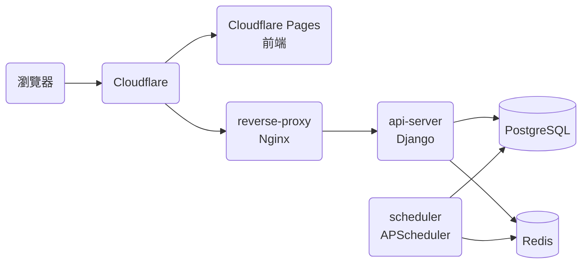
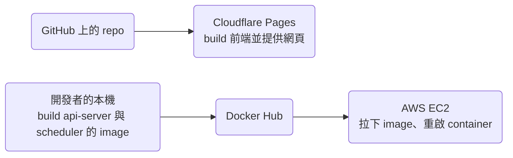

# 技術架構

本文件描述 `main` 上的程式碼目前的技術架構。

## 服務

上圖是 prod 的架構。不過開發環境沒有 Cloudflare，由 reverse-proxy 同時把 request 轉給前端的 dev server 與 api-server，各個 container 的設定寫在 `compose.dev.yaml`。

| 服務 | 程式碼 | 技術 |
| --- | --- | --- |
| 前端 | `frontend/` | React、TypeScript、Redux Toolkit，用 Create React App build |
| api-server | `api-server/` | Django、Python |
| scheduler | `scheduler/` | Python、APScheduler，定時抓行情與公司資料、清理過期的資料、處理到期的訂閱 |
| reverse-proxy | `reverse-proxy/` | Nginx |

## 部署

前端與 api-server 用不同的路徑部署，api-server 與 scheduler 由開發者手動部署，步驟寫在 README 的「The Development Workflow」。所以前端與 api-server 的新版本不會同時上線，修改 API 或資料庫時，要讓 prod 上的前端在 api-server 部署前後都能正常運作。

## 登入

使用者用 Google OAuth 登入。前端與 api-server 之間用 HTTP-only cookie 存放 JWT，會修改資料的 request 另外在 `X-CSRFToken` header 帶上 CSRF token，api-server 不保存 session。`RefreshToken` 存放 refresh token 的雜湊值，用來做 refresh token 的 rotation。

## 前端

- 全域狀態放在 Redux Toolkit 的 slice。`Main.tsx` 在 `componentDidMount` 同時初始化使用者的投資組合與大盤指數的狀態。
- Workbox 用 stale-while-revalidate 的策略 cache app shell、靜態檔案與不會修改資料的 GET request。前端新增、修改或刪除資料時都要連上 api-server，離線時只能讀取 Workbox cache 裡的資料，所以不會出現離線時的修改與 api-server 上的資料衝突的情況。
- 介面與文案的規則寫在 [ui-guidelines.md](ui-guidelines.md)。

## 付款與額度

- 綠界（ECPay）處理信用卡付款，以及背景的定期定額扣款。scheduler 每天執行 `reconcile_due_billing_profiles`，處理到期的 `BillingProfile`。
- api-server 寫入資料之前，先用 `api-server/main/billing/services/entitlements.py` 檢查使用者的方案還有沒有額度。各方案的額度也定義在這個檔案，Free 方案的是 `FREE_QUOTA`。

## Domain 規則

還沒有 spec 的能力，它的 domain 規則暫時寫在這一節。Backfill 補上那個能力的 spec 時，把規則改寫成需求搬進 spec，並更新連到這一節的連結。

- 持股：把某檔股票所有交易紀錄的成交股數加總，買進的股數算正數、賣出的股數算負數，總和大於 0 時，使用者持有這檔股票。
- 額度的範圍：額度只會擋下新增資料，使用者超過額度或更換方案時，既有的資料都不會被刪除。

## 功能與程式碼對照

| 功能 | 網址 | 前端頁面 | 後端 app | Spec |
| --- | --- | --- | --- | --- |
| 儀表板 | `/` | `frontend/src/pages/Main/Dashboard/Dashboard.tsx` | 無，由前端彙整其他 app 的資料 | 無 |
| 市場 | `/market` | `frontend/src/pages/Main/Market/Market.tsx` | `api-server/main/market/` | 無 |
| 大盤指數 | `/market-index/:market` | `frontend/src/pages/Main/MarketIndexDetails/MarketIndexDetails.tsx` | `api-server/main/market/` | 無 |
| 搜尋 | `/search` | `frontend/src/pages/Main/Search/Search.tsx` | `api-server/main/market/` | 無 |
| 持股 | `/`、`/market/holding/:sid` | `frontend/src/pages/Main/Dashboard/Dashboard.tsx`、`frontend/src/pages/Main/Details/Details.tsx` | `api-server/main/trade_record/` | 無 |
| 個股詳情 | `/market/:sid` | `frontend/src/pages/Main/Details/Details.tsx` | `api-server/main/market/`、`api-server/main/stock_memo/` | 無 |
| 自選股 | `/market`、`/market/favorites/:sid` | `frontend/src/pages/Main/Market/Market.tsx`、`frontend/src/pages/Main/Details/Details.tsx` | `api-server/main/favorite/` | 無 |
| 歷史紀錄 | `/records` | `frontend/src/pages/Main/Records/Records.tsx` | `api-server/main/trade_record/`、`api-server/main/cash_dividend/` | 無 |
| 買賣計畫 | `/plans` | `frontend/src/pages/Main/Plans/Plans.tsx` | `api-server/main/trade_plan/` | 無 |
| 收益分析 | `/earning-analysis` | `frontend/src/pages/Main/EarningAnalysis/EarningAnalysis.tsx` | 無，在前端計算 | 無 |
| 手續費 | `/handling-fee` | `frontend/src/pages/Main/HandlingFee/HandlingFee.tsx` | `api-server/main/handling_fee/` | 無 |
| 登入與帳號 | `/login`、`/settings/user-info`、`/settings/account-binding` | `frontend/src/pages/Login/Login.tsx`、`frontend/src/pages/Settings/UserInfo/UserInfo.tsx`、`frontend/src/pages/Settings/AccountBinding/AccountBinding.tsx` | `api-server/main/account/` | 無 |
| 資料控制 | `/settings/data-controls` | `frontend/src/pages/Settings/DataControls/DataControls.tsx`、`frontend/src/pages/Settings/DeleteAccount/DeleteAccount.tsx` | `api-server/main/trade_record/`、`api-server/main/cash_dividend/`、`api-server/main/account/` | 無 |
| 付款與方案 | `/settings/current-plan` | `frontend/src/pages/Settings/CurrentPlan/CurrentPlan.tsx` | `api-server/main/billing/` | 無 |
| 問題回報 | `/settings/issue-report` | `frontend/src/pages/Settings/IssueReport/IssueReport.tsx` | `api-server/main/issue_report/` | 無 |
| 歡迎頁 | `/welcome` | `frontend/src/pages/Welcome/Welcome.tsx` | 無 | 無 |
| 法律頁面 | `/privacy-policy`、`/terms-of-service` | `frontend/src/pages/PrivacyPolicy/PrivacyPolicy.tsx`、`frontend/src/pages/TermsOfService/TermsOfService.tsx` | 無 | 無 |

「Spec」一欄寫「無」的功能還沒有 spec，修改這些功能的行為之前，先照 sdd skill 的「Procedure: Backfill」補上 spec。

## Data model

股票代號在 API 與前端叫做 `sid`，在資料表裡是 `company_id`，型別是字串，例如 `"2330"`、`"0050"`。

### 帳號

- `User`：使用者，以 UUID 識別，記錄 Google OAuth 的資料。
- `RefreshToken`：refresh token 的雜湊值。

### 市場資料

- `Company`：股票的基本資料。
- `StockInfo`：即時的股價與成交量。
- `History`：每日、每週、每月的歷史股價。
- `StockPricePerMinute`：個股盤中每分鐘的價格，個股詳情的盤中走勢用的就是這份資料。
- `MarketIndexPerMinute`：上市、上櫃指數盤中每分鐘的價格。
- `MarketIndexHistory`：上市、上櫃指數每日的收盤價。
- `MaterialFact`：公司發布的重大訊息。

### 使用者資料

- `TradeRecord`：交易紀錄。`deal_quantity` 在買進時是正數，賣出時是負數。
- `CashDividendRecord`：現金股利紀錄。
- `StockMemo`：個股筆記。
- `TradePlan`：買賣計畫。
- `Favorite`：自選股。
- `HandlingFeeDiscountRecord`：手續費折讓。
- `BillingProfile`：使用者目前的方案、到期時間與訂閱狀態。
- `SubscriptionPayment`：付款與訂閱帳單的紀錄。
- `IssueReport`：使用者回報的問題，最多 5,000 字。
- `DataChangeLog`：記錄使用者每次新增、修改或刪除資料（例如 `TradeRecord`），讓 API 只回傳前端上次同步之後變動的資料。

## 測試

- api-server 用 pytest。每個 app 的 `tests/unit/` 放 unit test，CI 會執行；`tests/integration/` 放會呼叫外部服務的 integration test，CI 不執行。
- 前端用 Create React App 內建的 Jest（`npm test`），目前還沒有 test。
- `make check-scenarios` 檢查每個 spec 情境都有 test 或 `tests/manual/` 的段落，對應的規則寫在 sdd skill 的「Spec Conventions」。
