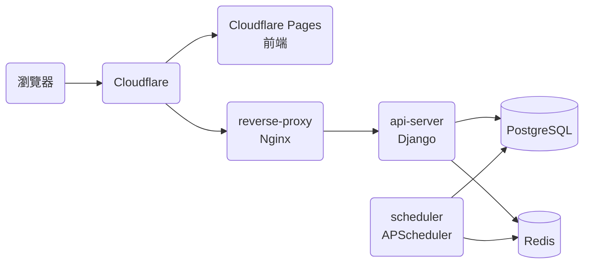
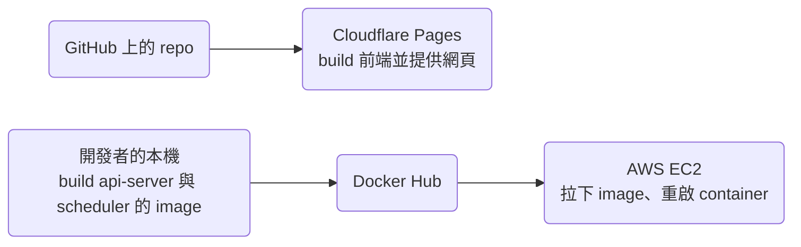

# 技術架構

本文件描述 `main` 上的程式碼目前的技術架構。

## 服務

上圖是 prod 的架構。不過開發環境沒有 Cloudflare，由 reverse-proxy 同時把 request 轉給前端的 dev server 與 api-server，各個 container 的設定寫在 `compose.dev.yaml`。

| 服務 | 程式碼 | 技術 |
| --- | --- | --- |
| 前端 | `frontend/` | React、TypeScript、Redux Toolkit，用 Create React App build |
| api-server | `api-server/` | Django、Python |
| scheduler | `scheduler/` | Python、APScheduler，定時抓行情與公司資料、清理過期的資料、處理到期的訂閱 |
| reverse-proxy | `reverse-proxy/` | Nginx |

## 部署

前端與 api-server 用不同的路徑部署，api-server 與 scheduler 由開發者手動部署，步驟寫在 README 的「The Development Workflow」。所以前端與 api-server 的新版本不會同時上線，修改 API 或資料庫時，要讓 prod 上的前端在 api-server 部署前後都能正常運作。

### 公開頁面的預先 render

Cloudflare Pages 用 `npm run build` build 前端，build 完成後 `postbuild` 執行 `frontend/scripts/prerender.mjs`：用 Puppeteer 開啟 build 出來的 `/welcome`、`/privacy-policy`、`/terms-of-service`，把 render 好的 DOM 存成 `build/welcome.html` 這類檔案。Cloudflare Pages 直接用這些檔案回應這三個網址，其他網址都回 `index.html`。dev 環境的 image 不下載 Puppeteer 用的 Chrome，所以本機產生不了這些檔案。

> 設計理由：預先 render 擷取的是實際 build 出來的頁面，而不是用 `renderToString`，因為 Create React App 產生的 CSS module class name 與檔名帶有 hash，不 eject 的話，另外的 bundler 產生不出一樣的結果。

## 登入

使用者用 Google OAuth 登入。前端與 api-server 之間用 HTTP-only cookie 存放 JWT，會修改資料的 request 另外在 `X-CSRFToken` header 帶上 CSRF token，api-server 不保存 session。`RefreshToken` 存放 refresh token 的雜湊值，用來做 refresh token 的 rotation。

Access token 15 分鐘後到期，refresh token 30 天後到期。Rotation 時，新的 refresh token 沿用舊的到期時間，所以登入 30 天後就換不到新的 token，不過最後換到的 access token 還能再用到它到期為止，最多 15 分鐘。前端的 request 收到 401 時，會先用 refresh token 換一組新的 token 再重送一次 request，換不到就登出並導向歡迎頁。

## 前端

- 全域狀態放在 Redux Toolkit 的 slice。`Main.tsx` 在 `componentDidMount` 同時初始化使用者的投資組合與大盤指數的狀態。
- Service worker 用 Workbox 處理 cache：
  - Build 出來的檔案在安裝 service worker 時就 precache。
  - 開啟頁面的 request 一律回 app shell（`index.html`）。例外是預先 render 的三個公開頁面、路徑以 `/_` 開頭的頁面，以及路徑帶副檔名的檔案，這些 request 會送到網路。
  - 同一個網域的圖片與 `.mp4` 影片用 stale-while-revalidate，其他網域的圖片（例如 Gravatar 頭像）不 cache。
  - `frontend/src/service-worker.ts` 的 `apiCachePaths` 列出的 GET request（例如自選股、買賣計畫、現金股利、走勢資料）用 network first，3 秒內沒有回應就改用 cache。
  - 登出時刪掉 API 的 cache。
- 交易紀錄存在瀏覽器的 IndexedDB，前端只向 api-server 要上次同步之後有變動的紀錄（見 Data model 的 `DataChangeLog`）。大盤指數的歷史收盤價也存在 IndexedDB，前端只向 api-server 要最新一筆之後的資料。
- 前端新增、修改或刪除資料時都要連上 api-server，離線時只能讀取 cache 裡的資料，所以不會出現離線時的修改與 api-server 上的資料衝突的情況。
- 市場頁依名稱排序時用 `localeCompare(…, "zh-Hant")`。CLDR 對 zh-Hant 預設的排序是依筆畫，在 Node 22（ICU 76.1）實測，「中華電、台塑、台積電、聯發科、鴻海」依這個順序排列。
- 頭像與名字頁用使用者 email 的 MD5 向 gravatar.com 查詢頭像，查詢時帶 `d=404`，所以這個 email 沒有 Gravatar 頭像時，gravatar.com 回 404。
- 介面與文案的規則寫在 [ui-guidelines.md](ui-guidelines.md)。

前端的狀態只存交易紀錄的手續費總和，淨手續費在每次讀取時才用這個總和減掉手續費折讓的總和算出來。

> 設計理由：以前淨手續費直接存在 Redux，每次新增、修改、刪除交易紀錄或手續費折讓時再修補這個值，結果算出來的值會跟紀錄對不上。改成讀取時才算之後，儀表板與手續費頁顯示的數字一定跟紀錄一致。

## 付款與額度

- 綠界（ECPay）處理信用卡付款，以及背景的定期定額扣款。scheduler 每天執行 `reconcile_due_billing_profiles`，處理到期的 `BillingProfile`。
- 綠界用 server 對 server 的通知，把付款結果與每期扣款的結果送到 api-server。api-server 回 `1|OK` 表示收到；回 `0|ERROR` 時，綠界會再送一次通知。
- 使用者開始結帳超過 30 分鐘還沒有付款結果時，下一次每天的到期處理會把那筆付款標成過期；同一位使用者在這之前再開始一次結帳時，前一筆還沒付款的結帳會被取代。綠界之後才通知付款成功時，過期的付款仍然會變成已付款。
- api-server 寫入資料之前，先用 `api-server/main/billing/services/entitlements.py` 檢查使用者的方案還有沒有額度。各方案的額度也定義在這個檔案，Free 方案的是 `FREE_QUOTA`。

## Domain 規則

還沒有 spec 的能力，它的 domain 規則暫時寫在這一節。Backfill 補上那個能力的 spec 時，把規則改寫成需求搬進 spec，並更新連到這一節的連結。

目前每個能力都有 spec，所以這一節沒有規則。

## 功能與程式碼對照

儀表板 `/` 沒有自己的 spec，畫面上的各區塊與新增交易紀錄的入口分屬交易紀錄與現金股利、持股、投資績效、手續費與市場行情這幾個功能，所以這幾列的網址都有 `/`。

| 功能 | 網址 | 前端頁面 | 後端 app | Spec |
| --- | --- | --- | --- | --- |
| 交易紀錄與現金股利 | `/`、`/records`、`/records/trade/new`、`/records/trade/:recordId/edit`、`/records/cash-dividend/new`、`/records/cash-dividend/:recordId/edit`、`/settings/data-controls` | `frontend/src/pages/Main/Dashboard/Dashboard.tsx`、`frontend/src/pages/Main/Records/Records.tsx`、`frontend/src/pages/Main/EditorRoutes/EditorRoutes.tsx`、`frontend/src/pages/Settings/DataControls/DataControls.tsx` | `api-server/main/trade_record/`、`api-server/main/cash_dividend/` | [records.md](records.md) |
| 持股 | `/`、`/market`、`/market/holding/:sid` | `frontend/src/pages/Main/Dashboard/Dashboard.tsx`、`frontend/src/pages/Main/Market/Market.tsx`、`frontend/src/pages/Main/Details/Details.tsx`，計算在 `frontend/src/workers/tradeRecordWorker.ts` 與 `frontend/src/utils/market.ts` | 無，由前端依交易紀錄計算；Free 方案的持股檔數由 `api-server/main/billing/services/entitlements.py` 計算 | [holdings.md](holdings.md) |
| 投資績效 | `/`、`/earning-analysis`、`/market`、`/market/:sid` | `frontend/src/pages/Main/Dashboard/Dashboard.tsx`、`frontend/src/pages/Main/EarningAnalysis/EarningAnalysis.tsx`、`frontend/src/pages/Main/Market/Market.tsx`、`frontend/src/pages/Main/Details/Details.tsx`，計算在 `frontend/src/workers/tradeRecordWorker.ts` 與 `frontend/src/utils/util.ts` | 無，在前端計算 | [performance.md](performance.md) |
| 手續費 | `/`、`/handling-fee`、`/handling-fee/discounts/new`、`/handling-fee/discounts/:discountId/edit` | `frontend/src/pages/Main/Dashboard/Dashboard.tsx`、`frontend/src/pages/Main/HandlingFee/HandlingFee.tsx`、`frontend/src/pages/Main/EditorRoutes/EditorRoutes.tsx` | `api-server/main/handling_fee/` | [handling-fees.md](handling-fees.md) |
| 市場行情 | `/`、`/market-index/:market`、`/search`、`/market`、`/market/:sid`，以及各編輯器的「股票」欄位 | `frontend/src/pages/Main/Dashboard/Dashboard.tsx`、`frontend/src/pages/Main/MarketIndexDetails/MarketIndexDetails.tsx`、`frontend/src/pages/Main/Search/Search.tsx`、`frontend/src/components/StockSearchContent/StockSearchContent.tsx`（搜尋頁與桌面瀏覽器的搜尋視窗 `frontend/src/components/StockSearchModal/StockSearchModal.tsx` 共用）、`frontend/src/components/StockPicker/StockPicker.tsx`，重新抓行情的間隔在 `frontend/src/pages/Main/Main.tsx`、`Market.tsx` 與 `Details.tsx` | `api-server/main/market/` | [market-data.md](market-data.md) |
| 個股詳情 | `/market/:sid`、`/market/holding/:sid`、`/market/favorites/:sid` | `frontend/src/pages/Main/Details/Details.tsx` | `api-server/main/market/`、`api-server/main/stock_memo/` | [stock-details.md](stock-details.md) |
| 自選股 | `/market`、`/market/favorites/:sid` | `frontend/src/pages/Main/Market/Market.tsx`、`frontend/src/pages/Main/Details/Details.tsx` | `api-server/main/favorite/` | [favorites.md](favorites.md) |
| 買賣計畫 | `/plans`、`/plans/new`、`/plans/:planId/edit`、`/market` | `frontend/src/pages/Main/Plans/Plans.tsx`、`frontend/src/pages/Main/EditorRoutes/EditorRoutes.tsx`、`frontend/src/components/TradePlanEditor/TradePlanEditor.tsx`、`frontend/src/pages/Main/Market/Market.tsx` | `api-server/main/trade_plan/` | [trade-plans.md](trade-plans.md) |
| 帳號 | `/login`、`/settings`、`/settings/user-info`、`/settings/account-binding` | `frontend/src/pages/Login/Login.tsx`、`frontend/src/pages/Settings/Overview/Overview.tsx`、`frontend/src/pages/Settings/UserInfo/UserInfo.tsx`、`frontend/src/pages/Settings/AccountBinding/AccountBinding.tsx` | `api-server/main/account/` | [account.md](account.md) |
| 方案與付款 | `/settings/current-plan` | `frontend/src/pages/Settings/CurrentPlan/CurrentPlan.tsx`、`frontend/src/components/PlanUpsellModal/PlanUpsellModal.tsx` | `api-server/main/billing/` | [billing.md](billing.md) |
| 問題回報 | `/settings`、`/settings/issue-report` | `frontend/src/pages/Settings/Overview/Overview.tsx`、`frontend/src/pages/Settings/IssueReport/IssueReport.tsx` | `api-server/main/issue_report/` | [issue-reports.md](issue-reports.md) |
| 公開頁面 | `/welcome`、`/privacy-policy`、`/terms-of-service`，以及其他找不到的網址 | `frontend/src/pages/Welcome/Welcome.tsx`、`frontend/src/pages/PrivacyPolicy/PrivacyPolicy.tsx`、`frontend/src/pages/TermsOfService/TermsOfService.tsx`、`frontend/src/pages/NotFound/NotFound.tsx`、`frontend/src/components/PageMeta/PageMeta.tsx`、`frontend/public/index.html`、`frontend/public/robots.txt`、`frontend/public/sitemap.xml`、`frontend/scripts/prerender.mjs` | 無 | [public-pages.md](public-pages.md) |

「Spec」一欄寫「無」的功能還沒有 spec，修改這些功能的行為之前，先照 sdd skill 的「Procedure: Backfill」補上 spec。

## Data model

股票代號在 API 與前端叫做 `sid`，在資料表裡是 `company_id`，型別是字串，例如 `"2330"`、`"0050"`。

### 帳號

- `User`：使用者，以 UUID 識別，記錄 Google OAuth 的資料。
- `RefreshToken`：refresh token 的雜湊值。

### 市場資料

- `Company`：股票的基本資料。
- `StockInfo`：即時的股價與成交量。
- `History`：每日的收盤價與成交量，只保留最近 80 天。資料表的欄位也能存每週與每月的資料，但目前沒有程式寫入。
- `StockPricePerMinute`：個股盤中每 5 分鐘一筆的價格，個股詳情的盤中走勢用的就是這份資料。
- `MarketIndexPerMinute`：上市、上櫃指數盤中每分鐘的價格。
- `MarketIndexHistory`：上市、上櫃指數每日的收盤價。
- `MaterialFact`：公司發布的重大訊息。

### 使用者資料

- `TradeRecord`：交易紀錄。`deal_quantity` 在買進時是正數，賣出時是負數。
- `CashDividendRecord`：現金股利紀錄。
- `StockMemo`：個股筆記。
- `TradePlan`：買賣計畫。
- `Favorite`：自選股。
- `HandlingFeeDiscountRecord`：手續費折讓。
- `BillingProfile`：使用者目前的方案、到期時間與訂閱狀態。
- `SubscriptionPayment`：付款與訂閱帳單的紀錄。
- `IssueReport`：使用者回報的問題，最多 5,000 字。
- `DataChangeLog`：記錄使用者每次新增、修改或刪除資料（例如 `TradeRecord`），讓 API 只回傳前端上次同步之後變動的資料。

## 測試

- api-server 用 pytest。每個 app 的 `tests/unit/` 放 unit test，CI 會執行；`tests/integration/` 放會呼叫外部服務的 integration test，CI 不執行。
- 前端用 Create React App 內建的 Jest（`npm test`），目前還沒有 test。
- `make check-scenarios` 檢查每個 spec 情境都有 test 或 `tests/manual/` 的段落，對應的規則寫在 sdd skill 的「Spec Conventions」。
