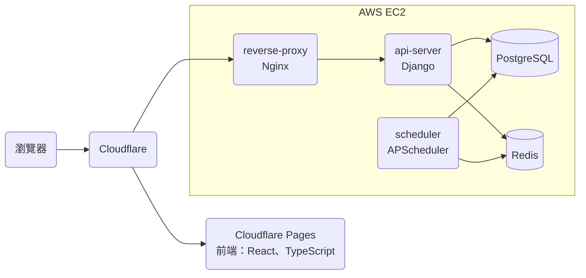
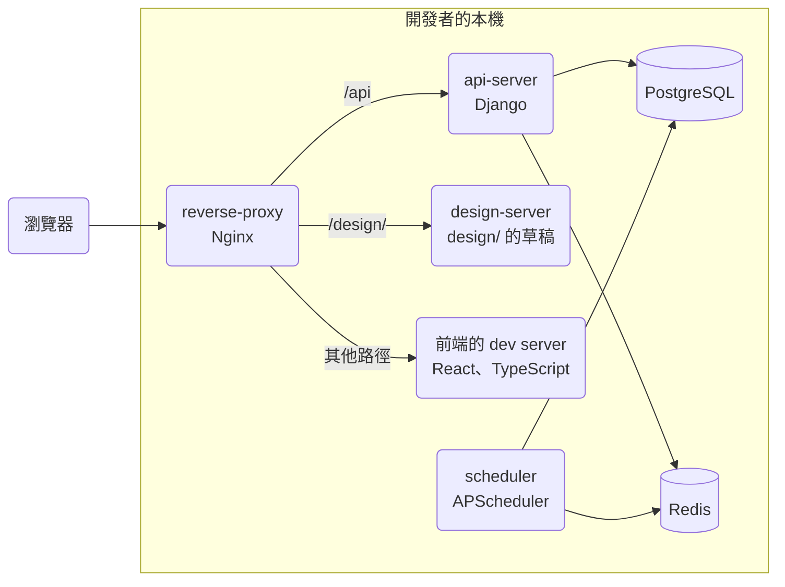
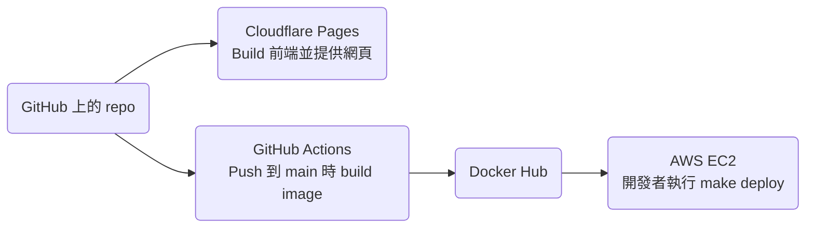
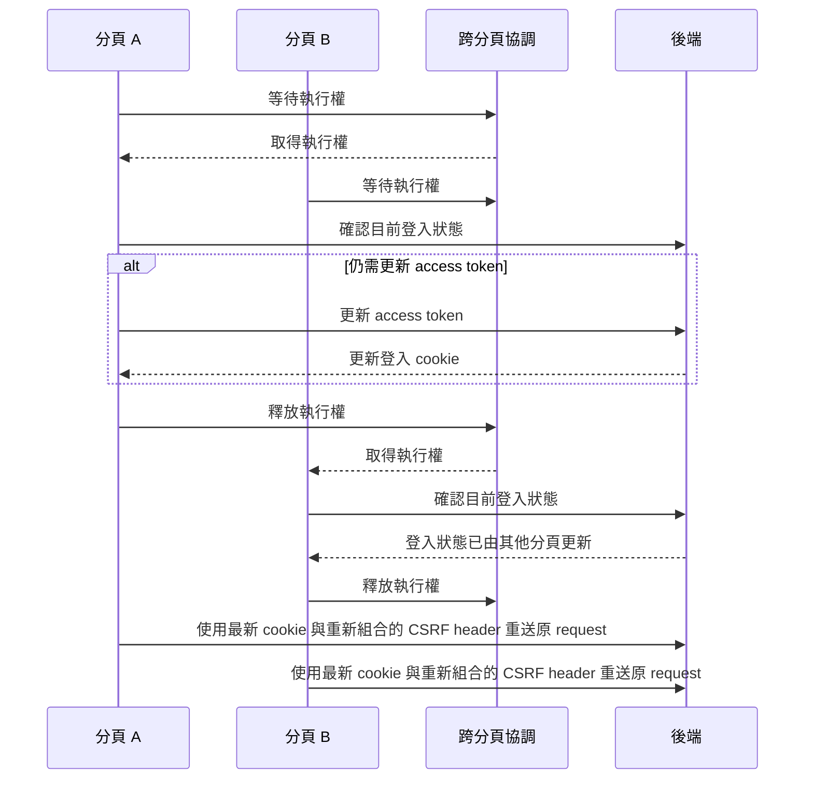
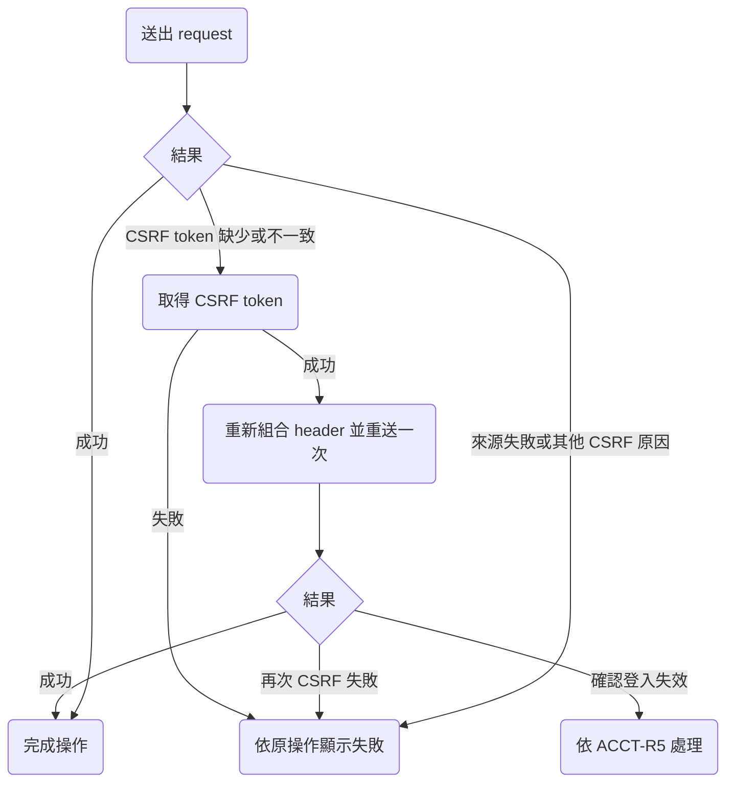
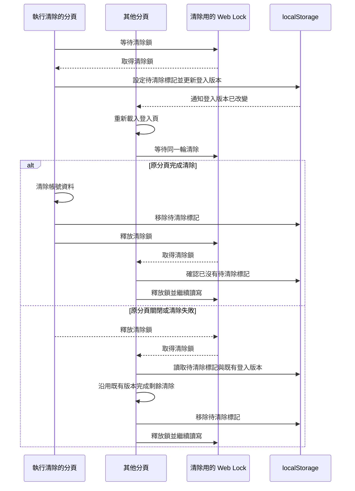
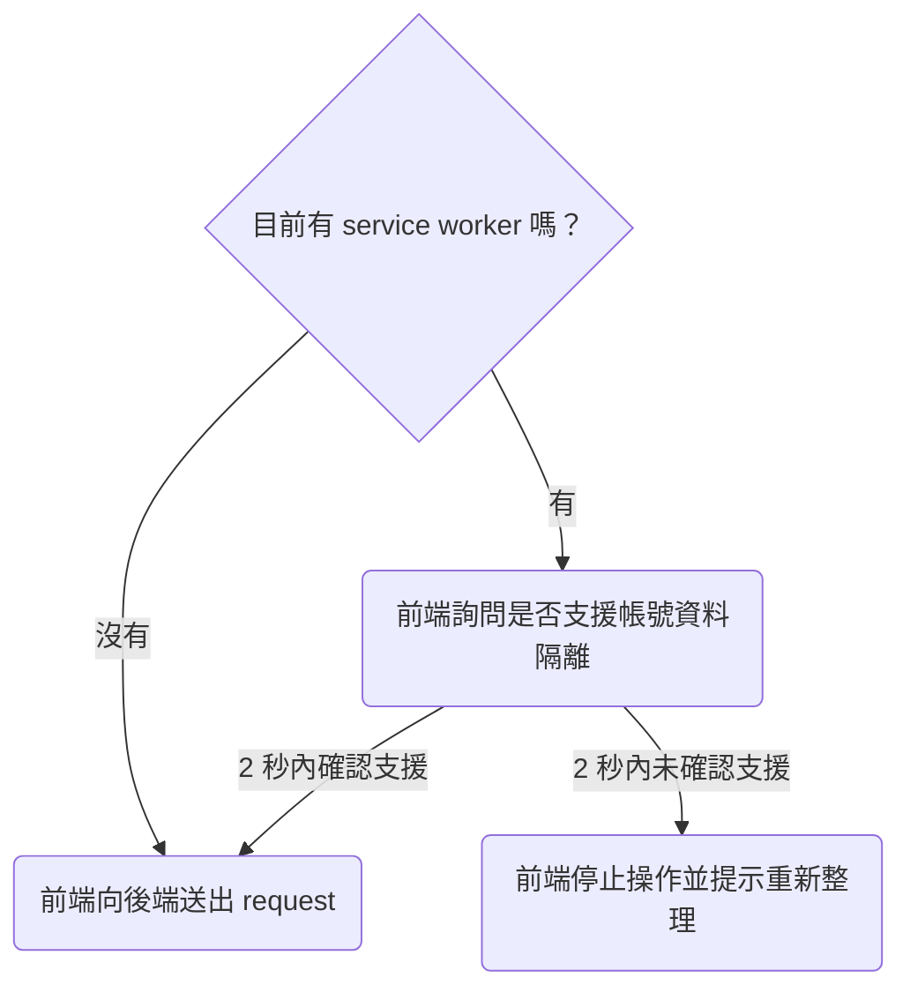
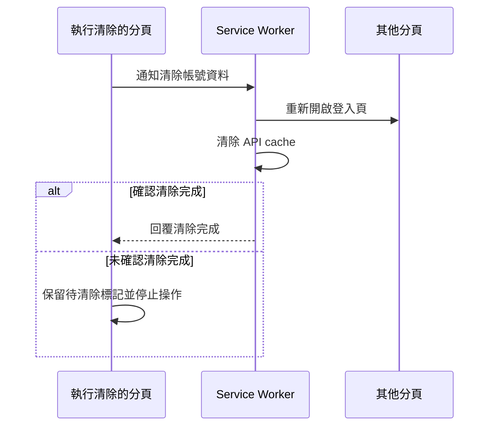
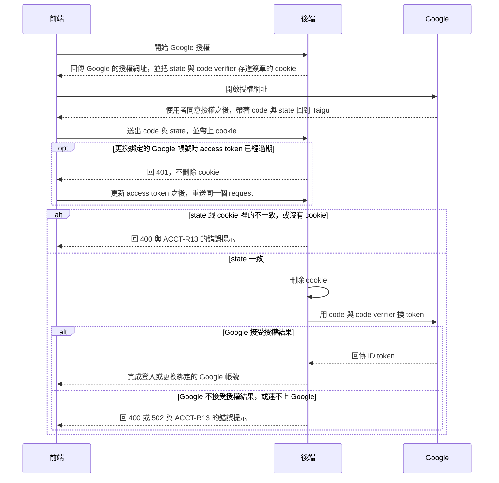

# 技術架構

## 服務

### Prod 環境

### Dev 環境

Dev 環境的每個服務都是本機的 container，前端與後端都在 `local.taigu.tw` 這個網域，所以前端的 request 不像 prod 那樣跨網域（cookie 的設定見「登入」）。

### Scheduler 執行的 Cron Job

scheduler 沒有自己的 cron job 程式：它的 image 以同一個 tag 的 `api-server` image 為基礎，每個 cron job 都執行後端的一個 management command（放在 `api-server/main/<app>/management/commands/`）。所以要知道一個能力的資料由哪些 cron job 處理，要先從 `scheduler/main.py` 找到 command 名稱，再到 `api-server/main/<app>/management/commands/` 讀那個 command。

## 部署

因為前端在 Cloudflare Pages build 完就自動上線，後端（`api-server` 與 scheduler 的 container）則要等開發者執行 `make deploy` 才上線，所以前端與後端的新版本不會同時上線，修改 API 或資料庫時，要讓 prod 上的前端在後端部署前後都能正常運作。`make deploy` 先執行 migration 再重啟 container，所以從 migration 完成到 container 重啟之前，舊版的後端會用新的資料庫結構執行，資料庫的修改也要讓舊版的後端正常運作。

### 公開頁面的 Prerender

Cloudflare Pages 用 `npm run build` build 前端（這是 Cloudflare Pages 上的設定），build 完成後，`postbuild` 把 `/welcome`、`/privacy-policy`、`/terms-of-service` 三個頁面 render 好的 DOM 存成 HTML 檔，Cloudflare Pages 直接用這些檔案回應這三個網址，其他網址都回 `index.html`（使用者看到的結果見 PUB-R7）。這三個網址在 `frontend/scripts/prerender.mjs` 與 `frontend/src/service-worker.ts` 各列了一次，`service-worker.ts` 用這份清單讓 service worker 不用 app shell 回應這三個網址，所以兩份清單要一致。

> 設計理由：Prerender 擷取的是實際 build 出來的頁面，而不是用 `renderToString`，因為 Create React App 產生的 CSS module class name 與檔名帶有 hash，不 eject 的話，另外的 bundler 產生不出一樣的結果。

## 登入

### 登入 Cookie

後端把 JWT 放在 HTTP-only cookie，前端的 JavaScript 讀不到；會修改資料的 request，前端從 CSRF cookie 讀出 CSRF token，放進 header。

Prod 的前端在 `taigu.tw`、後端在 `api.taigu.tw`，dev 環境的兩者都在 `local.taigu.tw`，所以 prod 的 CSRF cookie 設在 `.taigu.tw`，前端才讀得到，放 JWT 的 cookie 則只屬於後端的網域。

### 跨分頁更新 Access Token

登入狀態維持多久，以及 refresh token 的 rotation，見 ACCT-R5 與 ACCT-R6。

Access token 過期時，前端用 refresh token 向後端取得新的 access token，後端同時替換 refresh token。

更新 access token 與更換綁定的 Google 帳號都會修改目前瀏覽器的登入 cookie，因此前端跨分頁協調這兩種操作，同一時間只由一個分頁執行。多個分頁需要更新 access token 時的流程如下圖。

> 設計理由：多分頁更新 access token 時由前端協調，後端仍依 ACCT-R6 拒絕已失效的 refresh token。不提供允許舊 token 再使用的短暫期間，因為那也會允許遭竊的舊 token 在這段期間繼續使用。後端已發出新的 token，但瀏覽器沒收到回應時，使用者仍可能需要重新登入。完整討論見 [0005](../plans/archive/0005-login-account-fixes.md)。

登入狀態檢查只驗證 access token，不讀取完整帳號資料，也不占用帳號資料讀取的 rate limit。

### CSRF 失敗與重試

後端在 CSRF 檢查失敗時回傳錯誤原因，前端依 ACCT-R16 決定是否重試。取得 CSRF cookie 的 GET 不要求有效的 access token，因此 access token 過期時仍能恢復 refresh request；取得 cookie 不會登入、更換綁定的 Google 帳號或修改帳號資料。被 CSRF middleware 拒絕的 request 不進入原本的 view，也不消耗 OAuth state。

### 更換綁定的 Google 帳號時替換 Refresh Token Family

更換綁定的 Google 帳號時，後端在同一個資料庫 transaction 內更新帳號資料、撤銷目前 refresh token 的舊 family，並建立沿用舊 family 到期時間的新 family。其他瀏覽器的 family 不變，access token 的驗證方式也不變。

> 設計理由：更換綁定的 Google 帳號時建立新的 family，舊 family 的 token 再被使用時只影響已作廢的舊 family，避免連帶撤銷新 family 的 refresh token。其他裝置的登出屬於另一個功能，不在更換綁定的 Google 帳號時加入。完整討論見 [0005](../plans/archive/0005-login-account-fixes.md)。

### 登入後的返回網址

前端把登入後要返回的網址與儲存當下的時間存進原分頁的 sessionStorage。前端依 ACCT-R3 判定能否使用，先移除紀錄再換頁。前端載入時會清除舊版存在 localStorage、沒有期限的返回網址，不把舊紀錄轉成新的有效紀錄。

### 跨分頁清除帳號資料

主動登出與登入失效時的清除規則見 ACCT-R17。登入時，前端也會清除殘留的舊帳號資料，並保留原分頁有效的返回紀錄。這些操作共用以下跨分頁清除機制。

前端會一併清除 IndexedDB、localStorage、sessionStorage、service worker cache 與記憶體中的帳號資料，避免仍開著的分頁把舊資料重新寫回。

前端在送出 request、重試、處理回應與寫入交易紀錄前檢查登入版本，並透過 Redux 忽略清除前開始的非同步操作結果。跨分頁清除與失敗後接手的流程如下：

### Service Worker 的帳號資料隔離

前端送出 API request 前，依下圖確認目前的 service worker 是否支援帳號資料隔離：

支援帳號資料隔離的 service worker 收到清除通知後，依下圖完成清除：

新版 service worker 使用獨立名稱的 API cache，不讀取舊 worker 可能繼續寫入的 cache。前端為可放入 API cache 的 GET request 加上 `_account_session` 查詢參數，以登入版本區分 cache key；後端忽略這個參數。即使舊回應在清除後才完成寫入，新登入的 request 也不會讀到舊版本的 key。

### 分頁儲存與版本相容性

前端將返回網址存在 sessionStorage，保留 path、query string 與最初記住網址的時間。[瀏覽器文件](https://developer.mozilla.org/en-US/docs/Web/API/Window/sessionStorage) 說明頁面還原可能保留 sessionStorage，有 opener 的新分頁也可能取得一份副本。因此前端接受瀏覽器還原或複製分頁時帶回的紀錄，仍依 ACCT-R3 的原期限判定；一般另開分頁不共用紀錄。2026-10 在 Linux ARM64 的 Chromium 156.0.8078.47 實測，一般新分頁不共用返回紀錄，有 opener 的新分頁則取得相同的網址與原始時間。瀏覽器選單的還原與複製分頁尚未實測。

跨分頁協調使用同源的 Web Locks API；沒有使用新版協調機制的舊頁面不會遵守這把鎖，因此與舊版頁面並存時仍可能觸發 ACCT-R6。瀏覽器未提供 Web Locks API 時，前端停止需要鎖的操作，避免在無法協調時送出並行的 access token 更新 request。

2026-10 在上述 Chromium，以 production build、service worker 與本機後端實測時，結果如下：

- 2 個與 4 個分頁同時需要更新 access token 時，各分頁都成功讀取資料，沒有因正常更新觸發 replay detection。
- 登出時，其他分頁重新開啟登入頁；清除暫停期間，其他分頁等待同一輪清除，登入版本只改變一次。執行清除的分頁關閉後，其他分頁能沿用同一個登入版本完成清除。
- 帳號 A 的 API 回應延遲 5 秒才完成時，登入版本改變後不會把資料寫回帳號 B 使用的 API cache。IndexedDB、舊 API cache、最近點選股票與舊返回網址都會清除；帳號 B 離線時沒有讀到帳號 A 的資料。這項檢查以固定的成功登入回應與測試帳號 cookie 代替 Google 授權。
- 以不回覆帳號資料隔離訊息、使用舊 cache 名稱的 worker 模擬舊版時，前端停止寫入並提示重新整理；換回新版 worker 後，操作成功。這項檢查沒有涵蓋所有舊版前端與 worker 的組合。

實際 Google 授權、更換綁定的 Google 帳號與更新 access token 同時發生，以及安裝後的 PWA，仍需要依手動檢查確認。

### Google 授權

登入（ACCT-R1）與更換綁定的 Google 帳號（ACCT-R11）的 request 照下圖的順序處理，授權要通過的檢查見 ACCT-R12：

放 `state` 與 PKCE 的 code verifier 的 cookie 由 Django 的 `SECRET_KEY` 簽章，而且是 HTTP-only，只屬於後端的網域，SameSite 是 `Strict`；cookie 的期限，以及同一個瀏覽器開始好幾次授權時哪一次能通過檢查，見 ACCT-R12。

後端處理更換綁定的 Google 帳號的 request 時，先確認登入狀態，再比對 `state`，所以 access token 過期時，後端在刪除 cookie 之前就回 401，前端更新 access token 之後重送的 request 仍能通過檢查。

> 設計理由：`state` 與 code verifier 存在後端簽章的 cookie，而不是 Django session 或前端的 sessionStorage。不用 Django session，是因為後端用 JWT cookie 維持登入，沒有用 Django session，存進 Django session 的話，每次開始授權都要在資料庫寫一筆 session，還要另外清掉過期的 session；不存在前端的 sessionStorage、由前端比對 `state`，是因為這樣後端仍然會拿任何送來的 `code` 去換 token，而且 code verifier 會變成 JavaScript 讀得到的值。完整討論見 [0001](../plans/archive/0001-oauth-state-check.md)。

授權沒有完成時，後端把 ACCT-R13 的錯誤提示放在回應的 `message`，前端把 `message` 顯示成錯誤提示。回應的 status code 依原因而不同：

- 沒通過 `state` 的檢查、Google 不接受授權結果，或無法確認 ID token 真的來自 Google 時，後端回 400。
- 連不上 Google 或 Google 回 5xx 時，後端回 502。
- Google 的 token endpoint 回 `invalid_grant` 以外的錯誤（例如 client secret 錯誤時的 `invalid_client`）時，後端不處理這些錯誤，request 會得到 500，因為這些錯誤代表後端的設定有問題，不是這次授權的問題。

上面這些授權失敗都不能回 401 或 403，因為前端收到 401 時會先更新 access token，403 則保留給 CSRF 檢查失敗，由 ACCT-R16 處理。Google 帶回的 `error` 只由前端處理，不會送到後端。

Google 與瀏覽器在這個流程裡的行為如下：

- Google 接受 web application 類型、帶 client secret 的 OAuth client 使用 PKCE。2026-10 實測時，授權網址帶 `code_challenge_method=S256` 時 Google 照常換到選擇帳號的畫面，帶不支援的值時 Google 顯示 `invalid_request`；token endpoint 同時收到 client secret 與 `code_verifier` 時，用不存在的 `code` 得到的是 `invalid_grant`，不是跟 PKCE 有關的錯誤。在桌面 Chrome 用真實的 Google 帳號執行 ACCT-R12.4 時，後端帶著 code verifier 換到了 token，使用者完成登入。
- 在桌面 Chrome 用真實的 Google 帳號，以及在 Chromium（Playwright 1.64）實測時，頁面從 Google 或其他網站被帶回 Taigu 之後，前端送給後端的 request 仍帶著 SameSite 為 `Strict` 的 cookie，這個 cookie 是頁面換到其他網站之前存下的。Prod 的前端與後端分別在 `taigu.tw` 與 `api.taigu.tw`，屬於同一個 site，所以 SameSite 的規則跟 dev 環境一樣。
- 在桌面 Chrome 實測時，使用者在 Google 的畫面取消授權之後，Google 帶回 Taigu 的網址有 `error=access_denied` 與 `state`，沒有 `code`。依 [Google 的文件](https://developers.google.com/identity/protocols/oauth2/web-server)，其他錯誤（例如 `redirect_uri_mismatch`、`admin_policy_enforced`）顯示在 Google 自己的錯誤頁，不會帶回 Taigu。

### 需要登入的 Endpoint 的 Rate Limit

需要登入的 endpoint 都先確認登入狀態，再套用 rate limit，所以未登入的 request 在確認登入狀態時就得到 401，不會用掉 rate limit 的額度。

> 設計理由：Rate limit 把所有未登入的 request 算在同一個 key，所以 rate limit 放在確認登入狀態之前的話，access token 過期的 request 會跟其他未登入的 request 共用額度，剛好有其他未登入的 request 用完額度時，這個 request 會得到 429，前端也不會更新 access token 再重送。沒有改成在遇到未登入的 request 時用 IP 當 key，因為同一個 IP 後面的使用者（例如同一個公司網路裡的人）仍會共用 rate limit 的額度，而且 access token 過期的 request 會先用掉一次額度、得到 401，更新 access token 之後重送時再用一次。完整討論見 [0001](../plans/archive/0001-oauth-state-check.md)。

## 前端

- 交易紀錄存在瀏覽器的 IndexedDB。後端用 `DataChangeLog` 記錄使用者每次新增、修改或刪除交易紀錄，前端記下最後同步到的 revision，之後只向後端要這個 revision 之後變動的紀錄。大盤指數的歷史收盤價也存在 IndexedDB，前端只向後端要最新一筆之後的資料。
- 前端新增、修改或刪除資料時都要連上後端，離線時只能讀取 IndexedDB 與 service worker cache 裡的資料，所以不會出現離線時的修改與後端上的資料衝突的情況。
- 頭像與名字頁向 gravatar.com 查詢頭像時帶 `d=404`，所以使用者的 email 沒有 Gravatar 頭像時，gravatar.com 回 404（使用者看到的結果見 ACCT-R10）。
- 市場頁依名稱排序（見 FAV-R8）時用 `localeCompare(…, "zh-Hant")`。CLDR 對 zh-Hant 預設的排序是依筆畫，在 Node 22（ICU 76.1）實測，「中華電、台塑、台積電、聯發科、鴻海」依這個順序排列。

Redux 只存交易紀錄的手續費總和，前端每次讀取淨手續費（見 FEE-R1）時，才用這個總和減掉手續費折讓的總和算出來。

> 設計理由：以前淨手續費直接存在 Redux，每次新增、修改、刪除交易紀錄或手續費折讓時再修補這個值，結果算出來的值會跟紀錄對不上。改成讀取時才算之後，儀表板與手續費頁顯示的數字一定跟紀錄一致。

## 付款與額度

- 綠界（ECPay）用 server 對 server 的通知，把第一次付款的結果送到 `ReturnURL`，把之後每期扣款的結果送到 `PeriodReturnURL`，後端回 `1|OK` 表示收到。後端對 `ReturnURL` 回 `0|ERROR` 時，綠界會在 5 到 15 分鐘後再送一次，當天共送 4 次（[綠界文件 2878](https://developers.ecpay.com.tw/2878/)）；`PeriodReturnURL` 每期只送一次通知（[綠界文件 5631](https://developers.ecpay.com.tw/5631/)），文件沒有寫到重送。
- 後端寫入資料之前，先用 `api-server/main/billing/services/entitlements.py` 檢查使用者的方案還有沒有額度，額度不足時回 402 與 `QUOTA_EXCEEDED`，前端收到這個回應時顯示 `PlanUpsellModal`（見 BILL-R9）。

### 綠界的定期扣款

後端依賴綠界定期扣款的這些行為：

- 每期的扣款日固定在第一次扣款的那一天，那個月沒有那一天時改在月底；扣款失敗時，沒有補授權的話，綠界要到下一期的扣款日才會再扣款（[綠界文件 2868](https://developers.ecpay.com.tw/2868/)）。BILL-R14 依此推算每期的結束時間，BILL-R22 依此在本期沒有扣款成功時結束訂閱。
- 授權時卡片已經到期，或連續 6 次扣款失敗時，綠界自動終止定期扣款（[綠界客服中心 16214](https://support.ecpay.com.tw/16214/)）。
- 終止的定期扣款不能重新啟用（[綠界文件 2900](https://developers.ecpay.com.tw/2900/)）。

2026-10 在綠界的 stage 環境（測試特店 3002607）實測的結果如下：

- `QueryCreditCardPeriodInfo` 回傳的 `TotalSuccessTimes` 算進第一次扣款，`ExecLog` 也列出第一次扣款，所以剛付款的定期扣款，`TotalSuccessTimes` 是 1。
- 請綠界終止已經終止的定期扣款時，`CreditCardPeriodAction` 回傳 `RtnCode` `90100149`（「該訂單狀態為停用中」），後端照 BILL-R22 算成終止成功；查詢這份定期扣款時，`RtnCode` 是 1，`ExecStatus` 是 `0`。
- 查詢與終止不存在的定期扣款時，分別回傳 `RtnCode` `10200047` 與 `90100150`。
- 綠界每期的扣款日從第一次授權的日期起算，還是從結帳建立的時間（`MerchantTradeDate`）起算、在扣款日的哪個時段扣款，以及第二期以後 `PeriodReturnURL` 送來的 `TotalSuccessTimes` 是不是跟查詢的結果一樣算進第一次扣款，都還沒有實測，因為 stage 環境要等一個月才會扣第二期。要測的項目記在 roadmap 的「訂閱流程少見情況的修正」。

### 付款紀錄

後端用 `SubscriptionPayment` 記下每一筆付款與每期扣款，下面這些機制跨了好幾個檔案：

- `BillingProfile.initial_payment` 指向讓訂閱變成自動續訂中的那筆付款。這筆付款的 `provider_subscription_id`（綠界的 `MerchantTradeNo`）就是 BILL-R27 所說訂閱自己的定期扣款，`paid_at` 則是 BILL-R14 推算每期結束時間的起點。自動續訂中的訂閱一定有 `initial_payment`；沒有的話，後端不知道要向綠界查詢或終止哪一份定期扣款，所以停止自動續訂時回錯誤，每天的到期處理也不處理這份訂閱，只記下錯誤。
- 定期扣款成功的紀錄，`provider_request_id` 是「第一次付款的 `MerchantTradeNo`」加上 `P` 與 `TotalSuccessTimes`。後端從 `PeriodReturnURL` 的通知記下扣款，或照 BILL-R22 從查詢的結果記下扣款時，都用這個編號，所以只要兩邊的 `TotalSuccessTimes` 一樣算進第一次扣款，同一次扣款不論先從哪一邊記下，另一邊都會對到同一筆紀錄，本期只延後一次（BILL-R20）；通知這一邊還沒有實測（見「綠界的定期扣款」）。扣款失敗的紀錄改用 `F` 加上通知裡的 `Gwsr`，因為扣款失敗不會增加 `TotalSuccessTimes`。
- 後端送給綠界的定期扣款 request，連線與讀取的逾時加起來不超過 13 秒，因為等待期內停止自動續訂要依序查詢與終止，兩個 request 都要在 gunicorn 預設 30 秒的 worker timeout 之內結束，後端才回得了 BILL-R23 的錯誤訊息。
- 訂閱已經是自動續訂中時，若另一筆付款成功（BILL-R27），後端會將這筆付款的 `provider_subscription_termination_pending` 欄位設為 true，直到綠界終止這筆付款的定期扣款。每天的到期處理依這個欄位再請綠界終止。
- 每天的到期處理逐份處理等待期內的訂閱，處理其中一份時綠界回傳錯誤的話，這份訂閱留到下一次再處理，不影響其他訂閱。

### 等待期的判定

等待期內的訂閱何時、依什麼判定這一期有沒有扣款成功，見 BILL-R21 與 BILL-R22。

> 設計理由：不依定期扣款失敗的通知判定，因為綠界文件對扣款失敗時會不會通知寫得前後不一致，依失敗通知判定的路徑可能永遠不會執行，仍要靠查詢處理沒收到通知的情況。在本期結束日的隔天查詢的代價是，本期在 00:00 結束的使用者，等待期最長約 27 小時 40 分。完整討論見 [0006](../plans/archive/0006-billing-fixes.md)。

### 等待期內停止自動續訂

等待期內停止自動續訂的處理見 BILL-R23。

> 設計理由：等待期內不能停止的話，知道卡片刷不過的使用者最多要等約一天才能重新訂閱；停止之前不查詢的話，後端漏收這一期的成功通知時，已經付了這一期的使用者會被當成未訂閱。完整討論見 [0006](../plans/archive/0006-billing-fixes.md)。

### 從綠界付款頁回到方案頁

2026-10 在 macOS 的 Chrome（headless）以 dev 環境實測，從綠界的付款頁按上一頁時，瀏覽器重新載入方案頁，沒有從 bfcache 還原。重新載入的網址帶著「確認訂閱 Standard」視窗加上的 `##`，下一個開啟的視窗再加上 `##` 時，新的歷史紀錄跟目前的網址相同，設定頁（`frontend/src/pages/Settings/Settings.tsx`）會從這筆重複的紀錄往回退，視窗因此一開啟就關閉，所以前端在 Router 初始化前，用 `replaceState` 清除重新載入後留下的 `##`、加號選單的 `#@` 與底部操作選單的 `#!`，保留路徑、查詢參數與 history state，且只在初始化時清除，避免影響操作中開啟的視窗與選單；其他網址片段保留。從 bfcache 還原的情況還沒有實測：前端在 `pageshow` 事件的 `persisted` 是 true 時關閉視窗，並讓付款週期的按鈕可以再點選（BILL-R17.2），這段處理只用手動觸發的 `pageshow` 事件確認過，要測的項目記在 roadmap 的「訂閱流程少見情況的修正」。

### 白名單

白名單存在 `standard_whitelist` 資料表，一位使用者一列，另外記錄加入的原因（`note`）與加入的時間。

> 設計理由：白名單不存成 `BillingProfile` 的欄位，因為後端有些地方會讀出整筆 `BillingProfile` 再整筆存回去，白名單存在同一列的話，開發者修改白名單時，修改可能被同時進行的這些處理蓋掉。分開存的代價是每次判定方案都要多查一次 `standard_whitelist`，不過這次查詢只是用 user id 透過 index 找出一筆資料。完整討論見 [0002](../plans/archive/0002-standard-whitelist.md)。

開發者用 management command `standard_whitelist` 把使用者加入或移出白名單，以及列出白名單上的使用者。

> 設計理由：白名單不用 Django admin 或 Taigu 裡的管理頁面維護，因為後端沒有啟用 Django admin，`User` 也沒有 `is_staff` 欄位，要另外做 staff 的權限與登入方式；也不寫在設定檔或環境變數裡，因為那樣每次修改白名單都要重新部署，或改 prod 的 `.env` 再重新啟動後端。完整討論見 [0002](../plans/archive/0002-standard-whitelist.md)。

## 使用統計

使用紀錄（USAGE-R1）存在 `daily_activity` 資料表，帳號刪除時一併刪除（USAGE-R2）。前端在 USAGE-R1 規定的時候呼叫 `open-session`，並帶上 `platform` 參數。舊版前端呼叫 `open-session` 時不會帶 `platform` 參數，後端照樣記下這一天，這一列的 `platform` 欄位是空的；同一位使用者同一天，`platform` 欄位是空的列也只有一列。

前端呼叫 `open-session` 時，如果瀏覽器還沒有 CSRF cookie，先等 `me` 的回應設定 cookie，再呼叫 `open-session`，避免第一次記錄使用情況就得到可預防的 CSRF 錯誤；實際發生 CSRF 失敗時依 ACCT-R16 處理，提示則依 USAGE-R1。

2026-10 在 macOS 的桌面 Chrome 實測時，瀏覽器的行為如下：

- 前端在 Chrome 的分頁裡執行時，`display-mode: standalone` 不成立，所以記成網頁。
- 從其他分頁切回 Taigu 的分頁時，頁面觸發 `visibilitychange`，前端呼叫 `open-session`，後端記下使用紀錄。
- 後端存下的 User-Agent 跟瀏覽器的 `navigator.userAgent` 相同，request 經過 Cloudflare 與 Nginx 之後沒有被改掉。

其他平台與情況還沒有實測，要測的項目記在 roadmap 的「依平台分開的統計」。

舊版前端有兩種：新版前端上線之前就開著的頁面，以及新版前端上線之後，使用者第一次開啟 Taigu 時 service worker 從 cache 提供的頁面。Service worker 從 cache 提供舊版前端時，同一位使用者那一天可能同時有 `platform` 欄位是空的與有值的兩列，順序如下圖：

## 後台

後端把後台的 endpoint 都放在 `/api/admin/` 底下，由 `api-server/main/admin_console/` 這個 app 處理，每支 endpoint 都用同一個權限檢查：先確認登入狀態，沒有登入時跟其他需要登入的 endpoint 一樣回 401（見 ACCT-R4），前端照常更新 access token 再重送；已經登入但不是 superuser 時回 404。會修改資料的 endpoint 先確認是不是 superuser，再檢查 CSRF token，所以不是 superuser 的 request 沒帶 CSRF token 時也回 404，不會因為 CSRF 檢查失敗而回 403。

> 設計理由：不是 superuser 時回 404，讓一般使用者看到的結果跟網址不存在時相同，看不出 Taigu 有後台。完整討論見 [0004](../plans/archive/0004-admin-console.md)。

使用者是不是 superuser，記在 `User` 從 Django 的 `AbstractUser` 繼承的 `is_superuser` 欄位，開發者用 management command `superuser` 設定 superuser（見 ADMIN-R2）。`me` 的回應帶有 `is_superuser`，前端用它決定要不要顯示後台的入口與頁面。

> 設計理由：Superuser 不另外開資料表，也不用 Django admin，因為 `is_superuser` 已經在 `User` 上，後端也沒有啟用 Django admin（見「白名單」一節）。完整討論見 [0004](../plans/archive/0004-admin-console.md)。

前端的後台頁面用 lazy load 載入，所以一般使用者開啟其他頁面時不會載入或執行後台的程式碼；不過 service worker 照常 precache 後台的 chunk。

> 設計理由：後台的 chunk 不排除在 precache 之外，因為 service worker 用 cache 裡的舊版 `index.html` 回應頁面載入，排除的話，前端每次上線新版之後，舊版頁面要求的舊版後台 chunk 已經不在 Cloudflare Pages 上，後台會載入失敗。完整討論見 [0004](../plans/archive/0004-admin-console.md)。

問題回報頁判斷內容有沒有超過 4 行（ADMIN-R12）時，先用 `-webkit-line-clamp: 4` 截斷內容，再比較截斷後的 `clientHeight` 與完整內容的 `scrollHeight`，`scrollHeight` 比 `clientHeight` 多超過 1px 才算截斷。2026-10 在 macOS 的 Chrome 156（headless）實測時，內容是 5 行、10 行，或是在 390px 寬的畫面上沒有換行的 600 個字時，`scrollHeight` 大於 `clientHeight`；內容剛好是 4 行短句時，兩者相同。其他瀏覽器還沒有實測。

後台的統計在每次讀取時從 `daily_activity`、`User`、`BillingProfile`、`standard_whitelist` 與付款的資料表計算，不存每天的彙總數字。

> 設計理由：統計不存成每天的快照，因為帳號只會由開發者依使用者的要求刪除，刪除後過去的數字跟著變小的影響不大，而且留存與試用轉付費是依時間分批，就算每天存下快照，帳號刪除之後各批的數字還是會變。完整討論見 [0004](../plans/archive/0004-admin-console.md)。

各訂閱狀態的人數（ADMIN-R10）讀的是 `BillingProfile` 記下的 `subscription_status` 與 `cancel_at_period_end`；沒有 `BillingProfile` 的使用者，就是 ADMIN-R10 所說還沒記下訂閱狀態的使用者。

## Domain 規則

目前每個能力都有 spec，所以這一節沒有規則。

## 能力與程式碼對照

儀表板 `/` 沒有自己的 spec，畫面上的各區塊與新增交易紀錄的入口分屬交易紀錄與現金股利、持股、投資績效、手續費與市場行情這幾個能力，所以這幾列的網址都有 `/`。

| 能力 | 網址 | 前端頁面 | 後端 app | Spec |
| --- | --- | --- | --- | --- |
| 交易紀錄與現金股利 | `/`、`/records`、`/records/trade/new`、`/records/trade/:recordId/edit`、`/records/cash-dividend/new`、`/records/cash-dividend/:recordId/edit`、`/settings/data-controls` | `frontend/src/pages/Main/Dashboard/Dashboard.tsx`、`frontend/src/pages/Main/Records/Records.tsx`、`frontend/src/pages/Main/EditorRoutes/EditorRoutes.tsx`、`frontend/src/pages/Settings/DataControls/DataControls.tsx` | `api-server/main/trade_record/`、`api-server/main/cash_dividend/` | [records.md](records.md) |
| 持股 | `/`、`/market`、`/market/holding/:sid` | `frontend/src/pages/Main/Dashboard/Dashboard.tsx`、`frontend/src/pages/Main/Market/Market.tsx`、`frontend/src/pages/Main/Details/Details.tsx`，計算在 `frontend/src/workers/tradeRecordWorker.ts` 與 `frontend/src/utils/market.ts` | 無，由前端依交易紀錄計算；Free 方案的持股檔數由 `api-server/main/billing/services/entitlements.py` 計算 | [holdings.md](holdings.md) |
| 投資績效 | `/`、`/earning-analysis`、`/market`、`/market/:sid` | `frontend/src/pages/Main/Dashboard/Dashboard.tsx`、`frontend/src/pages/Main/EarningAnalysis/EarningAnalysis.tsx`、`frontend/src/pages/Main/Market/Market.tsx`、`frontend/src/pages/Main/Details/Details.tsx`，計算在 `frontend/src/workers/tradeRecordWorker.ts` 與 `frontend/src/utils/util.ts` | 無，在前端計算 | [performance.md](performance.md) |
| 手續費 | `/`、`/handling-fee`、`/handling-fee/discounts/new`、`/handling-fee/discounts/:discountId/edit` | `frontend/src/pages/Main/Dashboard/Dashboard.tsx`、`frontend/src/pages/Main/HandlingFee/HandlingFee.tsx`、`frontend/src/pages/Main/EditorRoutes/EditorRoutes.tsx` | `api-server/main/handling_fee/` | [handling-fees.md](handling-fees.md) |
| 市場行情 | `/`、`/market-index/:market`、`/search`、`/market`、`/market/:sid`，以及各編輯器的「股票」欄位 | `frontend/src/pages/Main/Dashboard/Dashboard.tsx`、`frontend/src/pages/Main/MarketIndexDetails/MarketIndexDetails.tsx`、`frontend/src/pages/Main/Search/Search.tsx`、`frontend/src/components/StockSearchContent/StockSearchContent.tsx`（搜尋頁與桌面瀏覽器的搜尋視窗 `frontend/src/components/StockSearchModal/StockSearchModal.tsx` 共用）、`frontend/src/components/StockPicker/StockPicker.tsx`，重新抓行情的間隔在 `frontend/src/pages/Main/Main.tsx`、`Market.tsx` 與 `Details.tsx` | `api-server/main/market/` | [market-data.md](market-data.md) |
| 個股詳情 | `/market/:sid`、`/market/holding/:sid`、`/market/favorites/:sid` | `frontend/src/pages/Main/Details/Details.tsx` | `api-server/main/market/`、`api-server/main/stock_memo/` | [stock-details.md](stock-details.md) |
| 自選股 | `/market`、`/market/favorites/:sid` | `frontend/src/pages/Main/Market/Market.tsx`、`frontend/src/pages/Main/Details/Details.tsx` | `api-server/main/favorite/` | [favorites.md](favorites.md) |
| 買賣計畫 | `/plans`、`/plans/new`、`/plans/:planId/edit`、`/market` | `frontend/src/pages/Main/Plans/Plans.tsx`、`frontend/src/pages/Main/EditorRoutes/EditorRoutes.tsx`、`frontend/src/components/TradePlanEditor/TradePlanEditor.tsx`、`frontend/src/pages/Main/Market/Market.tsx` | `api-server/main/trade_plan/` | [trade-plans.md](trade-plans.md) |
| 帳號 | `/login`、`/settings`、`/settings/user-info`、`/settings/account-binding` | `frontend/src/pages/Login/Login.tsx`、`frontend/src/pages/Settings/Overview/Overview.tsx`、`frontend/src/pages/Settings/UserInfo/UserInfo.tsx`、`frontend/src/pages/Settings/AccountBinding/AccountBinding.tsx` | `api-server/main/account/` | [account.md](account.md) |
| 方案與付款 | `/settings/current-plan` | `frontend/src/pages/Settings/CurrentPlan/CurrentPlan.tsx`、`frontend/src/components/PlanUpsellModal/PlanUpsellModal.tsx` | `api-server/main/billing/` | [billing.md](billing.md) |
| 問題回報 | `/settings`、`/settings/issue-report` | `frontend/src/pages/Settings/Overview/Overview.tsx`、`frontend/src/pages/Settings/IssueReport/IssueReport.tsx` | `api-server/main/issue_report/` | [issue-reports.md](issue-reports.md) |
| 使用統計 | 要登入才能使用的頁面（見 ACCT-R3），後台 `/admin` 底下的頁面除外 | `frontend/src/pages/Main/Main.tsx`、`frontend/src/pages/Settings/Settings.tsx`，判斷平台的是 `frontend/src/utils/util.ts` 的 `Util.isPWA` | `api-server/main/usage/`，記下使用紀錄的 `open-session` endpoint 在 `api-server/main/account/` | [usage-stats.md](usage-stats.md) |
| 後台 | `/admin`、`/admin/usage`、`/admin/subscriptions`、`/admin/issue-reports`、`/settings` | `frontend/src/pages/Admin/`、`frontend/src/pages/Settings/Overview/Overview.tsx` | `api-server/main/admin_console/`，設定 superuser 的 management command 在 `api-server/main/account/` | [admin.md](admin.md) |
| 公開頁面 | `/welcome`、`/privacy-policy`、`/terms-of-service`，以及其他找不到的網址 | `frontend/src/pages/Welcome/Welcome.tsx`、`frontend/src/pages/PrivacyPolicy/PrivacyPolicy.tsx`、`frontend/src/pages/TermsOfService/TermsOfService.tsx`、`frontend/src/pages/NotFound/NotFound.tsx`、`frontend/src/components/PageMeta/PageMeta.tsx`、`frontend/public/index.html`、`frontend/public/robots.txt`、`frontend/public/sitemap.xml`、`frontend/scripts/prerender.mjs` | 無 | [public-pages.md](public-pages.md) |

## Data Model

- 股票代號在 API 與前端叫做 `sid`，在參照股票的資料表裡是 `company_id`，在 `Company` 自己的資料表裡則是主鍵 `stock_id`，型別都是字串，例如 `"2330"`、`"0050"`。
- `TradeRecord` 沒有記錄買賣方向的欄位，`deal_quantity` 在買進時是正數，賣出時是負數，前端依正負號判斷買賣。
