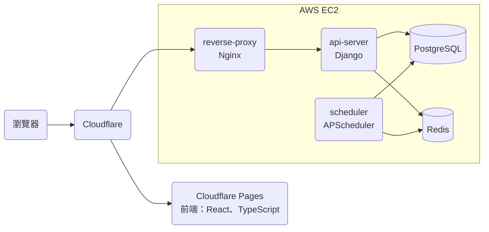
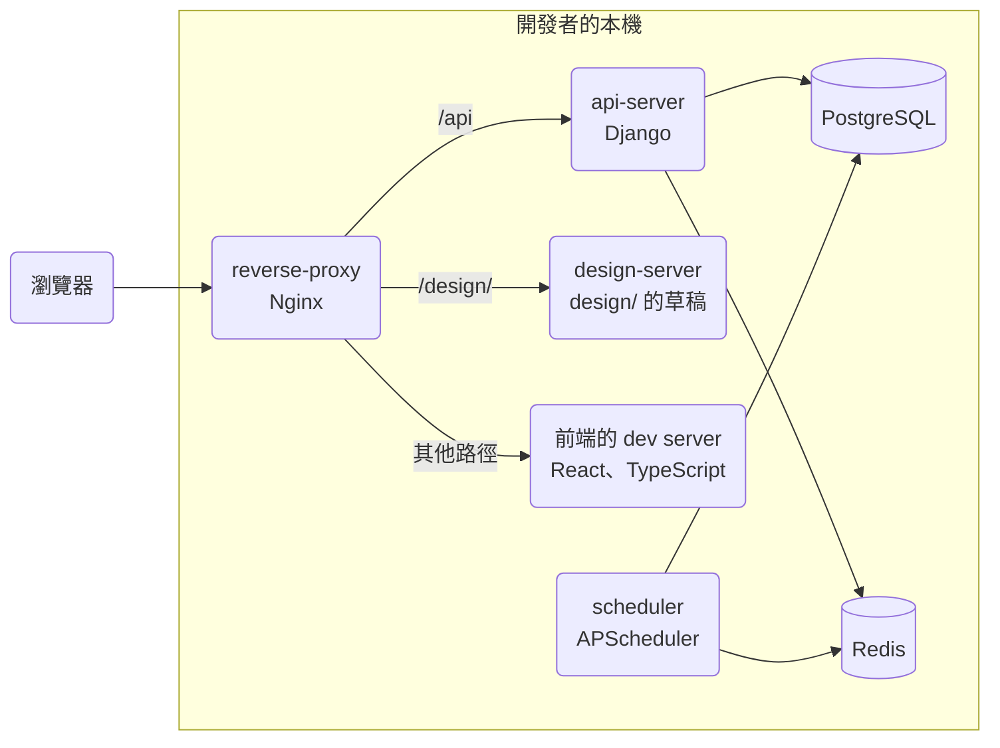
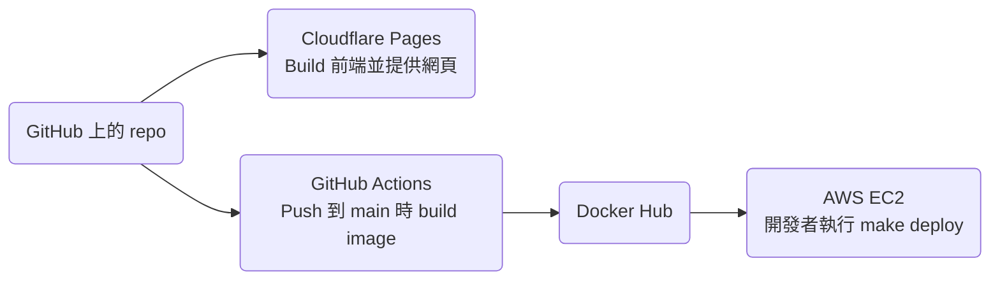

# 技術架構

## 服務

### Prod 環境

### Dev 環境

Dev 環境的每個服務都是本機的 container，前端與 api-server 都在 `local.taigu.tw` 這個網域，所以前端的 request 不像 prod 那樣跨網域（cookie 的設定見「登入」）。

### Scheduler 執行的 Cron Job

scheduler 沒有自己的 cron job 程式：它的 image 以同一個 tag 的 api-server image 為基礎，每個 cron job 都執行 api-server 的一個 management command（放在 `api-server/main/<app>/management/commands/`）。所以要知道一個能力的資料由哪些 cron job 處理，要先從 `scheduler/main.py` 找到 command 名稱，再到 api-server 讀那個 command。

## 部署

因為前端在 Cloudflare Pages build 完就自動上線，api-server 與 scheduler 則要等開發者執行 `make deploy` 才上線，所以前端與 api-server 的新版本不會同時上線，修改 API 或資料庫時，要讓 prod 上的前端在 api-server 部署前後都能正常運作。`make deploy` 先執行 migration 再重啟 container，所以從 migration 完成到 container 重啟之前，舊版的 api-server 與 scheduler 會用新的資料庫結構執行，資料庫的修改也要讓舊版的 api-server 正常運作。

### 公開頁面的 Prerender

Cloudflare Pages 用 `npm run build` build 前端，這是 Cloudflare Pages 上的設定，不在 repo 裡。Build 完成後，`postbuild` 把 `/welcome`、`/privacy-policy`、`/terms-of-service` 三個頁面 render 好的 DOM 存成 HTML 檔，Cloudflare Pages 直接用這些檔案回應這三個網址，其他網址都回 `index.html`（使用者看到的結果見 PUB-R7）。這三個網址在 `frontend/scripts/prerender.mjs` 與 `frontend/src/service-worker.ts` 各列了一次，`service-worker.ts` 用這份清單讓 service worker 不用 app shell 回應這三個網址，所以兩份清單要一致。

> 設計理由：Prerender 擷取的是實際 build 出來的頁面，而不是用 `renderToString`，因為 Create React App 產生的 CSS module class name 與檔名帶有 hash，不 eject 的話，另外的 bundler 產生不出一樣的結果。

## 登入

api-server 把 JWT 放在 HTTP-only cookie，前端的 JavaScript 讀不到；會修改資料的 request，前端從 CSRF cookie 讀出 CSRF token，放進 `X-CSRFToken` header。Prod 的前端在 `taigu.tw`、api-server 在 `api.taigu.tw`，dev 環境的兩者都在 `local.taigu.tw`，所以 prod 的 CSRF cookie 設在 `.taigu.tw`，前端才讀得到，放 JWT 的 cookie 則只屬於 api-server 的網域。登入狀態維持多久，以及 refresh token 的 rotation，見 ACCT-R5 與 ACCT-R6。

## 前端

- 交易紀錄存在瀏覽器的 IndexedDB。api-server 用 `DataChangeLog` 記錄使用者每次新增、修改或刪除交易紀錄，前端記下最後同步到的 revision，之後只向 api-server 要這個 revision 之後變動的紀錄。大盤指數的歷史收盤價也存在 IndexedDB，前端只向 api-server 要最新一筆之後的資料。
- 前端新增、修改或刪除資料時都要連上 api-server，離線時只能讀取 IndexedDB 與 service worker cache 裡的資料，所以不會出現離線時的修改與 api-server 上的資料衝突的情況。
- 頭像與名字頁向 gravatar.com 查詢頭像時帶 `d=404`，所以使用者的 email 沒有 Gravatar 頭像時，gravatar.com 回 404（使用者看到的結果見 ACCT-R10）。
- 市場頁依名稱排序（見 FAV-R8）時用 `localeCompare(…, "zh-Hant")`。CLDR 對 zh-Hant 預設的排序是依筆畫，在 Node 22（ICU 76.1）實測，「中華電、台塑、台積電、聯發科、鴻海」依這個順序排列。

Redux 只存交易紀錄的手續費總和，前端每次讀取淨手續費（見 FEE-R1）時，才用這個總和減掉手續費折讓的總和算出來。

> 設計理由：以前淨手續費直接存在 Redux，每次新增、修改、刪除交易紀錄或手續費折讓時再修補這個值，結果算出來的值會跟紀錄對不上。改成讀取時才算之後，儀表板與手續費頁顯示的數字一定跟紀錄一致。

## 付款與額度

- 綠界（ECPay）用 server 對 server 的通知，把付款結果與每期扣款的結果送到 api-server。api-server 回 `1|OK` 表示收到；回 `0|ERROR` 時，綠界會再送一次通知。
- api-server 寫入資料之前，先用 `api-server/main/billing/services/entitlements.py` 檢查使用者的方案還有沒有額度，額度不足時回 402 與 `QUOTA_EXCEEDED`，前端收到這個回應時顯示 `PlanUpsellModal`（見 BILL-R9）。

## Domain 規則

目前每個能力都有 spec，所以這一節沒有規則。

## 能力與程式碼對照

儀表板 `/` 沒有自己的 spec，畫面上的各區塊與新增交易紀錄的入口分屬交易紀錄與現金股利、持股、投資績效、手續費與市場行情這幾個能力，所以這幾列的網址都有 `/`。

| 能力 | 網址 | 前端頁面 | 後端 app | Spec |
| --- | --- | --- | --- | --- |
| 交易紀錄與現金股利 | `/`、`/records`、`/records/trade/new`、`/records/trade/:recordId/edit`、`/records/cash-dividend/new`、`/records/cash-dividend/:recordId/edit`、`/settings/data-controls` | `frontend/src/pages/Main/Dashboard/Dashboard.tsx`、`frontend/src/pages/Main/Records/Records.tsx`、`frontend/src/pages/Main/EditorRoutes/EditorRoutes.tsx`、`frontend/src/pages/Settings/DataControls/DataControls.tsx` | `api-server/main/trade_record/`、`api-server/main/cash_dividend/` | [records.md](records.md) |
| 持股 | `/`、`/market`、`/market/holding/:sid` | `frontend/src/pages/Main/Dashboard/Dashboard.tsx`、`frontend/src/pages/Main/Market/Market.tsx`、`frontend/src/pages/Main/Details/Details.tsx`，計算在 `frontend/src/workers/tradeRecordWorker.ts` 與 `frontend/src/utils/market.ts` | 無，由前端依交易紀錄計算；Free 方案的持股檔數由 `api-server/main/billing/services/entitlements.py` 計算 | [holdings.md](holdings.md) |
| 投資績效 | `/`、`/earning-analysis`、`/market`、`/market/:sid` | `frontend/src/pages/Main/Dashboard/Dashboard.tsx`、`frontend/src/pages/Main/EarningAnalysis/EarningAnalysis.tsx`、`frontend/src/pages/Main/Market/Market.tsx`、`frontend/src/pages/Main/Details/Details.tsx`，計算在 `frontend/src/workers/tradeRecordWorker.ts` 與 `frontend/src/utils/util.ts` | 無，在前端計算 | [performance.md](performance.md) |
| 手續費 | `/`、`/handling-fee`、`/handling-fee/discounts/new`、`/handling-fee/discounts/:discountId/edit` | `frontend/src/pages/Main/Dashboard/Dashboard.tsx`、`frontend/src/pages/Main/HandlingFee/HandlingFee.tsx`、`frontend/src/pages/Main/EditorRoutes/EditorRoutes.tsx` | `api-server/main/handling_fee/` | [handling-fees.md](handling-fees.md) |
| 市場行情 | `/`、`/market-index/:market`、`/search`、`/market`、`/market/:sid`，以及各編輯器的「股票」欄位 | `frontend/src/pages/Main/Dashboard/Dashboard.tsx`、`frontend/src/pages/Main/MarketIndexDetails/MarketIndexDetails.tsx`、`frontend/src/pages/Main/Search/Search.tsx`、`frontend/src/components/StockSearchContent/StockSearchContent.tsx`（搜尋頁與桌面瀏覽器的搜尋視窗 `frontend/src/components/StockSearchModal/StockSearchModal.tsx` 共用）、`frontend/src/components/StockPicker/StockPicker.tsx`，重新抓行情的間隔在 `frontend/src/pages/Main/Main.tsx`、`Market.tsx` 與 `Details.tsx` | `api-server/main/market/` | [market-data.md](market-data.md) |
| 個股詳情 | `/market/:sid`、`/market/holding/:sid`、`/market/favorites/:sid` | `frontend/src/pages/Main/Details/Details.tsx` | `api-server/main/market/`、`api-server/main/stock_memo/` | [stock-details.md](stock-details.md) |
| 自選股 | `/market`、`/market/favorites/:sid` | `frontend/src/pages/Main/Market/Market.tsx`、`frontend/src/pages/Main/Details/Details.tsx` | `api-server/main/favorite/` | [favorites.md](favorites.md) |
| 買賣計畫 | `/plans`、`/plans/new`、`/plans/:planId/edit`、`/market` | `frontend/src/pages/Main/Plans/Plans.tsx`、`frontend/src/pages/Main/EditorRoutes/EditorRoutes.tsx`、`frontend/src/components/TradePlanEditor/TradePlanEditor.tsx`、`frontend/src/pages/Main/Market/Market.tsx` | `api-server/main/trade_plan/` | [trade-plans.md](trade-plans.md) |
| 帳號 | `/login`、`/settings`、`/settings/user-info`、`/settings/account-binding` | `frontend/src/pages/Login/Login.tsx`、`frontend/src/pages/Settings/Overview/Overview.tsx`、`frontend/src/pages/Settings/UserInfo/UserInfo.tsx`、`frontend/src/pages/Settings/AccountBinding/AccountBinding.tsx` | `api-server/main/account/` | [account.md](account.md) |
| 方案與付款 | `/settings/current-plan` | `frontend/src/pages/Settings/CurrentPlan/CurrentPlan.tsx`、`frontend/src/components/PlanUpsellModal/PlanUpsellModal.tsx` | `api-server/main/billing/` | [billing.md](billing.md) |
| 問題回報 | `/settings`、`/settings/issue-report` | `frontend/src/pages/Settings/Overview/Overview.tsx`、`frontend/src/pages/Settings/IssueReport/IssueReport.tsx` | `api-server/main/issue_report/` | [issue-reports.md](issue-reports.md) |
| 公開頁面 | `/welcome`、`/privacy-policy`、`/terms-of-service`，以及其他找不到的網址 | `frontend/src/pages/Welcome/Welcome.tsx`、`frontend/src/pages/PrivacyPolicy/PrivacyPolicy.tsx`、`frontend/src/pages/TermsOfService/TermsOfService.tsx`、`frontend/src/pages/NotFound/NotFound.tsx`、`frontend/src/components/PageMeta/PageMeta.tsx`、`frontend/public/index.html`、`frontend/public/robots.txt`、`frontend/public/sitemap.xml`、`frontend/scripts/prerender.mjs` | 無 | [public-pages.md](public-pages.md) |

## Data Model

- 股票代號在 API 與前端叫做 `sid`，在參照股票的資料表裡是 `company_id`，在 `Company` 自己的資料表裡則是主鍵 `stock_id`，型別都是字串，例如 `"2330"`、`"0050"`。
- `TradeRecord` 沒有記錄買賣方向的欄位，`deal_quantity` 在買進時是正數，賣出時是負數，前端依正負號判斷買賣。
