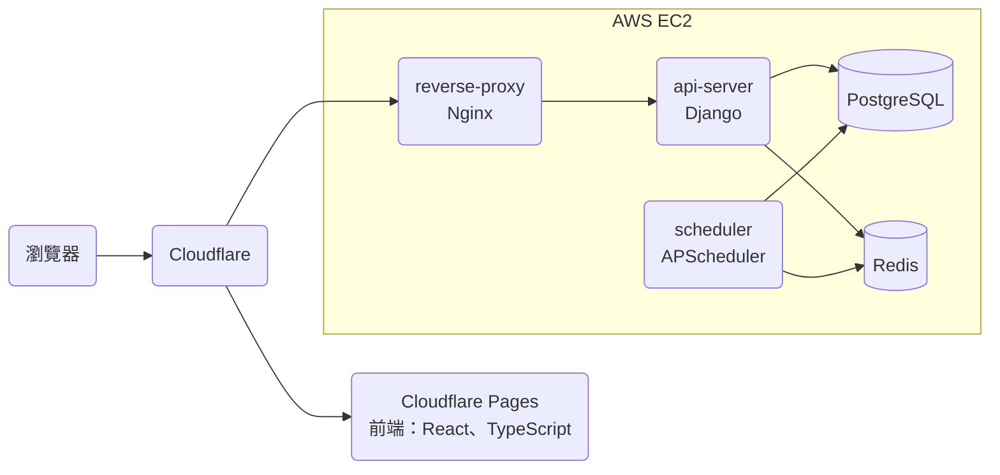
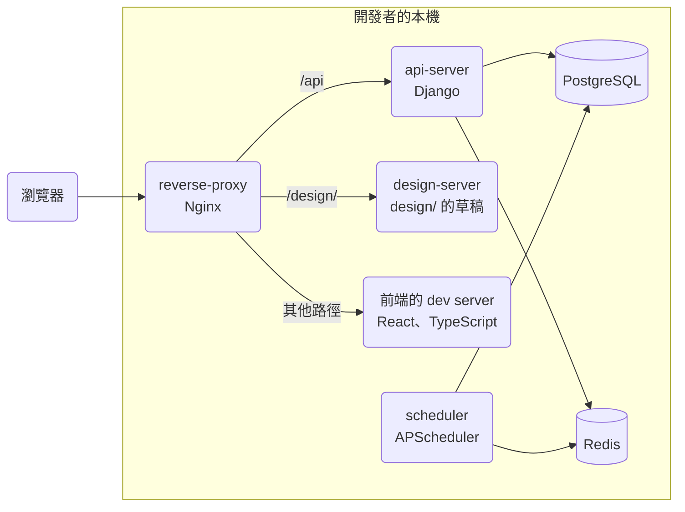
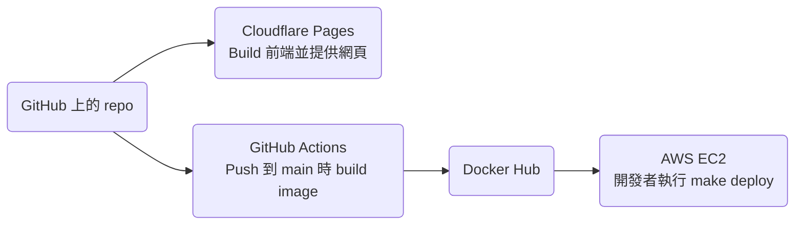
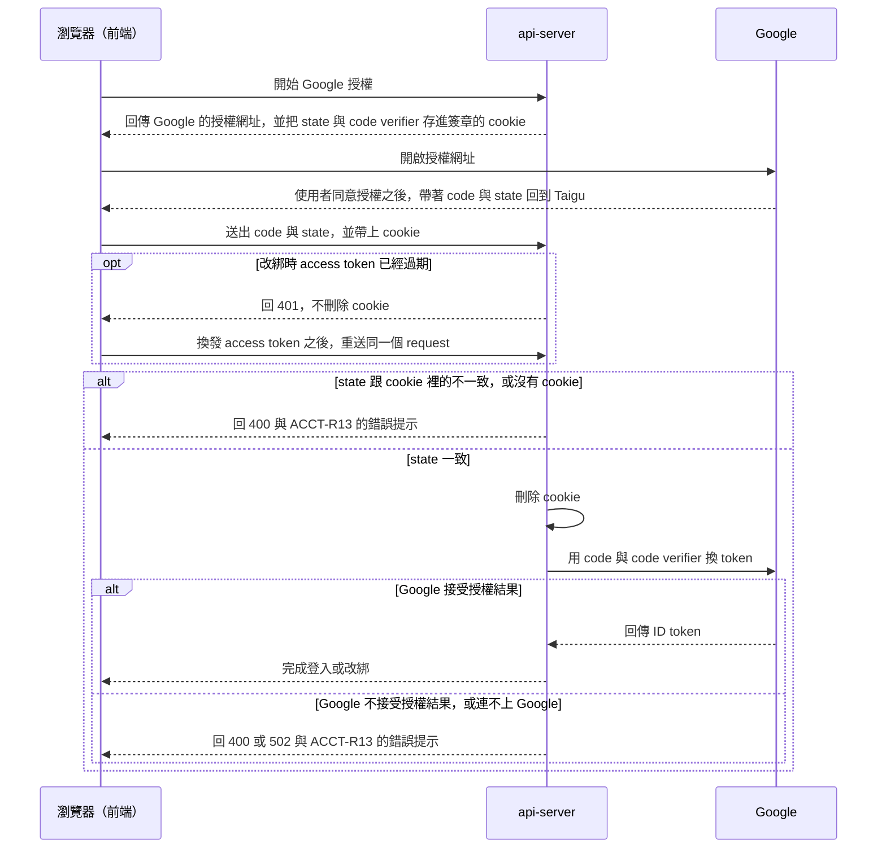
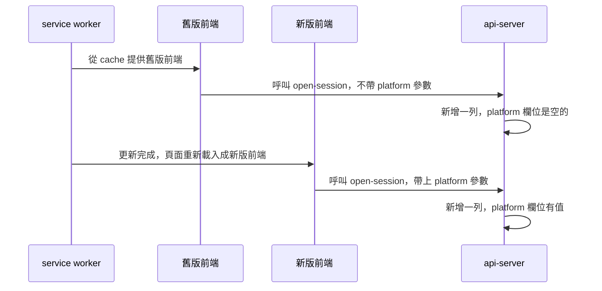

# 技術架構

## 服務

### Prod 環境

### Dev 環境

Dev 環境的每個服務都是本機的 container，前端與 api-server 都在 `local.taigu.tw` 這個網域，所以前端的 request 不像 prod 那樣跨網域（cookie 的設定見「登入」）。

### Scheduler 執行的 Cron Job

scheduler 沒有自己的 cron job 程式：它的 image 以同一個 tag 的 api-server image 為基礎，每個 cron job 都執行 api-server 的一個 management command（放在 `api-server/main/<app>/management/commands/`）。所以要知道一個能力的資料由哪些 cron job 處理，要先從 `scheduler/main.py` 找到 command 名稱，再到 api-server 讀那個 command。

## 部署

因為前端在 Cloudflare Pages build 完就自動上線，api-server 與 scheduler 則要等開發者執行 `make deploy` 才上線，所以前端與 api-server 的新版本不會同時上線，修改 API 或資料庫時，要讓 prod 上的前端在 api-server 部署前後都能正常運作。`make deploy` 先執行 migration 再重啟 container，所以從 migration 完成到 container 重啟之前，舊版的 api-server 與 scheduler 會用新的資料庫結構執行，資料庫的修改也要讓舊版的 api-server 正常運作。

### 公開頁面的 Prerender

Cloudflare Pages 用 `npm run build` build 前端，這是 Cloudflare Pages 上的設定，不在 repo 裡。Build 完成後，`postbuild` 把 `/welcome`、`/privacy-policy`、`/terms-of-service` 三個頁面 render 好的 DOM 存成 HTML 檔，Cloudflare Pages 直接用這些檔案回應這三個網址，其他網址都回 `index.html`（使用者看到的結果見 PUB-R7）。這三個網址在 `frontend/scripts/prerender.mjs` 與 `frontend/src/service-worker.ts` 各列了一次，`service-worker.ts` 用這份清單讓 service worker 不用 app shell 回應這三個網址，所以兩份清單要一致。

> 設計理由：Prerender 擷取的是實際 build 出來的頁面，而不是用 `renderToString`，因為 Create React App 產生的 CSS module class name 與檔名帶有 hash，不 eject 的話，另外的 bundler 產生不出一樣的結果。

## 登入

api-server 把 JWT 放在 HTTP-only cookie，前端的 JavaScript 讀不到；會修改資料的 request，前端從 CSRF cookie 讀出 CSRF token，放進 `X-CSRFToken` header。Prod 的前端在 `taigu.tw`、api-server 在 `api.taigu.tw`，dev 環境的兩者都在 `local.taigu.tw`，所以 prod 的 CSRF cookie 設在 `.taigu.tw`，前端才讀得到，放 JWT 的 cookie 則只屬於 api-server 的網域。登入狀態維持多久，以及 refresh token 的 rotation，見 ACCT-R5 與 ACCT-R6。

### Google 授權

登入（ACCT-R1）與改綁（ACCT-R11）的 request 照下圖的順序處理，授權要通過的檢查見 ACCT-R12：

放 `state` 與 PKCE 的 code verifier 的 cookie 由 Django 的 `SECRET_KEY` 簽章，而且是 HTTP-only，只屬於 api-server 的網域，SameSite 是 `Strict`；cookie 的期限，以及同一個瀏覽器開始好幾次授權時哪一次能通過檢查，見 ACCT-R12。api-server 處理改綁的 request 時，先確認登入狀態，再比對 `state`，所以 access token 過期時，api-server 在刪除 cookie 之前就回 401，前端換發 access token 之後重送的 request 仍能通過檢查。

> 設計理由：`state` 與 code verifier 存在 api-server 簽章的 cookie，而不是 Django session 或前端的 sessionStorage。不用 Django session，是因為 Taigu 的登入用的是 JWT cookie，沒有用 Django session，存進 Django session 的話，每次開始授權都要在資料庫寫一筆 session，還要另外清掉過期的 session；不存在前端的 sessionStorage、由前端比對 `state`，是因為這樣 api-server 仍然會拿任何送來的 `code` 去換 token，而且 code verifier 會變成 JavaScript 讀得到的值。完整討論見 [0001](../plans/archive/0001-oauth-state-check.md)。

授權沒有完成時，api-server 把 ACCT-R13 的錯誤提示放在回應的 `message`，前端把 `message` 顯示成錯誤提示。回應的 status code 依原因而不同：

- 沒通過 `state` 的檢查、Google 不接受授權結果，或無法確認 ID token 真的來自 Google 時，api-server 回 400。
- 連不上 Google 或 Google 回 5xx 時，api-server 回 502。
- Google 的 token endpoint 回 `invalid_grant` 以外的錯誤（例如 client secret 錯誤時的 `invalid_client`）時，api-server 不處理這些錯誤，request 會得到 500，因為這些錯誤代表 api-server 的設定有問題，不是這次授權的問題。

上面這些情況都不能回 401 或 403，因為前端收到這兩個 status code 時會當成登入狀態結束，帳號綁定頁的使用者會因此被登出。Google 帶回的 `error` 只由前端處理，不會送到 api-server。

Google 與瀏覽器在這個流程裡的行為如下：

- Google 接受 web application 類型、帶 client secret 的 OAuth client 使用 PKCE。2026-10 實測時，授權網址帶 `code_challenge_method=S256` 時 Google 照常換到選擇帳號的畫面，帶不支援的值時 Google 顯示 `invalid_request`；token endpoint 同時收到 client secret 與 `code_verifier` 時，用不存在的 `code` 得到的是 `invalid_grant`，不是跟 PKCE 有關的錯誤。在桌面 Chrome 用真實的 Google 帳號執行 ACCT-R12.4 時，api-server 帶著 code verifier 換到了 token，使用者完成登入。
- 在桌面 Chrome 用真實的 Google 帳號，以及在 Chromium（Playwright 1.64）實測時，頁面從 Google 或其他網站被帶回 Taigu 之後，前端送給 api-server 的 request 仍帶著 SameSite 為 `Strict` 的 cookie，這個 cookie 是頁面換到其他網站之前存下的。Prod 的前端與 api-server 分別在 `taigu.tw` 與 `api.taigu.tw`，屬於同一個 site，所以 SameSite 的規則跟 dev 環境一樣。
- 在桌面 Chrome 實測時，使用者在 Google 的畫面取消授權之後，Google 帶回 Taigu 的網址有 `error=access_denied` 與 `state`，沒有 `code`。依 [Google 的文件](https://developers.google.com/identity/protocols/oauth2/web-server)，其他錯誤（例如 `redirect_uri_mismatch`、`admin_policy_enforced`）顯示在 Google 自己的錯誤頁，不會帶回 Taigu。

### 需要登入的 Endpoint 的 Rate Limit

需要登入的 endpoint 都先確認登入狀態，再套用 rate limit，所以未登入的 request 在確認登入狀態時就得到 401，不會用掉 rate limit 的額度。

> 設計理由：Rate limit 把所有未登入的 request 算在同一個 key，所以 rate limit 放在確認登入狀態之前的話，access token 過期的 request 會跟其他未登入的 request 共用額度，剛好有其他未登入的 request 用完額度時，這個 request 會得到 429，前端也不會換發 access token 再重送。沒有改成在遇到未登入的 request 時用 IP 當 key，因為同一個 IP 後面的使用者（例如同一個公司網路裡的人）仍會共用 rate limit 的額度，而且 access token 過期的 request 會先用掉一次額度、得到 401，換發 access token 之後重送時再用一次。完整討論見 [0001](../plans/archive/0001-oauth-state-check.md)。

## 前端

- 交易紀錄存在瀏覽器的 IndexedDB。api-server 用 `DataChangeLog` 記錄使用者每次新增、修改或刪除交易紀錄，前端記下最後同步到的 revision，之後只向 api-server 要這個 revision 之後變動的紀錄。大盤指數的歷史收盤價也存在 IndexedDB，前端只向 api-server 要最新一筆之後的資料。
- 前端新增、修改或刪除資料時都要連上 api-server，離線時只能讀取 IndexedDB 與 service worker cache 裡的資料，所以不會出現離線時的修改與 api-server 上的資料衝突的情況。
- 頭像與名字頁向 gravatar.com 查詢頭像時帶 `d=404`，所以使用者的 email 沒有 Gravatar 頭像時，gravatar.com 回 404（使用者看到的結果見 ACCT-R10）。
- 市場頁依名稱排序（見 FAV-R8）時用 `localeCompare(…, "zh-Hant")`。CLDR 對 zh-Hant 預設的排序是依筆畫，在 Node 22（ICU 76.1）實測，「中華電、台塑、台積電、聯發科、鴻海」依這個順序排列。

Redux 只存交易紀錄的手續費總和，前端每次讀取淨手續費（見 FEE-R1）時，才用這個總和減掉手續費折讓的總和算出來。

> 設計理由：以前淨手續費直接存在 Redux，每次新增、修改、刪除交易紀錄或手續費折讓時再修補這個值，結果算出來的值會跟紀錄對不上。改成讀取時才算之後，儀表板與手續費頁顯示的數字一定跟紀錄一致。

## 付款與額度

- 綠界（ECPay）用 server 對 server 的通知，把付款結果與每期扣款的結果送到 api-server。api-server 回 `1|OK` 表示收到；回 `0|ERROR` 時，綠界會再送一次通知。
- api-server 寫入資料之前，先用 `api-server/main/billing/services/entitlements.py` 檢查使用者的方案還有沒有額度，額度不足時回 402 與 `QUOTA_EXCEEDED`，前端收到這個回應時顯示 `PlanUpsellModal`（見 BILL-R9）。

### 白名單

白名單存在 `standard_whitelist` 資料表，一位使用者一列，另外記錄加入的原因（`note`）與加入的時間。

> 設計理由：白名單不存成 `BillingProfile` 的欄位，因為 api-server 有些地方會讀出整筆 `BillingProfile` 再整筆存回去，白名單存在同一列的話，開發者修改白名單時，修改可能被同時進行的這些處理蓋掉。分開存的代價是每次判定方案都要多查一次 `standard_whitelist`，不過這次查詢只是用 user id 透過 index 找出一筆資料。完整討論見 [0002](../plans/archive/0002-standard-whitelist.md)。

開發者用 management command `standard_whitelist` 把使用者加入或移出白名單，以及列出白名單上的使用者。

> 設計理由：白名單不用 Django admin 或 Taigu 裡的管理頁面維護，因為 api-server 沒有啟用 Django admin，`User` 也沒有 `is_staff` 欄位，要另外做 staff 的權限與登入方式；也不寫在設定檔或環境變數裡，因為那樣每次修改白名單都要重新部署，或改 prod 的 `.env` 再重新啟動 api-server。完整討論見 [0002](../plans/archive/0002-standard-whitelist.md)。

## 使用統計

使用紀錄（USAGE-R1）存在 `daily_activity` 資料表，帳號刪除時一併刪除（USAGE-R2）。前端在 USAGE-R1 規定的時候呼叫 `open-session`，並帶上 `platform` 參數。舊版前端呼叫 `open-session` 時不會帶 `platform` 參數，api-server 照樣記下這一天，這一列的 `platform` 欄位是空的；同一位使用者同一天，`platform` 欄位是空的列也只有一列。

前端呼叫 `open-session` 時，如果瀏覽器還沒有 CSRF cookie，前端先等 `me` 的回應再呼叫，因為 `me` 的回應會設定 CSRF cookie，而前端收到 403 時會把使用者登出，所以沒有 CSRF cookie 時直接呼叫 `open-session`，使用者會被登出。

2026-10 在 macOS 的桌面 Chrome 實測時，瀏覽器的行為如下：

- Taigu 在 Chrome 的分頁裡執行時，`display-mode: standalone` 不成立，所以記成網頁。
- 從其他分頁切回 Taigu 的分頁時，頁面觸發 `visibilitychange`，Taigu 記下使用紀錄。
- api-server 存下的 User-Agent 跟瀏覽器的 `navigator.userAgent` 相同，request 經過 Cloudflare 與 Nginx 之後沒有被改掉。

其他平台與情況還沒有實測，要測的項目記在 roadmap 的「依平台分開的統計」。

舊版前端有兩種：新版前端上線之前就開著的頁面，以及新版前端上線之後，使用者第一次開啟 Taigu 時 service worker 從 cache 提供的頁面。Service worker 從 cache 提供舊版前端時，同一位使用者那一天可能同時有 `platform` 欄位是空的與有值的兩列，順序如下圖：

## Domain 規則

目前每個能力都有 spec，所以這一節沒有規則。

## 能力與程式碼對照

儀表板 `/` 沒有自己的 spec，畫面上的各區塊與新增交易紀錄的入口分屬交易紀錄與現金股利、持股、投資績效、手續費與市場行情這幾個能力，所以這幾列的網址都有 `/`。

| 能力 | 網址 | 前端頁面 | 後端 app | Spec |
| --- | --- | --- | --- | --- |
| 交易紀錄與現金股利 | `/`、`/records`、`/records/trade/new`、`/records/trade/:recordId/edit`、`/records/cash-dividend/new`、`/records/cash-dividend/:recordId/edit`、`/settings/data-controls` | `frontend/src/pages/Main/Dashboard/Dashboard.tsx`、`frontend/src/pages/Main/Records/Records.tsx`、`frontend/src/pages/Main/EditorRoutes/EditorRoutes.tsx`、`frontend/src/pages/Settings/DataControls/DataControls.tsx` | `api-server/main/trade_record/`、`api-server/main/cash_dividend/` | [records.md](records.md) |
| 持股 | `/`、`/market`、`/market/holding/:sid` | `frontend/src/pages/Main/Dashboard/Dashboard.tsx`、`frontend/src/pages/Main/Market/Market.tsx`、`frontend/src/pages/Main/Details/Details.tsx`，計算在 `frontend/src/workers/tradeRecordWorker.ts` 與 `frontend/src/utils/market.ts` | 無，由前端依交易紀錄計算；Free 方案的持股檔數由 `api-server/main/billing/services/entitlements.py` 計算 | [holdings.md](holdings.md) |
| 投資績效 | `/`、`/earning-analysis`、`/market`、`/market/:sid` | `frontend/src/pages/Main/Dashboard/Dashboard.tsx`、`frontend/src/pages/Main/EarningAnalysis/EarningAnalysis.tsx`、`frontend/src/pages/Main/Market/Market.tsx`、`frontend/src/pages/Main/Details/Details.tsx`，計算在 `frontend/src/workers/tradeRecordWorker.ts` 與 `frontend/src/utils/util.ts` | 無，在前端計算 | [performance.md](performance.md) |
| 手續費 | `/`、`/handling-fee`、`/handling-fee/discounts/new`、`/handling-fee/discounts/:discountId/edit` | `frontend/src/pages/Main/Dashboard/Dashboard.tsx`、`frontend/src/pages/Main/HandlingFee/HandlingFee.tsx`、`frontend/src/pages/Main/EditorRoutes/EditorRoutes.tsx` | `api-server/main/handling_fee/` | [handling-fees.md](handling-fees.md) |
| 市場行情 | `/`、`/market-index/:market`、`/search`、`/market`、`/market/:sid`，以及各編輯器的「股票」欄位 | `frontend/src/pages/Main/Dashboard/Dashboard.tsx`、`frontend/src/pages/Main/MarketIndexDetails/MarketIndexDetails.tsx`、`frontend/src/pages/Main/Search/Search.tsx`、`frontend/src/components/StockSearchContent/StockSearchContent.tsx`（搜尋頁與桌面瀏覽器的搜尋視窗 `frontend/src/components/StockSearchModal/StockSearchModal.tsx` 共用）、`frontend/src/components/StockPicker/StockPicker.tsx`，重新抓行情的間隔在 `frontend/src/pages/Main/Main.tsx`、`Market.tsx` 與 `Details.tsx` | `api-server/main/market/` | [market-data.md](market-data.md) |
| 個股詳情 | `/market/:sid`、`/market/holding/:sid`、`/market/favorites/:sid` | `frontend/src/pages/Main/Details/Details.tsx` | `api-server/main/market/`、`api-server/main/stock_memo/` | [stock-details.md](stock-details.md) |
| 自選股 | `/market`、`/market/favorites/:sid` | `frontend/src/pages/Main/Market/Market.tsx`、`frontend/src/pages/Main/Details/Details.tsx` | `api-server/main/favorite/` | [favorites.md](favorites.md) |
| 買賣計畫 | `/plans`、`/plans/new`、`/plans/:planId/edit`、`/market` | `frontend/src/pages/Main/Plans/Plans.tsx`、`frontend/src/pages/Main/EditorRoutes/EditorRoutes.tsx`、`frontend/src/components/TradePlanEditor/TradePlanEditor.tsx`、`frontend/src/pages/Main/Market/Market.tsx` | `api-server/main/trade_plan/` | [trade-plans.md](trade-plans.md) |
| 帳號 | `/login`、`/settings`、`/settings/user-info`、`/settings/account-binding` | `frontend/src/pages/Login/Login.tsx`、`frontend/src/pages/Settings/Overview/Overview.tsx`、`frontend/src/pages/Settings/UserInfo/UserInfo.tsx`、`frontend/src/pages/Settings/AccountBinding/AccountBinding.tsx` | `api-server/main/account/` | [account.md](account.md) |
| 方案與付款 | `/settings/current-plan` | `frontend/src/pages/Settings/CurrentPlan/CurrentPlan.tsx`、`frontend/src/components/PlanUpsellModal/PlanUpsellModal.tsx` | `api-server/main/billing/` | [billing.md](billing.md) |
| 問題回報 | `/settings`、`/settings/issue-report` | `frontend/src/pages/Settings/Overview/Overview.tsx`、`frontend/src/pages/Settings/IssueReport/IssueReport.tsx` | `api-server/main/issue_report/` | [issue-reports.md](issue-reports.md) |
| 使用統計 | 要登入才能使用的頁面（見 ACCT-R3） | `frontend/src/pages/Main/Main.tsx`、`frontend/src/pages/Settings/Settings.tsx`，判斷平台的是 `frontend/src/utils/util.ts` 的 `Util.isPWA` | `api-server/main/usage/`，記下使用紀錄的 `open-session` endpoint 在 `api-server/main/account/` | [usage-stats.md](usage-stats.md) |
| 公開頁面 | `/welcome`、`/privacy-policy`、`/terms-of-service`，以及其他找不到的網址 | `frontend/src/pages/Welcome/Welcome.tsx`、`frontend/src/pages/PrivacyPolicy/PrivacyPolicy.tsx`、`frontend/src/pages/TermsOfService/TermsOfService.tsx`、`frontend/src/pages/NotFound/NotFound.tsx`、`frontend/src/components/PageMeta/PageMeta.tsx`、`frontend/public/index.html`、`frontend/public/robots.txt`、`frontend/public/sitemap.xml`、`frontend/scripts/prerender.mjs` | 無 | [public-pages.md](public-pages.md) |

## Data Model

- 股票代號在 API 與前端叫做 `sid`，在參照股票的資料表裡是 `company_id`，在 `Company` 自己的資料表裡則是主鍵 `stock_id`，型別都是字串，例如 `"2330"`、`"0050"`。
- `TradeRecord` 沒有記錄買賣方向的欄位，`deal_quantity` 在買進時是正數，賣出時是負數，前端依正負號判斷買賣。
- `IssueReport` 的 `platform` 與 `user_agent` 可以是空的，空值出現在下面這些情況：
  - Taigu 開始記錄這兩個欄位之前送出的問題回報，兩個欄位都是空的。
  - 之後的問題回報由舊版前端送出，或 request 帶的 `platform` 不是 `web` 也不是 `pwa` 時，`platform` 是空的。
  - Request 沒有帶 User-Agent 時，`user_agent` 是空的。
