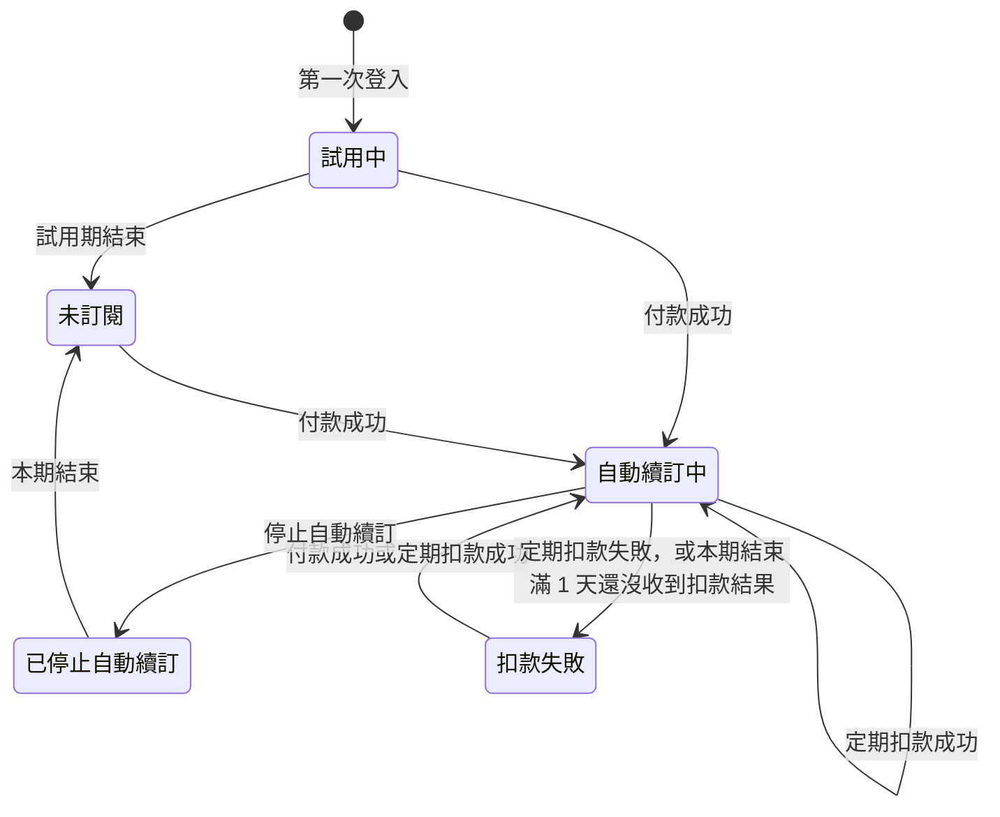

# 方案與訂閱付款

方案決定使用者新增資料時是否受額度限制，以及行情多久更新一次。新使用者第一次登入後先試用 Standard 方案，之後可以在方案頁用信用卡透過綠界（ECPay）訂閱 Standard 方案，按月或按年自動扣款；沒有訂閱的使用者使用 Free 方案，不過開發者加進白名單的使用者不用付費也能使用 Standard 方案。所有使用者都會用到這項能力：Free 方案的使用者在額度用完時會看到升級提示，想訂閱或停止自動續訂的使用者則在方案頁（`/settings/current-plan`）操作。

使用者的訂閱處於下面五種狀態之一，狀態之間的轉換如下圖：

- 試用中：新使用者免費使用 Standard 的期間。
- 自動續訂中：使用者付款訂閱了 Standard，綠界會在每期到期時自動扣款。
- 已停止自動續訂：使用者停止了自動續訂，Standard 可以用到本期結束。
- 扣款失敗：綠界的定期扣款沒有成功。
- 未訂閱：試用期結束後沒有訂閱，或停止自動續訂後本期已經結束。

> 設計理由：沒有訂閱的狀態不叫 Free，因為白名單上的使用者可以沒有訂閱、方案卻是 Standard，訂閱狀態和方案用同一個詞時，讀者分不出 Free 指的是哪一個。完整討論見 [0002](../plans/archive/0002-standard-whitelist.md)。

「本期」指最近一次付款成功或定期扣款成功之後的一段訂閱期間，從什麼時候起算、有多長見 BILL-R14 與 BILL-R20。「每天的到期處理」指後端的 cron job 每天台灣時間凌晨 3:40 執行、更新到期訂閱狀態的處理。「本月」指台灣時間本月 1 日 0 點到現在。下面各需求的情境，前提沒有寫到白名單的，都是指不在白名單上的使用者。

## 需求

### BILL-R1 方案的判定

方案是 Standard 的使用者新增資料不受額度限制。方案依以下規則判定：

- 使用者在白名單上時，不論訂閱狀態，方案都是 Standard。
- 使用者不在白名單上時，試用中的使用者在試用期結束之前，以及自動續訂中與已停止自動續訂的使用者在本期結束之前，方案是 Standard。
- 使用者不在白名單上時，扣款失敗與未訂閱的使用者，方案是 Free。

- BILL-R1.1 已停止自動續訂但本期還沒結束
  - 前提：使用者已停止自動續訂，本期還剩 20 天。
  - 動作：開啟方案頁。
  - 結果：方案是 Standard，方案頁不顯示「額度使用」區塊。
- BILL-R1.2 扣款失敗
  - 前提：使用者的訂閱是扣款失敗。
  - 動作：開啟方案頁。
  - 結果：方案是 Free，「目前方案」區塊寫「付款未完成，重新完成付款後可恢復 Standard 權益。」，方案頁有「額度使用」區塊。
- BILL-R1.3 白名單上的使用者試用期已經結束
  - 前提：使用者在白名單上，試用期已經結束而且未訂閱，已有 10 檔自選股。
  - 動作：把另一檔股票加入自選股。
  - 結果：後端加入這檔股票。
- BILL-R1.4 白名單上的使用者扣款失敗
  - 前提：使用者在白名單上，訂閱是扣款失敗，本月已新增 20 筆交易紀錄。
  - 動作：新增一筆交易紀錄。
  - 結果：後端新增這筆交易紀錄。
- BILL-R1.5 白名單上的使用者停止自動續訂後本期結束
  - 前提：使用者在白名單上，已停止自動續訂，本期在 1 分鐘前結束，每天的到期處理還沒有執行，本月已新增 10 筆買賣計畫。
  - 動作：新增一筆買賣計畫。
  - 結果：後端新增這筆買賣計畫。

### BILL-R2 試用期

每個 Taigu 帳號第一次登入時開始 31 天的 Standard 試用期，試用期結束時變成未訂閱，同一個 Taigu 帳號只有一次試用期。更換綁定的 Google 帳號不改變這個 Taigu 帳號的試用期；原本的 Google 帳號之後依 ACCT-R2 建立另一個 Taigu 帳號時，新帳號仍有自己的試用期。

- BILL-R2.1 第一次登入
  - 前提：使用者從來沒有登入過 Taigu。
  - 動作：使用者在 2026/10/21 第一次用 Google 帳號登入。
  - 結果：訂閱是試用中，方案是 Standard，方案頁顯示標籤「試用中」與「試用至 2026/11/21」。
- BILL-R2.2 試用期結束
  - 前提：使用者的試用期在 1 分鐘前結束，每天的到期處理還沒有執行。
  - 動作：開啟方案頁。
  - 結果：方案是 Free。
- BILL-R2.3 試用期結束後再登入
  - 前提：使用者的試用期已經結束，而且未訂閱。
  - 動作：使用者登出後，再用同一個 Google 帳號登入。
  - 結果：使用者仍未訂閱，試用期不會重新開始。
- BILL-R2.4 舊 Google 帳號重新註冊
  - 前提：Taigu 帳號 A 的試用期已結束，使用者把它綁定的 Google 帳號從 G1 換成 G2。
  - 動作：登出後，用 G1 再次登入。
  - 結果：建立不同於 A 的 Taigu 帳號 B，B 開始自己的 31 天試用期；A 的試用期不變。
- BILL-R2.5 更換綁定的 Google 帳號不重算試用期
  - 前提：Taigu 帳號的試用期還剩 10 天。
  - 動作：成功把綁定的 Google 帳號換成另一個 Google 帳號。
  - 結果：這個 Taigu 帳號的試用到期時間不變。

> 設計理由：試用資格以 Taigu 帳號判定，接受使用者在更換綁定的 Google 帳號後，用原本的 Google 帳號重新註冊取得另一次試用，因此不另存曾經使用過的 Google 身分來限制試用。完整討論見 [0005](../plans/archive/0005-login-account-fixes.md)。

### BILL-R3 每月新增的交易紀錄與現金股利紀錄

方案是 Free 的使用者本月新增的交易紀錄與現金股利紀錄合計已有 20 筆以上時，後端不接受新增這兩種紀錄。

- BILL-R3.1 兩種紀錄合計 20 筆之後
  - 前提：方案是 Free，本月已新增 10 筆交易紀錄與 10 筆現金股利紀錄。
  - 動作：新增一筆現金股利紀錄。
  - 結果：後端不新增這筆現金股利紀錄。
- BILL-R3.2 試用期間新增的紀錄在試用期結束後仍算進本月
  - 前提：使用者本月在試用期間新增了 25 筆交易紀錄，之後試用期在本月結束，方案變成 Free。
  - 動作：新增一筆交易紀錄。
  - 結果：後端不新增這筆交易紀錄。

### BILL-R4 每月額度的計算方式

每月額度計算的是本月新增、而且還沒刪除的資料筆數，跟資料上記的日期（例如交易日期）無關。

- BILL-R4.1 上個月最後一刻新增的紀錄不算進本月
  - 前提：方案是 Free，使用者在上個月最後一天的 23:59（台灣時間）新增了 20 筆買進 2330 的交易紀錄，沒有其他持股，本月還沒新增任何紀錄。
  - 動作：在本月新增一筆買進 2330 的交易紀錄。
  - 結果：後端新增這筆交易紀錄，方案頁的「交易與股利」一列顯示「本月 1 / 20」。
- BILL-R4.2 交易日期在上個月的紀錄算進本月
  - 前提：方案是 Free，本月已新增 19 筆買進 2330 的交易紀錄，沒有其他持股。
  - 動作：新增一筆交易日期在上個月、買進 2330 的交易紀錄。
  - 結果：後端新增這筆交易紀錄，方案頁的「交易與股利」一列顯示「本月 20 / 20」。
- BILL-R4.3 刪除本月新增的紀錄之後再新增
  - 前提：方案是 Free，本月已新增 20 筆買進 2330 的交易紀錄，沒有其他持股，之後刪除了其中 1 筆。
  - 動作：新增一筆買進 2330 的交易紀錄。
  - 結果：後端新增這筆交易紀錄。

### BILL-R5 每月新增的買賣計畫

方案是 Free 的使用者本月新增的買賣計畫已有 10 筆以上時，後端不接受新增買賣計畫。

- BILL-R5.1 本月已有 10 筆買賣計畫
  - 前提：方案是 Free，本月已新增 10 筆買賣計畫。
  - 動作：新增一筆買賣計畫。
  - 結果：後端不新增這筆買賣計畫。

### BILL-R6 持股檔數

方案是 Free 的使用者已持有 10 檔以上的股票時，後端不接受買進其他股票的交易紀錄。持股的判斷方式見 HOLD-R1。

- BILL-R6.1 持有 10 檔時買進第 11 檔
  - 前提：方案是 Free，持有 10 檔股票。
  - 動作：新增一筆買進另一檔股票的交易紀錄。
  - 結果：後端不新增這筆交易紀錄。
- BILL-R6.2 持有 10 檔時加碼其中一檔
  - 前提：方案是 Free，持有 10 檔股票，其中一檔是 2330，本月新增的交易紀錄與現金股利紀錄還不到 20 筆。
  - 動作：新增一筆買進 2330 的交易紀錄。
  - 結果：後端新增這筆交易紀錄。

### BILL-R7 自選股檔數

方案是 Free 的使用者已有 10 檔以上的自選股時，後端不接受加入其他股票。加入自選股的操作見 FAV-R1。

- BILL-R7.1 已有 10 檔時加入第 11 檔
  - 前提：方案是 Free，已有 10 檔自選股。
  - 動作：把另一檔股票加入自選股。
  - 結果：後端不加入這檔股票。

### BILL-R8 額度只擋下新增資料

額度只擋下新增資料，不限制編輯與刪除，使用者超過額度或更換方案時，既有的資料都不會被刪除。

- BILL-R8.1 持股額度用完後把紀錄改成另一檔股票
  - 前提：方案是 Free，持有 10 檔股票，其中 2330 有兩筆買進的交易紀錄。
  - 動作：把其中一筆 2330 交易紀錄的股票代號改成 2603 後送出。
  - 結果：後端儲存修改後的交易紀錄，使用者持有 11 檔股票。
- BILL-R8.2 試用期結束時自選股超過 10 檔
  - 前提：使用者在試用中，已有 12 檔自選股。
  - 動作：試用期結束。
  - 結果：市場頁的「關注」分頁仍列出 12 檔股票。

### BILL-R9 額度擋下新增時的升級提示

額度擋下新增時，畫面顯示升級提示視窗，標題與「目前限制」寫出用完的是哪一種額度，並列出升級 Standard 之後解除的限制；新增交易紀錄時，交易紀錄與現金股利紀錄的每月額度與持股檔數都用完的話，畫面顯示的是每月額度的提示。四種額度的標題與「目前限制」如下表：

| 用完的額度 | 標題 | 目前限制 |
| --- | --- | --- |
| 交易紀錄與現金股利紀錄的每月額度 | 這個月的新增額度已用完 | Free 方案每月最多只能新增 20 筆交易紀錄與現金股利。 |
| 買賣計畫的每月額度 | 這個月的買賣計畫額度已用完 | Free 方案每月最多只能新增 10 筆買賣計畫。 |
| 持股檔數 | 持股檔數已達 Free 上限 | Free 方案最多只能同時持有 10 檔股票。 |
| 自選股檔數 | 關注清單已達 Free 上限 | Free 方案最多只能關注 10 檔股票。 |

- BILL-R9.1 本月額度已用完時新增交易紀錄
  - 前提：方案是 Free，本月已新增 20 筆交易紀錄。
  - 動作：新增一筆交易紀錄。
  - 結果：後端不新增這筆交易紀錄，畫面顯示升級提示視窗，標題是「這個月的新增額度已用完」，「目前限制」寫「Free 方案每月最多只能新增 20 筆交易紀錄與現金股利。」，視窗裡有關閉視窗的按鈕與「查看 Standard 方案」按鈕。
- BILL-R9.2 點「查看 Standard 方案」
  - 前提：畫面顯示升級提示視窗。
  - 動作：點「查看 Standard 方案」。
  - 結果：升級提示視窗關閉，畫面換到方案頁。
- BILL-R9.3 兩種額度都用完時新增交易紀錄
  - 前提：方案是 Free，持有 10 檔股票，本月已新增 20 筆交易紀錄。
  - 動作：新增一筆買進不是持股的股票的交易紀錄。
  - 結果：後端不新增這筆交易紀錄，升級提示視窗的標題是「這個月的新增額度已用完」。

### BILL-R10 方案頁的「目前方案」區塊

方案頁的「目前方案」區塊依以下規則顯示內容：

- 本期結束之前，自動續訂中的使用者，以及不在白名單上、已停止自動續訂的使用者，區塊顯示 Standard、付款週期、每期金額與本期的結束日。
- 不在白名單上的試用中使用者在試用期結束之前，區塊顯示 Standard、標籤「試用中」與試用期的結束日。
- 不在白名單上的扣款失敗使用者，區塊顯示 Free 與「付款未完成，重新完成付款後可恢復 Standard 權益。」。
- 不在白名單上、未訂閱的使用者，區塊顯示 Free。
- 白名單上的使用者不是自動續訂中，或本期已經結束時，區塊只顯示 Standard、標籤「使用中」、行情更新的頻率，以及額度不限量的說明。

- BILL-R10.1 自動續訂中
  - 前提：使用者的訂閱是月繳的自動續訂中，本期到 2026/11/21。
  - 動作：開啟方案頁。
  - 結果：「目前方案」區塊顯示「Standard」、標籤「月繳」、「NT$65/月」與「下次續費 2026/11/21」。
- BILL-R10.2 已停止自動續訂
  - 前提：使用者已停止月繳的自動續訂，本期到 2026/11/21。
  - 動作：開啟方案頁。
  - 結果：「目前方案」區塊顯示「Standard」、「有效至 2026/11/21」，以及「目前方案可使用至 2026/11/21。到期後會切換為 Free，不會再自動扣款。」。
- BILL-R10.3 白名單上的使用者未訂閱
  - 前提：使用者在白名單上，現在未訂閱，以前訂閱過月繳的 Standard 方案，上一期在 2026/09/21 結束。
  - 動作：開啟方案頁。
  - 結果：「目前方案」區塊裡只有「Standard」、標籤「使用中」、「行情更新 約每 30 秒」與「額度 交易與股利、買賣計畫、持股、關注皆不限量」。
- BILL-R10.4 白名單上的使用者在試用中
  - 前提：使用者在白名單上，在試用中，試用期到 2026/11/21。
  - 動作：開啟方案頁。
  - 結果：「目前方案」區塊裡只有「Standard」、標籤「使用中」、「行情更新 約每 30 秒」與「額度 交易與股利、買賣計畫、持股、關注皆不限量」，沒有標籤「試用中」，也沒有「試用至 2026/11/21」。
- BILL-R10.5 白名單上的使用者扣款失敗
  - 前提：使用者在白名單上，訂閱是扣款失敗。
  - 動作：開啟方案頁。
  - 結果：「目前方案」區塊裡只有「Standard」、標籤「使用中」、「行情更新 約每 30 秒」與「額度 交易與股利、買賣計畫、持股、關注皆不限量」，沒有「付款未完成，重新完成付款後可恢復 Standard 權益。」。
- BILL-R10.6 白名單上的使用者已停止自動續訂
  - 前提：使用者在白名單上，已停止月繳的自動續訂，本期到 2026/11/21。
  - 動作：開啟方案頁。
  - 結果：「目前方案」區塊裡只有「Standard」、標籤「使用中」、「行情更新 約每 30 秒」與「額度 交易與股利、買賣計畫、持股、關注皆不限量」，沒有「有效至 2026/11/21」，也沒有「到期後會切換為 Free」。
- BILL-R10.7 白名單上的使用者在自動續訂中
  - 前提：使用者在白名單上，訂閱是月繳的自動續訂中，本期到 2026/11/21。
  - 動作：開啟方案頁。
  - 結果：「目前方案」區塊顯示「Standard」、標籤「月繳」、「NT$65/月」與「下次續費 2026/11/21」。

> 設計理由：白名單上的使用者看到的方案頁跟付費訂閱的使用者一樣，畫面上不提白名單；不過白名單上的使用者不論訂閱狀態都能使用 Standard 方案，「有效至」「試用至」這類日期與「付款未完成」的說明對他們不成立，所以不顯示這些內容。白名單上的使用者在試用中或未訂閱時，方案頁也沒有替他們編一組付款週期與續費日期，因為使用者會以為那一天會被扣款，點「停止自動續訂」時也沒有定期扣款可以取消。完整討論見 [0002](../plans/archive/0002-standard-whitelist.md)。

### BILL-R11 方案頁的「額度使用」區塊

方案是 Free 時，方案頁顯示「額度使用」區塊，列出四種額度目前的用量與上限；方案是 Standard 時，方案頁不顯示這個區塊。

- BILL-R11.1 Free 方案的額度用量
  - 前提：方案是 Free，本月已新增 5 筆交易紀錄、2 筆現金股利紀錄與 3 筆買賣計畫，持有 2 檔股票，有 4 檔自選股。
  - 動作：開啟方案頁。
  - 結果：「額度使用」區塊的「交易與股利」一列顯示「本月 7 / 20」，「買賣計畫」一列顯示「本月 3 / 10」，「持股」一列的用量是 2、上限是 10，「關注」一列的用量是 4、上限是 10。

### BILL-R12 方案頁的「方案選擇」區塊

使用者看不看得到方案頁的「方案選擇」區塊，依以下規則判定：

- 使用者不在白名單上，而且在試用中、扣款失敗或未訂閱時，看得到這個區塊，可以選擇月繳 NT$65 或年繳 NT$700 訂閱 Standard 方案。
- 自動續訂中與已停止自動續訂的使用者在本期結束之前，以及白名單上的使用者，看不到這個區塊。

- BILL-R12.1 試用中
  - 前提：使用者在試用中，試用期還剩 31 天。
  - 動作：開啟方案頁。
  - 結果：「方案選擇」區塊有「月繳 NT$65」與「年繳 NT$700」兩個選項。
- BILL-R12.2 未訂閱
  - 前提：使用者的試用期已經結束，而且未訂閱。
  - 動作：開啟方案頁。
  - 結果：「方案選擇」區塊有「月繳 NT$65」與「年繳 NT$700」兩個選項。
- BILL-R12.3 自動續訂中
  - 前提：使用者的訂閱是自動續訂中，本期還剩 20 天。
  - 動作：開啟方案頁。
  - 結果：方案頁不顯示「方案選擇」區塊。
- BILL-R12.4 已停止自動續訂
  - 前提：使用者已停止自動續訂，本期還剩 20 天。
  - 動作：開啟方案頁。
  - 結果：方案頁不顯示「方案選擇」區塊。
- BILL-R12.5 白名單上的使用者未訂閱
  - 前提：使用者在白名單上，而且未訂閱。
  - 動作：開啟方案頁。
  - 結果：方案頁不顯示「方案選擇」區塊。
- BILL-R12.6 白名單上的使用者在試用中
  - 前提：使用者在白名單上，在試用中，試用期還剩 31 天。
  - 動作：開啟方案頁。
  - 結果：方案頁不顯示「方案選擇」區塊。
- BILL-R12.7 白名單上的使用者扣款失敗
  - 前提：使用者在白名單上，訂閱是扣款失敗。
  - 動作：開啟方案頁。
  - 結果：方案頁不顯示「方案選擇」區塊。
- BILL-R12.8 已停止自動續訂後本期結束
  - 前提：使用者已停止自動續訂，本期在 1 分鐘前結束，每天的到期處理還沒有執行。
  - 動作：開啟方案頁。
  - 結果：「方案選擇」區塊有「月繳 NT$65」與「年繳 NT$700」兩個選項。

### BILL-R13 確認訂閱並前往綠界付款

使用者在「方案選擇」點選付款週期後，畫面先顯示「確認訂閱 Standard」視窗，寫出付款週期與每期金額，使用者點「前往綠界付款」之後才前往綠界的信用卡付款頁。

- BILL-R13.1 點選月繳
  - 前提：方案頁顯示「方案選擇」區塊。
  - 動作：點「月繳」。
  - 結果：畫面顯示「確認訂閱 Standard」視窗，寫出「付款週期 月繳」與「每期金額 NT$65」，視窗裡有關閉視窗的按鈕與「前往綠界付款」按鈕。
- BILL-R13.2 前往綠界付款
  - 前提：畫面顯示「確認訂閱 Standard」視窗。
  - 動作：點「前往綠界付款」。
  - 結果：瀏覽器換到綠界的信用卡付款頁。

### BILL-R14 付款成功

綠界通知後端付款成功時，訂閱變成自動續訂中，本期從收到通知的時間起算 1 個月（月繳）或 1 年（年繳），試用期剩下的天數不會保留；在台灣時間 1 日或 29 日到 31 日的 00:00 到 08:00 收到通知時本期何時結束，不在這條規則的範圍內。

- BILL-R14.1 試用中付款
  - 前提：使用者在試用中，試用期到 2026/11/15，選擇月繳並前往綠界付款。
  - 動作：綠界在 2026/10/21 通知後端這筆付款成功。
  - 結果：訂閱變成自動續訂中，方案頁顯示標籤「月繳」與「下次續費 2026/11/21」。
- BILL-R14.2 在月底付款月繳
  - 前提：使用者選擇月繳並前往綠界付款。
  - 動作：綠界在 2024/01/31 10:00 通知後端這筆付款成功。
  - 結果：本期在 2024/02/29 10:00 結束。
- BILL-R14.3 開啟付款頁超過 30 分鐘才付款成功
  - 前提：使用者在 31 分鐘前從方案頁前往綠界付款頁。
  - 動作：綠界通知後端這筆付款成功。
  - 結果：這筆付款算付款成功，訂閱變成自動續訂中。

### BILL-R15 付款失敗

綠界通知後端付款失敗時，訂閱狀態不變。

- BILL-R15.1 未訂閱時付款失敗
  - 前提：使用者未訂閱，選擇月繳並前往綠界付款。
  - 動作：綠界通知後端這筆付款失敗。
  - 結果：使用者仍未訂閱。

### BILL-R16 付款成功通知的驗證

綠界的付款成功通知裡，檢查碼（CheckMacValue）、綠界特店編號、金額或綠界交易編號對不上時，後端不把這筆付款算成付款成功。

- BILL-R16.1 檢查碼不對
  - 前提：使用者未訂閱，有一筆還沒完成的月繳付款。
  - 動作：後端收到一則這筆付款成功的通知，但通知的檢查碼不對。
  - 結果：這筆付款不算付款成功，使用者仍未訂閱。
- BILL-R16.2 綠界特店編號不是 Taigu 的
  - 前提：使用者有一筆還沒完成的月繳付款。
  - 動作：後端收到一則這筆付款成功的通知，通知裡的綠界特店編號不是 Taigu 的。
  - 結果：這筆付款不算付款成功。
- BILL-R16.3 金額跟這筆付款不同
  - 前提：使用者有一筆還沒完成、金額是 65 元的月繳付款。
  - 動作：後端收到一則這筆付款成功的通知，通知裡的金額是 700 元。
  - 結果：這筆付款不算付款成功。
- BILL-R16.4 綠界交易編號已經用在另一筆付款
  - 前提：使用者有一筆已經付款成功的付款，以及一筆還沒完成的付款。
  - 動作：後端收到一則還沒完成的那筆付款成功的通知，通知裡的綠界交易編號跟已經付款成功的那筆相同。
  - 結果：還沒完成的那筆付款不算付款成功。

### BILL-R17 付款完成前重新付款

付款完成之前，使用者可以再從方案頁前往綠界付款，後端不會因為前一次的付款還沒完成而拒絕這次付款。

- BILL-R17.1 前一次付款還沒完成
  - 前提：使用者前往綠界付款頁，沒有完成付款就回到方案頁。
  - 動作：再選一次付款週期並點「前往綠界付款」。
  - 結果：後端建立這次的付款。

### BILL-R18 不接受訂閱 Standard 方案的情況

後端在下面這些情況不接受訂閱 Standard 方案：

- 自動續訂中與已停止自動續訂的使用者，在本期結束之前。
- 白名單上的使用者。

- BILL-R18.1 自動續訂中再訂閱
  - 前提：使用者的訂閱是自動續訂中，本期還剩 29 天。
  - 動作：使用者要求訂閱月繳的 Standard。
  - 結果：後端拒絕這次訂閱，不建立付款。
- BILL-R18.2 已停止自動續訂後再訂閱
  - 前提：使用者已停止自動續訂，本期還剩 20 天。
  - 動作：使用者要求訂閱月繳的 Standard。
  - 結果：後端拒絕這次訂閱，不建立付款。
- BILL-R18.3 白名單上的使用者要求訂閱
  - 前提：使用者在白名單上，而且未訂閱。
  - 動作：使用者要求訂閱月繳的 Standard 方案。
  - 結果：後端拒絕這次訂閱，不建立付款。

> 設計理由：白名單上的使用者不能訂閱 Standard 方案，因為他們看到的方案頁跟付費訂閱的使用者一樣，沒有「方案選擇」區塊（見 BILL-R12），而且白名單上的使用者付款之後，綠界每期向他們扣款，他們卻沒有因此多得到任何權益。完整討論見 [0002](../plans/archive/0002-standard-whitelist.md)。

### BILL-R19 從綠界回到方案頁

使用者在綠界付款頁走完付款流程後，瀏覽器回到方案頁，頁面頂端顯示「若已完成付款，系統會在收到綠界通知後更新方案狀態。」這段提示。

- BILL-R19.1 從綠界回到方案頁
  - 前提：使用者在綠界付款頁走完付款流程。
  - 動作：綠界把瀏覽器導回 Taigu。
  - 結果：瀏覽器開啟方案頁，頁面頂端顯示「若已完成付款，系統會在收到綠界通知後更新方案狀態。」這段提示。

### BILL-R20 定期扣款成功

自動續訂中或扣款失敗的訂閱收到綠界定期扣款成功的通知時，訂閱變成自動續訂中，本期改從收到通知的時間重新起算，長度照 BILL-R14。

- BILL-R20.1 自動續訂中的定期扣款成功
  - 前提：使用者的訂閱是月繳的自動續訂中，本期在 2026/10/21 10:00 結束。
  - 動作：綠界在 2026/10/21 11:00 通知後端定期扣款成功。
  - 結果：訂閱仍是自動續訂中，方案頁顯示「下次續費 2026/11/21」。
- BILL-R20.2 扣款失敗後定期扣款成功
  - 前提：使用者的訂閱是扣款失敗。
  - 動作：綠界通知後端定期扣款成功。
  - 結果：訂閱變成自動續訂中，方案是 Standard。

### BILL-R21 定期扣款失敗

自動續訂中的訂閱收到綠界定期扣款失敗的通知時，訂閱變成扣款失敗。

- BILL-R21.1 定期扣款失敗
  - 前提：使用者的訂閱是月繳的自動續訂中，本期還剩 20 天。
  - 動作：綠界通知後端定期扣款失敗。
  - 結果：訂閱變成扣款失敗，方案是 Free。

### BILL-R22 本期結束後沒收到定期扣款結果

自動續訂中的訂閱在本期結束滿 1 天之後，如果後端還沒收到定期扣款的結果，每天的到期處理會把訂閱改成扣款失敗。

- BILL-R22.1 本期結束不到 1 天
  - 前提：使用者的訂閱是自動續訂中，本期在 1 分鐘前結束，後端還沒收到定期扣款的結果。
  - 動作：每天的到期處理執行。
  - 結果：每天的到期處理不改變這份訂閱的狀態。
- BILL-R22.2 本期結束滿 1 天
  - 前提：使用者的訂閱是自動續訂中，本期在 1 天又 1 分鐘前結束，後端還沒收到定期扣款的結果。
  - 動作：每天的到期處理執行。
  - 結果：訂閱變成扣款失敗。

> 設計理由：本期結束後先等 1 天才改成扣款失敗，是為了留時間給綠界送來這一期的定期扣款結果。

### BILL-R23 停止自動續訂

使用者能不能停止自動續訂，依以下規則判定：

- 自動續訂中的使用者在本期結束之前，可以在方案頁的「訂閱管理」區塊停止自動續訂，後端請綠界取消之後的定期扣款，成功之後訂閱變成已停止自動續訂。
- 試用中與未訂閱的使用者不能停止自動續訂。

「訂閱管理」區塊依以下規則顯示內容：

- 自動續訂中的使用者在本期結束之前，區塊裡有「停止自動續訂」按鈕。
- 不在白名單上、已停止自動續訂的使用者在本期結束之前，區塊裡寫「Standard 權益會保留到本期結束。到期後會切換為 Free，不會再自動扣款。」。
- 其他使用者（包括已停止自動續訂的白名單上的人）看不到這個區塊。

白名單上的使用者停止自動續訂時，確認視窗的說明只有「停止後不會再自動扣款。」，停止之後頁面頂端顯示「已停止自動續訂，之後不會再扣款。」。

- BILL-R23.1 開啟停止自動續訂的確認視窗
  - 前提：使用者的訂閱是自動續訂中，本期到 2026/11/21。
  - 動作：在「訂閱管理」區塊點「停止自動續訂」。
  - 結果：畫面顯示確認視窗，標題是「停止 Standard 自動續訂？」，寫出「Standard 權益會保留至 2026/11/21。到期後會切換為 Free。」，按鈕是「保留自動續訂」與「停止自動續訂」。
- BILL-R23.2 確認停止自動續訂
  - 前提：畫面顯示停止自動續訂的確認視窗，本期到 2026/11/21。
  - 動作：點確認視窗裡的「停止自動續訂」。
  - 結果：確認視窗關閉，訂閱變成已停止自動續訂，頁面頂端顯示「已停止自動續訂，Standard 權益會保留到 2026/11/21。」，「訂閱管理」區塊不再有「停止自動續訂」按鈕。
- BILL-R23.3 綠界沒有取消定期扣款
  - 前提：畫面顯示停止自動續訂的確認視窗，綠界無法取消這份訂閱的定期扣款。
  - 動作：點確認視窗裡的「停止自動續訂」。
  - 結果：確認視窗不關閉，訂閱仍是自動續訂中。
- BILL-R23.4 試用中要求停止自動續訂
  - 前提：使用者在試用中。
  - 動作：使用者要求停止自動續訂。
  - 結果：後端拒絕，訂閱仍是試用中，試用期的結束時間不變。
- BILL-R23.5 未訂閱時要求停止自動續訂
  - 前提：使用者未訂閱。
  - 動作：使用者要求停止自動續訂。
  - 結果：後端拒絕，使用者仍未訂閱。
- BILL-R23.6 白名單上的使用者在自動續訂中
  - 前提：使用者在白名單上，訂閱是月繳的自動續訂中，本期到 2026/11/21。
  - 動作：開啟方案頁。
  - 結果：「訂閱管理」區塊有「停止自動續訂」按鈕。
- BILL-R23.7 白名單上的使用者開啟停止自動續訂的確認視窗
  - 前提：使用者在白名單上，訂閱是月繳的自動續訂中，本期到 2026/11/21。
  - 動作：在「訂閱管理」區塊點「停止自動續訂」。
  - 結果：畫面顯示確認視窗，標題是「停止 Standard 自動續訂？」，說明是「停止後不會再自動扣款。」，沒有「Standard 權益會保留至 2026/11/21。到期後會切換為 Free。」，也沒有「到期後會發生什麼？」，按鈕是「保留自動續訂」與「停止自動續訂」。
- BILL-R23.8 白名單上的使用者確認停止自動續訂
  - 前提：使用者在白名單上，畫面顯示停止自動續訂的確認視窗，本期到 2026/11/21。
  - 動作：點確認視窗裡的「停止自動續訂」。
  - 結果：確認視窗關閉，訂閱變成已停止自動續訂，頁面頂端顯示「已停止自動續訂，之後不會再扣款。」，方案頁不顯示「訂閱管理」區塊。

> 設計理由：白名單上的使用者本期結束後仍能使用 Standard 方案，所以確認視窗與停止後的提示不寫本期的結束日與切換為 Free；停止之後也不顯示「訂閱管理」區塊，因為區塊裡剩下的內容只有本期的結束日與切換為 Free 的說明。完整討論見 [0002](../plans/archive/0002-standard-whitelist.md)。

### BILL-R24 停止自動續訂後到期

已停止自動續訂的使用者在本期結束時變成未訂閱。

- BILL-R24.1 本期剛結束
  - 前提：使用者已停止自動續訂，本期在 1 分鐘前結束，每天的到期處理還沒執行。
  - 動作：開啟方案頁。
  - 結果：方案是 Free，「目前方案」區塊顯示「Free」。

### BILL-R25 白名單

開發者可以把 Taigu 的使用者加進白名單，也可以把使用者移出白名單；使用者更換綁定的 Google 帳號（見 ACCT-R11）之後仍在白名單上。白名單上的使用者的方案見 BILL-R1。

- BILL-R25.1 加入白名單
  - 前提：使用者未訂閱。
  - 動作：開發者把使用者加進白名單。
  - 結果：方案變成 Standard。
- BILL-R25.2 移出白名單
  - 前提：使用者在白名單上，而且未訂閱。
  - 動作：開發者把使用者移出白名單。
  - 結果：方案變成 Free。
- BILL-R25.3 更換綁定的 Google 帳號
  - 前提：使用者在白名單上，而且未訂閱。
  - 動作：使用者把綁定的 Google 帳號換成另一個 Google 帳號。
  - 結果：使用者仍在白名單上，方案是 Standard。

> 設計理由：白名單記的是 Taigu 的帳號，不是 Google 帳號的 Email，所以使用者更換綁定的 Google 帳號之後仍在白名單上；也因為記的是 Taigu 的帳號，開發者只能把已經登入過 Taigu 的人加進白名單。完整討論見 [0002](../plans/archive/0002-standard-whitelist.md)。

### BILL-R26 加入或移出白名單不改變訂閱

加入或移出白名單都不改變使用者的訂閱：訂閱狀態不變，試用期與本期照原本的時間結束，綠界的定期扣款也照常進行。

- BILL-R26.1 加入白名單時在自動續訂中
  - 前提：使用者的訂閱是月繳的自動續訂中，本期到 2026/11/21。
  - 動作：開發者把使用者加進白名單。
  - 結果：訂閱仍是自動續訂中，本期仍到 2026/11/21。
- BILL-R26.2 白名單上的使用者定期扣款成功
  - 前提：使用者在白名單上，訂閱是月繳的自動續訂中，本期在 2026/10/21 10:00 結束。
  - 動作：綠界在 2026/10/21 11:00 通知後端定期扣款成功。
  - 結果：訂閱仍是自動續訂中，本期到 2026/11/21 11:00。
- BILL-R26.3 移出白名單時試用期還沒結束
  - 前提：使用者在白名單上，在試用中，試用期到 2026/11/21。
  - 動作：開發者把使用者移出白名單。
  - 結果：訂閱是試用中，試用期仍到 2026/11/21，方案是 Standard。

> 設計理由：加入白名單時，後端不替使用者取消綠界的定期扣款，自動續訂中的使用者要自己在方案頁停止自動續訂（見 BILL-R23），因為白名單上的使用者不多，其中付費訂閱的使用者更少，開發者可以直接請他們停止自動續訂；而且加入白名單不會因為綠界的錯誤而失敗。完整討論見 [0002](../plans/archive/0002-standard-whitelist.md)。
