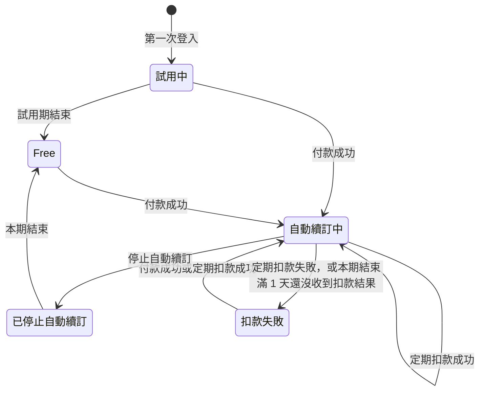

# 方案與訂閱付款

方案決定使用者新增資料時受不受額度限制，以及行情多久更新一次。新使用者第一次登入後先試用 Standard 方案 31 天，之後可以在方案頁用信用卡透過綠界（ECPay）訂閱 Standard，按月或按年自動扣款；沒有訂閱的使用者使用 Free 方案。所有使用者都會用到這項能力：Free 方案的使用者在額度用完時會看到升級提示，想訂閱或停止自動續訂的使用者則在方案頁（`/settings/current-plan`）操作。

使用者的訂閱處於下面五種狀態之一，狀態之間的轉換如下圖：

- 試用中：新使用者免費使用 Standard 的期間。
- 自動續訂中：使用者付款訂閱了 Standard，綠界會在每期到期時自動扣款。
- 已停止自動續訂：使用者停止了自動續訂，Standard 可以用到本期結束。
- 扣款失敗：綠界的定期扣款沒有成功。
- Free：試用期結束後沒有訂閱，或停止自動續訂後本期已經結束。

「本期」指最近一次付款成功或定期扣款成功之後的 1 個月（月繳）或 1 年（年繳）。「每天的到期處理」指 Taigu 每天台灣時間凌晨 3:40 執行、更新到期訂閱狀態的處理。「本月」指台灣時間本月 1 日 0 點到現在。

## 需求

### BILL-R1 方案的判定

試用中的使用者在試用期結束之前，以及自動續訂中與已停止自動續訂的使用者在本期結束之前，方案是 Standard，新增資料不受額度限制；扣款失敗與 Free 狀態的使用者，方案是 Free。

- BILL-R1.1 已停止自動續訂但本期還沒結束
  - 前提：使用者已停止自動續訂，本期還剩 20 天。
  - 動作：開啟方案頁。
  - 結果：方案是 Standard，方案頁不顯示「額度使用」區塊。
- BILL-R1.2 扣款失敗
  - 前提：使用者的訂閱是扣款失敗。
  - 動作：開啟方案頁。
  - 結果：方案是 Free，「目前方案」區塊寫「付款未完成，重新完成付款後可恢復 Standard 權益。」，方案頁有「額度使用」區塊。

### BILL-R2 試用期

使用者第一次登入時開始 31 天的 Standard 試用期，試用期結束時方案變成 Free，而且每位使用者只有一次試用期。

- BILL-R2.1 第一次登入
  - 前提：使用者從來沒有登入過 Taigu。
  - 動作：使用者在 2026/10/21 第一次用 Google 帳號登入。
  - 結果：訂閱是試用中，方案是 Standard，方案頁顯示標籤「試用中」與「試用至 2026/11/21」。
- BILL-R2.2 試用期結束
  - 前提：使用者的試用期在 1 分鐘前結束，每天的到期處理還沒有執行。
  - 動作：開啟方案頁。
  - 結果：方案是 Free。
- BILL-R2.3 試用期結束後再登入
  - 前提：使用者的試用期已經結束，訂閱是 Free。
  - 動作：使用者登出後，再用同一個 Google 帳號登入。
  - 結果：訂閱仍是 Free，試用期不會重新開始。

### BILL-R3 每月新增的交易紀錄與現金股利紀錄

方案是 Free 的使用者本月新增的交易紀錄與現金股利紀錄合計已有 20 筆以上時，Taigu 不接受新增這兩種紀錄。

- BILL-R3.1 兩種紀錄合計 20 筆之後
  - 前提：方案是 Free，本月已新增 10 筆交易紀錄與 10 筆現金股利紀錄。
  - 動作：新增一筆現金股利紀錄。
  - 結果：Taigu 不新增這筆現金股利紀錄。
- BILL-R3.2 試用期間新增的紀錄在試用期結束後仍算進本月
  - 前提：使用者本月在試用期間新增了 25 筆交易紀錄，之後試用期在本月結束，方案變成 Free。
  - 動作：新增一筆交易紀錄。
  - 結果：Taigu 不新增這筆交易紀錄。

### BILL-R4 每月額度的計算方式

每月額度計算的是本月新增、而且還沒刪除的資料筆數，跟資料上記的日期（例如交易日期）無關。

- BILL-R4.1 上個月最後一刻新增的紀錄不算進本月
  - 前提：方案是 Free，使用者在上個月最後一天的 23:59（台灣時間）新增了 20 筆買進 2330 的交易紀錄，沒有其他持股，本月還沒新增任何紀錄。
  - 動作：在本月新增一筆買進 2330 的交易紀錄。
  - 結果：Taigu 新增這筆交易紀錄，方案頁的「交易與股利」一列顯示「本月 1 / 20」。
- BILL-R4.2 交易日期在上個月的紀錄算進本月
  - 前提：方案是 Free，本月已新增 19 筆買進 2330 的交易紀錄，沒有其他持股。
  - 動作：新增一筆交易日期在上個月、買進 2330 的交易紀錄。
  - 結果：Taigu 新增這筆交易紀錄，方案頁的「交易與股利」一列顯示「本月 20 / 20」。
- BILL-R4.3 刪除本月新增的紀錄之後再新增
  - 前提：方案是 Free，本月已新增 20 筆買進 2330 的交易紀錄，沒有其他持股，之後刪除了其中 1 筆。
  - 動作：新增一筆買進 2330 的交易紀錄。
  - 結果：Taigu 新增這筆交易紀錄。

### BILL-R5 每月新增的買賣計畫

方案是 Free 的使用者本月新增的買賣計畫已有 10 筆以上時，Taigu 不接受新增買賣計畫。

- BILL-R5.1 本月已有 10 筆買賣計畫
  - 前提：方案是 Free，本月已新增 10 筆買賣計畫。
  - 動作：新增一筆買賣計畫。
  - 結果：Taigu 不新增這筆買賣計畫。

### BILL-R6 持股檔數

方案是 Free 的使用者已持有 10 檔以上的股票時，Taigu 不接受買進其他股票的交易紀錄。持股的判斷方式見 [holdings.md](holdings.md)。

- BILL-R6.1 持有 10 檔時買進第 11 檔
  - 前提：方案是 Free，持有 10 檔股票。
  - 動作：新增一筆買進另一檔股票的交易紀錄。
  - 結果：Taigu 不新增這筆交易紀錄。
- BILL-R6.2 持有 10 檔時加碼其中一檔
  - 前提：方案是 Free，持有 10 檔股票，其中一檔是 2330，本月新增的交易紀錄與現金股利紀錄還不到 20 筆。
  - 動作：新增一筆買進 2330 的交易紀錄。
  - 結果：Taigu 新增這筆交易紀錄。

### BILL-R7 自選股檔數

方案是 Free 的使用者已有 10 檔以上的自選股時，Taigu 不接受加入其他股票。加入自選股的操作見 [favorites.md](favorites.md)。

- BILL-R7.1 已有 10 檔時加入第 11 檔
  - 前提：方案是 Free，已有 10 檔自選股。
  - 動作：把另一檔股票加入自選股。
  - 結果：Taigu 不加入這檔股票。

### BILL-R8 額度只擋下新增資料

額度只擋下新增資料，不限制編輯與刪除，使用者超過額度或更換方案時，既有的資料都不會被刪除。

- BILL-R8.1 持股額度用完後把紀錄改成另一檔股票
  - 前提：方案是 Free，持有 10 檔股票，其中 2330 有兩筆買進的交易紀錄。
  - 動作：把其中一筆 2330 交易紀錄的股票代號改成 2603 後送出。
  - 結果：Taigu 儲存修改後的交易紀錄，使用者持有 11 檔股票。
- BILL-R8.2 試用期結束時自選股超過 10 檔
  - 前提：使用者在試用中，已有 12 檔自選股。
  - 動作：試用期結束。
  - 結果：市場頁的「關注」分頁仍列出 12 檔股票。

### BILL-R9 額度擋下新增時的升級提示

額度擋下新增時，畫面顯示升級提示視窗，標題與「目前限制」寫出用完的是哪一種額度，並列出升級 Standard 之後解除的限制。四種額度的標題與「目前限制」如下表：

| 用完的額度 | 標題 | 目前限制 |
| --- | --- | --- |
| 交易紀錄與現金股利紀錄的每月額度 | 這個月的新增額度已用完 | Free 方案每月最多只能新增 20 筆交易紀錄與現金股利。 |
| 買賣計畫的每月額度 | 這個月的買賣計畫額度已用完 | Free 方案每月最多只能新增 10 筆買賣計畫。 |
| 持股檔數 | 持股檔數已達 Free 上限 | Free 方案最多只能同時持有 10 檔股票。 |
| 自選股檔數 | 關注清單已達 Free 上限 | Free 方案最多只能關注 10 檔股票。 |

- BILL-R9.1 本月額度已用完時新增交易紀錄
  - 前提：方案是 Free，本月已新增 20 筆交易紀錄。
  - 動作：新增一筆交易紀錄。
  - 結果：Taigu 不新增這筆交易紀錄，畫面顯示升級提示視窗，標題是「這個月的新增額度已用完」，「目前限制」寫「Free 方案每月最多只能新增 20 筆交易紀錄與現金股利。」，視窗裡有關閉視窗的按鈕與「查看 Standard 方案」按鈕。
- BILL-R9.2 點「查看 Standard 方案」
  - 前提：畫面顯示升級提示視窗。
  - 動作：點「查看 Standard 方案」。
  - 結果：升級提示視窗關閉，畫面換到方案頁。

### BILL-R10 方案頁的「目前方案」區塊

自動續訂中與已停止自動續訂的使用者在本期結束之前，方案頁的「目前方案」區塊顯示 Standard、付款週期、每期金額與本期的結束日。

- BILL-R10.1 自動續訂中
  - 前提：使用者的訂閱是月繳的自動續訂中，本期到 2026/11/21。
  - 動作：開啟方案頁。
  - 結果：「目前方案」區塊顯示「Standard」、標籤「月繳」、「NT$65/月」與「下次續費 2026/11/21」。
- BILL-R10.2 已停止自動續訂
  - 前提：使用者已停止月繳的自動續訂，本期到 2026/11/21。
  - 動作：開啟方案頁。
  - 結果：「目前方案」區塊顯示「Standard」、「有效至 2026/11/21」，以及「目前方案可使用至 2026/11/21。到期後會切換為 Free，不會再自動扣款。」。

### BILL-R11 方案頁的「額度使用」區塊

方案是 Free 時，方案頁顯示「額度使用」區塊，列出四種額度目前的用量與上限；方案是 Standard 時，方案頁不顯示這個區塊。

- BILL-R11.1 Free 方案的額度用量
  - 前提：方案是 Free，本月已新增 5 筆交易紀錄、2 筆現金股利紀錄與 3 筆買賣計畫，持有 2 檔股票，有 4 檔自選股。
  - 動作：開啟方案頁。
  - 結果：「額度使用」區塊的「交易與股利」一列顯示「本月 7 / 20」，「買賣計畫」一列顯示「本月 3 / 10」，「持股」一列的用量是 2、上限是 10，「關注」一列的用量是 4、上限是 10。

### BILL-R12 方案頁的「方案選擇」區塊

試用中、扣款失敗與 Free 狀態的使用者在方案頁看得到「方案選擇」區塊，可以選擇月繳 NT$65 或年繳 NT$700 訂閱 Standard；自動續訂中與已停止自動續訂的使用者在本期結束之前看不到這個區塊。

- BILL-R12.1 試用中
  - 前提：使用者在試用中，試用期還剩 31 天。
  - 動作：開啟方案頁。
  - 結果：「方案選擇」區塊有「月繳 NT$65」與「年繳 NT$700」兩個選項。
- BILL-R12.2 Free 狀態
  - 前提：使用者的試用期已經結束，訂閱是 Free。
  - 動作：開啟方案頁。
  - 結果：「方案選擇」區塊有「月繳 NT$65」與「年繳 NT$700」兩個選項。
- BILL-R12.3 自動續訂中
  - 前提：使用者的訂閱是自動續訂中，本期還剩 20 天。
  - 動作：開啟方案頁。
  - 結果：方案頁不顯示「方案選擇」區塊。
- BILL-R12.4 已停止自動續訂
  - 前提：使用者已停止自動續訂，本期還剩 20 天。
  - 動作：開啟方案頁。
  - 結果：方案頁不顯示「方案選擇」區塊。

### BILL-R13 確認訂閱並前往綠界付款

使用者在「方案選擇」點選付款週期後，畫面先顯示「確認訂閱 Standard」視窗，寫出付款週期與每期金額，使用者點「前往綠界付款」之後才前往綠界的信用卡付款頁。

- BILL-R13.1 點選月繳
  - 前提：方案頁顯示「方案選擇」區塊。
  - 動作：點「月繳」。
  - 結果：畫面顯示「確認訂閱 Standard」視窗，寫出「付款週期 月繳」與「每期金額 NT$65」，視窗裡有關閉視窗的按鈕與「前往綠界付款」按鈕。
- BILL-R13.2 前往綠界付款
  - 前提：畫面顯示「確認訂閱 Standard」視窗。
  - 動作：點「前往綠界付款」。
  - 結果：瀏覽器換到綠界的信用卡付款頁。

### BILL-R14 付款成功

綠界通知 Taigu 付款成功時，訂閱變成自動續訂中，本期從收到通知的時間起算 1 個月（月繳）或 1 年（年繳），試用期剩下的天數不會保留。

- BILL-R14.1 試用中付款
  - 前提：使用者在試用中，試用期到 2026/11/15，選擇月繳並前往綠界付款。
  - 動作：綠界在 2026/10/21 通知 Taigu 這筆付款成功。
  - 結果：訂閱變成自動續訂中，方案頁顯示標籤「月繳」與「下次續費 2026/11/21」。
- BILL-R14.2 在月底付款月繳
  - 前提：使用者選擇月繳並前往綠界付款。
  - 動作：綠界在 2024/01/31 10:00 通知 Taigu 這筆付款成功。
  - 結果：本期在 2024/02/29 10:00 結束。
- BILL-R14.3 開啟付款頁超過 30 分鐘才付款成功
  - 前提：使用者在 31 分鐘前從方案頁前往綠界付款頁。
  - 動作：綠界通知 Taigu 這筆付款成功。
  - 結果：這筆付款算付款成功，訂閱變成自動續訂中。

### BILL-R15 付款失敗

綠界通知 Taigu 付款失敗時，訂閱狀態不變。

- BILL-R15.1 Free 狀態付款失敗
  - 前提：使用者的訂閱是 Free，選擇月繳並前往綠界付款。
  - 動作：綠界通知 Taigu 這筆付款失敗。
  - 結果：訂閱仍是 Free。

### BILL-R16 付款成功通知的驗證

綠界的付款成功通知裡，檢查碼（CheckMacValue）、綠界特店編號、金額或綠界交易編號對不上時，Taigu 不把這筆付款算成付款成功。

- BILL-R16.1 檢查碼不對
  - 前提：使用者的訂閱是 Free，有一筆還沒完成的月繳付款。
  - 動作：Taigu 收到一則這筆付款成功的通知，但通知的檢查碼不對。
  - 結果：這筆付款不算付款成功，訂閱仍是 Free。
- BILL-R16.2 綠界特店編號不是 Taigu 的
  - 前提：使用者有一筆還沒完成的月繳付款。
  - 動作：Taigu 收到一則這筆付款成功的通知，通知裡的綠界特店編號不是 Taigu 的。
  - 結果：這筆付款不算付款成功。
- BILL-R16.3 金額跟這筆付款不同
  - 前提：使用者有一筆還沒完成、金額是 65 元的月繳付款。
  - 動作：Taigu 收到一則這筆付款成功的通知，通知裡的金額是 700 元。
  - 結果：這筆付款不算付款成功。
- BILL-R16.4 綠界交易編號已經用在另一筆付款
  - 前提：使用者有一筆已經付款成功的付款，以及一筆還沒完成的付款。
  - 動作：Taigu 收到一則還沒完成的那筆付款成功的通知，通知裡的綠界交易編號跟已經付款成功的那筆相同。
  - 結果：還沒完成的那筆付款不算付款成功。

### BILL-R17 付款完成前重新付款

付款完成之前，使用者可以再從方案頁前往綠界付款，Taigu 不會因為前一次的付款還沒完成而拒絕這次付款。

- BILL-R17.1 前一次付款還沒完成
  - 前提：使用者前往綠界付款頁，沒有完成付款就回到方案頁。
  - 動作：再選一次付款週期並點「前往綠界付款」。
  - 結果：Taigu 建立這次的付款。

### BILL-R18 本期還沒結束時不能再訂閱

自動續訂中與已停止自動續訂的使用者在本期結束之前，Taigu 不接受再訂閱一次 Standard。

- BILL-R18.1 自動續訂中再訂閱
  - 前提：使用者的訂閱是自動續訂中，本期還剩 29 天。
  - 動作：使用者要求訂閱月繳的 Standard。
  - 結果：Taigu 拒絕這次訂閱，不建立付款。
- BILL-R18.2 已停止自動續訂後再訂閱
  - 前提：使用者已停止自動續訂，本期還剩 20 天。
  - 動作：使用者要求訂閱月繳的 Standard。
  - 結果：Taigu 拒絕這次訂閱，不建立付款。

### BILL-R19 從綠界回到方案頁

使用者在綠界付款頁走完付款流程後，瀏覽器回到方案頁，頁面頂端顯示「若已完成付款，系統會在收到綠界通知後更新方案狀態。」這段提示。

- BILL-R19.1 從綠界回到方案頁
  - 前提：使用者在綠界付款頁走完付款流程。
  - 動作：綠界把瀏覽器導回 Taigu。
  - 結果：瀏覽器開啟方案頁，頁面頂端顯示「若已完成付款，系統會在收到綠界通知後更新方案狀態。」這段提示。

### BILL-R20 定期扣款成功

自動續訂中或扣款失敗的訂閱收到綠界定期扣款成功的通知時，訂閱變成自動續訂中，本期改從收到通知的時間起算 1 個月（月繳）或 1 年（年繳）。

- BILL-R20.1 自動續訂中的定期扣款成功
  - 前提：使用者的訂閱是月繳的自動續訂中，本期在 2026/10/21 10:00 結束。
  - 動作：綠界在 2026/10/21 11:00 通知 Taigu 定期扣款成功。
  - 結果：訂閱仍是自動續訂中，方案頁顯示「下次續費 2026/11/21」。
- BILL-R20.2 扣款失敗後定期扣款成功
  - 前提：使用者的訂閱是扣款失敗。
  - 動作：綠界通知 Taigu 定期扣款成功。
  - 結果：訂閱變成自動續訂中，方案是 Standard。

### BILL-R21 定期扣款失敗

自動續訂中的訂閱收到綠界定期扣款失敗的通知時，訂閱變成扣款失敗。

- BILL-R21.1 定期扣款失敗
  - 前提：使用者的訂閱是月繳的自動續訂中，本期還剩 20 天。
  - 動作：綠界通知 Taigu 定期扣款失敗。
  - 結果：訂閱變成扣款失敗，方案是 Free。

### BILL-R22 本期結束後沒收到定期扣款結果

自動續訂中的訂閱在本期結束滿 1 天之後，如果 Taigu 還沒收到定期扣款的結果，每天的到期處理會把訂閱改成扣款失敗。

- BILL-R22.1 本期結束不到 1 天
  - 前提：使用者的訂閱是自動續訂中，本期在 1 分鐘前結束，Taigu 還沒收到定期扣款的結果。
  - 動作：每天的到期處理執行。
  - 結果：每天的到期處理不改變這份訂閱的狀態。
- BILL-R22.2 本期結束滿 1 天
  - 前提：使用者的訂閱是自動續訂中，本期在 1 天又 1 分鐘前結束，Taigu 還沒收到定期扣款的結果。
  - 動作：每天的到期處理執行。
  - 結果：訂閱變成扣款失敗。

> 設計理由：本期結束後先等 1 天才改成扣款失敗，是為了留時間給綠界送來這一期的定期扣款結果。

### BILL-R23 停止自動續訂

自動續訂中的使用者在本期結束之前，可以在方案頁的「訂閱管理」區塊停止自動續訂，Taigu 請綠界取消之後的定期扣款，成功之後訂閱變成已停止自動續訂；試用中與 Free 狀態的使用者不能停止自動續訂。

- BILL-R23.1 開啟停止自動續訂的確認視窗
  - 前提：使用者的訂閱是自動續訂中，本期到 2026/11/21。
  - 動作：在「訂閱管理」區塊點「停止自動續訂」。
  - 結果：畫面顯示確認視窗，標題是「停止 Standard 自動續訂？」，寫出「Standard 權益會保留至 2026/11/21。到期後會切換為 Free。」，按鈕是「保留自動續訂」與「停止自動續訂」。
- BILL-R23.2 確認停止自動續訂
  - 前提：畫面顯示停止自動續訂的確認視窗，本期到 2026/11/21。
  - 動作：點確認視窗裡的「停止自動續訂」。
  - 結果：確認視窗關閉，訂閱變成已停止自動續訂，頁面頂端顯示「已停止自動續訂，Standard 權益會保留到 2026/11/21。」，「訂閱管理」區塊不再有「停止自動續訂」按鈕。
- BILL-R23.3 綠界沒有取消定期扣款
  - 前提：畫面顯示停止自動續訂的確認視窗，綠界無法取消這份訂閱的定期扣款。
  - 動作：點確認視窗裡的「停止自動續訂」。
  - 結果：確認視窗不關閉，訂閱仍是自動續訂中。
- BILL-R23.4 試用中要求停止自動續訂
  - 前提：使用者在試用中。
  - 動作：使用者要求停止自動續訂。
  - 結果：Taigu 拒絕，訂閱仍是試用中，試用期的結束時間不變。
- BILL-R23.5 Free 狀態要求停止自動續訂
  - 前提：使用者的訂閱是 Free。
  - 動作：使用者要求停止自動續訂。
  - 結果：Taigu 拒絕，訂閱仍是 Free。

### BILL-R24 停止自動續訂後到期

已停止自動續訂的訂閱在本期結束時變成 Free。

- BILL-R24.1 本期剛結束
  - 前提：使用者已停止自動續訂，本期在 1 分鐘前結束，每天的到期處理還沒執行。
  - 動作：開啟方案頁。
  - 結果：方案是 Free，「目前方案」區塊顯示「Free」。
- BILL-R24.2 每天的到期處理
  - 前提：使用者已停止自動續訂，本期在 1 分鐘前結束。
  - 動作：每天的到期處理執行。
  - 結果：訂閱變成 Free。
