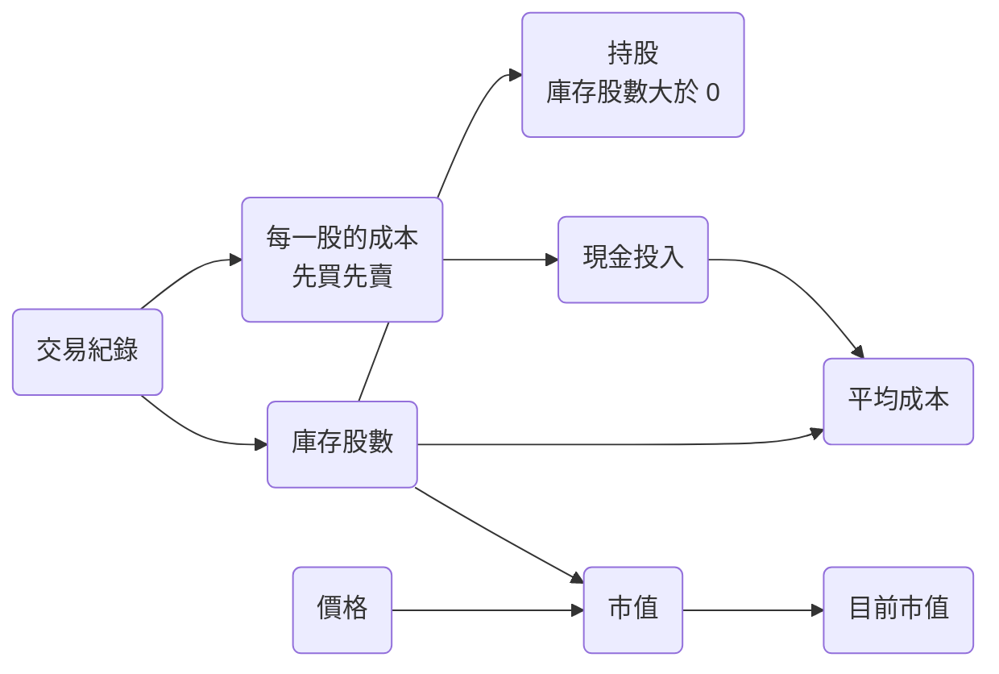

# 持股

持股是使用者目前持有的股票。Taigu 從使用者的交易紀錄算出每檔股票的庫存股數、現金投入與市值，所以使用者只要記錄交易，不用另外輸入持股，就能在市場頁的「持股」分頁查看自己持有哪些股票與每檔的庫存，在儀表板的「投資組合」卡片查看目前市值與各檔持股占目前市值的比例。每檔持股的現金投入與市值顯示在個股詳情頁的投資摘要（見 STOCK-R6）。

下圖是這些數字由哪些資料算出：

## 需求

### HOLD-R1 持股的判斷

某檔股票的每一筆賣出都不超過賣出當時的庫存股數時，這檔股票的庫存股數是它所有交易紀錄的成交股數加總（買進算正數、賣出算負數），庫存股數大於 0 的股票是使用者的持股。「賣出當時」依 HOLD-R2 處理交易紀錄的順序判斷。Free 方案的持股檔數額度（BILL-R6）用同樣的方式數持股。

- HOLD-R1.1 賣出部分股數
  - 前提：2330 有三筆交易紀錄，依交易日期是買進 1,000 股、買進 500 股、賣出 400 股。
  - 動作：開啟「持股」分頁。
  - 結果：「持股」分頁列出 2330，庫存是「1,100 股」。
- HOLD-R1.2 賣出全部股數
  - 前提：2330 有兩筆交易紀錄，依交易日期是買進 1,000 股、賣出 1,000 股，使用者沒有其他交易紀錄。
  - 動作：開啟「持股」分頁。
  - 結果：「持股」分頁沒有列出 2330，「持股檔數」是 0。
- HOLD-R1.3 只有現金股利紀錄的股票
  - 前提：使用者有一筆 2330 的現金股利紀錄，沒有任何交易紀錄。
  - 動作：開啟「持股」分頁。
  - 結果：「持股」分頁沒有列出 2330。

### HOLD-R2 先買先賣的成本

某檔股票的每一筆賣出都不超過賣出當時的庫存股數時，Taigu 依交易日期的先後處理它的交易紀錄（同一天的交易紀錄依新增的先後；在同一次開啟 Taigu 的期間改過交易日期的紀錄，重新整理之前不在這條規則的範圍內），賣出時先扣掉最早買進、還沒賣出的股數，庫存裡的每一股都以買進那筆交易紀錄的成交單價當作成本。

- HOLD-R2.1 賣出的股數超過第一筆買進
  - 前提：2330 有三筆交易紀錄：2024-01-02 以 100 元買進 1,000 股、2024-02-01 以 120 元買進 1,000 股、2024-03-01 以 130 元賣出 1,500 股。
  - 動作：開啟 2330 的個股詳情頁 `/market/holding/2330`。
  - 結果：投資摘要的「庫存」是「500 股」，「現金投入」是「$60,000」，「平均成本」是「$120.00」。
- HOLD-R2.2 新增的順序與交易日期的順序不同
  - 前提：使用者依序新增了三筆 2330 的交易紀錄：2024-02-01 以 120 元買進 1,000 股、2024-01-02 以 100 元買進 1,000 股、2024-03-01 以 130 元賣出 1,000 股。
  - 動作：開啟 2330 的個股詳情頁 `/market/holding/2330`。
  - 結果：投資摘要的「平均成本」是「$120.00」，因為交易日期較早的 100 元那 1,000 股先被賣出。
- HOLD-R2.3 同一天有多筆買進
  - 前提：使用者依序新增了三筆 2330 的交易紀錄：2024-01-02 以 100 元買進 1,000 股、同一天以 110 元買進 1,000 股、2024-01-03 以 120 元賣出 1,000 股。
  - 動作：開啟 2330 的個股詳情頁 `/market/holding/2330`。
  - 結果：投資摘要的「平均成本」是「$110.00」，因為先新增的 100 元那 1,000 股先被賣出。

### HOLD-R3 現金投入與平均成本

每檔持股的現金投入是庫存裡每一股成本的總和，平均成本是現金投入除以庫存股數，兩者都不含手續費。

- HOLD-R3.1 買進時付了手續費
  - 前提：2330 只有一筆交易紀錄：以 100 元買進 1,000 股，手續費 142 元。
  - 動作：開啟 2330 的個股詳情頁 `/market/holding/2330`。
  - 結果：投資摘要的「現金投入」是「$100,000」，「平均成本」是「$100.00」。

### HOLD-R4 市值

每檔持股的市值是這檔股票目前的價格乘以庫存股數，Taigu 還沒有價格的持股，市值算 0；價格怎麼決定見 MKT-R2。

- HOLD-R4.1 有價格的持股
  - 前提：2330 的庫存是 500 股，目前的價格是 600 元。
  - 動作：開啟 2330 的個股詳情頁 `/market/holding/2330`。
  - 結果：投資摘要的「證券市值」是「$300,000」。
- HOLD-R4.2 還沒有價格的持股
  - 前提：2330 的庫存是 500 股，Taigu 還沒有 2330 的價格。
  - 動作：開啟 2330 的個股詳情頁 `/market/holding/2330`。
  - 結果：投資摘要的「證券市值」是「$0」。

### HOLD-R5 抓取持股的價格

Taigu 照 MKT-R11 抓取與重新抓取所有持股的價格，抓取失敗時繼續顯示上次抓到的價格，而且使用者儲存一筆交易紀錄之後，Taigu 立刻抓取那檔股票的價格。

- HOLD-R5.1 價格改變
  - 前提：「持股」分頁顯示 2330 的價格是 600，之後 2330 的價格變成 610 元。
  - 動作：停在「持股」分頁，等待一次重新抓取的間隔。
  - 結果：沒有重新整理網頁，2330 的價格就變成 610。
- HOLD-R5.2 抓取失敗
  - 前提：「持股」分頁顯示 2330 的價格是 600，之後 2330 的價格變成 610 元。
  - 動作：裝置斷線，等待一次重新抓取的間隔。
  - 結果：2330 的價格仍然是 600。
- HOLD-R5.3 儲存交易紀錄之後
  - 前提：使用者沒有任何交易紀錄，Taigu 有 2002 的價格。
  - 動作：新增一筆 2002 買進 1,000 股的交易紀錄，不重新整理網頁，開啟「持股」分頁。
  - 結果：不用等下一次重新抓取，2002 就顯示價格，不是「--」。

### HOLD-R6 「持股」分頁的列表

「持股」分頁的標題是「持股追蹤」，分頁裡列出使用者的每一檔持股，每檔顯示股票名稱、股票代號、價格、漲跌幅、庫存股數與每檔股票的年化報酬率（見 PERF-R8），在桌面瀏覽器上另外顯示漲跌、成交量與平均成本，買賣計畫的差距提示見 PLAN-R14，還沒有價格的持股，價格顯示「--」；點選一檔持股會進入它的個股詳情頁 `/market/holding/<股票代號>`。搜尋框與排序選單是市場頁兩個分頁共用的控制列，規則見 FAV-R4 到 FAV-R8。

- HOLD-R6.1 桌面瀏覽器上的持股
  - 前提：使用者用桌面瀏覽器，2330 的庫存是 500 股、平均成本是 120 元；2330 的價格是 600 元，漲跌是 +6 元，成交量是 25,000 張。
  - 動作：開啟「持股」分頁。
  - 結果：2330 的卡片顯示「台積電」「2330」、價格「600」、漲跌與漲跌幅「▲ 6.00 1.01%」、「庫存」「500 股」、「平均成本」「$120.00」、2330 的年化報酬率與「成交量 2.5 萬張」。
- HOLD-R6.2 還沒有價格的持股
  - 前提：2330 是持股，Taigu 還沒有 2330 的價格。
  - 動作：開啟「持股」分頁。
  - 結果：2330 的價格顯示「--」。
- HOLD-R6.3 點選持股
  - 前提：「持股」分頁列出 2330。
  - 動作：點選 2330。
  - 結果：畫面換到 2330 的個股詳情頁，網址是 `/market/holding/2330`。

### HOLD-R7 「持股」分頁的統計數字

「持股」分頁上方的「持股檔數」是所有持股的檔數，「今日上漲」與「今日下跌」分別是漲跌大於 0 與小於 0 的持股檔數，還沒有價格的持股兩邊都不算，三個數字都不受搜尋文字影響。

- HOLD-R7.1 有漲有跌也有平盤
  - 前提：使用者有三檔持股，2330 的漲跌是 +5 元，2002 的漲跌是 -0.1 元，2317 的漲跌是 0。
  - 動作：開啟「持股」分頁。
  - 結果：「持股檔數」是 3，「今日上漲」是 1，「今日下跌」是 1。
- HOLD-R7.2 搜尋時與還沒有價格的持股
  - 前提：使用者有三檔持股，2330 的漲跌是 +5 元，2002 的漲跌是 -0.1 元，Taigu 還沒有 2317 的價格。
  - 動作：在「持股」分頁的搜尋框輸入「2330」。
  - 結果：列表只列出 2330，「持股檔數」仍然是 3，「今日上漲」是 1，「今日下跌」是 1。

### HOLD-R8 沒有任何持股時

使用者沒有任何持股時，「持股」分頁顯示「還沒有持股」與說明「新增第一筆交易紀錄後，這裡會自動整理你的庫存、成本與報酬率。」，並提供「新增交易紀錄」與「查看交易紀錄」兩個按鈕，分別進入新增交易紀錄的編輯器 `/records/trade/new` 與歷史紀錄頁 `/records`。

- HOLD-R8.1 所有股票都已賣出
  - 前提：使用者的交易紀錄只有 2330 買進 1,000 股與 2330 賣出 1,000 股兩筆。
  - 動作：開啟「持股」分頁。
  - 結果：畫面顯示「還沒有持股」「新增第一筆交易紀錄後，這裡會自動整理你的庫存、成本與報酬率。」與「新增交易紀錄」「查看交易紀錄」兩個按鈕。
- HOLD-R8.2 點選「新增交易紀錄」
  - 前提：使用者沒有任何交易紀錄。
  - 動作：在「持股」分頁點選「新增交易紀錄」。
  - 結果：畫面換到新增交易紀錄的編輯器，網址是 `/records/trade/new`。
- HOLD-R8.3 點選「查看交易紀錄」
  - 前提：使用者沒有任何交易紀錄。
  - 動作：在「持股」分頁點選「查看交易紀錄」。
  - 結果：畫面換到歷史紀錄頁，網址是 `/records`。

### HOLD-R9 儀表板的投資組合

儀表板「投資組合」卡片裡的圓餅圖替市值大於 0 的每檔持股畫一個區塊，區塊的大小依這檔持股的市值占目前市值的比例而定，卡片中央的「目前市值」是所有持股的市值合計（四捨五入到整數）；目前市值是 0 時，卡片裡不顯示圓餅圖。

- HOLD-R9.1 兩檔持股
  - 前提：使用者有兩檔持股，2330 的市值是 300,000 元，0050 的市值是 100,000 元。
  - 動作：開啟儀表板。
  - 結果：「目前市值」是「$400,000」，圓餅圖有兩個區塊，2330 的區塊占整圈的四分之三，0050 的區塊占四分之一。
- HOLD-R9.2 持股都還沒有價格
  - 前提：使用者唯一的持股是 2330，Taigu 還沒有 2330 的價格。
  - 動作：開啟儀表板。
  - 結果：「目前市值」是「$0」，「投資組合」卡片裡沒有圓餅圖。
