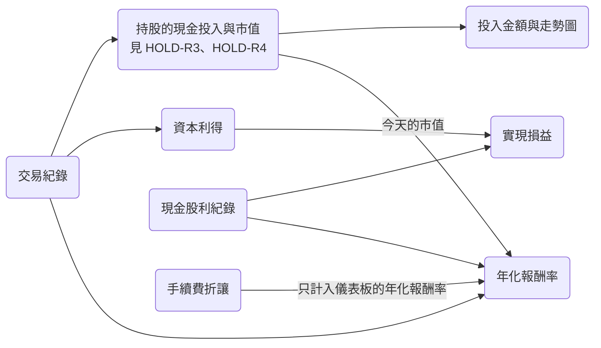

# 投資績效

投資績效是 Taigu 依使用者的交易紀錄、現金股利紀錄與手續費折讓，算出投入金額、年化報酬率與實現損益，顯示在儀表板 `/` 與收益分析頁 `/earning-analysis`，讓投資人不必自己在試算表裡算報酬。這些數字都由 Taigu 依使用者的紀錄與行情計算，Free 與 Standard 方案的算法相同，只有行情更新的頻率不同（見 MKT-R11）。

下圖是每個數字用到哪些紀錄：

## 需求

### PERF-R1 投入金額

儀表板的「投入金額」是使用者目前所有持股的現金投入合計；持股與每檔持股的現金投入見 HOLD-R1 與 HOLD-R3。

- PERF-R1.1 加總每檔持股的現金投入
  - 前提：使用者只有兩筆交易紀錄：2330 買進 1,000 股，成交單價 100 元；2317 買進 500 股，成交單價 110 元；手續費用都是預設值。
  - 動作：開啟儀表板。
  - 結果：「投入金額」顯示 $155,000。

### PERF-R2 沒有交易紀錄時的投入金額區塊

使用者沒有任何交易紀錄時，投入金額區塊顯示 $0，不顯示走勢圖與時間區間，改顯示一段提示，提示裡的連結會開啟新增交易紀錄的編輯器（見 REC-R1）。

- PERF-R2.1 沒有交易紀錄
  - 前提：使用者沒有任何交易紀錄。
  - 動作：開啟儀表板，點提示文字裡的連結。
  - 結果：點連結之前，「投入金額」顯示 $0，下方沒有走勢圖，也沒有「1M」「1Q」「1Y」「ALL」選項；點連結之後，畫面開啟新增交易紀錄的編輯器。

### PERF-R3 投入金額走勢圖

在台灣時間 08:00 以後，使用者最早一筆交易紀錄的日期不晚於今天時，投入金額區塊顯示一張折線圖，從最早一筆交易紀錄的日期到今天，每一天（包括週六與週日）都有一個點，點的值是那一天結束時的投入金額。

- PERF-R3.1 每天一個點
  - 前提：現在是台灣時間 08:00 以後。使用者只有兩筆 2330 的交易紀錄：10 天前買進 1,000 股，成交單價 100 元；5 天前買進 1,000 股，成交單價 110 元。時間區間選「ALL」。
  - 動作：查看折線圖上每個點的日期與金額。
  - 結果：從 10 天前到今天每天都有一個點，週六與週日也有；10 天前到 6 天前的點都是 $100,000，5 天前到今天的點都是 $210,000。

> 設計理由：走勢圖連週六與週日也畫一個點，因為台股有時會在週末開市，略過週末會讓那幾天的交易紀錄沒有算進走勢圖。

### PERF-R4 走勢圖的時間區間

走勢圖下方有「1M」「1Q」「1Y」「ALL」四個選項，在台灣時間 08:00 以後分別顯示最近 30 天、91 天、365 天（都含今天）與全部的點；打開 app 時選取「1M」，在 app 裡換頁後保留使用者的選擇。

- PERF-R4.1 打開 app 時顯示最近 30 天
  - 前提：現在是台灣時間 08:00 以後，使用者最早一筆交易紀錄是 100 天前。
  - 動作：重新整理頁面，開啟儀表板。
  - 結果：「1M」是選取狀態，折線圖最左邊的點是 29 天前，最右邊的點是今天。
- PERF-R4.2 紀錄的天數比時間區間短
  - 前提：現在是台灣時間 08:00 以後，使用者最早一筆交易紀錄是 100 天前。
  - 動作：在儀表板點「1Y」。
  - 結果：折線圖最左邊的點是 100 天前，最右邊的點是今天。
- PERF-R4.3 換頁後保留選擇
  - 前提：使用者在儀表板選了「1Y」。
  - 動作：換到市場頁，再回到儀表板。
  - 結果：「1Y」仍是選取狀態。

### PERF-R5 年化報酬率的算法

計算用到的紀錄同時符合四個條件時，年化報酬率是這些紀錄的現金流量的 XIRR，也就是讓每筆現金流量依日期折現（一年以 365 天計算）後總和等於 0 的年報酬率；四個條件是：交易紀錄至少有 2 筆、每檔持股都有價格、紀錄分布在兩個以上的日期（或紀錄都在今天以前的同一天但今天仍有持股），以及把計算用到的現金流量依日期加總後，最早一個加總不是 0 的日期是支出、最晚一個加總不是 0 的日期是收入（現金流量的定義見 PERF-R6，儀表板另外計入手續費折讓，見 PERF-R7）。

- PERF-R5.1 一年前買進、今天賣出
  - 前提：使用者只有兩筆 2330 的交易紀錄：365 天前買進 1,000 股，成交單價 100 元；今天賣出 1,000 股，成交單價 110 元；手續費用都是 0 元。
  - 動作：開啟儀表板。
  - 結果：「年化報酬率」顯示 10.00%。

### PERF-R6 年化報酬率的現金流量

計算年化報酬率時，每筆交易紀錄是它交易日期的一筆現金流量（買進是支出成交單價 × 股數加手續費用，賣出是收入成交單價 × 股數減手續費用），每筆現金股利紀錄是它日期的一筆收入，持股今天的市值（見 HOLD-R4）是今天的一筆收入。

- PERF-R6.1 扣除手續費用並計入現金股利
  - 前提：使用者只有兩筆 2330 的交易紀錄：365 天前買進 1,000 股，成交單價 100 元；今天賣出 1,000 股，成交單價 110 元；手續費用都是 1,000 元。另外有一筆 2330 今天的現金股利紀錄，金額 5,000 元。
  - 動作：開啟儀表板。
  - 結果：「年化報酬率」顯示 12.87%。
- PERF-R6.2 計入持股今天的市值
  - 前提：使用者只有兩筆 2330 的交易紀錄，都是 365 天前買進 500 股，成交單價 1,000 元，手續費用 0 元。2330 的價格是 1,080 元。
  - 動作：開啟儀表板。
  - 結果：「目前市值」顯示 $1,080,000，「年化報酬率」顯示 8.00%。

### PERF-R7 儀表板的年化報酬率

所有紀錄符合 PERF-R5 的條件時，儀表板的「年化報酬率」用所有股票的交易紀錄、所有現金股利紀錄、所有手續費折讓（每筆是它日期的一筆收入）與所有持股今天的市值計算。

- PERF-R7.1 合併所有股票並計入手續費折讓
  - 前提：使用者有四筆交易紀錄：2330 在 365 天前買進 1,000 股，成交單價 100 元，今天賣出 1,000 股，成交單價 110 元；2317 在 365 天前買進 1,000 股，成交單價 50 元，今天賣出 1,000 股，成交單價 45 元；手續費用都是 0 元。另外有一筆今天的手續費折讓，金額 1,000 元。
  - 動作：開啟儀表板。
  - 結果：「年化報酬率」顯示 4.00%。

### PERF-R8 每檔股票的年化報酬率

使用者目前持有的股票，它自己的紀錄符合 PERF-R5 的條件時，它的年化報酬率只用這檔股票的交易紀錄、這檔股票的現金股利紀錄與這檔股票今天的市值計算，不計入手續費折讓；個股詳情頁顯示的值，以使用者進入這一頁之後沒有新增、編輯或刪除現金股利紀錄，而且現金股利紀錄不晚於交易紀錄載入完成為限。個股詳情頁與市場頁的「持股」分頁怎麼顯示這個值，見 STOCK-R6 與 HOLD-R6。

- PERF-R8.1 只計入這檔股票的紀錄
  - 前提：使用者有四筆交易紀錄：2330 兩筆，都是 365 天前買進 500 股，成交單價 1,000 元；2317 兩筆，都是 365 天前買進 500 股，成交單價 100 元；手續費用都是 0 元。另外有一筆 2330 今天的現金股利紀錄，金額 5,000 元，以及一筆今天的手續費折讓，金額 1,000 元。2330 的價格是 1,080 元，2317 的價格是 150 元。
  - 動作：開啟 2330 的個股詳情頁，再開啟 2317 的個股詳情頁。
  - 結果：2330 的年化報酬率是 8.50%，2317 的是 50.00%，兩檔都沒有計入手續費折讓。

### PERF-R9 年化報酬率的上下限

依 PERF-R5 算出的年化報酬率介於 -99% 與 1000% 之間，實際的報酬率超出這個範圍時，Taigu 顯示最接近的邊界值。

- PERF-R9.1 報酬率高於 1000%
  - 前提：使用者只有兩筆 2330 的交易紀錄：昨天買進 1,000 股，成交單價 100 元；今天賣出 1,000 股，成交單價 110 元；手續費用都是 0 元。
  - 動作：開啟儀表板。
  - 結果：「年化報酬率」顯示 1000.00%。
- PERF-R9.2 報酬率低於 -99%
  - 前提：使用者只有兩筆 2330 的交易紀錄：昨天買進 1,000 股，成交單價 100 元；今天賣出 1,000 股，成交單價 50 元；手續費用都是 0 元。
  - 動作：開啟儀表板。
  - 結果：「年化報酬率」顯示 -99.00%。

### PERF-R10 紀錄都在今天時

計算用到的交易紀錄至少有 2 筆，而且所有紀錄都在今天時，年化報酬率是 0。

- PERF-R10.1 所有交易都在今天
  - 前提：使用者只有兩筆 2330 的交易紀錄，都是今天買進，股數分別是 1,000 股與 500 股，成交單價都是 100 元。
  - 動作：開啟儀表板。
  - 結果：「年化報酬率」顯示 0.00%。

### PERF-R11 資本利得

每筆賣出的股數都不超過當時的庫存時，每檔股票的資本利得，是依 HOLD-R2 的先買先賣，把每筆賣出的股數對上最早還沒賣出的買進股數，再把（賣出成交單價 − 買進成交單價）× 對上的股數加總，不扣除手續費用。

- PERF-R11.1 依先買先賣對上買進
  - 前提：使用者只有三筆 2330 的交易紀錄：3 天前買進 1,000 股，成交單價 100 元；2 天前買進 1,000 股，成交單價 110 元；昨天賣出 1,500 股，成交單價 120 元；手續費用都是預設值。使用者沒有現金股利紀錄。
  - 動作：開啟儀表板。
  - 結果：「實現損益」的金額是 25,000 元。

### PERF-R12 每檔股票的實現損益

每檔股票的實現損益是這檔股票的資本利得，加上這檔股票所有現金股利紀錄的金額；個股詳情頁怎麼顯示這個值，見 STOCK-R6。

- PERF-R12.1 資本利得加上現金股利
  - 前提：使用者有 PERF-R11.1 的三筆交易紀錄，另外有兩筆 2330 的現金股利紀錄，金額分別是 1,000 元與 2,000 元。
  - 動作：開啟 2330 的個股詳情頁。
  - 結果：「實現損益」的金額是 28,000 元。

### PERF-R13 儀表板的實現損益

儀表板的「實現損益」是所有股票的資本利得加上所有現金股利紀錄的金額。

- PERF-R13.1 加總所有股票
  - 前提：使用者有 PERF-R11.1 的三筆 2330 交易紀錄、兩筆 2317 的交易紀錄（2 天前買進 1,000 股，成交單價 100 元；昨天賣出 1,000 股，成交單價 90 元），以及一筆 0050 的現金股利紀錄，金額 3,000 元。
  - 動作：開啟儀表板。
  - 結果：「實現損益」的金額是 18,000 元。

### PERF-R14 收益分析頁的入口與分類

點儀表板的「實現損益」卡片會開啟收益分析頁 `/earning-analysis`，頁面可以切換「資本利得」與「現金股利」兩個分類，每次進入時選取的是「資本利得」。

- PERF-R14.1 每次進入都選取資本利得
  - 前提：使用者在儀表板。
  - 動作：點「實現損益」卡片，點「現金股利」，回到儀表板，再點一次「實現損益」卡片。
  - 結果：第一次點卡片後，網址變成 `/earning-analysis`，「資本利得」是選取狀態；點「現金股利」後，「現金股利」變成選取狀態；第二次點卡片後，「資本利得」又是選取狀態。

### PERF-R15 收益分析頁的橫條圖

收益分析頁的兩個分類各是一張橫條圖，金額四捨五入到整數後不是 0 的股票各有一條橫條，由上到下依金額從大到小排列；「資本利得」的金額是這檔股票的資本利得，「現金股利」的金額是這檔股票所有現金股利紀錄的金額合計。

- PERF-R15.1 資本利得的橫條
  - 前提：使用者有 PERF-R13.1 的五筆交易紀錄，另外有一筆 0050 買進 1,000 股的交易紀錄。
  - 動作：開啟收益分析頁。
  - 結果：「資本利得」有兩條橫條，台積電在上，鴻海在下，沒有 0050 的橫條。
- PERF-R15.2 現金股利的橫條
  - 前提：使用者有四筆現金股利紀錄：2330 兩筆，金額分別是 1,000 元與 2,000 元；0050 一筆，金額 1,500 元；2317 一筆，金額 0 元。
  - 動作：開啟收益分析頁，點「現金股利」。
  - 結果：有兩條橫條，台積電在上，0050 在下，沒有鴻海的橫條。

### PERF-R16 橫條的名稱

每條橫條旁寫這檔股票的公司名稱，Taigu 取不到公司名稱時改寫股票代號。

- PERF-R16.1 取不到公司名稱
  - 前提：使用者有 PERF-R11.1 的三筆 2330 交易紀錄，而且 Taigu 取公司名稱的 request 失敗。
  - 動作：開啟收益分析頁。
  - 結果：橫條旁寫「2330」，不是「台積電」。

### PERF-R17 收益分析頁沒有資料時

一個分類沒有任何橫條時，「資本利得」顯示「目前沒有任何損益資料」，「現金股利」顯示「目前沒有任何現金股利資料」。

- PERF-R17.1 只有買進，沒有現金股利
  - 前提：使用者只有一筆 2330 買進 1,000 股的交易紀錄，沒有現金股利紀錄。
  - 動作：開啟收益分析頁，再點「現金股利」。
  - 結果：「資本利得」顯示「目前沒有任何損益資料」，「現金股利」顯示「目前沒有任何現金股利資料」。
